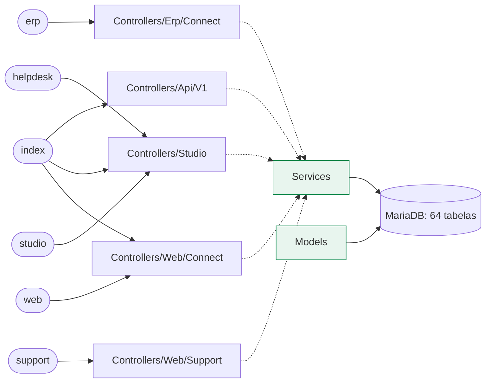

# Mapa do código do Connect ERP

> Gerado por `python3 tools/code-map.py` (ADR 0016). Não edite à mão: rode o script de novo.
> Para procurar algo no terminal: `python3 tools/code-map.py --find condominiums`.

**211** rotas fixas · **144** classes em `source/` · **64** tabelas nas migrations · **72** arquivos de teste · **34** ADRs · **172** páginas no catálogo do ERP.
Rotas geradas em laço (cadastros do ERP, catálogo) não entram na contagem; linhas dinâmicas por ambiente: erp: 8, index: 6.

Sumário: [Visão geral](#visão-geral) · [ERP](#erp-controllers-services-e-tabelas) · [Rotas](#rotas) · [Tabelas](#tabelas) · [Classes](#classes) · [Testes](#testes) · [Decisões](#decisões) · [Tarefas](#tarefas)

## Visão geral

## ERP: controllers, services e tabelas

```mermaid
flowchart LR
  Source_Controllers_Api_V1_BankBalances["Controllers/Api/V1/BankBalances"]
  Source_Services_Erp_BankBalances["Services/Erp/BankBalances"]
  Source_Controllers_Api_V1_BankBalances --> Source_Services_Erp_BankBalances
  Source_Controllers_Api_V1_CondominiumOnboarding["Controllers/Api/V1/CondominiumOnboarding"]
  Source_Services_CondominiumAccessDenied["Services/CondominiumAccessDenied"]
  Source_Controllers_Api_V1_CondominiumOnboarding --> Source_Services_CondominiumAccessDenied
  Source_Services_CondominiumScope["Services/CondominiumScope"]
  Source_Controllers_Api_V1_CondominiumOnboarding --> Source_Services_CondominiumScope
  Source_Services_OnboardingChecklist["Services/OnboardingChecklist"]
  Source_Controllers_Api_V1_CondominiumOnboarding --> Source_Services_OnboardingChecklist
  Source_Services_OnboardingItemNotFound["Services/OnboardingItemNotFound"]
  Source_Controllers_Api_V1_CondominiumOnboarding --> Source_Services_OnboardingItemNotFound
  Source_Services_OnboardingValidationError["Services/OnboardingValidationError"]
  Source_Controllers_Api_V1_CondominiumOnboarding --> Source_Services_OnboardingValidationError
  Source_Controllers_Api_V1_Condominiums["Controllers/Api/V1/Condominiums"]
  Source_Controllers_Api_V1_Condominiums --> Source_Services_CondominiumAccessDenied
  Source_Controllers_Api_V1_Condominiums --> Source_Services_CondominiumScope
  Source_Controllers_Api_V1_Inspections["Controllers/Api/V1/Inspections"]
  Source_Services_Inspections_InspectionError["Services/Inspections/InspectionError"]
  Source_Controllers_Api_V1_Inspections --> Source_Services_Inspections_InspectionError
  Source_Services_Inspections_InspectionService["Services/Inspections/InspectionService"]
  Source_Controllers_Api_V1_Inspections --> Source_Services_Inspections_InspectionService
  Source_Controllers_Api_V1_Me["Controllers/Api/V1/Me"]
  Source_Controllers_Api_V1_Me --> Source_Services_CondominiumScope
  Source_Services_TwoFactorService["Services/TwoFactorService"]
  Source_Controllers_Api_V1_Me --> Source_Services_TwoFactorService
  Source_Controllers_Api_V1_MonthClosings["Controllers/Api/V1/MonthClosings"]
  Source_Controllers_Api_V1_MonthClosings --> Source_Services_CondominiumAccessDenied
  Source_Services_Erp_MonthClosing["Services/Erp/MonthClosing"]
  Source_Controllers_Api_V1_MonthClosings --> Source_Services_Erp_MonthClosing
  Source_Controllers_Api_V1_OnboardingTemplates["Controllers/Api/V1/OnboardingTemplates"]
  Source_Services_OnboardingCatalog["Services/OnboardingCatalog"]
  Source_Controllers_Api_V1_OnboardingTemplates --> Source_Services_OnboardingCatalog
  Source_Controllers_Api_V1_OnboardingTemplates --> Source_Services_OnboardingItemNotFound
  Source_Controllers_Api_V1_OnboardingTemplates --> Source_Services_OnboardingValidationError
  Source_Controllers_Api_V1_RecurringEntriesGenerate["Controllers/Api/V1/RecurringEntriesGenerate"]
  Source_Services_Erp_RecurringEntries["Services/Erp/RecurringEntries"]
  Source_Controllers_Api_V1_RecurringEntriesGenerate --> Source_Services_Erp_RecurringEntries
  Source_Controllers_Api_V1_Registry["Controllers/Api/V1/Registry"]
  Source_Services_Erp_Registry_RegistryForbidden["Services/Erp/Registry/RegistryForbidden"]
  Source_Controllers_Api_V1_Registry --> Source_Services_Erp_Registry_RegistryForbidden
  Source_Services_Erp_Registry_RegistryInUse["Services/Erp/Registry/RegistryInUse"]
  Source_Controllers_Api_V1_Registry --> Source_Services_Erp_Registry_RegistryInUse
  Source_Services_Erp_Registry_RegistryLocked["Services/Erp/Registry/RegistryLocked"]
  Source_Controllers_Api_V1_Registry --> Source_Services_Erp_Registry_RegistryLocked
  Source_Services_Erp_Registry_RegistryNotFound["Services/Erp/Registry/RegistryNotFound"]
  Source_Controllers_Api_V1_Registry --> Source_Services_Erp_Registry_RegistryNotFound
  Source_Services_Erp_Registry_RegistryService["Services/Erp/Registry/RegistryService"]
  Source_Controllers_Api_V1_Registry --> Source_Services_Erp_Registry_RegistryService
  Source_Services_Erp_Registry_RegistryValidationException["Services/Erp/Registry/RegistryValidationException"]
  Source_Controllers_Api_V1_Registry --> Source_Services_Erp_Registry_RegistryValidationException
  Source_Controllers_Api_V1_TwoFactor["Controllers/Api/V1/TwoFactor"]
  Source_Controllers_Api_V1_UserTwoFactor["Controllers/Api/V1/UserTwoFactor"]
  Source_Services_TwoFactorAdminReset["Services/TwoFactorAdminReset"]
  Source_Controllers_Api_V1_UserTwoFactor --> Source_Services_TwoFactorAdminReset
  Source_Services_TwoFactorNotice["Services/TwoFactorNotice"]
  Source_Controllers_Api_V1_UserTwoFactor --> Source_Services_TwoFactorNotice
  Source_Controllers_Api_V1_UserTwoFactor --> Source_Services_TwoFactorService
  Source_Controllers_Erp_Connect_Condo["Controllers/Erp/Connect/Condo"]
  Source_Controllers_Erp_Connect_Condominium["Controllers/Erp/Connect/Condominium"]
  Source_Controllers_Erp_Connect_CondominiumChecklist["Controllers/Erp/Connect/CondominiumChecklist"]
  Source_Controllers_Erp_Connect_CondominiumChecklist --> Source_Services_CondominiumAccessDenied
  Source_Controllers_Erp_Connect_CondominiumChecklist --> Source_Services_CondominiumScope
  Source_Controllers_Erp_Connect_CondominiumChecklist --> Source_Services_OnboardingChecklist
  Source_Controllers_Erp_Connect_CondominiumChecklist --> Source_Services_OnboardingItemNotFound
  Source_Controllers_Erp_Connect_CondominiumChecklist --> Source_Services_OnboardingValidationError
  Source_Controllers_Erp_Connect_Condominiums["Controllers/Erp/Connect/Condominiums"]
  Source_Controllers_Erp_Connect_Condominiums --> Source_Services_CondominiumAccessDenied
  Source_Services_CondominiumRegistry["Services/CondominiumRegistry"]
  Source_Controllers_Erp_Connect_Condominiums --> Source_Services_CondominiumRegistry
  Source_Controllers_Erp_Connect_Condominiums --> Source_Services_CondominiumScope
  Source_Services_CondominiumValidator["Services/CondominiumValidator"]
  Source_Controllers_Erp_Connect_Condominiums --> Source_Services_CondominiumValidator
  Source_Controllers_Erp_Connect_Dash["Controllers/Erp/Connect/Dash"]
  Source_Controllers_Erp_Connect_Erp["Controllers/Erp/Connect/Erp"]
  Source_Controllers_Erp_Connect_Erp --> Source_Services_CondominiumScope
  Source_Controllers_Erp_Connect_Finance["Controllers/Erp/Connect/Finance"]
  Source_Controllers_Erp_Connect_Inspections["Controllers/Erp/Connect/Inspections"]
  Source_Controllers_Erp_Connect_Inspections --> Source_Services_CondominiumScope
  Source_Services_Inspections_ChecklistText["Services/Inspections/ChecklistText"]
  Source_Controllers_Erp_Connect_Inspections --> Source_Services_Inspections_ChecklistText
  Source_Controllers_Erp_Connect_Inspections --> Source_Services_Inspections_InspectionError
  Source_Services_Inspections_InspectionReport["Services/Inspections/InspectionReport"]
  Source_Controllers_Erp_Connect_Inspections --> Source_Services_Inspections_InspectionReport
  Source_Controllers_Erp_Connect_Inspections --> Source_Services_Inspections_InspectionService
  Source_Controllers_Erp_Connect_Login["Controllers/Erp/Connect/Login"]
  Source_Controllers_Erp_Connect_MonthClosings["Controllers/Erp/Connect/MonthClosings"]
  Source_Controllers_Erp_Connect_MonthClosings --> Source_Services_CondominiumAccessDenied
  Source_Controllers_Erp_Connect_MonthClosings --> Source_Services_Erp_MonthClosing
  Source_Controllers_Erp_Connect_MonthClosings --> Source_Services_Erp_RecurringEntries
  Source_Controllers_Erp_Connect_OnboardingCatalog["Controllers/Erp/Connect/OnboardingCatalog"]
  Source_Controllers_Erp_Connect_OnboardingCatalog --> Source_Services_OnboardingCatalog
  Source_Controllers_Erp_Connect_OnboardingCatalog --> Source_Services_OnboardingItemNotFound
  Source_Controllers_Erp_Connect_OnboardingCatalog --> Source_Services_OnboardingValidationError
  Source_Controllers_Erp_Connect_Panel["Controllers/Erp/Connect/Panel"]
  Source_Services_Erp_DemoData["Services/Erp/DemoData"]
  Source_Controllers_Erp_Connect_Panel --> Source_Services_Erp_DemoData
  Source_Controllers_Erp_Connect_Panel --> Source_Services_Erp_MonthClosing
  Source_Services_Erp_Registry_Definitions["Services/Erp/Registry/Definitions"]
  Source_Controllers_Erp_Connect_Panel --> Source_Services_Erp_Registry_Definitions
  Source_Controllers_Erp_Connect_Panel --> Source_Services_Erp_Registry_RegistryService
  Source_Controllers_Erp_Connect_Register["Controllers/Erp/Connect/Register"]
  Source_Controllers_Erp_Connect_Registry["Controllers/Erp/Connect/Registry"]
  Source_Controllers_Erp_Connect_Registry --> Source_Services_Erp_Registry_RegistryForbidden
  Source_Controllers_Erp_Connect_Registry --> Source_Services_Erp_Registry_RegistryInUse
  Source_Controllers_Erp_Connect_Registry --> Source_Services_Erp_Registry_RegistryLocked
  Source_Controllers_Erp_Connect_Registry --> Source_Services_Erp_Registry_RegistryNotFound
  Source_Controllers_Erp_Connect_Registry --> Source_Services_Erp_Registry_RegistryService
  Source_Controllers_Erp_Connect_Registry --> Source_Services_Erp_Registry_RegistryValidationException
  Source_Controllers_Erp_Connect_Security["Controllers/Erp/Connect/Security"]
  Source_Controllers_Erp_Connect_Security --> Source_Services_TwoFactorNotice
  Source_Controllers_Erp_Connect_Security --> Source_Services_TwoFactorService
  Source_Controllers_Erp_Connect_Users["Controllers/Erp/Connect/Users"]
  t_condominiums[("condominiums")]
  Source_Services_CondominiumRegistry --> t_condominiums
  t_user_condominium_access[("user_condominium_access")]
  Source_Services_CondominiumRegistry --> t_user_condominium_access
  t_access_permissions[("access_permissions")]
  Source_Services_CondominiumScope --> t_access_permissions
  t_access_role_permissions[("access_role_permissions")]
  Source_Services_CondominiumScope --> t_access_role_permissions
  t_access_roles[("access_roles")]
  Source_Services_CondominiumScope --> t_access_roles
  t_access_user_overrides[("access_user_overrides")]
  Source_Services_CondominiumScope --> t_access_user_overrides
  t_access_user_roles[("access_user_roles")]
  Source_Services_CondominiumScope --> t_access_user_roles
  Source_Services_CondominiumScope --> t_condominiums
  Source_Services_CondominiumScope --> t_user_condominium_access
  Source_Services_Erp_BankBalances --> t_condominiums
  t_erp_bank_accounts[("erp_bank_accounts")]
  Source_Services_Erp_BankBalances --> t_erp_bank_accounts
  t_erp_entries[("erp_entries")]
  Source_Services_Erp_BankBalances --> t_erp_entries
  Source_Services_Erp_MonthClosing --> t_condominiums
  Source_Services_Erp_MonthClosing --> t_erp_bank_accounts
  t_erp_chart_accounts[("erp_chart_accounts")]
  Source_Services_Erp_MonthClosing --> t_erp_chart_accounts
  Source_Services_Erp_MonthClosing --> t_erp_entries
  t_erp_month_closings[("erp_month_closings")]
  Source_Services_Erp_MonthClosing --> t_erp_month_closings
  Source_Services_Erp_RecurringEntries --> t_erp_entries
  t_erp_recurring_entries[("erp_recurring_entries")]
  Source_Services_Erp_RecurringEntries --> t_erp_recurring_entries
  t_erp_assets[("erp_assets")]
  Source_Services_Erp_Registry_Definitions --> t_erp_assets
  Source_Services_Erp_Registry_Definitions --> t_erp_bank_accounts
  t_erp_board_members[("erp_board_members")]
  Source_Services_Erp_Registry_Definitions --> t_erp_board_members
  Source_Services_Erp_Registry_Definitions --> t_erp_chart_accounts
  t_erp_common_areas[("erp_common_areas")]
  Source_Services_Erp_Registry_Definitions --> t_erp_common_areas
  t_erp_cost_centers[("erp_cost_centers")]
  Source_Services_Erp_Registry_Definitions --> t_erp_cost_centers
  t_erp_employees[("erp_employees")]
  Source_Services_Erp_Registry_Definitions --> t_erp_employees
  Source_Services_Erp_Registry_Definitions --> t_erp_entries
  t_erp_invoice_types[("erp_invoice_types")]
  Source_Services_Erp_Registry_Definitions --> t_erp_invoice_types
  t_erp_lawyers[("erp_lawyers")]
  Source_Services_Erp_Registry_Definitions --> t_erp_lawyers
  t_erp_linkable_areas[("erp_linkable_areas")]
  Source_Services_Erp_Registry_Definitions --> t_erp_linkable_areas
  t_erp_pets[("erp_pets")]
  Source_Services_Erp_Registry_Definitions --> t_erp_pets
  Source_Services_Erp_Registry_Definitions --> t_erp_recurring_entries
  t_erp_residents[("erp_residents")]
  Source_Services_Erp_Registry_Definitions --> t_erp_residents
  t_erp_suppliers[("erp_suppliers")]
  Source_Services_Erp_Registry_Definitions --> t_erp_suppliers
  t_erp_units[("erp_units")]
  Source_Services_Erp_Registry_Definitions --> t_erp_units
  t_erp_useful_contacts[("erp_useful_contacts")]
  Source_Services_Erp_Registry_Definitions --> t_erp_useful_contacts
  t_erp_vehicles[("erp_vehicles")]
  Source_Services_Erp_Registry_Definitions --> t_erp_vehicles
  t_erp_visitors[("erp_visitors")]
  Source_Services_Erp_Registry_Definitions --> t_erp_visitors
  Source_Services_Erp_Registry_RegistryService --> t_condominiums
  Source_Services_Erp_Registry_RegistryService --> t_erp_month_closings
  Source_Services_Erp_Registry_RegistryService --> t_erp_units
  t_pages[("pages")]
  Source_Services_Erp_Registry_RegistryService --> t_pages
  t_system_audit_logs[("system_audit_logs")]
  Source_Services_Erp_Registry_RegistryService --> t_system_audit_logs
  t_condominium_geolocations[("condominium_geolocations")]
  Source_Services_Inspections_InspectionService --> t_condominium_geolocations
  Source_Services_Inspections_InspectionService --> t_condominiums
  t_inspection_answers[("inspection_answers")]
  Source_Services_Inspections_InspectionService --> t_inspection_answers
  t_inspection_photos[("inspection_photos")]
  Source_Services_Inspections_InspectionService --> t_inspection_photos
  t_inspection_plans[("inspection_plans")]
  Source_Services_Inspections_InspectionService --> t_inspection_plans
  t_inspection_report_deliveries[("inspection_report_deliveries")]
  Source_Services_Inspections_InspectionService --> t_inspection_report_deliveries
  t_inspection_template_items[("inspection_template_items")]
  Source_Services_Inspections_InspectionService --> t_inspection_template_items
  t_inspection_templates[("inspection_templates")]
  Source_Services_Inspections_InspectionService --> t_inspection_templates
  t_inspections[("inspections")]
  Source_Services_Inspections_InspectionService --> t_inspections
  t_condominium_onboarding_items[("condominium_onboarding_items")]
  Source_Services_OnboardingCatalog --> t_condominium_onboarding_items
  t_onboarding_item_templates[("onboarding_item_templates")]
  Source_Services_OnboardingCatalog --> t_onboarding_item_templates
  Source_Services_OnboardingChecklist --> t_condominium_onboarding_items
  Source_Services_OnboardingChecklist --> t_onboarding_item_templates
  t_mail_queue[("mail_queue")]
  Source_Services_TwoFactorNotice --> t_mail_queue
  t_user_recovery_codes[("user_recovery_codes")]
  Source_Services_TwoFactorService --> t_user_recovery_codes
  t_user_two_factor[("user_two_factor")]
  Source_Services_TwoFactorService --> t_user_two_factor
```

## Rotas

<b>erp</b> (42 rotas)

| Verbo | Caminho | Controller | Onde |
|---|---|---|---|
| GET | `/erp` | `Controllers/Erp/Connect/Panel::root` | [container/erp/connect/v1/routes.php:32](../../container/erp/connect/v1/routes.php#L32) |
| GET | `/erp/login` | `Controllers/Erp/Connect/Login::login` | [container/erp/connect/v1/routes.php:33](../../container/erp/connect/v1/routes.php#L33) |
| POST | `/erp/login` | `Controllers/Erp/Connect/Login::login` | [container/erp/connect/v1/routes.php:34](../../container/erp/connect/v1/routes.php#L34) |
| POST | `/erp/sair` | `Controllers/Erp/Connect/Login::logout` | [container/erp/connect/v1/routes.php:35](../../container/erp/connect/v1/routes.php#L35) |
| GET | `/erp/sair` | `Controllers/Erp/Connect/Panel::root` | [container/erp/connect/v1/routes.php:36](../../container/erp/connect/v1/routes.php#L36) |
| GET | `/erp/recuperar-senha` | `Controllers/Erp/Connect/Login::forgot` | [container/erp/connect/v1/routes.php:37](../../container/erp/connect/v1/routes.php#L37) |
| GET | `/erp/seguranca` | `Controllers/Erp/Connect/Security::show` | [container/erp/connect/v1/routes.php:38](../../container/erp/connect/v1/routes.php#L38) |
| POST | `/erp/seguranca` | `Controllers/Erp/Connect/Security::update` | [container/erp/connect/v1/routes.php:39](../../container/erp/connect/v1/routes.php#L39) |
| GET | `/erp/seguranca/codigos` | `Controllers/Erp/Connect/Panel::recoveryCodes` | [container/erp/connect/v1/routes.php:40](../../container/erp/connect/v1/routes.php#L40) |
| POST | `/erp/contexto/condominio` | `Controllers/Erp/Connect/Panel::setCondominium` | [container/erp/connect/v1/routes.php:41](../../container/erp/connect/v1/routes.php#L41) |
| GET | `/erp/dashboard` | `Controllers/Erp/Connect/Panel::dashboard` | [container/erp/connect/v1/routes.php:43](../../container/erp/connect/v1/routes.php#L43) |
| GET | `/erp/condominios` | `Controllers/Erp/Connect/Condominiums::index` | [container/erp/connect/v1/routes.php:47](../../container/erp/connect/v1/routes.php#L47) |
| GET | `/erp/condominios/novo` | `Controllers/Erp/Connect/Condominiums::create` | [container/erp/connect/v1/routes.php:50](../../container/erp/connect/v1/routes.php#L50) |
| POST | `/erp/condominios/novo` | `Controllers/Erp/Connect/Condominiums::store` | [container/erp/connect/v1/routes.php:51](../../container/erp/connect/v1/routes.php#L51) |
| GET | `/erp/condominios/{id}/editar` | `Controllers/Erp/Connect/Condominiums::edit` | [container/erp/connect/v1/routes.php:52](../../container/erp/connect/v1/routes.php#L52) |
| POST | `/erp/condominios/{id}/editar` | `Controllers/Erp/Connect/Condominiums::update` | [container/erp/connect/v1/routes.php:53](../../container/erp/connect/v1/routes.php#L53) |
| GET | `/erp/condominios/{id}/checklist` | `Controllers/Erp/Connect/CondominiumChecklist::show` | [container/erp/connect/v1/routes.php:54](../../container/erp/connect/v1/routes.php#L54) |
| POST | `/erp/condominios/{id}/checklist/iniciar` | `Controllers/Erp/Connect/CondominiumChecklist::start` | [container/erp/connect/v1/routes.php:55](../../container/erp/connect/v1/routes.php#L55) |
| POST | `/erp/condominios/{id}/checklist/itens` | `Controllers/Erp/Connect/CondominiumChecklist::add` | [container/erp/connect/v1/routes.php:56](../../container/erp/connect/v1/routes.php#L56) |
| POST | `/erp/condominios/{id}/checklist/itens/{item}` | `Controllers/Erp/Connect/CondominiumChecklist::update` | [container/erp/connect/v1/routes.php:57](../../container/erp/connect/v1/routes.php#L57) |
| GET | `/erp/checklist/catalogo` | `Controllers/Erp/Connect/OnboardingCatalog::index` | [container/erp/connect/v1/routes.php:58](../../container/erp/connect/v1/routes.php#L58) |
| POST | `/erp/checklist/catalogo` | `Controllers/Erp/Connect/OnboardingCatalog::create` | [container/erp/connect/v1/routes.php:59](../../container/erp/connect/v1/routes.php#L59) |
| POST | `/erp/checklist/catalogo/{id}` | `Controllers/Erp/Connect/OnboardingCatalog::update` | [container/erp/connect/v1/routes.php:60](../../container/erp/connect/v1/routes.php#L60) |
| GET | `/erp/operacional/vistorias` | `Controllers/Erp/Connect/Inspections::index` | [container/erp/connect/v1/routes.php:100](../../container/erp/connect/v1/routes.php#L100) |
| GET | `/erp/operacional/vistorias/nova` | `Controllers/Erp/Connect/Inspections::create` | [container/erp/connect/v1/routes.php:101](../../container/erp/connect/v1/routes.php#L101) |
| POST | `/erp/operacional/vistorias` | `Controllers/Erp/Connect/Inspections::store` | [container/erp/connect/v1/routes.php:102](../../container/erp/connect/v1/routes.php#L102) |
| GET | `/erp/operacional/vistorias/configurar` | `Controllers/Erp/Connect/Inspections::settings` | [container/erp/connect/v1/routes.php:103](../../container/erp/connect/v1/routes.php#L103) |
| POST | `/erp/operacional/vistorias/modelos` | `Controllers/Erp/Connect/Inspections::saveTemplate` | [container/erp/connect/v1/routes.php:104](../../container/erp/connect/v1/routes.php#L104) |
| POST | `/erp/operacional/vistorias/planos` | `Controllers/Erp/Connect/Inspections::savePlan` | [container/erp/connect/v1/routes.php:105](../../container/erp/connect/v1/routes.php#L105) |
| POST | `/erp/operacional/vistorias/localizacao` | `Controllers/Erp/Connect/Inspections::saveLocation` | [container/erp/connect/v1/routes.php:106](../../container/erp/connect/v1/routes.php#L106) |
| GET | `/erp/operacional/vistorias/{id}` | `Controllers/Erp/Connect/Inspections::show` | [container/erp/connect/v1/routes.php:107](../../container/erp/connect/v1/routes.php#L107) |
| POST | `/erp/operacional/vistorias/{id}/itens/{item}` | `Controllers/Erp/Connect/Inspections::answer` | [container/erp/connect/v1/routes.php:108](../../container/erp/connect/v1/routes.php#L108) |
| GET | `/erp/operacional/vistorias/{id}/fotos/{photo}` | `Controllers/Erp/Connect/Inspections::photo` | [container/erp/connect/v1/routes.php:109](../../container/erp/connect/v1/routes.php#L109) |
| POST | `/erp/operacional/vistorias/{id}/fotos/{photo}/excluir` | `Controllers/Erp/Connect/Inspections::deletePhoto` | [container/erp/connect/v1/routes.php:110](../../container/erp/connect/v1/routes.php#L110) |
| POST | `/erp/operacional/vistorias/{id}/concluir` | `Controllers/Erp/Connect/Inspections::complete` | [container/erp/connect/v1/routes.php:111](../../container/erp/connect/v1/routes.php#L111) |
| POST | `/erp/operacional/vistorias/{id}/cancelar` | `Controllers/Erp/Connect/Inspections::cancel` | [container/erp/connect/v1/routes.php:112](../../container/erp/connect/v1/routes.php#L112) |
| GET | `/erp/operacional/vistorias/{id}/relatorio` | `Controllers/Erp/Connect/Inspections::report` | [container/erp/connect/v1/routes.php:113](../../container/erp/connect/v1/routes.php#L113) |
| GET | `/erp/operacional/vistorias/{id}/relatorio/pdf` | `Controllers/Erp/Connect/Inspections::reportPdf` | [container/erp/connect/v1/routes.php:114](../../container/erp/connect/v1/routes.php#L114) |
| POST | `/erp/operacional/vistorias/{id}/enviar` | `Controllers/Erp/Connect/Inspections::send` | [container/erp/connect/v1/routes.php:115](../../container/erp/connect/v1/routes.php#L115) |
| POST | `/erp/financeiro/fechamento-mensal/fechar` | `Controllers/Erp/Connect/MonthClosings::close` | [container/erp/connect/v1/routes.php:119](../../container/erp/connect/v1/routes.php#L119) |
| POST | `/erp/financeiro/fechamento-mensal/reabrir` | `Controllers/Erp/Connect/MonthClosings::reopen` | [container/erp/connect/v1/routes.php:120](../../container/erp/connect/v1/routes.php#L120) |
| GET | `/erp/condominios/{id}` | `Controllers/Erp/Connect/Condominiums::show` | [container/erp/connect/v1/routes.php:133](../../container/erp/connect/v1/routes.php#L133) |

<b>helpdesk</b> (32 rotas)

| Verbo | Caminho | Controller | Onde |
|---|---|---|---|
| GET | `/helpdesk` | `Controllers/Studio/Studio::tickets` | [container/cms/helpdesk/v1/routes.php:6](../../container/cms/helpdesk/v1/routes.php#L6) |
| GET | `/helpdesk/login` | `Controllers/Studio/Studio::login` | [container/cms/helpdesk/v1/routes.php:7](../../container/cms/helpdesk/v1/routes.php#L7) |
| POST | `/helpdesk/login` | `Controllers/Studio/Studio::login` | [container/cms/helpdesk/v1/routes.php:8](../../container/cms/helpdesk/v1/routes.php#L8) |
| GET | `/helpdesk/sair` | `Controllers/Studio/Studio::logout` | [container/cms/helpdesk/v1/routes.php:9](../../container/cms/helpdesk/v1/routes.php#L9) |
| GET | `/helpdesk/tickets` | `Controllers/Studio/Studio::tickets` | [container/cms/helpdesk/v1/routes.php:10](../../container/cms/helpdesk/v1/routes.php#L10) |
| POST | `/helpdesk/tickets` | `Controllers/Studio/Studio::tickets` | [container/cms/helpdesk/v1/routes.php:11](../../container/cms/helpdesk/v1/routes.php#L11) |
| GET | `/helpdesk/agenda` | `Controllers/Studio/Studio::agenda` | [container/cms/helpdesk/v1/routes.php:12](../../container/cms/helpdesk/v1/routes.php#L12) |
| POST | `/helpdesk/agenda` | `Controllers/Studio/Studio::agenda` | [container/cms/helpdesk/v1/routes.php:13](../../container/cms/helpdesk/v1/routes.php#L13) |
| GET | `/helpdesk/support` | `Controllers/Studio/Studio::support` | [container/cms/helpdesk/v1/routes.php:14](../../container/cms/helpdesk/v1/routes.php#L14) |
| GET | `/helpdesk/users` | `Controllers/Studio/Studio::users` | [container/cms/helpdesk/v1/routes.php:15](../../container/cms/helpdesk/v1/routes.php#L15) |
| GET | `/helpdesk/users/p/{page}` | `Controllers/Studio/Studio::users` | [container/cms/helpdesk/v1/routes.php:16](../../container/cms/helpdesk/v1/routes.php#L16) |
| GET | `/helpdesk/user` | `Controllers/Studio/Studio::userForm` | [container/cms/helpdesk/v1/routes.php:17](../../container/cms/helpdesk/v1/routes.php#L17) |
| POST | `/helpdesk/user` | `Controllers/Studio/Studio::userForm` | [container/cms/helpdesk/v1/routes.php:18](../../container/cms/helpdesk/v1/routes.php#L18) |
| GET | `/helpdesk/user/{id}` | `Controllers/Studio/Studio::userForm` | [container/cms/helpdesk/v1/routes.php:19](../../container/cms/helpdesk/v1/routes.php#L19) |
| POST | `/helpdesk/user/{id}` | `Controllers/Studio/Studio::userForm` | [container/cms/helpdesk/v1/routes.php:20](../../container/cms/helpdesk/v1/routes.php#L20) |
| GET | `/helpdesk/settings` | `Controllers/Studio/Studio::settings` | [container/cms/helpdesk/v1/routes.php:21](../../container/cms/helpdesk/v1/routes.php#L21) |
| POST | `/helpdesk/settings` | `Controllers/Studio/Studio::settings` | [container/cms/helpdesk/v1/routes.php:22](../../container/cms/helpdesk/v1/routes.php#L22) |
| GET | `/helpdesk/versions` | `Controllers/Studio/Studio::versions` | [container/cms/helpdesk/v1/routes.php:23](../../container/cms/helpdesk/v1/routes.php#L23) |
| POST | `/helpdesk/versions` | `Controllers/Studio/Studio::versions` | [container/cms/helpdesk/v1/routes.php:24](../../container/cms/helpdesk/v1/routes.php#L24) |
| GET | `/helpdesk/system-logs` | `Controllers/Studio/Studio::systemLogs` | [container/cms/helpdesk/v1/routes.php:25](../../container/cms/helpdesk/v1/routes.php#L25) |
| GET | `/helpdesk/system-logs/p/{page}` | `Controllers/Studio/Studio::systemLogs` | [container/cms/helpdesk/v1/routes.php:26](../../container/cms/helpdesk/v1/routes.php#L26) |
| POST | `/helpdesk/system-logs/action/{id}` | `Controllers/Studio/Studio::systemLogAction` | [container/cms/helpdesk/v1/routes.php:27](../../container/cms/helpdesk/v1/routes.php#L27) |
| GET | `/helpdesk/support/category` | `Controllers/Studio/Studio::supportCategory` | [container/cms/helpdesk/v1/routes.php:28](../../container/cms/helpdesk/v1/routes.php#L28) |
| POST | `/helpdesk/support/category` | `Controllers/Studio/Studio::supportCategory` | [container/cms/helpdesk/v1/routes.php:29](../../container/cms/helpdesk/v1/routes.php#L29) |
| GET | `/helpdesk/support/category/{id}` | `Controllers/Studio/Studio::supportCategory` | [container/cms/helpdesk/v1/routes.php:30](../../container/cms/helpdesk/v1/routes.php#L30) |
| POST | `/helpdesk/support/category/{id}` | `Controllers/Studio/Studio::supportCategory` | [container/cms/helpdesk/v1/routes.php:31](../../container/cms/helpdesk/v1/routes.php#L31) |
| GET | `/helpdesk/support/article` | `Controllers/Studio/Studio::supportArticle` | [container/cms/helpdesk/v1/routes.php:32](../../container/cms/helpdesk/v1/routes.php#L32) |
| POST | `/helpdesk/support/article` | `Controllers/Studio/Studio::supportArticle` | [container/cms/helpdesk/v1/routes.php:33](../../container/cms/helpdesk/v1/routes.php#L33) |
| GET | `/helpdesk/support/article/{id}` | `Controllers/Studio/Studio::supportArticle` | [container/cms/helpdesk/v1/routes.php:34](../../container/cms/helpdesk/v1/routes.php#L34) |
| POST | `/helpdesk/support/article/{id}` | `Controllers/Studio/Studio::supportArticle` | [container/cms/helpdesk/v1/routes.php:35](../../container/cms/helpdesk/v1/routes.php#L35) |
| POST | `/helpdesk/support/image` | `Controllers/Studio/Studio::supportImage` | [container/cms/helpdesk/v1/routes.php:36](../../container/cms/helpdesk/v1/routes.php#L36) |
| GET | `/helpdesk/ops/{errcode}` | `Controllers/Studio/Studio::error` | [container/cms/helpdesk/v1/routes.php:37](../../container/cms/helpdesk/v1/routes.php#L37) |

<b>index</b> (39 rotas)

| Verbo | Caminho | Controller | Onde |
|---|---|---|---|
| POST | `/api/v1/auth/2fa/verify` | `Controllers/Api/V1/TwoFactor::verify` | [index.php:37](../../index.php#L37) |
| GET | `/api/v1/me` | `Controllers/Api/V1/Me::show` | [index.php:38](../../index.php#L38) |
| GET | `/api/v1/condominiums` | `Controllers/Api/V1/Condominiums::index` | [index.php:39](../../index.php#L39) |
| GET | `/api/v1/condominiums/{id}` | `Controllers/Api/V1/Condominiums::show` | [index.php:40](../../index.php#L40) |
| GET | `/api/v1/condominiums/{id}/onboarding` | `Controllers/Api/V1/CondominiumOnboarding::index` | [index.php:41](../../index.php#L41) |
| POST | `/api/v1/condominiums/{id}/onboarding` | `Controllers/Api/V1/CondominiumOnboarding::start` | [index.php:42](../../index.php#L42) |
| POST | `/api/v1/condominiums/{id}/onboarding/items` | `Controllers/Api/V1/CondominiumOnboarding::add` | [index.php:43](../../index.php#L43) |
| PATCH | `/api/v1/condominiums/{id}/onboarding/items/{item}` | `Controllers/Api/V1/CondominiumOnboarding::update` | [index.php:44](../../index.php#L44) |
| GET | `/api/v1/onboarding/templates` | `Controllers/Api/V1/OnboardingTemplates::index` | [index.php:45](../../index.php#L45) |
| POST | `/api/v1/onboarding/templates` | `Controllers/Api/V1/OnboardingTemplates::create` | [index.php:46](../../index.php#L46) |
| PATCH | `/api/v1/onboarding/templates/{id}` | `Controllers/Api/V1/OnboardingTemplates::update` | [index.php:47](../../index.php#L47) |
| DELETE | `/api/v1/users/{id}/2fa` | `Controllers/Api/V1/UserTwoFactor::reset` | [index.php:49](../../index.php#L49) |
| GET | `/api/v1/bank-accounts/balances` | `Controllers/Api/V1/BankBalances::index` | [index.php:53](../../index.php#L53) |
| POST | `/api/v1/recurring-entries/generate` | `Controllers/Api/V1/RecurringEntriesGenerate::store` | [index.php:55](../../index.php#L55) |
| GET | `/api/v1/closings` | `Controllers/Api/V1/MonthClosings::show` | [index.php:57](../../index.php#L57) |
| POST | `/api/v1/closings` | `Controllers/Api/V1/MonthClosings::close` | [index.php:58](../../index.php#L58) |
| POST | `/api/v1/closings/reopen` | `Controllers/Api/V1/MonthClosings::reopen` | [index.php:59](../../index.php#L59) |
| GET | `/api/v1/inspection-templates` | `Controllers/Api/V1/Inspections::templates` | [index.php:75](../../index.php#L75) |
| GET | `/api/v1/inspections` | `Controllers/Api/V1/Inspections::index` | [index.php:76](../../index.php#L76) |
| GET | `/api/v1/inspections/schedule` | `Controllers/Api/V1/Inspections::schedule` | [index.php:77](../../index.php#L77) |
| POST | `/api/v1/inspections` | `Controllers/Api/V1/Inspections::store` | [index.php:78](../../index.php#L78) |
| GET | `/api/v1/inspections/{id}` | `Controllers/Api/V1/Inspections::show` | [index.php:79](../../index.php#L79) |
| PUT | `/api/v1/inspections/{id}/items/{item}` | `Controllers/Api/V1/Inspections::answer` | [index.php:80](../../index.php#L80) |
| POST | `/api/v1/inspections/{id}/items/{item}/photos` | `Controllers/Api/V1/Inspections::photo` | [index.php:81](../../index.php#L81) |
| POST | `/api/v1/inspections/{id}/complete` | `Controllers/Api/V1/Inspections::complete` | [index.php:82](../../index.php#L82) |
| GET | `/studio/login/2fa` | `Controllers/Studio/TwoFactor::challenge` | [index.php:96](../../index.php#L96) |
| POST | `/studio/login/2fa` | `Controllers/Studio/TwoFactor::challenge` | [index.php:97](../../index.php#L97) |
| GET | `/studio/seguranca/2fa` | `Controllers/Studio/TwoFactor::manage` | [index.php:98](../../index.php#L98) |
| POST | `/studio/seguranca/2fa` | `Controllers/Studio/TwoFactor::manage` | [index.php:99](../../index.php#L99) |
| GET | `/forget` | `Controllers/Web/Connect/Web::forget` | [index.php:102](../../index.php#L102) |
| POST | `/forget` | `Controllers/Web/Connect/Web::forget` | [index.php:103](../../index.php#L103) |
| GET | `/forget/{code}` | `Controllers/Web/Connect/Web::reset` | [index.php:104](../../index.php#L104) |
| POST | `/reset` | `Controllers/Web/Connect/Web::reset` | [index.php:105](../../index.php#L105) |
| GET | `/forget` | `Controllers/Web/Connect/Web::forget` | [index.php:118](../../index.php#L118) |
| POST | `/forget` | `Controllers/Web/Connect/Web::forget` | [index.php:119](../../index.php#L119) |
| GET | `/forget/{code}` | `Controllers/Web/Connect/Web::reset` | [index.php:120](../../index.php#L120) |
| POST | `/reset` | `Controllers/Web/Connect/Web::reset` | [index.php:121](../../index.php#L121) |
| GET | `/` | `Controllers/Web/Connect/Web::unavailable` | [index.php:137](../../index.php#L137) |
| GET | `/ops/{errcode}` | `Controllers/Web/Connect/Web::error` | [index.php:139](../../index.php#L139) |

<b>studio</b> (73 rotas)

| Verbo | Caminho | Controller | Onde |
|---|---|---|---|
| GET | `/studio` | `Controllers/Studio/Studio::root` | [container/cms/studio/v1/routes.php:6](../../container/cms/studio/v1/routes.php#L6) |
| GET | `/studio/login` | `Controllers/Studio/Studio::login` | [container/cms/studio/v1/routes.php:7](../../container/cms/studio/v1/routes.php#L7) |
| POST | `/studio/login` | `Controllers/Studio/Studio::login` | [container/cms/studio/v1/routes.php:8](../../container/cms/studio/v1/routes.php#L8) |
| GET | `/studio/login/2fa` | `Controllers/Studio/TwoFactor::challenge` | [container/cms/studio/v1/routes.php:9](../../container/cms/studio/v1/routes.php#L9) |
| POST | `/studio/login/2fa` | `Controllers/Studio/TwoFactor::challenge` | [container/cms/studio/v1/routes.php:10](../../container/cms/studio/v1/routes.php#L10) |
| GET | `/studio/seguranca/2fa` | `Controllers/Studio/TwoFactor::manage` | [container/cms/studio/v1/routes.php:11](../../container/cms/studio/v1/routes.php#L11) |
| POST | `/studio/seguranca/2fa` | `Controllers/Studio/TwoFactor::manage` | [container/cms/studio/v1/routes.php:12](../../container/cms/studio/v1/routes.php#L12) |
| GET | `/studio/sair` | `Controllers/Studio/Studio::logout` | [container/cms/studio/v1/routes.php:13](../../container/cms/studio/v1/routes.php#L13) |
| GET | `/studio/logoff` | `Controllers/Studio/Studio::logout` | [container/cms/studio/v1/routes.php:14](../../container/cms/studio/v1/routes.php#L14) |
| GET | `/studio/dash` | `Controllers/Studio/Studio::dash` | [container/cms/studio/v1/routes.php:16](../../container/cms/studio/v1/routes.php#L16) |
| GET | `/studio/buscar` | `Controllers/Studio/Studio::search` | [container/cms/studio/v1/routes.php:17](../../container/cms/studio/v1/routes.php#L17) |
| GET | `/studio/blog/home` | `Controllers/Studio/Studio::posts` | [container/cms/studio/v1/routes.php:18](../../container/cms/studio/v1/routes.php#L18) |
| POST | `/studio/blog/home` | `Controllers/Studio/Studio::posts` | [container/cms/studio/v1/routes.php:19](../../container/cms/studio/v1/routes.php#L19) |
| GET | `/studio/blog/home/p/{page}` | `Controllers/Studio/Studio::posts` | [container/cms/studio/v1/routes.php:20](../../container/cms/studio/v1/routes.php#L20) |
| GET | `/studio/blog/post` | `Controllers/Studio/Studio::post` | [container/cms/studio/v1/routes.php:21](../../container/cms/studio/v1/routes.php#L21) |
| POST | `/studio/blog/post` | `Controllers/Studio/Studio::post` | [container/cms/studio/v1/routes.php:22](../../container/cms/studio/v1/routes.php#L22) |
| GET | `/studio/blog/post/{id}` | `Controllers/Studio/Studio::post` | [container/cms/studio/v1/routes.php:23](../../container/cms/studio/v1/routes.php#L23) |
| POST | `/studio/blog/post/{id}` | `Controllers/Studio/Studio::post` | [container/cms/studio/v1/routes.php:24](../../container/cms/studio/v1/routes.php#L24) |
| POST | `/studio/blog/image` | `Controllers/Studio/Studio::postImage` | [container/cms/studio/v1/routes.php:25](../../container/cms/studio/v1/routes.php#L25) |
| GET | `/studio/notifications/count` | `Controllers/Studio/Studio::notificationsCount` | [container/cms/studio/v1/routes.php:26](../../container/cms/studio/v1/routes.php#L26) |
| GET | `/studio/notifications/list` | `Controllers/Studio/Studio::notificationsList` | [container/cms/studio/v1/routes.php:27](../../container/cms/studio/v1/routes.php#L27) |
| GET | `/studio/notifications/read/{id}` | `Controllers/Studio/Studio::notificationRead` | [container/cms/studio/v1/routes.php:28](../../container/cms/studio/v1/routes.php#L28) |
| POST | `/studio/notifications/action/{id}` | `Controllers/Studio/Studio::notificationAction` | [container/cms/studio/v1/routes.php:29](../../container/cms/studio/v1/routes.php#L29) |
| GET | `/studio/notifications` | `Controllers/Studio/Studio::notificationCenter` | [container/cms/studio/v1/routes.php:30](../../container/cms/studio/v1/routes.php#L30) |
| GET | `/studio/proposals` | `Controllers/Studio/Studio::proposals` | [container/cms/studio/v1/routes.php:31](../../container/cms/studio/v1/routes.php#L31) |
| GET | `/studio/proposals/p/{page}` | `Controllers/Studio/Studio::proposals` | [container/cms/studio/v1/routes.php:32](../../container/cms/studio/v1/routes.php#L32) |
| GET | `/studio/proposals/{id}` | `Controllers/Studio/Studio::proposal` | [container/cms/studio/v1/routes.php:33](../../container/cms/studio/v1/routes.php#L33) |
| POST | `/studio/proposals/{id}` | `Controllers/Studio/Studio::proposal` | [container/cms/studio/v1/routes.php:34](../../container/cms/studio/v1/routes.php#L34) |
| GET | `/studio/proposal-response/{id}/pdf` | `Controllers/Studio/Studio::proposalPdf` | [container/cms/studio/v1/routes.php:35](../../container/cms/studio/v1/routes.php#L35) |
| POST | `/studio/notifications/message` | `Controllers/Studio/Studio::notificationCompose` | [container/cms/studio/v1/routes.php:36](../../container/cms/studio/v1/routes.php#L36) |
| POST | `/studio/notifications/mail-queue` | `Controllers/Studio/Studio::mailQueueAction` | [container/cms/studio/v1/routes.php:37](../../container/cms/studio/v1/routes.php#L37) |
| POST | `/studio/notifications/read-all` | `Controllers/Studio/Studio::notificationsMarkAll` | [container/cms/studio/v1/routes.php:38](../../container/cms/studio/v1/routes.php#L38) |
| GET | `/studio/blog/categories` | `Controllers/Studio/Studio::categories` | [container/cms/studio/v1/routes.php:39](../../container/cms/studio/v1/routes.php#L39) |
| GET | `/studio/blog/category` | `Controllers/Studio/Studio::category` | [container/cms/studio/v1/routes.php:40](../../container/cms/studio/v1/routes.php#L40) |
| POST | `/studio/blog/category` | `Controllers/Studio/Studio::category` | [container/cms/studio/v1/routes.php:41](../../container/cms/studio/v1/routes.php#L41) |
| GET | `/studio/blog/category/{id}` | `Controllers/Studio/Studio::category` | [container/cms/studio/v1/routes.php:42](../../container/cms/studio/v1/routes.php#L42) |
| POST | `/studio/blog/category/{id}` | `Controllers/Studio/Studio::category` | [container/cms/studio/v1/routes.php:43](../../container/cms/studio/v1/routes.php#L43) |
| GET | `/studio/pages` | `Controllers/Studio/Studio::pages` | [container/cms/studio/v1/routes.php:45](../../container/cms/studio/v1/routes.php#L45) |
| GET | `/studio/page` | `Controllers/Studio/Studio::page` | [container/cms/studio/v1/routes.php:46](../../container/cms/studio/v1/routes.php#L46) |
| POST | `/studio/page` | `Controllers/Studio/Studio::page` | [container/cms/studio/v1/routes.php:47](../../container/cms/studio/v1/routes.php#L47) |
| GET | `/studio/page/{id}` | `Controllers/Studio/Studio::page` | [container/cms/studio/v1/routes.php:48](../../container/cms/studio/v1/routes.php#L48) |
| POST | `/studio/page/{id}` | `Controllers/Studio/Studio::page` | [container/cms/studio/v1/routes.php:49](../../container/cms/studio/v1/routes.php#L49) |
| GET | `/studio/media` | `Controllers/Studio/Studio::media` | [container/cms/studio/v1/routes.php:50](../../container/cms/studio/v1/routes.php#L50) |
| POST | `/studio/media` | `Controllers/Studio/Studio::media` | [container/cms/studio/v1/routes.php:51](../../container/cms/studio/v1/routes.php#L51) |
| GET | `/studio/media/p/{page}` | `Controllers/Studio/Studio::media` | [container/cms/studio/v1/routes.php:52](../../container/cms/studio/v1/routes.php#L52) |
| GET | `/studio/media/library` | `Controllers/Studio/Studio::mediaLibrary` | [container/cms/studio/v1/routes.php:53](../../container/cms/studio/v1/routes.php#L53) |
| POST | `/studio/media/editor` | `Controllers/Studio/Studio::editorImage` | [container/cms/studio/v1/routes.php:54](../../container/cms/studio/v1/routes.php#L54) |
| GET | `/studio/users` | `Controllers/Studio/Studio::users` | [container/cms/studio/v1/routes.php:55](../../container/cms/studio/v1/routes.php#L55) |
| GET | `/studio/users/p/{page}` | `Controllers/Studio/Studio::users` | [container/cms/studio/v1/routes.php:56](../../container/cms/studio/v1/routes.php#L56) |
| GET | `/studio/user` | `Controllers/Studio/Studio::userForm` | [container/cms/studio/v1/routes.php:57](../../container/cms/studio/v1/routes.php#L57) |
| POST | `/studio/user` | `Controllers/Studio/Studio::userForm` | [container/cms/studio/v1/routes.php:58](../../container/cms/studio/v1/routes.php#L58) |
| GET | `/studio/user/{id}` | `Controllers/Studio/Studio::userForm` | [container/cms/studio/v1/routes.php:59](../../container/cms/studio/v1/routes.php#L59) |
| POST | `/studio/user/{id}` | `Controllers/Studio/Studio::userForm` | [container/cms/studio/v1/routes.php:60](../../container/cms/studio/v1/routes.php#L60) |
| GET | `/studio/faqs` | `Controllers/Studio/Studio::faqs` | [container/cms/studio/v1/routes.php:61](../../container/cms/studio/v1/routes.php#L61) |
| POST | `/studio/faqs` | `Controllers/Studio/Studio::faqs` | [container/cms/studio/v1/routes.php:62](../../container/cms/studio/v1/routes.php#L62) |
| GET | `/studio/testimonials` | `Controllers/Studio/Studio::testimonials` | [container/cms/studio/v1/routes.php:63](../../container/cms/studio/v1/routes.php#L63) |
| POST | `/studio/testimonials` | `Controllers/Studio/Studio::testimonials` | [container/cms/studio/v1/routes.php:64](../../container/cms/studio/v1/routes.php#L64) |
| GET | `/studio/testimonials/{id}` | `Controllers/Studio/Studio::testimonials` | [container/cms/studio/v1/routes.php:65](../../container/cms/studio/v1/routes.php#L65) |
| POST | `/studio/testimonials/{id}` | `Controllers/Studio/Studio::testimonials` | [container/cms/studio/v1/routes.php:66](../../container/cms/studio/v1/routes.php#L66) |
| GET | `/studio/slides` | `Controllers/Studio/Studio::slides` | [container/cms/studio/v1/routes.php:67](../../container/cms/studio/v1/routes.php#L67) |
| GET | `/studio/slide` | `Controllers/Studio/Studio::slide` | [container/cms/studio/v1/routes.php:68](../../container/cms/studio/v1/routes.php#L68) |
| POST | `/studio/slide` | `Controllers/Studio/Studio::slide` | [container/cms/studio/v1/routes.php:69](../../container/cms/studio/v1/routes.php#L69) |
| GET | `/studio/slide/{id}` | `Controllers/Studio/Studio::slide` | [container/cms/studio/v1/routes.php:70](../../container/cms/studio/v1/routes.php#L70) |
| POST | `/studio/slide/{id}` | `Controllers/Studio/Studio::slide` | [container/cms/studio/v1/routes.php:71](../../container/cms/studio/v1/routes.php#L71) |
| GET | `/studio/reports` | `Controllers/Studio/Studio::reports` | [container/cms/studio/v1/routes.php:72](../../container/cms/studio/v1/routes.php#L72) |
| GET | `/studio/versions` | `Controllers/Studio/Studio::versions` | [container/cms/studio/v1/routes.php:73](../../container/cms/studio/v1/routes.php#L73) |
| POST | `/studio/versions` | `Controllers/Studio/Studio::versions` | [container/cms/studio/v1/routes.php:74](../../container/cms/studio/v1/routes.php#L74) |
| GET | `/studio/system-logs` | `Controllers/Studio/Studio::systemLogs` | [container/cms/studio/v1/routes.php:75](../../container/cms/studio/v1/routes.php#L75) |
| GET | `/studio/system-logs/p/{page}` | `Controllers/Studio/Studio::systemLogs` | [container/cms/studio/v1/routes.php:76](../../container/cms/studio/v1/routes.php#L76) |
| POST | `/studio/system-logs/action/{id}` | `Controllers/Studio/Studio::systemLogAction` | [container/cms/studio/v1/routes.php:77](../../container/cms/studio/v1/routes.php#L77) |
| GET | `/studio/settings` | `Controllers/Studio/Studio::settings` | [container/cms/studio/v1/routes.php:78](../../container/cms/studio/v1/routes.php#L78) |
| POST | `/studio/settings` | `Controllers/Studio/Studio::settings` | [container/cms/studio/v1/routes.php:79](../../container/cms/studio/v1/routes.php#L79) |
| GET | `/studio/ops/{errcode}` | `Controllers/Studio/Studio::error` | [container/cms/studio/v1/routes.php:81](../../container/cms/studio/v1/routes.php#L81) |

<b>support</b> (8 rotas)

| Verbo | Caminho | Controller | Onde |
|---|---|---|---|
| GET | `/suporte` | `Controllers/Web/Support/Support::home` | [container/web/support/v1/routes.php:5](../../container/web/support/v1/routes.php#L5) |
| GET | `/suporte/buscar` | `Controllers/Web/Support/Support::search` | [container/web/support/v1/routes.php:6](../../container/web/support/v1/routes.php#L6) |
| GET | `/suporte/widget` | `Controllers/Web/Support/Support::widget` | [container/web/support/v1/routes.php:7](../../container/web/support/v1/routes.php#L7) |
| POST | `/suporte/widget/abrir` | `Controllers/Web/Support/Support::widgetCreate` | [container/web/support/v1/routes.php:8](../../container/web/support/v1/routes.php#L8) |
| POST | `/suporte/widget/acompanhar` | `Controllers/Web/Support/Support::widgetLookup` | [container/web/support/v1/routes.php:9](../../container/web/support/v1/routes.php#L9) |
| POST | `/suporte/avaliar/{id}` | `Controllers/Web/Support/Support::vote` | [container/web/support/v1/routes.php:10](../../container/web/support/v1/routes.php#L10) |
| GET | `/suporte/{section}` | `Controllers/Web/Support/Support::category` | [container/web/support/v1/routes.php:11](../../container/web/support/v1/routes.php#L11) |
| GET | `/suporte/{section}/{article}` | `Controllers/Web/Support/Support::article` | [container/web/support/v1/routes.php:12](../../container/web/support/v1/routes.php#L12) |

<b>web</b> (17 rotas)

| Verbo | Caminho | Controller | Onde |
|---|---|---|---|
| GET | `/` | `Controllers/Web/Connect/Web::home` | [container/web/default/v1/routes.php:7](../../container/web/default/v1/routes.php#L7) |
| GET | `/solicite-sua-proposta` | `Controllers/Web/Connect/Web::sales` | [container/web/default/v1/routes.php:8](../../container/web/default/v1/routes.php#L8) |
| POST | `/solicite-sua-proposta` | `Controllers/Web/Connect/Web::proposalSubmit` | [container/web/default/v1/routes.php:9](../../container/web/default/v1/routes.php#L9) |
| GET | `/politica-de-privacidade` | `Controllers/Web/Connect/Web::legal` | [container/web/default/v1/routes.php:10](../../container/web/default/v1/routes.php#L10) |
| GET | `/termos-de-uso` | `Controllers/Web/Connect/Web::legal` | [container/web/default/v1/routes.php:11](../../container/web/default/v1/routes.php#L11) |
| GET | `/forget` | `Controllers/Web/Connect/Web::forget` | [container/web/default/v1/routes.php:14](../../container/web/default/v1/routes.php#L14) |
| POST | `/forget` | `Controllers/Web/Connect/Web::forget` | [container/web/default/v1/routes.php:15](../../container/web/default/v1/routes.php#L15) |
| GET | `/forget/{code}` | `Controllers/Web/Connect/Web::reset` | [container/web/default/v1/routes.php:16](../../container/web/default/v1/routes.php#L16) |
| POST | `/reset` | `Controllers/Web/Connect/Web::reset` | [container/web/default/v1/routes.php:17](../../container/web/default/v1/routes.php#L17) |
| GET | `/artigos` | `Controllers/Web/Connect/Web::articles` | [container/web/default/v1/routes.php:22](../../container/web/default/v1/routes.php#L22) |
| GET | `/artigos/p/{page}` | `Controllers/Web/Connect/Web::articles` | [container/web/default/v1/routes.php:23](../../container/web/default/v1/routes.php#L23) |
| GET | `/artigos/{uri}` | `Controllers/Web/Connect/Web::articlesPost` | [container/web/default/v1/routes.php:24](../../container/web/default/v1/routes.php#L24) |
| POST | `/artigos/buscar` | `Controllers/Web/Connect/Web::articlesSearch` | [container/web/default/v1/routes.php:25](../../container/web/default/v1/routes.php#L25) |
| GET | `/artigos/buscar/{search}/{page}` | `Controllers/Web/Connect/Web::articlesSearch` | [container/web/default/v1/routes.php:26](../../container/web/default/v1/routes.php#L26) |
| GET | `/artigos/em/{category}` | `Controllers/Web/Connect/Web::articlesCategory` | [container/web/default/v1/routes.php:27](../../container/web/default/v1/routes.php#L27) |
| GET | `/artigos/em/{category}/{page}` | `Controllers/Web/Connect/Web::articlesCategory` | [container/web/default/v1/routes.php:28](../../container/web/default/v1/routes.php#L28) |
| GET | `/ops/{errcode}` | `Controllers/Web/Connect/Web::error` | [container/web/default/v1/routes.php:34](../../container/web/default/v1/routes.php#L34) |

## Tabelas

| Tabela | Criada em | Alterada em | Usada por |
|---|---|---|---|
| `access_permissions` | `20260815_movesos_access_control.sql` | — | `Controllers/Studio/Studio`, `Services/CondominiumScope`, `Services/OnboardingAlerts`, `Support/Access` |
| `access_role_permissions` | `20260815_movesos_access_control.sql` | — | `Services/CondominiumScope`, `Services/OnboardingAlerts`, `Support/Access` |
| `access_roles` | `20260815_movesos_access_control.sql` | — | `Controllers/Studio/Studio`, `Services/CondominiumScope`, `Services/OnboardingAlerts`, `Support/Access`, `Support/AppLogger`, `Support/Proposal/ProposalService` |
| `access_user_overrides` | `20260815_movesos_access_control.sql` | — | `Controllers/Studio/Studio`, `Services/CondominiumScope`, `Services/OnboardingAlerts`, `Support/Access` |
| `access_user_roles` | `20260815_movesos_access_control.sql` | — | `Controllers/Studio/Studio`, `Services/CondominiumScope`, `Services/OnboardingAlerts`, `Support/Access`, `Support/AppLogger`, `Support/Proposal/ProposalService` |
| `app_log` | (legado) | `20260815_movesos_application_logs.sql` | `Controllers/Studio/Studio`, `Models/Session/AppLog`, `Support/AppLogger`, `Support/Audit` |
| `auth_throttle_events` | `20261108_0901_auth_throttle_events.sql` | — | `Services/LoginThrottle` |
| `brief` | `20260815_brief_testimonials.sql` | `20260816_branding_testimonial_rating.sql` | `Models/Brief/AppBrief` |
| `condominium_geolocations` | `20261108_0101_inspections.sql` | — | `Services/Inspections/InspectionService` |
| `condominium_onboarding_items` | `20261108_0010_condominium_onboarding.sql` | `20261108_0011_onboarding_alerts.sql` | `Services/OnboardingAlerts`, `Services/OnboardingCatalog`, `Services/OnboardingChecklist` |
| `condominiums` | `20261107_0002_condominiums.sql` | `20261108_0005_condominiums_registry.sql`, `20261108_0006_drop_condominium_manager.sql` | `Controllers/Api/V1/Me`, `Controllers/Erp/Connect/Condominiums`, `Controllers/Erp/Connect/Inspections`, `Controllers/Erp/Connect/Registry`, `Services/CondominiumRegistry`, `Services/CondominiumScope`, `Services/Erp/BankBalances`, `Services/Erp/MonthClosing`, `Services/Erp/Registry/RegistryService`, `Services/Inspections/InspectionService`, `Services/OnboardingAlerts` |
| `erp_assets` | `20261108_0301_erp_condominium_areas_assets.sql` | — | `Services/Erp/Registry/Definitions` |
| `erp_bank_accounts` | `20261108_0504_bank_accounts.sql` | — | `Services/Erp/BankBalances`, `Services/Erp/MonthClosing`, `Services/Erp/Registry/Definitions` |
| `erp_board_members` | `20261108_0201_erp_registries.sql` | `20261108_0402_unit_links.sql` | `Services/Erp/Registry/Definitions` |
| `erp_chart_accounts` | `20261108_0405_chart_of_accounts.sql` | — | `Services/Erp/MonthClosing`, `Services/Erp/Registry/Definitions` |
| `erp_common_areas` | `20261108_0301_erp_condominium_areas_assets.sql` | — | `Services/Erp/Registry/Definitions` |
| `erp_cost_centers` | `20261108_0503_cost_centers.sql` | — | `Services/Erp/Registry/Definitions` |
| `erp_employees` | `20261108_0201_erp_registries.sql` | — | `Services/Erp/Registry/Definitions` |
| `erp_entries` | `20261108_0506_entries.sql` | `20261108_0509_entry_recurring_link.sql` | `Services/Erp/BankBalances`, `Services/Erp/MonthClosing`, `Services/Erp/RecurringEntries`, `Services/Erp/Registry/Definitions` |
| `erp_invoice_types` | `20261108_0501_invoice_types.sql` | — | `Services/Erp/Registry/Definitions` |
| `erp_lawyers` | `20261108_0201_erp_registries.sql` | — | `Services/Erp/Registry/Definitions` |
| `erp_linkable_areas` | `20261108_0301_erp_condominium_areas_assets.sql` | `20261108_0404_linkable_area_units.sql` | `Services/Erp/Registry/Definitions` |
| `erp_month_closings` | `20261108_0511_month_closings.sql` | — | `Services/Erp/MonthClosing`, `Services/Erp/Registry/RegistryService` |
| `erp_pets` | `20261108_0201_erp_registries.sql` | `20261108_0402_unit_links.sql` | `Services/Erp/Registry/Definitions` |
| `erp_recurring_entries` | `20261108_0508_recurring_entries.sql` | — | `Services/Erp/RecurringEntries`, `Services/Erp/Registry/Definitions` |
| `erp_residents` | `20261108_0201_erp_registries.sql` | `20261108_0402_unit_links.sql` | `Services/Erp/Registry/Definitions` |
| `erp_suppliers` | `20261108_0201_erp_registries.sql` | — | `Services/Erp/Registry/Definitions` |
| `erp_units` | `20261108_0401_units.sql` | — | `Services/Erp/Registry/Definitions`, `Services/Erp/Registry/RegistryService` |
| `erp_useful_contacts` | `20261108_0201_erp_registries.sql` | — | `Services/Erp/Registry/Definitions` |
| `erp_vehicles` | `20261108_0201_erp_registries.sql` | `20261108_0402_unit_links.sql` | `Services/Erp/Registry/Definitions` |
| `erp_visitors` | `20261108_0201_erp_registries.sql` | `20261108_0402_unit_links.sql` | `Services/Erp/Registry/Definitions` |
| `faq_questions` | (legado) | `20260815_faq_support_link.sql` | `Models/Faq/Question` |
| `inspection_answers` | `20261108_0101_inspections.sql` | — | `Services/Inspections/InspectionService` |
| `inspection_photos` | `20261108_0101_inspections.sql` | — | `Services/Inspections/InspectionService` |
| `inspection_plans` | `20261108_0101_inspections.sql` | — | `Services/Inspections/InspectionService` |
| `inspection_report_deliveries` | `20261108_0101_inspections.sql` | — | `Services/Inspections/InspectionService` |
| `inspection_template_items` | `20261108_0101_inspections.sql` | — | `Services/Inspections/InspectionService` |
| `inspection_templates` | `20261108_0101_inspections.sql` | — | `Services/Inspections/InspectionService` |
| `inspections` | `20261108_0101_inspections.sql` | — | `Services/Inspections/InspectionService` |
| `mail_queue` | (legado) | `20260815_log_alerts.sql`, `20260815_mail_queue_scheduler.sql` | `Controllers/Studio/Studio`, `Services/OnboardingAlerts`, `Services/TwoFactorNotice`, `Support/Communication`, `Support/Email` |
| `module_migrations` | `001_modules.sql` | — | `Support/StudioModules` |
| `modules` | `001_modules.sql` | — | `Support/StudioModules` |
| `movesos_versions` | `20260815_movesos_version_settings.sql` | `20260816_support_theme_version.sql` | `Controllers/Studio/Studio` |
| `notification_messages` | (legado) | `20260815_mail_queue_scheduler.sql` | `Controllers/Studio/Studio`, `Models/Notification/NotificationMessage`, `Support/Audit` |
| `notifications` | (legado) | `20260815_log_alerts.sql`, `20260815_notifications_audit.sql` | `Controllers/Erp/Connect/Panel`, `Controllers/Erp/V1/Condominium`, `Controllers/Erp/V1/Corporations`, `Controllers/Erp/V1/Dash`, `Controllers/Erp/V1/Manager`, `Controllers/Erp/V1/Users`, `Controllers/Studio/Studio`, `Models/Notification/Notification`, `Services/OnboardingAlerts`, `Support/Audit` |
| `onboarding_item_templates` | `20261108_0010_condominium_onboarding.sql` | — | `Services/OnboardingCatalog`, `Services/OnboardingChecklist` |
| `pages` | `pages_posts.sql` | `pages_posts.sql` | `Controllers/Api/V1/Registry`, `Controllers/Erp/Connect/Panel`, `Controllers/Studio/Studio`, `Models/Post/Page`, `Models/Report/Access`, `Services/Erp/Registry/RegistryService` |
| `posts` | `pages_posts.sql` | `pages_posts.sql` | `Controllers/Studio/Studio`, `Models/Post/Post` |
| `settings` | (legado) | `20260815_movesos_version_settings.sql`, `20260816_branding_testimonial_rating.sql`, `20260816_site_support_module_access.sql`, `20260816_support_theme_version.sql` | `Controllers/Studio/Studio`, `Models/Settings/Settings`, `Support/Access` |
| `studio_calendar_events` | `20260816_service_desk.sql` | — | `Controllers/Studio/Studio` |
| `studio_support_templates` | `20260830_help_desk_operations.sql` | — | `Controllers/Studio/Studio` |
| `studio_support_ticket_attachments` | `20260830_help_desk_operations.sql` | `20260830_public_helpdesk_widget.sql` | `Controllers/Studio/Studio` |
| `studio_support_ticket_events` | `20260830_help_desk_operations.sql` | — | `Controllers/Studio/Studio` |
| `studio_support_ticket_messages` | `20260816_service_desk.sql` | — | `Controllers/Studio/Studio`, `Controllers/Web/Support/Support` |
| `studio_support_tickets` | `20260816_service_desk.sql` | `20260816_service_desk.sql`, `20260830_help_desk_operations.sql`, `20260830_public_helpdesk_widget.sql` | `Controllers/Studio/Studio`, `Controllers/Web/Support/Support` |
| `support_article_votes` | `20260815_support_center.sql` | — | `Controllers/Web/Connect/Web`, `Controllers/Web/Support/Support` |
| `support_articles` | `20260815_support_center.sql` | — | `Controllers/Studio/Studio`, `Controllers/Web/Connect/Web`, `Controllers/Web/Support/Support`, `Models/Support/SupportArticle` |
| `support_categories` | `20260815_support_center.sql` | — | `Models/Support/SupportCategory` |
| `system_audit_logs` | `20260815_notifications_audit.sql` | — | `Controllers/Studio/Studio`, `Models/Notification/AuditLog`, `Services/Erp/Registry/RegistryService`, `Support/Audit` |
| `system_protected_users` | `20260830_protected_primary_user.sql` | — | — |
| `user_condominium_access` | `20261107_0002_condominiums.sql` | — | `Services/CondominiumRegistry`, `Services/CondominiumScope` |
| `user_password_resets` | `20261107_0004_password_resets.sql` | — | `Services/PasswordResetService` |
| `user_recovery_codes` | `20261107_0001_two_factor.sql` | — | `Services/TwoFactorService` |
| `user_two_factor` | `20261107_0001_two_factor.sql` | — | `Controllers/Api/V1/UserTwoFactor`, `Services/TwoFactorService` |

## Classes

<b>Controllers</b> (43)

| Classe | Usa | Tabelas | Testes |
|---|---|---|---|
| [`Controllers/Api/V1/BankBalances`](../../source/Controllers/Api/V1/BankBalances.php) | Auth, BankBalances, Access | — | — |
| [`Controllers/Api/V1/CondominiumOnboarding`](../../source/Controllers/Api/V1/CondominiumOnboarding.php) | Auth, User, CondominiumAccessDenied, CondominiumScope, OnboardingChecklist, OnboardingItemNotFound, OnboardingValidationError, Access | — | 1 |
| [`Controllers/Api/V1/Condominiums`](../../source/Controllers/Api/V1/Condominiums.php) | Auth, CondominiumAccessDenied, CondominiumScope, Access | — | — |
| [`Controllers/Api/V1/Inspections`](../../source/Controllers/Api/V1/Inspections.php) | Auth, User, InspectionError, InspectionService | — | — |
| [`Controllers/Api/V1/Me`](../../source/Controllers/Api/V1/Me.php) | Auth, CondominiumScope, TwoFactorService, Access | condominiums | — |
| [`Controllers/Api/V1/MonthClosings`](../../source/Controllers/Api/V1/MonthClosings.php) | Auth, User, CondominiumAccessDenied, MonthClosing, Access | — | — |
| [`Controllers/Api/V1/OnboardingTemplates`](../../source/Controllers/Api/V1/OnboardingTemplates.php) | Auth, OnboardingCatalog, OnboardingItemNotFound, OnboardingValidationError, Access | — | 1 |
| [`Controllers/Api/V1/RecurringEntriesGenerate`](../../source/Controllers/Api/V1/RecurringEntriesGenerate.php) | Auth, RecurringEntries, Access | — | — |
| [`Controllers/Api/V1/Registry`](../../source/Controllers/Api/V1/Registry.php) | Auth, User, RegistryForbidden, RegistryInUse, RegistryLocked, RegistryNotFound, RegistryService, RegistryValidationException … | pages | 1 |
| [`Controllers/Api/V1/TwoFactor`](../../source/Controllers/Api/V1/TwoFactor.php) | Auth, ApiAuthenticated | — | — |
| [`Controllers/Api/V1/UserTwoFactor`](../../source/Controllers/Api/V1/UserTwoFactor.php) | Auth, AppLog, User, TwoFactorAdminReset, TwoFactorNotice, TwoFactorService, Access, AppLogger … | user_two_factor | — |
| [`Controllers/App/Connect/App`](../../source/Controllers/App/Connect/App.php) | Controller, Auth, Access, Online, Access | — | — |
| [`Controllers/App/Connect/Dash`](../../source/Controllers/App/Connect/Dash.php) | Auth, User | — | — |
| [`Controllers/App/V1/App`](../../source/Controllers/App/V1/App.php) | Controller, Session, Auth, Access, Online, AppSession, User | — | — |
| [`Controllers/App/V1/Dash`](../../source/Controllers/App/V1/Dash.php) | Controller, Auth | — | — |
| [`Controllers/Erp/Connect/Condo`](../../source/Controllers/Erp/Connect/Condo.php) | View, Address, AppCondominium, AppOwner, AppUnits, User, Email, Upload | — | — |
| [`Controllers/Erp/Connect/Condominium`](../../source/Controllers/Erp/Connect/Condominium.php) | Address, AppCondominium, AppCorporations, AppOwner, AppUnits, Notification, User, Pager … | — | — |
| [`Controllers/Erp/Connect/CondominiumChecklist`](../../source/Controllers/Erp/Connect/CondominiumChecklist.php) | Controller, Auth, User, CondominiumAccessDenied, CondominiumScope, OnboardingChecklist, OnboardingItemNotFound, OnboardingValidationError … | — | 2 |
| [`Controllers/Erp/Connect/Condominiums`](../../source/Controllers/Erp/Connect/Condominiums.php) | Controller, Auth, User, CondominiumAccessDenied, CondominiumRegistry, CondominiumScope, CondominiumValidator, Access … | condominiums | 1 |
| [`Controllers/Erp/Connect/Dash`](../../source/Controllers/Erp/Connect/Dash.php) | Session, Auth, AppCondominium, AppLog, AppSession, User | — | — |
| [`Controllers/Erp/Connect/Erp`](../../source/Controllers/Erp/Connect/Erp.php) | Controller, Session, Auth, AppWallet, Access, Online, AppSession, User … | — | 1 |
| [`Controllers/Erp/Connect/Finance`](../../source/Controllers/Erp/Connect/Finance.php) | App, AppCondominium, AppInvoice | — | — |
| [`Controllers/Erp/Connect/Inspections`](../../source/Controllers/Erp/Connect/Inspections.php) | Controller, Session, Auth, User, CondominiumScope, ChecklistText, InspectionError, InspectionReport … | condominiums | — |
| [`Controllers/Erp/Connect/Login`](../../source/Controllers/Erp/Connect/Login.php) | Controller, Auth, Access | — | — |
| [`Controllers/Erp/Connect/MonthClosings`](../../source/Controllers/Erp/Connect/MonthClosings.php) | Auth, User, CondominiumAccessDenied, MonthClosing, RecurringEntries, Access, AppLogger, CondominiumContext … | — | — |
| [`Controllers/Erp/Connect/OnboardingCatalog`](../../source/Controllers/Erp/Connect/OnboardingCatalog.php) | Controller, Auth, User, OnboardingCatalog, OnboardingItemNotFound, OnboardingValidationError, Access | — | 1 |
| [`Controllers/Erp/Connect/Panel`](../../source/Controllers/Erp/Connect/Panel.php) | Connect, Controller, Session, Auth, User, DemoData, MonthClosing, Definitions … | notifications, pages | 4 |
| [`Controllers/Erp/Connect/Register`](../../source/Controllers/Erp/Connect/Register.php) | Address, AppCondominium, AppUnits, User, Upload | — | — |
| [`Controllers/Erp/Connect/Registry`](../../source/Controllers/Erp/Connect/Registry.php) | Controller, Session, Auth, User, RegistryForbidden, RegistryInUse, RegistryLocked, RegistryNotFound … | condominiums | — |
| [`Controllers/Erp/Connect/Security`](../../source/Controllers/Erp/Connect/Security.php) | Controller, Session, Auth, TwoFactorNotice, TwoFactorService, Access, QrCode, SecretBox | — | — |
| [`Controllers/Erp/Connect/Users`](../../source/Controllers/Erp/Connect/Users.php) | View, Address, Auth, AppCondominium, User, Email, Pager, Upload | — | — |
| [`Controllers/Erp/V1/Condominium`](../../source/Controllers/Erp/V1/Condominium.php) | Address, AppCondominium, AppCorporations, AppOwner, AppUnits, Notification, User, Pager … | notifications | — |
| [`Controllers/Erp/V1/Corporations`](../../source/Controllers/Erp/V1/Corporations.php) | Address, AppCondominium, AppCorporations, Notification, Pager, Thumb, Upload | notifications | — |
| [`Controllers/Erp/V1/Dash`](../../source/Controllers/Erp/V1/Dash.php) | Auth, AppCondominium, AppCorporations, Channel, Question, Notification, Category, Post … | notifications | — |
| [`Controllers/Erp/V1/Erp`](../../source/Controllers/Erp/V1/Erp.php) | Controller, Session, Auth, Access, Online, AppSession, User | — | — |
| [`Controllers/Erp/V1/Manager`](../../source/Controllers/Erp/V1/Manager.php) | AppBankInter, AppCondominium, AppCorporations, AppUnits, Notification, User, Pager | notifications | — |
| [`Controllers/Erp/V1/Users`](../../source/Controllers/Erp/V1/Users.php) | View, Address, AppCondominium, AppCorporations, Notification, AppSession, User, Email … | notifications | — |
| [`Controllers/Pay/Pay`](../../source/Controllers/Pay/Pay.php) | Controller, Auth | — | — |
| [`Controllers/Studio/Studio`](../../source/Controllers/Studio/Studio.php) | Connect, Controller, Address, Auth, AppBrief, Channel, Question, AuditLog … | access_permissions, access_roles, access_user_overrides, access_user_roles, app_log, mail_queue, movesos_versions, notification_messages, notifications, pages, posts, settings, studio_calendar_events, studio_support_templates, studio_support_ticket_attachments, studio_support_ticket_events, studio_support_ticket_messages, studio_support_tickets, support_articles, system_audit_logs | 2 |
| [`Controllers/Studio/TwoFactor`](../../source/Controllers/Studio/TwoFactor.php) | Controller, Session, Auth, User, TwoFactorNotice, TwoFactorService, Access, QrCode … | — | — |
| [`Controllers/Web/Connect/Web`](../../source/Controllers/Web/Connect/Web.php) | Connect, Controller, Auth, AppBrief, Category, Page, Post, Access … | support_article_votes, support_articles | — |
| [`Controllers/Web/Support/Support`](../../source/Controllers/Web/Support/Support.php) | Connect, Controller, SupportArticle, SupportCategory, AppLogger, Upload | studio_support_ticket_messages, studio_support_tickets, support_article_votes, support_articles | 1 |
| [`Controllers/Web/V1/Web`](../../source/Controllers/Web/V1/Web.php) | Controller, Auth, AppLog, AppSession, User | — | — |

<b>Core</b> (6)

| Classe | Usa | Tabelas | Testes |
|---|---|---|---|
| [`Core/Connect`](../../source/Core/Connect.php) | AppLogger | — | 1 |
| [`Core/Controller`](../../source/Core/Controller.php) | Message, Seo | — | — |
| [`Core/Model`](../../source/Core/Model.php) | AppLogger, Audit, Message | — | — |
| [`Core/Router`](../../source/Core/Router.php) | — | — | 2 |
| [`Core/Session`](../../source/Core/Session.php) | Message | — | 1 |
| [`Core/View`](../../source/Core/View.php) | — | — | 7 |

<b>Http</b> (1)

| Classe | Usa | Tabelas | Testes |
|---|---|---|---|
| [`Connect/Http/JsonResponse`](../../source/Connect/Http/JsonResponse.php) | — | — | — |

<b>Models</b> (36)

| Classe | Usa | Tabelas | Testes |
|---|---|---|---|
| [`Models/Address`](../../source/Models/Address.php) | Model | — | — |
| [`Models/Auth`](../../source/Models/Auth.php) | Connect, Model, Session, AppCondominium, AppCorporations, AppLog, LoginThrottle, PasswordResetService … | — | 5 |
| [`Models/Banking/AppBankInter`](../../source/Models/Banking/AppBankInter.php) | — | — | — |
| [`Models/Banking/Banking`](../../source/Models/Banking/Banking.php) | Model | — | — |
| [`Models/Brief/AppBrief`](../../source/Models/Brief/AppBrief.php) | Model | brief | — |
| [`Models/Corporation/AppCondominium`](../../source/Models/Corporation/AppCondominium.php) | Model, Session, Address | — | — |
| [`Models/Corporation/AppCorporations`](../../source/Models/Corporation/AppCorporations.php) | Model, Session, Address | — | — |
| [`Models/Corporation/AppOwner`](../../source/Models/Corporation/AppOwner.php) | Model, User | — | — |
| [`Models/Corporation/AppUnits`](../../source/Models/Corporation/AppUnits.php) | Model, User | — | — |
| [`Models/Erp/AppCategory`](../../source/Models/Erp/AppCategory.php) | Model | — | — |
| [`Models/Erp/AppInvoice`](../../source/Models/Erp/AppInvoice.php) | Model | — | — |
| [`Models/Erp/AppWallet`](../../source/Models/Erp/AppWallet.php) | Model, AppCondominium | — | — |
| [`Models/Faq/Channel`](../../source/Models/Faq/Channel.php) | Model | — | 1 |
| [`Models/Faq/Question`](../../source/Models/Faq/Question.php) | Model | faq_questions | 1 |
| [`Models/Notification/AuditLog`](../../source/Models/Notification/AuditLog.php) | Model | system_audit_logs | — |
| [`Models/Notification/Notification`](../../source/Models/Notification/Notification.php) | Model | notifications | — |
| [`Models/Notification/NotificationCategory`](../../source/Models/Notification/NotificationCategory.php) | Model | — | — |
| [`Models/Notification/NotificationMessage`](../../source/Models/Notification/NotificationMessage.php) | Model | notification_messages | 2 |
| [`Models/Post/Category`](../../source/Models/Post/Category.php) | Model | — | 1 |
| [`Models/Post/Page`](../../source/Models/Post/Page.php) | Model, User | pages | 1 |
| [`Models/Post/Post`](../../source/Models/Post/Post.php) | Model, User | posts | 1 |
| [`Models/Proposal/Proposal`](../../source/Models/Proposal/Proposal.php) | Model | — | — |
| [`Models/Proposal/ProposalResponse`](../../source/Models/Proposal/ProposalResponse.php) | Model | — | — |
| [`Models/Report/Access`](../../source/Models/Report/Access.php) | Model, Session | pages | — |
| [`Models/Report/Online`](../../source/Models/Report/Online.php) | Model, Session, User | — | — |
| [`Models/Session/AppLog`](../../source/Models/Session/AppLog.php) | Model, AppLogger | app_log | — |
| [`Models/Session/AppSession`](../../source/Models/Session/AppSession.php) | Model, User | — | — |
| [`Models/Settings/Settings`](../../source/Models/Settings/Settings.php) | Model | settings | 1 |
| [`Models/Slide/AppSlide`](../../source/Models/Slide/AppSlide.php) | Model, SlideCategory, User | — | — |
| [`Models/Slide/AppSlides`](../../source/Models/Slide/AppSlides.php) | Model, User | — | — |
| [`Models/Slide/CategorySlide`](../../source/Models/Slide/CategorySlide.php) | Model | — | — |
| [`Models/Slide/SlideCategory`](../../source/Models/Slide/SlideCategory.php) | Model | — | — |
| [`Models/Support/SupportArticle`](../../source/Models/Support/SupportArticle.php) | Model | support_articles | 1 |
| [`Models/Support/SupportCategory`](../../source/Models/Support/SupportCategory.php) | Model | support_categories | 1 |
| [`Models/Talk/Talk`](../../source/Models/Talk/Talk.php) | Model | — | — |
| [`Models/User`](../../source/Models/User.php) | Model, AppOwner, Access | — | 22 |

<b>Services</b> (33)

| Classe | Usa | Tabelas | Testes |
|---|---|---|---|
| [`Services/CondominiumAccessDenied`](../../source/Services/CondominiumAccessDenied.php) | — | — | 4 |
| [`Services/CondominiumRegistry`](../../source/Services/CondominiumRegistry.php) | Connect, User, Access, Audit | condominiums, user_condominium_access | 1 |
| [`Services/CondominiumScope`](../../source/Services/CondominiumScope.php) | Connect, User, AppLogger | access_permissions, access_role_permissions, access_roles, access_user_overrides, access_user_roles, condominiums, user_condominium_access | 15 |
| [`Services/CondominiumValidator`](../../source/Services/CondominiumValidator.php) | — | — | 2 |
| [`Services/Erp/BankBalances`](../../source/Services/Erp/BankBalances.php) | Connect, User, CondominiumScope | condominiums, erp_bank_accounts, erp_entries | 2 |
| [`Services/Erp/DemoData`](../../source/Services/Erp/DemoData.php) | — | — | 1 |
| [`Services/Erp/MonthClosing`](../../source/Services/Erp/MonthClosing.php) | Connect, User, CondominiumAccessDenied, CondominiumScope, Audit | condominiums, erp_bank_accounts, erp_chart_accounts, erp_entries, erp_month_closings | 3 |
| [`Services/Erp/RecurringEntries`](../../source/Services/Erp/RecurringEntries.php) | Connect, User, CondominiumScope, RegistryService, RegistryValidationException | erp_entries, erp_recurring_entries | 3 |
| [`Services/Erp/Registry/Definitions`](../../source/Services/Erp/Registry/Definitions.php) | — | erp_assets, erp_bank_accounts, erp_board_members, erp_chart_accounts, erp_common_areas, erp_cost_centers, erp_employees, erp_entries, erp_invoice_types, erp_lawyers, erp_linkable_areas, erp_pets, erp_recurring_entries, erp_residents, erp_suppliers, erp_units, erp_useful_contacts, erp_vehicles, erp_visitors | 11 |
| [`Services/Erp/Registry/RegistryForbidden`](../../source/Services/Erp/Registry/RegistryForbidden.php) | — | — | 2 |
| [`Services/Erp/Registry/RegistryInUse`](../../source/Services/Erp/Registry/RegistryInUse.php) | — | — | 5 |
| [`Services/Erp/Registry/RegistryLocked`](../../source/Services/Erp/Registry/RegistryLocked.php) | — | — | 2 |
| [`Services/Erp/Registry/RegistryNotFound`](../../source/Services/Erp/Registry/RegistryNotFound.php) | — | — | 2 |
| [`Services/Erp/Registry/RegistryService`](../../source/Services/Erp/Registry/RegistryService.php) | Connect, User, CondominiumScope, Audit | condominiums, erp_month_closings, erp_units, pages, system_audit_logs | 11 |
| [`Services/Erp/Registry/RegistryValidationException`](../../source/Services/Erp/Registry/RegistryValidationException.php) | — | — | 8 |
| [`Services/Erp/Registry/RegistryValidator`](../../source/Services/Erp/Registry/RegistryValidator.php) | BrDocument | — | 8 |
| [`Services/Inspections/ChecklistText`](../../source/Services/Inspections/ChecklistText.php) | — | — | 1 |
| [`Services/Inspections/Geo`](../../source/Services/Inspections/Geo.php) | — | — | 1 |
| [`Services/Inspections/InspectionError`](../../source/Services/Inspections/InspectionError.php) | — | — | 3 |
| [`Services/Inspections/InspectionReport`](../../source/Services/Inspections/InspectionReport.php) | View, User, AppLogger, Email, MailTemplate | — | 1 |
| [`Services/Inspections/InspectionService`](../../source/Services/Inspections/InspectionService.php) | Connect, User, CondominiumScope, Access, Audit | condominium_geolocations, condominiums, inspection_answers, inspection_photos, inspection_plans, inspection_report_deliveries, inspection_template_items, inspection_templates, inspections | 2 |
| [`Services/Inspections/PhotoStorage`](../../source/Services/Inspections/PhotoStorage.php) | — | — | 2 |
| [`Services/Inspections/Schedule`](../../source/Services/Inspections/Schedule.php) | — | — | 1 |
| [`Services/LoginThrottle`](../../source/Services/LoginThrottle.php) | Connect, AppLogger | auth_throttle_events | 1 |
| [`Services/OnboardingAlerts`](../../source/Services/OnboardingAlerts.php) | Connect, User, AppLogger, MailTemplate | access_permissions, access_role_permissions, access_roles, access_user_overrides, access_user_roles, condominium_onboarding_items, condominiums, mail_queue, notifications | 2 |
| [`Services/OnboardingCatalog`](../../source/Services/OnboardingCatalog.php) | Connect, Audit | condominium_onboarding_items, onboarding_item_templates | 1 |
| [`Services/OnboardingChecklist`](../../source/Services/OnboardingChecklist.php) | Connect, Audit | condominium_onboarding_items, onboarding_item_templates | 5 |
| [`Services/OnboardingItemNotFound`](../../source/Services/OnboardingItemNotFound.php) | — | — | 1 |
| [`Services/OnboardingValidationError`](../../source/Services/OnboardingValidationError.php) | — | — | 2 |
| [`Services/PasswordResetService`](../../source/Services/PasswordResetService.php) | Connect, AppLogger, PasswordResetToken | user_password_resets | 1 |
| [`Services/TwoFactorAdminReset`](../../source/Services/TwoFactorAdminReset.php) | — | — | 1 |
| [`Services/TwoFactorNotice`](../../source/Services/TwoFactorNotice.php) | AppLogger, Email, MailTemplate | mail_queue | 1 |
| [`Services/TwoFactorService`](../../source/Services/TwoFactorService.php) | Connect, AppLogger, SecretBox, Totp | user_recovery_codes, user_two_factor | 2 |

<b>Support</b> (25)

| Classe | Usa | Tabelas | Testes |
|---|---|---|---|
| [`Support/Access`](../../source/Support/Access.php) | Connect, User | access_permissions, access_role_permissions, access_roles, access_user_overrides, access_user_roles, settings | 9 |
| [`Support/AppLogger`](../../source/Support/AppLogger.php) | — | access_roles, access_user_roles, app_log | — |
| [`Support/Audit`](../../source/Support/Audit.php) | Connect | app_log, notification_messages, notifications, system_audit_logs | — |
| [`Support/ClientIp`](../../source/Support/ClientIp.php) | — | — | 1 |
| [`Support/Communication`](../../source/Support/Communication.php) | Connect, Notification, NotificationCategory, NotificationMessage, User | mail_queue | 1 |
| [`Support/Email`](../../source/Support/Email.php) | Connect | mail_queue | — |
| [`Support/Erp/BrDocument`](../../source/Support/Erp/BrDocument.php) | — | — | 1 |
| [`Support/Erp/CondominiumContext`](../../source/Support/Erp/CondominiumContext.php) | Session, Auth, User, CondominiumScope, Access, AppLogger | — | 2 |
| [`Support/Erp/FieldSpec`](../../source/Support/Erp/FieldSpec.php) | — | — | — |
| [`Support/Erp/RegistryFormat`](../../source/Support/Erp/RegistryFormat.php) | — | — | — |
| [`Support/MailTemplate`](../../source/Support/MailTemplate.php) | View | — | 3 |
| [`Support/Message`](../../source/Support/Message.php) | Session | — | — |
| [`Support/Middleware/ApiAuthenticated`](../../source/Support/Middleware/ApiAuthenticated.php) | Session, Auth | — | — |
| [`Support/Pager`](../../source/Support/Pager.php) | — | — | — |
| [`Support/PasswordResetToken`](../../source/Support/PasswordResetToken.php) | — | — | 2 |
| [`Support/Proposal/ProposalMailer`](../../source/Support/Proposal/ProposalMailer.php) | Proposal, User | — | — |
| [`Support/Proposal/ProposalPdf`](../../source/Support/Proposal/ProposalPdf.php) | Proposal, ProposalResponse | — | — |
| [`Support/Proposal/ProposalService`](../../source/Support/Proposal/ProposalService.php) | Connect, Notification, NotificationCategory, NotificationMessage, Proposal, User, AppLogger, Email | access_roles, access_user_roles | — |
| [`Support/QrCode`](../../source/Support/QrCode.php) | — | — | 3 |
| [`Support/SecretBox`](../../source/Support/SecretBox.php) | — | — | 1 |
| [`Support/Seo`](../../source/Support/Seo.php) | — | — | — |
| [`Support/StudioModules`](../../source/Support/StudioModules.php) | Connect, User | module_migrations, modules | — |
| [`Support/Thumb`](../../source/Support/Thumb.php) | — | — | 1 |
| [`Support/Totp`](../../source/Support/Totp.php) | — | — | 2 |
| [`Support/Upload`](../../source/Support/Upload.php) | — | — | 1 |

## Testes

Rodar só com `composer test:unit:offline`, `composer test:unit` ou `composer test:integration` (nunca `vendor/bin/phpunit` direto).

## Decisões

- [0001 — Local environment on the shared XAMPP stack](../../docs/Organic%20Code/decisions/0001-local-environment.md)
- [0002 — Help Desk e Central de Suporte como temas próprios](../../docs/Organic%20Code/decisions/0002-helpdesk-support-themes.md)
- [0004 — Distribuição Organic em container/shared e fim de organic/ e src/](../../docs/Organic%20Code/decisions/0004-organic-shared-assets.md)
- [0005 — Imagens do legado ficam no storage, fora do Git](../../docs/Organic%20Code/decisions/0005-legacy-images-storage.md)
- [0006 — Autorização fail-closed e suíte unit sem MariaDB](../../docs/Organic%20Code/decisions/0006-fail-closed-access-and-offline-unit-tests.md)
- [0007 — Tema ERP em container/erp/connect/v1 e primeira fatia de Condomínios](../../docs/Organic%20Code/decisions/0007-erp-theme-and-condominiums-slice.md)
- [0008 — Templates de e-mail no ambiente send](../../docs/Organic%20Code/decisions/0008-send-mail-templates.md)
- [0009 — Recuperação de senha com token aleatório, hash e uso único](../../docs/Organic%20Code/decisions/0009-password-reset-tokens.md)
- [0010 — Moldura do ERP, catálogo de rotas e login compartilhado com o Studio](../../docs/Organic%20Code/decisions/0010-erp-frontend-shell-and-catalog.md)
- [0011 — Cadastro e edição de condomínios (AP-004)](../../docs/Organic%20Code/decisions/0011-condominium-registry.md)
- [0012 — Banco único (C5)](../../docs/Organic%20Code/decisions/0012-single-database.md)
- [0013 — Checklist de chegada do condomínio](../../docs/Organic%20Code/decisions/0013-condominium-onboarding-checklist.md)
- [0014 — Motor único dos cadastros do ERP (grupo Cadastros)](../../docs/Organic%20Code/decisions/0014-registry-engine.md)
- [0015 — Vistoria presencial: check-in por GPS, fotos privadas e relatório](../../docs/Organic%20Code/decisions/0015-inspections-gps-photos.md)
- [0016 — Mapa do código e vigia de 30 minutos](../../docs/Organic%20Code/decisions/0016-code-map-and-watchdog.md)
- [0017 — Unidades (AP-006) e troca de unit_label por unit_id](../../docs/Organic%20Code/decisions/0017-units-and-unit-links.md)
- [0018 — Áreas comuns, áreas vinculáveis e patrimônio pelo motor de cadastros](../../docs/Organic%20Code/decisions/0018-condominium-areas-assets.md)
- [0019 — Plano de contas (AP-160)](../../docs/Organic%20Code/decisions/0019-chart-of-accounts.md)
- [0020 — Tipos de faturas (AP-168) e campo de referência entre cadastros](../../docs/Organic%20Code/decisions/0020-invoice-types-and-references.md)
- [0021 — Centros de custo (CN-002) e contas bancárias (CN-003)](../../docs/Organic%20Code/decisions/0021-cost-centers-and-bank-accounts.md)
- [0022 — Lançamentos (AP-020): receitas e despesas por condomínio](../../docs/Organic%20Code/decisions/0022-financial-entries.md)
- [0023 — Limite de tentativas de login e 2FA por conta e por IP](../../docs/Organic%20Code/decisions/0023-login-throttle-account-ip.md)
- [0024 — Contas a pagar e a receber (AP-022/023) como visões dos lançamentos e saldo por conta bancária](../../docs/Organic%20Code/decisions/0024-payables-receivables-bank-balances.md)
- [0025 — Reset do 2FA de outro usuário por administrador](../../docs/Organic%20Code/decisions/0025-admin-two-factor-reset.md)
- [0026 — Studio (CMS) e Help Desk com a moldura do ERP, e Studio em host próprio](../../docs/Organic%20Code/decisions/0026-studio-helpdesk-erp-shell.md)
- [0027 — Lançamentos fixos (AP-021) e geração do mês sem duplicar](../../docs/Organic%20Code/decisions/0027-recurring-entries.md)
- [0028 — Aviso por e-mail quando o 2FA da conta muda](../../docs/Organic%20Code/decisions/0028-two-factor-change-notice.md)
- [0029 — QR code na configuração do 2FA, gerado no servidor](../../docs/Organic%20Code/decisions/0029-two-factor-qr-code.md)
- [0030 — Condomínio da barra superior como contexto global do ERP, com slug na URL](../../docs/Organic%20Code/decisions/0030-condominium-context-in-url.md)
- [0031 — Fechamento mensal (AP-030): resumo da competência e trava dos lançamentos](../../docs/Organic%20Code/decisions/0031-month-closing.md)
- [0032 — Financeiro no contexto do condomínio da barra superior](../../docs/Organic%20Code/decisions/0032-finance-condominium-context.md)
- [ADR-001 — Reutilizar núcleo de identidade e auditoria](../../docs/decisions/ADR-001-EXISTING-CORE.md)
- [ADR-002 — Administradora única, sem SaaS](../../docs/decisions/ADR-002-ADMINISTRADORA-UNICA.md)
- [ADR-003 — Design System do Studio em camada única](../../docs/decisions/ADR-003-STUDIO-DESIGN-SYSTEM.md)

## Tarefas

A fila de trabalho são as issues abertas de [djalmamartins/connect-erp](https://github.com/djalmamartins/connect-erp/issues). As que dependem do Djalma têm o rótulo `precisa-djalma`; o vigia de 30 minutos (`tools/claude/vigia/`) pula essas e retoma as outras.
