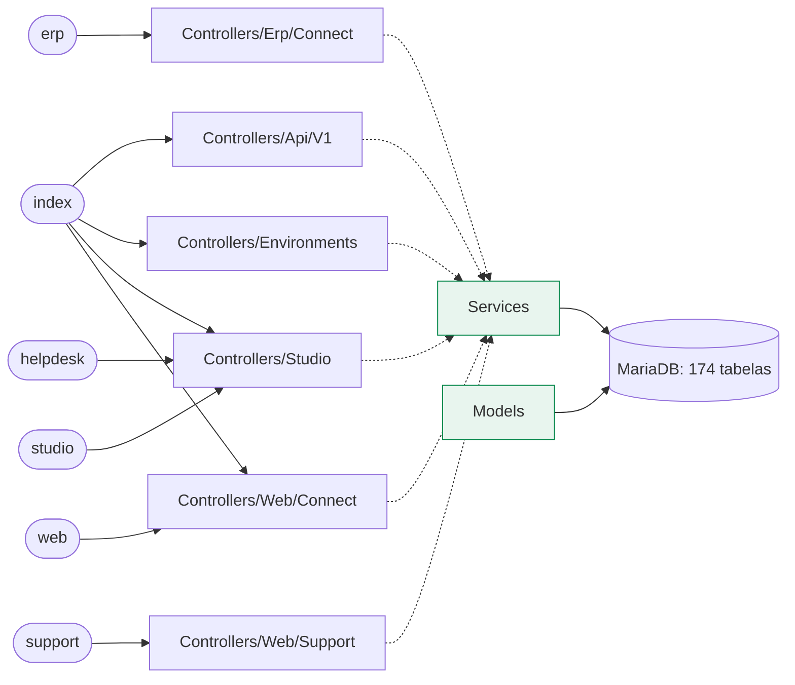

# Mapa do código do Connect ERP

> Gerado por `python3 tools/code-map.py` (ADR 0016). Não edite à mão: rode o script de novo.
> Para procurar algo no terminal: `python3 tools/code-map.py --find condominiums`.

**733** rotas fixas · **662** classes em `source/` · **174** tabelas nas migrations · **594** arquivos de teste · **417** ADRs · **172** páginas no catálogo do ERP.
Rotas geradas em laço (cadastros do ERP, catálogo) não entram na contagem; linhas dinâmicas por ambiente: erp: 10, index: 6.

Sumário: [Visão geral](#visão-geral) · [ERP](#erp-controllers-services-e-tabelas) · [Rotas](#rotas) · [Tabelas](#tabelas) · [Classes](#classes) · [Testes](#testes) · [Decisões](#decisões) · [Tarefas](#tarefas)

## Visão geral



## ERP: controllers, services e tabelas

```mermaid
flowchart LR
  Source_Controllers_Api_V1_AccessAdmin["Controllers/Api/V1/AccessAdmin"]
  Source_Services_CondominiumAccessDenied["Services/CondominiumAccessDenied"]
  Source_Controllers_Api_V1_AccessAdmin --> Source_Services_CondominiumAccessDenied
  Source_Services_Erp_PartnerAccess["Services/Erp/PartnerAccess"]
  Source_Controllers_Api_V1_AccessAdmin --> Source_Services_Erp_PartnerAccess
  Source_Services_Erp_Registry_RegistryNotFound["Services/Erp/Registry/RegistryNotFound"]
  Source_Controllers_Api_V1_AccessAdmin --> Source_Services_Erp_Registry_RegistryNotFound
  Source_Services_Erp_ResidentInvitations["Services/Erp/ResidentInvitations"]
  Source_Controllers_Api_V1_AccessAdmin --> Source_Services_Erp_ResidentInvitations
  Source_Services_Erp_ResidentPortalPermissions["Services/Erp/ResidentPortalPermissions"]
  Source_Controllers_Api_V1_AccessAdmin --> Source_Services_Erp_ResidentPortalPermissions
  Source_Controllers_Api_V1_Accountability["Controllers/Api/V1/Accountability"]
  Source_Controllers_Api_V1_Accountability --> Source_Services_CondominiumAccessDenied
  Source_Services_Erp_Accountability["Services/Erp/Accountability"]
  Source_Controllers_Api_V1_Accountability --> Source_Services_Erp_Accountability
  Source_Services_Erp_ListDocument["Services/Erp/ListDocument"]
  Source_Controllers_Api_V1_Accountability --> Source_Services_Erp_ListDocument
  Source_Services_Erp_ReportExportLimit["Services/Erp/ReportExportLimit"]
  Source_Controllers_Api_V1_Accountability --> Source_Services_Erp_ReportExportLimit
  Source_Controllers_Api_V1_AccountabilityLinks["Controllers/Api/V1/AccountabilityLinks"]
  Source_Controllers_Api_V1_AccountabilityLinks --> Source_Services_CondominiumAccessDenied
  Source_Services_Erp_AccountabilityLinks["Services/Erp/AccountabilityLinks"]
  Source_Controllers_Api_V1_AccountabilityLinks --> Source_Services_Erp_AccountabilityLinks
  Source_Controllers_Api_V1_AccountabilityPublications["Controllers/Api/V1/AccountabilityPublications"]
  Source_Controllers_Api_V1_AccountabilityPublications --> Source_Services_CondominiumAccessDenied
  Source_Controllers_Api_V1_AccountabilityPublications --> Source_Services_Erp_Accountability
  Source_Services_Erp_AccountabilityPublications["Services/Erp/AccountabilityPublications"]
  Source_Controllers_Api_V1_AccountabilityPublications --> Source_Services_Erp_AccountabilityPublications
  Source_Services_Erp_AnnualAccountability["Services/Erp/AnnualAccountability"]
  Source_Controllers_Api_V1_AccountabilityPublications --> Source_Services_Erp_AnnualAccountability
  Source_Services_Erp_CollectionReports["Services/Erp/CollectionReports"]
  Source_Controllers_Api_V1_AccountabilityPublications --> Source_Services_Erp_CollectionReports
  Source_Controllers_Api_V1_AccountabilityPublications --> Source_Services_Erp_ReportExportLimit
  Source_Controllers_Api_V1_AccountingReports["Controllers/Api/V1/AccountingReports"]
  Source_Controllers_Api_V1_AccountingReports --> Source_Services_CondominiumAccessDenied
  Source_Services_Erp_AccountingReports["Services/Erp/AccountingReports"]
  Source_Controllers_Api_V1_AccountingReports --> Source_Services_Erp_AccountingReports
  Source_Controllers_Api_V1_AccountingReports --> Source_Services_Erp_ListDocument
  Source_Controllers_Api_V1_AccountingReports --> Source_Services_Erp_ReportExportLimit
  Source_Controllers_Api_V1_AgreementWatch["Controllers/Api/V1/AgreementWatch"]
  Source_Controllers_Api_V1_AgreementWatch --> Source_Services_CondominiumAccessDenied
  Source_Services_Erp_AgreementWatch["Services/Erp/AgreementWatch"]
  Source_Controllers_Api_V1_AgreementWatch --> Source_Services_Erp_AgreementWatch
  Source_Controllers_Api_V1_Agreements["Controllers/Api/V1/Agreements"]
  Source_Services_Erp_Agreements["Services/Erp/Agreements"]
  Source_Controllers_Api_V1_Agreements --> Source_Services_Erp_Agreements
  Source_Controllers_Api_V1_Agreements --> Source_Services_Erp_Registry_RegistryNotFound
  Source_Services_Erp_Registry_RegistryValidationException["Services/Erp/Registry/RegistryValidationException"]
  Source_Controllers_Api_V1_Agreements --> Source_Services_Erp_Registry_RegistryValidationException
  Source_Controllers_Api_V1_AnnouncementBoard["Controllers/Api/V1/AnnouncementBoard"]
  Source_Controllers_Api_V1_AnnouncementBoard --> Source_Services_CondominiumAccessDenied
  Source_Services_Erp_AnnouncementBoard["Services/Erp/AnnouncementBoard"]
  Source_Controllers_Api_V1_AnnouncementBoard --> Source_Services_Erp_AnnouncementBoard
  Source_Controllers_Api_V1_AnnouncementRetry["Controllers/Api/V1/AnnouncementRetry"]
  Source_Controllers_Api_V1_AnnouncementRetry --> Source_Services_CondominiumAccessDenied
  Source_Services_Erp_AnnouncementRetry["Services/Erp/AnnouncementRetry"]
  Source_Controllers_Api_V1_AnnouncementRetry --> Source_Services_Erp_AnnouncementRetry
  Source_Controllers_Api_V1_AnnouncementRetry --> Source_Services_Erp_Registry_RegistryNotFound
  Source_Controllers_Api_V1_AnnouncementRetry --> Source_Services_Erp_Registry_RegistryValidationException
  Source_Controllers_Api_V1_Announcements["Controllers/Api/V1/Announcements"]
  Source_Controllers_Api_V1_Announcements --> Source_Services_CondominiumAccessDenied
  Source_Services_Erp_Announcements["Services/Erp/Announcements"]
  Source_Controllers_Api_V1_Announcements --> Source_Services_Erp_Announcements
  Source_Controllers_Api_V1_Announcements --> Source_Services_Erp_Registry_RegistryNotFound
  Source_Controllers_Api_V1_AnnualAccountability["Controllers/Api/V1/AnnualAccountability"]
  Source_Controllers_Api_V1_AnnualAccountability --> Source_Services_CondominiumAccessDenied
  Source_Controllers_Api_V1_AnnualAccountability --> Source_Services_Erp_AnnualAccountability
  Source_Controllers_Api_V1_AnnualAccountability --> Source_Services_Erp_ListDocument
  Source_Controllers_Api_V1_AnnualAccountability --> Source_Services_Erp_ReportExportLimit
  Source_Controllers_Api_V1_AnnualBalance["Controllers/Api/V1/AnnualBalance"]
  Source_Controllers_Api_V1_AnnualBalance --> Source_Services_CondominiumAccessDenied
  Source_Services_Erp_AnnualBalance["Services/Erp/AnnualBalance"]
  Source_Controllers_Api_V1_AnnualBalance --> Source_Services_Erp_AnnualBalance
  Source_Controllers_Api_V1_AnnualBalance --> Source_Services_Erp_ListDocument
  Source_Controllers_Api_V1_AnnualBalance --> Source_Services_Erp_ReportExportLimit
  Source_Controllers_Api_V1_Assemblies["Controllers/Api/V1/Assemblies"]
  Source_Controllers_Api_V1_Assemblies --> Source_Services_CondominiumAccessDenied
  Source_Services_Erp_Assemblies["Services/Erp/Assemblies"]
  Source_Controllers_Api_V1_Assemblies --> Source_Services_Erp_Assemblies
  Source_Controllers_Api_V1_Assemblies --> Source_Services_Erp_ListDocument
  Source_Controllers_Api_V1_Assemblies --> Source_Services_Erp_Registry_RegistryNotFound
  Source_Controllers_Api_V1_Assemblies --> Source_Services_Erp_ReportExportLimit
  Source_Controllers_Api_V1_AssemblyDraftCancellation["Controllers/Api/V1/AssemblyDraftCancellation"]
  Source_Controllers_Api_V1_AssemblyDraftCancellation --> Source_Services_CondominiumAccessDenied
  Source_Services_Erp_AssemblyDraftCancellation["Services/Erp/AssemblyDraftCancellation"]
  Source_Controllers_Api_V1_AssemblyDraftCancellation --> Source_Services_Erp_AssemblyDraftCancellation
  Source_Controllers_Api_V1_AssemblyDraftCancellation --> Source_Services_Erp_Registry_RegistryValidationException
  Source_Controllers_Api_V1_AssemblyHistory["Controllers/Api/V1/AssemblyHistory"]
  Source_Controllers_Api_V1_AssemblyHistory --> Source_Services_CondominiumAccessDenied
  Source_Services_Erp_AssemblyHistory["Services/Erp/AssemblyHistory"]
  Source_Controllers_Api_V1_AssemblyHistory --> Source_Services_Erp_AssemblyHistory
  Source_Controllers_Api_V1_AssemblyReadiness["Controllers/Api/V1/AssemblyReadiness"]
  Source_Services_Erp_AssemblyReadiness["Services/Erp/AssemblyReadiness"]
  Source_Controllers_Api_V1_AssemblyReadiness --> Source_Services_Erp_AssemblyReadiness
  Source_Controllers_Api_V1_AssemblyReadiness --> Source_Services_Erp_Registry_RegistryNotFound
  Source_Controllers_Api_V1_BalanceSheet["Controllers/Api/V1/BalanceSheet"]
  Source_Controllers_Api_V1_BalanceSheet --> Source_Services_CondominiumAccessDenied
  Source_Services_Erp_BalanceSheet["Services/Erp/BalanceSheet"]
  Source_Controllers_Api_V1_BalanceSheet --> Source_Services_Erp_BalanceSheet
  Source_Controllers_Api_V1_BalanceSheet --> Source_Services_Erp_ListDocument
  Source_Controllers_Api_V1_BalanceSheet --> Source_Services_Erp_ReportExportLimit
  Source_Controllers_Api_V1_BankAccountOverview["Controllers/Api/V1/BankAccountOverview"]
  Source_Controllers_Api_V1_BankAccountOverview --> Source_Services_CondominiumAccessDenied
  Source_Services_Erp_BankAccountOverview["Services/Erp/BankAccountOverview"]
  Source_Controllers_Api_V1_BankAccountOverview --> Source_Services_Erp_BankAccountOverview
  Source_Services_Erp_Registry_RegistryService["Services/Erp/Registry/RegistryService"]
  Source_Controllers_Api_V1_BankAccountOverview --> Source_Services_Erp_Registry_RegistryService
  Source_Controllers_Api_V1_BankBalances["Controllers/Api/V1/BankBalances"]
  Source_Services_Erp_BankBalances["Services/Erp/BankBalances"]
  Source_Controllers_Api_V1_BankBalances --> Source_Services_Erp_BankBalances
  Source_Controllers_Api_V1_BankCredentialsApi["Controllers/Api/V1/BankCredentialsApi"]
  Source_Services_Erp_Banking_BankCredentialSetup["Services/Erp/Banking/BankCredentialSetup"]
  Source_Controllers_Api_V1_BankCredentialsApi --> Source_Services_Erp_Banking_BankCredentialSetup
  Source_Controllers_Api_V1_BankCredentialsApi --> Source_Services_Erp_Registry_RegistryNotFound
  Source_Controllers_Api_V1_BankWebhook["Controllers/Api/V1/BankWebhook"]
  Source_Services_Erp_Banking_BankAdapters["Services/Erp/Banking/BankAdapters"]
  Source_Controllers_Api_V1_BankWebhook --> Source_Services_Erp_Banking_BankAdapters
  Source_Services_Erp_Banking_BankWebhooks["Services/Erp/Banking/BankWebhooks"]
  Source_Controllers_Api_V1_BankWebhook --> Source_Services_Erp_Banking_BankWebhooks
  Source_Controllers_Api_V1_Banking["Controllers/Api/V1/Banking"]
  Source_Services_Erp_Banking_BankCharges["Services/Erp/Banking/BankCharges"]
  Source_Controllers_Api_V1_Banking --> Source_Services_Erp_Banking_BankCharges
  Source_Services_Erp_Banking_BankRemittances["Services/Erp/Banking/BankRemittances"]
  Source_Controllers_Api_V1_Banking --> Source_Services_Erp_Banking_BankRemittances
  Source_Services_Erp_Banking_BankReturns["Services/Erp/Banking/BankReturns"]
  Source_Controllers_Api_V1_Banking --> Source_Services_Erp_Banking_BankReturns
  Source_Services_Erp_BillingLetter["Services/Erp/BillingLetter"]
  Source_Controllers_Api_V1_Banking --> Source_Services_Erp_BillingLetter
  Source_Controllers_Api_V1_Banking --> Source_Services_Erp_Registry_RegistryNotFound
  Source_Controllers_Api_V1_BannerDeactivation["Controllers/Api/V1/BannerDeactivation"]
  Source_Controllers_Api_V1_BannerDeactivation --> Source_Services_CondominiumAccessDenied
  Source_Services_Erp_BannerDeactivation["Services/Erp/BannerDeactivation"]
  Source_Controllers_Api_V1_BannerDeactivation --> Source_Services_Erp_BannerDeactivation
  Source_Controllers_Api_V1_BannerDeactivation --> Source_Services_Erp_Registry_RegistryService
  Source_Controllers_Api_V1_BannerDeactivation --> Source_Services_Erp_Registry_RegistryValidationException
  Source_Controllers_Api_V1_BannerOverview["Controllers/Api/V1/BannerOverview"]
  Source_Controllers_Api_V1_BannerOverview --> Source_Services_CondominiumAccessDenied
  Source_Services_Erp_BannerOverview["Services/Erp/BannerOverview"]
  Source_Controllers_Api_V1_BannerOverview --> Source_Services_Erp_BannerOverview
  Source_Controllers_Api_V1_BannerOverview --> Source_Services_Erp_Registry_RegistryService
  Source_Controllers_Api_V1_BatchReversal["Controllers/Api/V1/BatchReversal"]
  Source_Controllers_Api_V1_BatchReversal --> Source_Services_CondominiumAccessDenied
  Source_Services_Erp_BatchReversal["Services/Erp/BatchReversal"]
  Source_Controllers_Api_V1_BatchReversal --> Source_Services_Erp_BatchReversal
  Source_Services_Erp_BatchSettlementRejected["Services/Erp/BatchSettlementRejected"]
  Source_Controllers_Api_V1_BatchReversal --> Source_Services_Erp_BatchSettlementRejected
  Source_Controllers_Api_V1_BatchSettlement["Controllers/Api/V1/BatchSettlement"]
  Source_Controllers_Api_V1_BatchSettlement --> Source_Services_CondominiumAccessDenied
  Source_Services_Erp_BatchSettlement["Services/Erp/BatchSettlement"]
  Source_Controllers_Api_V1_BatchSettlement --> Source_Services_Erp_BatchSettlement
  Source_Controllers_Api_V1_BatchSettlement --> Source_Services_Erp_BatchSettlementRejected
  Source_Controllers_Api_V1_BillingCheck["Controllers/Api/V1/BillingCheck"]
  Source_Controllers_Api_V1_BillingCheck --> Source_Services_CondominiumAccessDenied
  Source_Services_Erp_BillingCheck["Services/Erp/BillingCheck"]
  Source_Controllers_Api_V1_BillingCheck --> Source_Services_Erp_BillingCheck
  Source_Controllers_Api_V1_BillingRules["Controllers/Api/V1/BillingRules"]
  Source_Services_Erp_BillingRules["Services/Erp/BillingRules"]
  Source_Controllers_Api_V1_BillingRules --> Source_Services_Erp_BillingRules
  Source_Services_Erp_RecurringEntries["Services/Erp/RecurringEntries"]
  Source_Controllers_Api_V1_BillingRules --> Source_Services_Erp_RecurringEntries
  Source_Services_Erp_Registry_RegistryForbidden["Services/Erp/Registry/RegistryForbidden"]
  Source_Controllers_Api_V1_BillingRules --> Source_Services_Erp_Registry_RegistryForbidden
  Source_Controllers_Api_V1_BillingRules --> Source_Services_Erp_Registry_RegistryNotFound
  Source_Controllers_Api_V1_BoardComposition["Controllers/Api/V1/BoardComposition"]
  Source_Controllers_Api_V1_BoardComposition --> Source_Services_CondominiumAccessDenied
  Source_Services_Erp_BoardComposition["Services/Erp/BoardComposition"]
  Source_Controllers_Api_V1_BoardComposition --> Source_Services_Erp_BoardComposition
  Source_Controllers_Api_V1_BoardTermExpiry["Controllers/Api/V1/BoardTermExpiry"]
  Source_Controllers_Api_V1_BoardTermExpiry --> Source_Services_CondominiumAccessDenied
  Source_Services_Erp_BoardTermExpiry["Services/Erp/BoardTermExpiry"]
  Source_Controllers_Api_V1_BoardTermExpiry --> Source_Services_Erp_BoardTermExpiry
  Source_Controllers_Api_V1_BoardTermExpiry --> Source_Services_Erp_Registry_RegistryValidationException
  Source_Controllers_Api_V1_BudgetProposal["Controllers/Api/V1/BudgetProposal"]
  Source_Controllers_Api_V1_BudgetProposal --> Source_Services_CondominiumAccessDenied
  Source_Services_Erp_BudgetProposal["Services/Erp/BudgetProposal"]
  Source_Controllers_Api_V1_BudgetProposal --> Source_Services_Erp_BudgetProposal
  Source_Controllers_Api_V1_CashBook["Controllers/Api/V1/CashBook"]
  Source_Controllers_Api_V1_CashBook --> Source_Services_CondominiumAccessDenied
  Source_Services_Erp_CashBook["Services/Erp/CashBook"]
  Source_Controllers_Api_V1_CashBook --> Source_Services_Erp_CashBook
  Source_Controllers_Api_V1_CashForecast["Controllers/Api/V1/CashForecast"]
  Source_Controllers_Api_V1_CashForecast --> Source_Services_CondominiumAccessDenied
  Source_Services_Erp_CashForecast["Services/Erp/CashForecast"]
  Source_Controllers_Api_V1_CashForecast --> Source_Services_Erp_CashForecast
  Source_Controllers_Api_V1_ChartOpenings["Controllers/Api/V1/ChartOpenings"]
  Source_Controllers_Api_V1_ChartOpenings --> Source_Services_CondominiumAccessDenied
  Source_Services_Erp_ChartOpenings["Services/Erp/ChartOpenings"]
  Source_Controllers_Api_V1_ChartOpenings --> Source_Services_Erp_ChartOpenings
  Source_Controllers_Api_V1_ChartReports["Controllers/Api/V1/ChartReports"]
  Source_Controllers_Api_V1_ChartReports --> Source_Services_CondominiumAccessDenied
  Source_Services_Erp_ChartReports["Services/Erp/ChartReports"]
  Source_Controllers_Api_V1_ChartReports --> Source_Services_Erp_ChartReports
  Source_Controllers_Api_V1_CheckCopyMatching["Controllers/Api/V1/CheckCopyMatching"]
  Source_Controllers_Api_V1_CheckCopyMatching --> Source_Services_CondominiumAccessDenied
  Source_Services_Erp_CheckCopyMatching["Services/Erp/CheckCopyMatching"]
  Source_Controllers_Api_V1_CheckCopyMatching --> Source_Services_Erp_CheckCopyMatching
  Source_Controllers_Api_V1_CheckCopyMatching --> Source_Services_Erp_Registry_RegistryValidationException
  Source_Controllers_Api_V1_CheckCopyReview["Controllers/Api/V1/CheckCopyReview"]
  Source_Controllers_Api_V1_CheckCopyReview --> Source_Services_CondominiumAccessDenied
  Source_Services_Erp_CheckCopyReview["Services/Erp/CheckCopyReview"]
  Source_Controllers_Api_V1_CheckCopyReview --> Source_Services_Erp_CheckCopyReview
  Source_Controllers_Api_V1_ClosingReadiness["Controllers/Api/V1/ClosingReadiness"]
  Source_Controllers_Api_V1_ClosingReadiness --> Source_Services_CondominiumAccessDenied
  Source_Services_Erp_ClosingReadiness["Services/Erp/ClosingReadiness"]
  Source_Controllers_Api_V1_ClosingReadiness --> Source_Services_Erp_ClosingReadiness
  Source_Controllers_Api_V1_CollectionProgress["Controllers/Api/V1/CollectionProgress"]
  Source_Controllers_Api_V1_CollectionProgress --> Source_Services_CondominiumAccessDenied
  Source_Services_Erp_CollectionProgress["Services/Erp/CollectionProgress"]
  Source_Controllers_Api_V1_CollectionProgress --> Source_Services_Erp_CollectionProgress
  Source_Controllers_Api_V1_CollectionReports["Controllers/Api/V1/CollectionReports"]
  Source_Controllers_Api_V1_CollectionReports --> Source_Services_CondominiumAccessDenied
  Source_Controllers_Api_V1_CollectionReports --> Source_Services_Erp_CollectionReports
  Source_Controllers_Api_V1_CollectionReports --> Source_Services_Erp_ListDocument
  Source_Controllers_Api_V1_CollectionReports --> Source_Services_Erp_ReportExportLimit
  Source_Controllers_Api_V1_Collections["Controllers/Api/V1/Collections"]
  Source_Controllers_Api_V1_Collections --> Source_Services_CondominiumAccessDenied
  Source_Services_Erp_Collections["Services/Erp/Collections"]
  Source_Controllers_Api_V1_Collections --> Source_Services_Erp_Collections
  Source_Controllers_Api_V1_Collections --> Source_Services_Erp_Registry_RegistryNotFound
  Source_Controllers_Api_V1_CommitmentCancellation["Controllers/Api/V1/CommitmentCancellation"]
  Source_Controllers_Api_V1_CommitmentCancellation --> Source_Services_CondominiumAccessDenied
  Source_Services_Erp_CommitmentCancellation["Services/Erp/CommitmentCancellation"]
  Source_Controllers_Api_V1_CommitmentCancellation --> Source_Services_Erp_CommitmentCancellation
  Source_Controllers_Api_V1_CommitmentCancellation --> Source_Services_Erp_Registry_RegistryValidationException
  Source_Controllers_Api_V1_CommitmentSettlement["Controllers/Api/V1/CommitmentSettlement"]
  Source_Controllers_Api_V1_CommitmentSettlement --> Source_Services_CondominiumAccessDenied
  Source_Services_Erp_CommitmentSettlement["Services/Erp/CommitmentSettlement"]
  Source_Controllers_Api_V1_CommitmentSettlement --> Source_Services_Erp_CommitmentSettlement
  Source_Controllers_Api_V1_CommitmentSettlement --> Source_Services_Erp_Registry_RegistryValidationException
  Source_Controllers_Api_V1_CommitmentsPosition["Controllers/Api/V1/CommitmentsPosition"]
  Source_Controllers_Api_V1_CommitmentsPosition --> Source_Services_CondominiumAccessDenied
  Source_Services_Erp_CommitmentsPosition["Services/Erp/CommitmentsPosition"]
  Source_Controllers_Api_V1_CommitmentsPosition --> Source_Services_Erp_CommitmentsPosition
  Source_Controllers_Api_V1_CommonAreaBookingMode["Controllers/Api/V1/CommonAreaBookingMode"]
  Source_Controllers_Api_V1_CommonAreaBookingMode --> Source_Services_CondominiumAccessDenied
  Source_Services_Erp_CommonAreaBookingMode["Services/Erp/CommonAreaBookingMode"]
  Source_Controllers_Api_V1_CommonAreaBookingMode --> Source_Services_Erp_CommonAreaBookingMode
  Source_Controllers_Api_V1_CommonAreaBookingMode --> Source_Services_Erp_Registry_RegistryValidationException
  Source_Controllers_Api_V1_CommonAreaUsage["Controllers/Api/V1/CommonAreaUsage"]
  Source_Controllers_Api_V1_CommonAreaUsage --> Source_Services_CondominiumAccessDenied
  Source_Services_Erp_CommonAreaUsage["Services/Erp/CommonAreaUsage"]
  Source_Controllers_Api_V1_CommonAreaUsage --> Source_Services_Erp_CommonAreaUsage
  Source_Controllers_Api_V1_CondominiumOnboarding["Controllers/Api/V1/CondominiumOnboarding"]
  Source_Controllers_Api_V1_CondominiumOnboarding --> Source_Services_CondominiumAccessDenied
  Source_Services_CondominiumScope["Services/CondominiumScope"]
  Source_Controllers_Api_V1_CondominiumOnboarding --> Source_Services_CondominiumScope
  Source_Services_OnboardingChecklist["Services/OnboardingChecklist"]
  Source_Controllers_Api_V1_CondominiumOnboarding --> Source_Services_OnboardingChecklist
  Source_Services_OnboardingItemNotFound["Services/OnboardingItemNotFound"]
  Source_Controllers_Api_V1_CondominiumOnboarding --> Source_Services_OnboardingItemNotFound
  Source_Services_OnboardingValidationError["Services/OnboardingValidationError"]
  Source_Controllers_Api_V1_CondominiumOnboarding --> Source_Services_OnboardingValidationError
  Source_Controllers_Api_V1_Condominiums["Controllers/Api/V1/Condominiums"]
  Source_Controllers_Api_V1_Condominiums --> Source_Services_CondominiumAccessDenied
  Source_Controllers_Api_V1_Condominiums --> Source_Services_CondominiumScope
  Source_Controllers_Api_V1_ContactCoverage["Controllers/Api/V1/ContactCoverage"]
  Source_Controllers_Api_V1_ContactCoverage --> Source_Services_CondominiumAccessDenied
  Source_Services_Erp_ContactCoverage["Services/Erp/ContactCoverage"]
  Source_Controllers_Api_V1_ContactCoverage --> Source_Services_Erp_ContactCoverage
  Source_Controllers_Api_V1_ContactDeduplication["Controllers/Api/V1/ContactDeduplication"]
  Source_Controllers_Api_V1_ContactDeduplication --> Source_Services_CondominiumAccessDenied
  Source_Services_Erp_ContactDeduplication["Services/Erp/ContactDeduplication"]
  Source_Controllers_Api_V1_ContactDeduplication --> Source_Services_Erp_ContactDeduplication
  Source_Controllers_Api_V1_ContactDeduplication --> Source_Services_Erp_Registry_RegistryValidationException
  Source_Controllers_Api_V1_ContractClosing["Controllers/Api/V1/ContractClosing"]
  Source_Controllers_Api_V1_ContractClosing --> Source_Services_CondominiumAccessDenied
  Source_Services_Erp_ContractClosing["Services/Erp/ContractClosing"]
  Source_Controllers_Api_V1_ContractClosing --> Source_Services_Erp_ContractClosing
  Source_Controllers_Api_V1_ContractClosing --> Source_Services_Erp_Registry_RegistryValidationException
  Source_Controllers_Api_V1_ContractPortfolio["Controllers/Api/V1/ContractPortfolio"]
  Source_Controllers_Api_V1_ContractPortfolio --> Source_Services_CondominiumAccessDenied
  Source_Services_Erp_ContractPortfolio["Services/Erp/ContractPortfolio"]
  Source_Controllers_Api_V1_ContractPortfolio --> Source_Services_Erp_ContractPortfolio
  Source_Controllers_Api_V1_ContractRenewal["Controllers/Api/V1/ContractRenewal"]
  Source_Controllers_Api_V1_ContractRenewal --> Source_Services_CondominiumAccessDenied
  Source_Services_Erp_ContractRenewal["Services/Erp/ContractRenewal"]
  Source_Controllers_Api_V1_ContractRenewal --> Source_Services_Erp_ContractRenewal
  Source_Controllers_Api_V1_ContractRenewal --> Source_Services_Erp_Registry_RegistryValidationException
  Source_Controllers_Api_V1_CostCenterDeactivation["Controllers/Api/V1/CostCenterDeactivation"]
  Source_Controllers_Api_V1_CostCenterDeactivation --> Source_Services_CondominiumAccessDenied
  Source_Services_Erp_CostCenterDeactivation["Services/Erp/CostCenterDeactivation"]
  Source_Controllers_Api_V1_CostCenterDeactivation --> Source_Services_Erp_CostCenterDeactivation
  Source_Controllers_Api_V1_CostCenterDeactivation --> Source_Services_Erp_Registry_RegistryValidationException
  Source_Controllers_Api_V1_DelinquencyByLocation["Controllers/Api/V1/DelinquencyByLocation"]
  Source_Controllers_Api_V1_DelinquencyByLocation --> Source_Services_CondominiumAccessDenied
  Source_Services_Erp_DelinquencyByLocation["Services/Erp/DelinquencyByLocation"]
  Source_Controllers_Api_V1_DelinquencyByLocation --> Source_Services_Erp_DelinquencyByLocation
  Source_Controllers_Api_V1_DeliveryLog["Controllers/Api/V1/DeliveryLog"]
  Source_Controllers_Api_V1_DeliveryLog --> Source_Services_CondominiumAccessDenied
  Source_Services_Erp_DeliveryLog["Services/Erp/DeliveryLog"]
  Source_Controllers_Api_V1_DeliveryLog --> Source_Services_Erp_DeliveryLog
  Source_Controllers_Api_V1_DiscountOverview["Controllers/Api/V1/DiscountOverview"]
  Source_Controllers_Api_V1_DiscountOverview --> Source_Services_CondominiumAccessDenied
  Source_Services_Erp_DiscountOverview["Services/Erp/DiscountOverview"]
  Source_Controllers_Api_V1_DiscountOverview --> Source_Services_Erp_DiscountOverview
  Source_Controllers_Api_V1_DocumentTransit["Controllers/Api/V1/DocumentTransit"]
  Source_Controllers_Api_V1_DocumentTransit --> Source_Services_CondominiumAccessDenied
  Source_Services_Erp_DocumentTransit["Services/Erp/DocumentTransit"]
  Source_Controllers_Api_V1_DocumentTransit --> Source_Services_Erp_DocumentTransit
  Source_Controllers_Api_V1_DocumentTransitSettlement["Controllers/Api/V1/DocumentTransitSettlement"]
  Source_Controllers_Api_V1_DocumentTransitSettlement --> Source_Services_CondominiumAccessDenied
  Source_Services_Erp_DocumentTransitSettlement["Services/Erp/DocumentTransitSettlement"]
  Source_Controllers_Api_V1_DocumentTransitSettlement --> Source_Services_Erp_DocumentTransitSettlement
  Source_Controllers_Api_V1_DocumentTransitSettlement --> Source_Services_Erp_Registry_RegistryValidationException
  Source_Controllers_Api_V1_EmployeeHeadcount["Controllers/Api/V1/EmployeeHeadcount"]
  Source_Controllers_Api_V1_EmployeeHeadcount --> Source_Services_CondominiumAccessDenied
  Source_Services_Erp_EmployeeHeadcount["Services/Erp/EmployeeHeadcount"]
  Source_Controllers_Api_V1_EmployeeHeadcount --> Source_Services_Erp_EmployeeHeadcount
  Source_Controllers_Api_V1_EmployeeSalaryReadjustment["Controllers/Api/V1/EmployeeSalaryReadjustment"]
  Source_Controllers_Api_V1_EmployeeSalaryReadjustment --> Source_Services_CondominiumAccessDenied
  Source_Services_Erp_EmployeeSalaryReadjustment["Services/Erp/EmployeeSalaryReadjustment"]
  Source_Controllers_Api_V1_EmployeeSalaryReadjustment --> Source_Services_Erp_EmployeeSalaryReadjustment
  Source_Controllers_Api_V1_EmployeeSalaryReadjustment --> Source_Services_Erp_Registry_RegistryValidationException
  Source_Controllers_Api_V1_EmployeeTermination["Controllers/Api/V1/EmployeeTermination"]
  Source_Controllers_Api_V1_EmployeeTermination --> Source_Services_CondominiumAccessDenied
  Source_Services_Erp_EmployeeTermination["Services/Erp/EmployeeTermination"]
  Source_Controllers_Api_V1_EmployeeTermination --> Source_Services_Erp_EmployeeTermination
  Source_Controllers_Api_V1_EmployeeTermination --> Source_Services_Erp_Registry_RegistryValidationException
  Source_Controllers_Api_V1_EntryAttachments["Controllers/Api/V1/EntryAttachments"]
  Source_Services_Erp_Antivirus_UploadScanUnavailable["Services/Erp/Antivirus/UploadScanUnavailable"]
  Source_Controllers_Api_V1_EntryAttachments --> Source_Services_Erp_Antivirus_UploadScanUnavailable
  Source_Services_Erp_EntryAttachments["Services/Erp/EntryAttachments"]
  Source_Controllers_Api_V1_EntryAttachments --> Source_Services_Erp_EntryAttachments
  Source_Controllers_Api_V1_EntryAttachments --> Source_Services_Erp_Registry_RegistryNotFound
  Source_Controllers_Api_V1_EntryCancellation["Controllers/Api/V1/EntryCancellation"]
  Source_Controllers_Api_V1_EntryCancellation --> Source_Services_CondominiumAccessDenied
  Source_Services_Erp_EntryCancellation["Services/Erp/EntryCancellation"]
  Source_Controllers_Api_V1_EntryCancellation --> Source_Services_Erp_EntryCancellation
  Source_Controllers_Api_V1_EntryCancellation --> Source_Services_Erp_Registry_RegistryValidationException
  Source_Controllers_Api_V1_EntryCopy["Controllers/Api/V1/EntryCopy"]
  Source_Controllers_Api_V1_EntryCopy --> Source_Services_CondominiumAccessDenied
  Source_Services_Erp_EntryCopy["Services/Erp/EntryCopy"]
  Source_Controllers_Api_V1_EntryCopy --> Source_Services_Erp_EntryCopy
  Source_Controllers_Api_V1_EntryCopy --> Source_Services_Erp_Registry_RegistryValidationException
  Source_Controllers_Api_V1_EntryReclassification["Controllers/Api/V1/EntryReclassification"]
  Source_Controllers_Api_V1_EntryReclassification --> Source_Services_CondominiumAccessDenied
  Source_Services_Erp_EntryReclassification["Services/Erp/EntryReclassification"]
  Source_Controllers_Api_V1_EntryReclassification --> Source_Services_Erp_EntryReclassification
  Source_Controllers_Api_V1_EntryReclassification --> Source_Services_Erp_Registry_RegistryValidationException
  Source_Controllers_Api_V1_EntryReschedule["Controllers/Api/V1/EntryReschedule"]
  Source_Controllers_Api_V1_EntryReschedule --> Source_Services_CondominiumAccessDenied
  Source_Services_Erp_EntryReschedule["Services/Erp/EntryReschedule"]
  Source_Controllers_Api_V1_EntryReschedule --> Source_Services_Erp_EntryReschedule
  Source_Controllers_Api_V1_EntryReschedule --> Source_Services_Erp_Registry_RegistryValidationException
  Source_Controllers_Api_V1_EntryShortcuts["Controllers/Api/V1/EntryShortcuts"]
  Source_Services_Erp_EntryShortcuts["Services/Erp/EntryShortcuts"]
  Source_Controllers_Api_V1_EntryShortcuts --> Source_Services_Erp_EntryShortcuts
  Source_Services_Erp_Registry_RegistryLocked["Services/Erp/Registry/RegistryLocked"]
  Source_Controllers_Api_V1_EntryShortcuts --> Source_Services_Erp_Registry_RegistryLocked
  Source_Controllers_Api_V1_EntryShortcuts --> Source_Services_Erp_Registry_RegistryNotFound
  Source_Controllers_Api_V1_EntryShortcuts --> Source_Services_Erp_Registry_RegistryValidationException
  Source_Services_Erp_RevenueLaunch["Services/Erp/RevenueLaunch"]
  Source_Controllers_Api_V1_EntryShortcuts --> Source_Services_Erp_RevenueLaunch
  Source_Controllers_Api_V1_ErpAdmin["Controllers/Api/V1/ErpAdmin"]
  Source_Controllers_Api_V1_ErpAdmin --> Source_Services_CondominiumAccessDenied
  Source_Services_Erp_AdminReports["Services/Erp/AdminReports"]
  Source_Controllers_Api_V1_ErpAdmin --> Source_Services_Erp_AdminReports
  Source_Services_Erp_ErpAccess["Services/Erp/ErpAccess"]
  Source_Controllers_Api_V1_ErpAdmin --> Source_Services_Erp_ErpAccess
  Source_Controllers_Api_V1_ErpAdmin --> Source_Services_Erp_Registry_RegistryForbidden
  Source_Controllers_Api_V1_ErpSettings["Controllers/Api/V1/ErpSettings"]
  Source_Controllers_Api_V1_ErpSettings --> Source_Services_CondominiumAccessDenied
  Source_Services_Erp_ErpSettings["Services/Erp/ErpSettings"]
  Source_Controllers_Api_V1_ErpSettings --> Source_Services_Erp_ErpSettings
  Source_Controllers_Api_V1_ErpSettings --> Source_Services_Erp_Registry_RegistryForbidden
  Source_Controllers_Api_V1_ErpSettings --> Source_Services_Erp_Registry_RegistryNotFound
  Source_Controllers_Api_V1_ExpenseBenchmark["Controllers/Api/V1/ExpenseBenchmark"]
  Source_Services_Erp_ExpenseBenchmark["Services/Erp/ExpenseBenchmark"]
  Source_Controllers_Api_V1_ExpenseBenchmark --> Source_Services_Erp_ExpenseBenchmark
  Source_Controllers_Api_V1_ExpenseReview["Controllers/Api/V1/ExpenseReview"]
  Source_Controllers_Api_V1_ExpenseReview --> Source_Services_CondominiumAccessDenied
  Source_Services_Erp_ExpenseReview["Services/Erp/ExpenseReview"]
  Source_Controllers_Api_V1_ExpenseReview --> Source_Services_Erp_ExpenseReview
  Source_Controllers_Api_V1_ExtraChargeCancellation["Controllers/Api/V1/ExtraChargeCancellation"]
  Source_Controllers_Api_V1_ExtraChargeCancellation --> Source_Services_CondominiumAccessDenied
  Source_Services_Erp_ExtraChargeCancellation["Services/Erp/ExtraChargeCancellation"]
  Source_Controllers_Api_V1_ExtraChargeCancellation --> Source_Services_Erp_ExtraChargeCancellation
  Source_Controllers_Api_V1_ExtraChargeCancellation --> Source_Services_Erp_Registry_RegistryValidationException
  Source_Controllers_Api_V1_ExtraChargeOverview["Controllers/Api/V1/ExtraChargeOverview"]
  Source_Controllers_Api_V1_ExtraChargeOverview --> Source_Services_CondominiumAccessDenied
  Source_Services_Erp_ExtraChargeOverview["Services/Erp/ExtraChargeOverview"]
  Source_Controllers_Api_V1_ExtraChargeOverview --> Source_Services_Erp_ExtraChargeOverview
  Source_Controllers_Api_V1_FeeSimulation["Controllers/Api/V1/FeeSimulation"]
  Source_Controllers_Api_V1_FeeSimulation --> Source_Services_CondominiumAccessDenied
  Source_Services_Erp_FeeSimulation["Services/Erp/FeeSimulation"]
  Source_Controllers_Api_V1_FeeSimulation --> Source_Services_Erp_FeeSimulation
  Source_Controllers_Api_V1_FinancialReports["Controllers/Api/V1/FinancialReports"]
  Source_Controllers_Api_V1_FinancialReports --> Source_Services_CondominiumAccessDenied
  Source_Services_Erp_FinancialReports["Services/Erp/FinancialReports"]
  Source_Controllers_Api_V1_FinancialReports --> Source_Services_Erp_FinancialReports
  Source_Controllers_Api_V1_GatehouseDeactivation["Controllers/Api/V1/GatehouseDeactivation"]
  Source_Controllers_Api_V1_GatehouseDeactivation --> Source_Services_CondominiumAccessDenied
  Source_Services_Erp_GatehouseDeactivation["Services/Erp/GatehouseDeactivation"]
  Source_Controllers_Api_V1_GatehouseDeactivation --> Source_Services_Erp_GatehouseDeactivation
  Source_Controllers_Api_V1_GatehouseDeactivation --> Source_Services_Erp_Registry_RegistryService
  Source_Controllers_Api_V1_GatehouseDeactivation --> Source_Services_Erp_Registry_RegistryValidationException
  Source_Controllers_Api_V1_GatehouseOverview["Controllers/Api/V1/GatehouseOverview"]
  Source_Controllers_Api_V1_GatehouseOverview --> Source_Services_CondominiumAccessDenied
  Source_Services_Erp_GatehouseOverview["Services/Erp/GatehouseOverview"]
  Source_Controllers_Api_V1_GatehouseOverview --> Source_Services_Erp_GatehouseOverview
  Source_Controllers_Api_V1_GatehouseOverview --> Source_Services_Erp_Registry_RegistryService
  Source_Controllers_Api_V1_GatehouseTraffic["Controllers/Api/V1/GatehouseTraffic"]
  Source_Controllers_Api_V1_GatehouseTraffic --> Source_Services_CondominiumAccessDenied
  Source_Services_Erp_GatehouseTraffic["Services/Erp/GatehouseTraffic"]
  Source_Controllers_Api_V1_GatehouseTraffic --> Source_Services_Erp_GatehouseTraffic
  Source_Controllers_Api_V1_Help["Controllers/Api/V1/Help"]
  Source_Services_Support_HelpSuggestions["Services/Support/HelpSuggestions"]
  Source_Controllers_Api_V1_Help --> Source_Services_Support_HelpSuggestions
  Source_Controllers_Api_V1_ImportDiscard["Controllers/Api/V1/ImportDiscard"]
  Source_Controllers_Api_V1_ImportDiscard --> Source_Services_CondominiumAccessDenied
  Source_Services_Erp_ImportDiscard["Services/Erp/ImportDiscard"]
  Source_Controllers_Api_V1_ImportDiscard --> Source_Services_Erp_ImportDiscard
  Source_Controllers_Api_V1_ImportDiscard --> Source_Services_Erp_Registry_RegistryNotFound
  Source_Controllers_Api_V1_ImportDiscard --> Source_Services_Erp_Registry_RegistryValidationException
  Source_Controllers_Api_V1_Imports["Controllers/Api/V1/Imports"]
  Source_Services_Erp_Banking_BankStatementFetch["Services/Erp/Banking/BankStatementFetch"]
  Source_Controllers_Api_V1_Imports --> Source_Services_Erp_Banking_BankStatementFetch
  Source_Services_Erp_Imports_Imports["Services/Erp/Imports/Imports"]
  Source_Controllers_Api_V1_Imports --> Source_Services_Erp_Imports_Imports
  Source_Controllers_Api_V1_Imports --> Source_Services_Erp_Registry_RegistryForbidden
  Source_Controllers_Api_V1_Imports --> Source_Services_Erp_Registry_RegistryLocked
  Source_Controllers_Api_V1_Imports --> Source_Services_Erp_Registry_RegistryNotFound
  Source_Controllers_Api_V1_Imports --> Source_Services_Erp_Registry_RegistryValidationException
  Source_Controllers_Api_V1_ImportsOverview["Controllers/Api/V1/ImportsOverview"]
  Source_Controllers_Api_V1_ImportsOverview --> Source_Services_CondominiumAccessDenied
  Source_Services_Erp_ImportsOverview["Services/Erp/ImportsOverview"]
  Source_Controllers_Api_V1_ImportsOverview --> Source_Services_Erp_ImportsOverview
  Source_Controllers_Api_V1_Inspections["Controllers/Api/V1/Inspections"]
  Source_Services_Inspections_InspectionError["Services/Inspections/InspectionError"]
  Source_Controllers_Api_V1_Inspections --> Source_Services_Inspections_InspectionError
  Source_Services_Inspections_InspectionService["Services/Inspections/InspectionService"]
  Source_Controllers_Api_V1_Inspections --> Source_Services_Inspections_InspectionService
  Source_Controllers_Api_V1_InstallmentPayables["Controllers/Api/V1/InstallmentPayables"]
  Source_Controllers_Api_V1_InstallmentPayables --> Source_Services_CondominiumAccessDenied
  Source_Services_Erp_InstallmentPayables["Services/Erp/InstallmentPayables"]
  Source_Controllers_Api_V1_InstallmentPayables --> Source_Services_Erp_InstallmentPayables
  Source_Controllers_Api_V1_InstallmentPayables --> Source_Services_Erp_Registry_RegistryValidationException
  Source_Controllers_Api_V1_InsuranceCoverage["Controllers/Api/V1/InsuranceCoverage"]
  Source_Controllers_Api_V1_InsuranceCoverage --> Source_Services_CondominiumAccessDenied
  Source_Services_Erp_InsuranceCoverage["Services/Erp/InsuranceCoverage"]
  Source_Controllers_Api_V1_InsuranceCoverage --> Source_Services_Erp_InsuranceCoverage
  Source_Controllers_Api_V1_IntegrationStatus["Controllers/Api/V1/IntegrationStatus"]
  Source_Services_Erp_IntegrationStatus["Services/Erp/IntegrationStatus"]
  Source_Controllers_Api_V1_IntegrationStatus --> Source_Services_Erp_IntegrationStatus
  Source_Controllers_Api_V1_IntegrationTokens["Controllers/Api/V1/IntegrationTokens"]
  Source_Services_Talk_TalkTokens["Services/Talk/TalkTokens"]
  Source_Controllers_Api_V1_IntegrationTokens --> Source_Services_Talk_TalkTokens
  Source_Controllers_Api_V1_Investments["Controllers/Api/V1/Investments"]
  Source_Controllers_Api_V1_Investments --> Source_Services_CondominiumAccessDenied
  Source_Controllers_Api_V1_Investments --> Source_Services_Erp_AccountingReports
  Source_Services_Erp_Investments["Services/Erp/Investments"]
  Source_Controllers_Api_V1_Investments --> Source_Services_Erp_Investments
  Source_Controllers_Api_V1_Investments --> Source_Services_Erp_Registry_RegistryNotFound
  Source_Controllers_Api_V1_InvoiceEntryCleanup["Controllers/Api/V1/InvoiceEntryCleanup"]
  Source_Controllers_Api_V1_InvoiceEntryCleanup --> Source_Services_CondominiumAccessDenied
  Source_Services_Erp_InvoiceEntryCleanup["Services/Erp/InvoiceEntryCleanup"]
  Source_Controllers_Api_V1_InvoiceEntryCleanup --> Source_Services_Erp_InvoiceEntryCleanup
  Source_Controllers_Api_V1_InvoiceEntryCleanup --> Source_Services_Erp_Registry_RegistryService
  Source_Controllers_Api_V1_InvoiceEntryCleanup --> Source_Services_Erp_Registry_RegistryValidationException
  Source_Controllers_Api_V1_InvoiceReconciliation["Controllers/Api/V1/InvoiceReconciliation"]
  Source_Controllers_Api_V1_InvoiceReconciliation --> Source_Services_CondominiumAccessDenied
  Source_Services_Erp_InvoiceReconciliation["Services/Erp/InvoiceReconciliation"]
  Source_Controllers_Api_V1_InvoiceReconciliation --> Source_Services_Erp_InvoiceReconciliation
  Source_Controllers_Api_V1_InvoiceReconciliation --> Source_Services_Erp_Registry_RegistryService
  Source_Controllers_Api_V1_InvoiceTypeDeactivation["Controllers/Api/V1/InvoiceTypeDeactivation"]
  Source_Controllers_Api_V1_InvoiceTypeDeactivation --> Source_Services_CondominiumAccessDenied
  Source_Services_Erp_InvoiceTypeDeactivation["Services/Erp/InvoiceTypeDeactivation"]
  Source_Controllers_Api_V1_InvoiceTypeDeactivation --> Source_Services_Erp_InvoiceTypeDeactivation
  Source_Controllers_Api_V1_InvoiceTypeDeactivation --> Source_Services_Erp_Registry_RegistryService
  Source_Controllers_Api_V1_InvoiceTypeDeactivation --> Source_Services_Erp_Registry_RegistryValidationException
  Source_Controllers_Api_V1_InvoiceTypeOverview["Controllers/Api/V1/InvoiceTypeOverview"]
  Source_Controllers_Api_V1_InvoiceTypeOverview --> Source_Services_CondominiumAccessDenied
  Source_Services_Erp_InvoiceTypeOverview["Services/Erp/InvoiceTypeOverview"]
  Source_Controllers_Api_V1_InvoiceTypeOverview --> Source_Services_Erp_InvoiceTypeOverview
  Source_Controllers_Api_V1_InvoiceTypeOverview --> Source_Services_Erp_Registry_RegistryService
  Source_Controllers_Api_V1_Invoices["Controllers/Api/V1/Invoices"]
  Source_Services_Erp_Invoices["Services/Erp/Invoices"]
  Source_Controllers_Api_V1_Invoices --> Source_Services_Erp_Invoices
  Source_Controllers_Api_V1_Invoices --> Source_Services_Erp_Registry_RegistryLocked
  Source_Controllers_Api_V1_Invoices --> Source_Services_Erp_Registry_RegistryNotFound
  Source_Controllers_Api_V1_Invoices --> Source_Services_Erp_Registry_RegistryValidationException
  Source_Controllers_Api_V1_LegalCasePortfolio["Controllers/Api/V1/LegalCasePortfolio"]
  Source_Controllers_Api_V1_LegalCasePortfolio --> Source_Services_CondominiumAccessDenied
  Source_Services_Erp_LegalCasePortfolio["Services/Erp/LegalCasePortfolio"]
  Source_Controllers_Api_V1_LegalCasePortfolio --> Source_Services_Erp_LegalCasePortfolio
  Source_Controllers_Api_V1_LegalCaseSettlement["Controllers/Api/V1/LegalCaseSettlement"]
  Source_Controllers_Api_V1_LegalCaseSettlement --> Source_Services_CondominiumAccessDenied
  Source_Services_Erp_LegalCaseSettlement["Services/Erp/LegalCaseSettlement"]
  Source_Controllers_Api_V1_LegalCaseSettlement --> Source_Services_Erp_LegalCaseSettlement
  Source_Controllers_Api_V1_LegalCaseSettlement --> Source_Services_Erp_Registry_RegistryValidationException
  Source_Controllers_Api_V1_LocalHolidays["Controllers/Api/V1/LocalHolidays"]
  Source_Controllers_Api_V1_LocalHolidays --> Source_Services_CondominiumAccessDenied
  Source_Services_Erp_LocalHolidays["Services/Erp/LocalHolidays"]
  Source_Controllers_Api_V1_LocalHolidays --> Source_Services_Erp_LocalHolidays
  Source_Controllers_Api_V1_LostFoundDisposal["Controllers/Api/V1/LostFoundDisposal"]
  Source_Controllers_Api_V1_LostFoundDisposal --> Source_Services_CondominiumAccessDenied
  Source_Services_Erp_LostFoundDisposal["Services/Erp/LostFoundDisposal"]
  Source_Controllers_Api_V1_LostFoundDisposal --> Source_Services_Erp_LostFoundDisposal
  Source_Controllers_Api_V1_LostFoundDisposal --> Source_Services_Erp_Registry_RegistryValidationException
  Source_Controllers_Api_V1_LostFoundSummary["Controllers/Api/V1/LostFoundSummary"]
  Source_Controllers_Api_V1_LostFoundSummary --> Source_Services_CondominiumAccessDenied
  Source_Services_Erp_LostFoundSummary["Services/Erp/LostFoundSummary"]
  Source_Controllers_Api_V1_LostFoundSummary --> Source_Services_Erp_LostFoundSummary
  Source_Controllers_Api_V1_MaintenanceCancellation["Controllers/Api/V1/MaintenanceCancellation"]
  Source_Controllers_Api_V1_MaintenanceCancellation --> Source_Services_CondominiumAccessDenied
  Source_Services_Erp_MaintenanceCancellation["Services/Erp/MaintenanceCancellation"]
  Source_Controllers_Api_V1_MaintenanceCancellation --> Source_Services_Erp_MaintenanceCancellation
  Source_Controllers_Api_V1_MaintenanceCancellation --> Source_Services_Erp_Registry_RegistryValidationException
  Source_Controllers_Api_V1_MaintenanceCompletion["Controllers/Api/V1/MaintenanceCompletion"]
  Source_Controllers_Api_V1_MaintenanceCompletion --> Source_Services_CondominiumAccessDenied
  Source_Services_Erp_MaintenanceCompletion["Services/Erp/MaintenanceCompletion"]
  Source_Controllers_Api_V1_MaintenanceCompletion --> Source_Services_Erp_MaintenanceCompletion
  Source_Controllers_Api_V1_MaintenanceCompletion --> Source_Services_Erp_Registry_RegistryValidationException
  Source_Controllers_Api_V1_MaintenanceCompliance["Controllers/Api/V1/MaintenanceCompliance"]
  Source_Controllers_Api_V1_MaintenanceCompliance --> Source_Services_CondominiumAccessDenied
  Source_Services_Erp_MaintenanceCompliance["Services/Erp/MaintenanceCompliance"]
  Source_Controllers_Api_V1_MaintenanceCompliance --> Source_Services_Erp_MaintenanceCompliance
  Source_Controllers_Api_V1_ManagementFees["Controllers/Api/V1/ManagementFees"]
  Source_Services_Erp_ManagementFees["Services/Erp/ManagementFees"]
  Source_Controllers_Api_V1_ManagementFees --> Source_Services_Erp_ManagementFees
  Source_Controllers_Api_V1_ManagementFees --> Source_Services_Erp_Registry_RegistryNotFound
  Source_Controllers_Api_V1_ManagementFees --> Source_Services_Erp_Registry_RegistryValidationException
  Source_Controllers_Api_V1_ManagementReports["Controllers/Api/V1/ManagementReports"]
  Source_Controllers_Api_V1_ManagementReports --> Source_Services_CondominiumAccessDenied
  Source_Controllers_Api_V1_ManagementReports --> Source_Services_Erp_ListDocument
  Source_Services_Erp_ManagementReports["Services/Erp/ManagementReports"]
  Source_Controllers_Api_V1_ManagementReports --> Source_Services_Erp_ManagementReports
  Source_Controllers_Api_V1_ManagementReports --> Source_Services_Erp_Registry_RegistryNotFound
  Source_Controllers_Api_V1_ManagementReports --> Source_Services_Erp_ReportExportLimit
  Source_Controllers_Api_V1_Me["Controllers/Api/V1/Me"]
  Source_Controllers_Api_V1_Me --> Source_Services_CondominiumScope
  Source_Services_TwoFactorService["Services/TwoFactorService"]
  Source_Controllers_Api_V1_Me --> Source_Services_TwoFactorService
  Source_Controllers_Api_V1_MeterDeactivation["Controllers/Api/V1/MeterDeactivation"]
  Source_Controllers_Api_V1_MeterDeactivation --> Source_Services_CondominiumAccessDenied
  Source_Services_Erp_MeterDeactivation["Services/Erp/MeterDeactivation"]
  Source_Controllers_Api_V1_MeterDeactivation --> Source_Services_Erp_MeterDeactivation
  Source_Controllers_Api_V1_MeterDeactivation --> Source_Services_Erp_Registry_RegistryService
  Source_Controllers_Api_V1_MeterDeactivation --> Source_Services_Erp_Registry_RegistryValidationException
  Source_Controllers_Api_V1_MeterReadingReview["Controllers/Api/V1/MeterReadingReview"]
  Source_Controllers_Api_V1_MeterReadingReview --> Source_Services_CondominiumAccessDenied
  Source_Services_Erp_MeterReadingReview["Services/Erp/MeterReadingReview"]
  Source_Controllers_Api_V1_MeterReadingReview --> Source_Services_Erp_MeterReadingReview
  Source_Controllers_Api_V1_MeterReadings["Controllers/Api/V1/MeterReadings"]
  Source_Services_Erp_MeterReadings["Services/Erp/MeterReadings"]
  Source_Controllers_Api_V1_MeterReadings --> Source_Services_Erp_MeterReadings
  Source_Controllers_Api_V1_MeterReadings --> Source_Services_Erp_Registry_RegistryNotFound
  Source_Controllers_Api_V1_MeterReadings --> Source_Services_Erp_Registry_RegistryValidationException
  Source_Controllers_Api_V1_MonthClosingBatch["Controllers/Api/V1/MonthClosingBatch"]
  Source_Controllers_Api_V1_MonthClosingBatch --> Source_Services_CondominiumAccessDenied
  Source_Controllers_Api_V1_MonthClosingBatch --> Source_Services_Erp_AccountabilityLinks
  Source_Services_Erp_MonthClosingBatch["Services/Erp/MonthClosingBatch"]
  Source_Controllers_Api_V1_MonthClosingBatch --> Source_Services_Erp_MonthClosingBatch
  Source_Services_Erp_MonthClosingBatchRefused["Services/Erp/MonthClosingBatchRefused"]
  Source_Controllers_Api_V1_MonthClosingBatch --> Source_Services_Erp_MonthClosingBatchRefused
  Source_Controllers_Api_V1_MonthClosings["Controllers/Api/V1/MonthClosings"]
  Source_Controllers_Api_V1_MonthClosings --> Source_Services_CondominiumAccessDenied
  Source_Controllers_Api_V1_MonthClosings --> Source_Services_Erp_AccountabilityLinks
  Source_Services_Erp_MonthClosing["Services/Erp/MonthClosing"]
  Source_Controllers_Api_V1_MonthClosings --> Source_Services_Erp_MonthClosing
  Source_Controllers_Api_V1_MoveSettlement["Controllers/Api/V1/MoveSettlement"]
  Source_Controllers_Api_V1_MoveSettlement --> Source_Services_CondominiumAccessDenied
  Source_Services_Erp_MoveSettlement["Services/Erp/MoveSettlement"]
  Source_Controllers_Api_V1_MoveSettlement --> Source_Services_Erp_MoveSettlement
  Source_Controllers_Api_V1_MoveSettlement --> Source_Services_Erp_Registry_RegistryValidationException
  Source_Controllers_Api_V1_MyDay["Controllers/Api/V1/MyDay"]
  Source_Services_Erp_MyDay["Services/Erp/MyDay"]
  Source_Controllers_Api_V1_MyDay --> Source_Services_Erp_MyDay
  Source_Services_Erp_MyDayError["Services/Erp/MyDayError"]
  Source_Controllers_Api_V1_MyDay --> Source_Services_Erp_MyDayError
  Source_Controllers_Api_V1_NotificationQueueHealth["Controllers/Api/V1/NotificationQueueHealth"]
  Source_Controllers_Api_V1_NotificationQueueHealth --> Source_Services_CondominiumAccessDenied
  Source_Services_Erp_NotificationQueueHealth["Services/Erp/NotificationQueueHealth"]
  Source_Controllers_Api_V1_NotificationQueueHealth --> Source_Services_Erp_NotificationQueueHealth
  Source_Controllers_Api_V1_NotificationStaleCancellation["Controllers/Api/V1/NotificationStaleCancellation"]
  Source_Controllers_Api_V1_NotificationStaleCancellation --> Source_Services_CondominiumAccessDenied
  Source_Services_Erp_NotificationStaleCancellation["Services/Erp/NotificationStaleCancellation"]
  Source_Controllers_Api_V1_NotificationStaleCancellation --> Source_Services_Erp_NotificationStaleCancellation
  Source_Controllers_Api_V1_NotificationStaleCancellation --> Source_Services_Erp_Registry_RegistryNotFound
  Source_Controllers_Api_V1_NotificationStaleCancellation --> Source_Services_Erp_Registry_RegistryValidationException
  Source_Controllers_Api_V1_Notifications["Controllers/Api/V1/Notifications"]
  Source_Controllers_Api_V1_Notifications --> Source_Services_CondominiumScope
  Source_Services_Erp_NotificationDispatcher["Services/Erp/NotificationDispatcher"]
  Source_Controllers_Api_V1_Notifications --> Source_Services_Erp_NotificationDispatcher
  Source_Controllers_Api_V1_Notifications --> Source_Services_Erp_Registry_RegistryNotFound
  Source_Controllers_Api_V1_ObligationCalendar["Controllers/Api/V1/ObligationCalendar"]
  Source_Controllers_Api_V1_ObligationCalendar --> Source_Services_CondominiumAccessDenied
  Source_Services_Erp_ObligationCalendar["Services/Erp/ObligationCalendar"]
  Source_Controllers_Api_V1_ObligationCalendar --> Source_Services_Erp_ObligationCalendar
  Source_Controllers_Api_V1_OccurrenceAging["Controllers/Api/V1/OccurrenceAging"]
  Source_Controllers_Api_V1_OccurrenceAging --> Source_Services_CondominiumAccessDenied
  Source_Services_Erp_OccurrenceAging["Services/Erp/OccurrenceAging"]
  Source_Controllers_Api_V1_OccurrenceAging --> Source_Services_Erp_OccurrenceAging
  Source_Controllers_Api_V1_OccurrenceClosing["Controllers/Api/V1/OccurrenceClosing"]
  Source_Controllers_Api_V1_OccurrenceClosing --> Source_Services_CondominiumAccessDenied
  Source_Services_Erp_OccurrenceClosing["Services/Erp/OccurrenceClosing"]
  Source_Controllers_Api_V1_OccurrenceClosing --> Source_Services_Erp_OccurrenceClosing
  Source_Controllers_Api_V1_OccurrenceClosing --> Source_Services_Erp_Registry_RegistryValidationException
  Source_Controllers_Api_V1_OccurrenceTicketSync["Controllers/Api/V1/OccurrenceTicketSync"]
  Source_Controllers_Api_V1_OccurrenceTicketSync --> Source_Services_CondominiumAccessDenied
  Source_Services_Erp_OccurrenceTicketSync["Services/Erp/OccurrenceTicketSync"]
  Source_Controllers_Api_V1_OccurrenceTicketSync --> Source_Services_Erp_OccurrenceTicketSync
  Source_Controllers_Api_V1_OccurrenceTicketSync --> Source_Services_Erp_Registry_RegistryValidationException
  Source_Controllers_Api_V1_Occurrences["Controllers/Api/V1/Occurrences"]
  Source_Services_Erp_Occurrences["Services/Erp/Occurrences"]
  Source_Controllers_Api_V1_Occurrences --> Source_Services_Erp_Occurrences
  Source_Controllers_Api_V1_Occurrences --> Source_Services_Erp_Registry_RegistryNotFound
  Source_Services_Support_TicketError["Services/Support/TicketError"]
  Source_Controllers_Api_V1_Occurrences --> Source_Services_Support_TicketError
  Source_Controllers_Api_V1_OnboardingRenewal["Controllers/Api/V1/OnboardingRenewal"]
  Source_Controllers_Api_V1_OnboardingRenewal --> Source_Services_CondominiumAccessDenied
  Source_Controllers_Api_V1_OnboardingRenewal --> Source_Services_Erp_Registry_RegistryValidationException
  Source_Services_OnboardingRenewal["Services/OnboardingRenewal"]
  Source_Controllers_Api_V1_OnboardingRenewal --> Source_Services_OnboardingRenewal
  Source_Controllers_Api_V1_OnboardingTemplates["Controllers/Api/V1/OnboardingTemplates"]
  Source_Services_OnboardingCatalog["Services/OnboardingCatalog"]
  Source_Controllers_Api_V1_OnboardingTemplates --> Source_Services_OnboardingCatalog
  Source_Controllers_Api_V1_OnboardingTemplates --> Source_Services_OnboardingItemNotFound
  Source_Controllers_Api_V1_OnboardingTemplates --> Source_Services_OnboardingValidationError
  Source_Controllers_Api_V1_OperationalDashboard["Controllers/Api/V1/OperationalDashboard"]
  Source_Services_Erp_FinancialDashboard["Services/Erp/FinancialDashboard"]
  Source_Controllers_Api_V1_OperationalDashboard --> Source_Services_Erp_FinancialDashboard
  Source_Services_Erp_OperationalDashboard["Services/Erp/OperationalDashboard"]
  Source_Controllers_Api_V1_OperationalDashboard --> Source_Services_Erp_OperationalDashboard
  Source_Controllers_Api_V1_OperationalDashboard --> Source_Services_Erp_RecurringEntries
  Source_Controllers_Api_V1_OperationalDashboard --> Source_Services_Erp_Registry_RegistryNotFound
  Source_Controllers_Api_V1_OperationsSummary["Controllers/Api/V1/OperationsSummary"]
  Source_Controllers_Api_V1_OperationsSummary --> Source_Services_CondominiumAccessDenied
  Source_Services_Erp_OperationsSummary["Services/Erp/OperationsSummary"]
  Source_Controllers_Api_V1_OperationsSummary --> Source_Services_Erp_OperationsSummary
  Source_Controllers_Api_V1_Panels["Controllers/Api/V1/Panels"]
  Source_Services_Erp_PanelSummaries["Services/Erp/PanelSummaries"]
  Source_Controllers_Api_V1_Panels --> Source_Services_Erp_PanelSummaries
  Source_Controllers_Api_V1_Panels --> Source_Services_Erp_Registry_RegistryForbidden
  Source_Controllers_Api_V1_Panels --> Source_Services_Erp_Registry_RegistryNotFound
  Source_Controllers_Api_V1_PatrimonialEntries["Controllers/Api/V1/PatrimonialEntries"]
  Source_Controllers_Api_V1_PatrimonialEntries --> Source_Services_CondominiumAccessDenied
  Source_Services_Erp_PatrimonialEntries["Services/Erp/PatrimonialEntries"]
  Source_Controllers_Api_V1_PatrimonialEntries --> Source_Services_Erp_PatrimonialEntries
  Source_Controllers_Api_V1_PatrimonialImports["Controllers/Api/V1/PatrimonialImports"]
  Source_Controllers_Api_V1_PatrimonialImports --> Source_Services_CondominiumAccessDenied
  Source_Services_Erp_Imports_PatrimonialImports["Services/Erp/Imports/PatrimonialImports"]
  Source_Controllers_Api_V1_PatrimonialImports --> Source_Services_Erp_Imports_PatrimonialImports
  Source_Controllers_Api_V1_PaymentReports["Controllers/Api/V1/PaymentReports"]
  Source_Controllers_Api_V1_PaymentReports --> Source_Services_CondominiumAccessDenied
  Source_Controllers_Api_V1_PaymentReports --> Source_Services_Erp_ListDocument
  Source_Services_Erp_PaymentReports["Services/Erp/PaymentReports"]
  Source_Controllers_Api_V1_PaymentReports --> Source_Services_Erp_PaymentReports
  Source_Controllers_Api_V1_PaymentReports --> Source_Services_Erp_Registry_RegistryNotFound
  Source_Controllers_Api_V1_PaymentReports --> Source_Services_Erp_ReportExportLimit
  Source_Controllers_Api_V1_People["Controllers/Api/V1/People"]
  Source_Services_Erp_People["Services/Erp/People"]
  Source_Controllers_Api_V1_People --> Source_Services_Erp_People
  Source_Controllers_Api_V1_People --> Source_Services_Erp_Registry_RegistryNotFound
  Source_Controllers_Api_V1_PersonalDataAnonymization["Controllers/Api/V1/PersonalDataAnonymization"]
  Source_Services_Privacy_PersonalDataAnonymizer["Services/Privacy/PersonalDataAnonymizer"]
  Source_Controllers_Api_V1_PersonalDataAnonymization --> Source_Services_Privacy_PersonalDataAnonymizer
  Source_Services_Privacy_PersonalDataExport["Services/Privacy/PersonalDataExport"]
  Source_Controllers_Api_V1_PersonalDataAnonymization --> Source_Services_Privacy_PersonalDataExport
  Source_Controllers_Api_V1_PersonalDataReport["Controllers/Api/V1/PersonalDataReport"]
  Source_Controllers_Api_V1_PersonalDataReport --> Source_Services_Privacy_PersonalDataExport
  Source_Controllers_Api_V1_PetUnitRelease["Controllers/Api/V1/PetUnitRelease"]
  Source_Controllers_Api_V1_PetUnitRelease --> Source_Services_CondominiumAccessDenied
  Source_Services_Erp_PetUnitRelease["Services/Erp/PetUnitRelease"]
  Source_Controllers_Api_V1_PetUnitRelease --> Source_Services_Erp_PetUnitRelease
  Source_Controllers_Api_V1_PetUnitRelease --> Source_Services_Erp_Registry_RegistryValidationException
  Source_Controllers_Api_V1_PetsVehiclesSummary["Controllers/Api/V1/PetsVehiclesSummary"]
  Source_Controllers_Api_V1_PetsVehiclesSummary --> Source_Services_CondominiumAccessDenied
  Source_Services_Erp_PetsVehiclesSummary["Services/Erp/PetsVehiclesSummary"]
  Source_Controllers_Api_V1_PetsVehiclesSummary --> Source_Services_Erp_PetsVehiclesSummary
  Source_Controllers_Api_V1_Proposals["Controllers/Api/V1/Proposals"]
  Source_Services_Proposals_ProposalDesk["Services/Proposals/ProposalDesk"]
  Source_Controllers_Api_V1_Proposals --> Source_Services_Proposals_ProposalDesk
  Source_Services_Proposals_ProposalDeskError["Services/Proposals/ProposalDeskError"]
  Source_Controllers_Api_V1_Proposals --> Source_Services_Proposals_ProposalDeskError
  Source_Controllers_Api_V1_RecurringClosing["Controllers/Api/V1/RecurringClosing"]
  Source_Controllers_Api_V1_RecurringClosing --> Source_Services_CondominiumAccessDenied
  Source_Services_Erp_RecurringClosing["Services/Erp/RecurringClosing"]
  Source_Controllers_Api_V1_RecurringClosing --> Source_Services_Erp_RecurringClosing
  Source_Controllers_Api_V1_RecurringClosing --> Source_Services_Erp_Registry_RegistryValidationException
  Source_Controllers_Api_V1_RecurringEntriesGenerate["Controllers/Api/V1/RecurringEntriesGenerate"]
  Source_Controllers_Api_V1_RecurringEntriesGenerate --> Source_Services_Erp_RecurringEntries
  Source_Controllers_Api_V1_RecurringPortfolio["Controllers/Api/V1/RecurringPortfolio"]
  Source_Controllers_Api_V1_RecurringPortfolio --> Source_Services_CondominiumAccessDenied
  Source_Services_Erp_RecurringPortfolio["Services/Erp/RecurringPortfolio"]
  Source_Controllers_Api_V1_RecurringPortfolio --> Source_Services_Erp_RecurringPortfolio
  Source_Controllers_Api_V1_RecurringReadjustment["Controllers/Api/V1/RecurringReadjustment"]
  Source_Controllers_Api_V1_RecurringReadjustment --> Source_Services_CondominiumAccessDenied
  Source_Services_Erp_RecurringReadjustment["Services/Erp/RecurringReadjustment"]
  Source_Controllers_Api_V1_RecurringReadjustment --> Source_Services_Erp_RecurringReadjustment
  Source_Controllers_Api_V1_RecurringReadjustment --> Source_Services_Erp_Registry_RegistryValidationException
  Source_Controllers_Api_V1_Registry["Controllers/Api/V1/Registry"]
  Source_Controllers_Api_V1_Registry --> Source_Services_CondominiumScope
  Source_Services_Erp_EntryUnits["Services/Erp/EntryUnits"]
  Source_Controllers_Api_V1_Registry --> Source_Services_Erp_EntryUnits
  Source_Controllers_Api_V1_Registry --> Source_Services_Erp_Registry_RegistryForbidden
  Source_Services_Erp_Registry_RegistryInUse["Services/Erp/Registry/RegistryInUse"]
  Source_Controllers_Api_V1_Registry --> Source_Services_Erp_Registry_RegistryInUse
  Source_Controllers_Api_V1_Registry --> Source_Services_Erp_Registry_RegistryLocked
  Source_Controllers_Api_V1_Registry --> Source_Services_Erp_Registry_RegistryNotFound
  Source_Services_Erp_Registry_RegistryPaymentLocked["Services/Erp/Registry/RegistryPaymentLocked"]
  Source_Controllers_Api_V1_Registry --> Source_Services_Erp_Registry_RegistryPaymentLocked
  Source_Controllers_Api_V1_Registry --> Source_Services_Erp_Registry_RegistryService
  Source_Controllers_Api_V1_Registry --> Source_Services_Erp_Registry_RegistryValidationException
  Source_Controllers_Api_V1_RegistryHealth["Controllers/Api/V1/RegistryHealth"]
  Source_Controllers_Api_V1_RegistryHealth --> Source_Services_CondominiumAccessDenied
  Source_Services_Erp_RegistryHealth["Services/Erp/RegistryHealth"]
  Source_Controllers_Api_V1_RegistryHealth --> Source_Services_Erp_RegistryHealth
  Source_Controllers_Api_V1_RegistryReports["Controllers/Api/V1/RegistryReports"]
  Source_Controllers_Api_V1_RegistryReports --> Source_Services_CondominiumAccessDenied
  Source_Controllers_Api_V1_RegistryReports --> Source_Services_Erp_ListDocument
  Source_Services_Erp_RegistryReports["Services/Erp/RegistryReports"]
  Source_Controllers_Api_V1_RegistryReports --> Source_Services_Erp_RegistryReports
  Source_Controllers_Api_V1_RegistryReports --> Source_Services_Erp_Registry_RegistryForbidden
  Source_Controllers_Api_V1_RegistryReports --> Source_Services_Erp_ReportExportLimit
  Source_Controllers_Api_V1_ReservationClosure["Controllers/Api/V1/ReservationClosure"]
  Source_Controllers_Api_V1_ReservationClosure --> Source_Services_CondominiumAccessDenied
  Source_Controllers_Api_V1_ReservationClosure --> Source_Services_Erp_Registry_RegistryValidationException
  Source_Services_Erp_ReservationClosure["Services/Erp/ReservationClosure"]
  Source_Controllers_Api_V1_ReservationClosure --> Source_Services_Erp_ReservationClosure
  Source_Controllers_Api_V1_ReservationExpiry["Controllers/Api/V1/ReservationExpiry"]
  Source_Controllers_Api_V1_ReservationExpiry --> Source_Services_CondominiumAccessDenied
  Source_Controllers_Api_V1_ReservationExpiry --> Source_Services_Erp_Registry_RegistryValidationException
  Source_Services_Erp_ReservationExpiry["Services/Erp/ReservationExpiry"]
  Source_Controllers_Api_V1_ReservationExpiry --> Source_Services_Erp_ReservationExpiry
  Source_Controllers_Api_V1_ReservationFeeBilling["Controllers/Api/V1/ReservationFeeBilling"]
  Source_Controllers_Api_V1_ReservationFeeBilling --> Source_Services_Erp_Registry_RegistryNotFound
  Source_Controllers_Api_V1_ReservationFeeBilling --> Source_Services_Erp_Registry_RegistryValidationException
  Source_Services_Erp_ReservationFeeBilling["Services/Erp/ReservationFeeBilling"]
  Source_Controllers_Api_V1_ReservationFeeBilling --> Source_Services_Erp_ReservationFeeBilling
  Source_Controllers_Api_V1_ResidentApp["Controllers/Api/V1/ResidentApp"]
  Source_Services_Erp_DebtCertificateBlocked["Services/Erp/DebtCertificateBlocked"]
  Source_Controllers_Api_V1_ResidentApp --> Source_Services_Erp_DebtCertificateBlocked
  Source_Controllers_Api_V1_ResidentApp --> Source_Services_Erp_Registry_RegistryNotFound
  Source_Controllers_Api_V1_ResidentApp --> Source_Services_Erp_Registry_RegistryValidationException
  Source_Services_Privacy_PrivacyCenter["Services/Privacy/PrivacyCenter"]
  Source_Controllers_Api_V1_ResidentApp --> Source_Services_Privacy_PrivacyCenter
  Source_Services_Resident_ResidentCertificates["Services/Resident/ResidentCertificates"]
  Source_Controllers_Api_V1_ResidentApp --> Source_Services_Resident_ResidentCertificates
  Source_Services_Resident_ResidentFeatureDisabled["Services/Resident/ResidentFeatureDisabled"]
  Source_Controllers_Api_V1_ResidentApp --> Source_Services_Resident_ResidentFeatureDisabled
  Source_Services_Resident_ResidentFeed["Services/Resident/ResidentFeed"]
  Source_Controllers_Api_V1_ResidentApp --> Source_Services_Resident_ResidentFeed
  Source_Services_Resident_ResidentHousehold["Services/Resident/ResidentHousehold"]
  Source_Controllers_Api_V1_ResidentApp --> Source_Services_Resident_ResidentHousehold
  Source_Services_Resident_ResidentNotAllowed["Services/Resident/ResidentNotAllowed"]
  Source_Controllers_Api_V1_ResidentApp --> Source_Services_Resident_ResidentNotAllowed
  Source_Services_Resident_ResidentPortal["Services/Resident/ResidentPortal"]
  Source_Controllers_Api_V1_ResidentApp --> Source_Services_Resident_ResidentPortal
  Source_Services_Resident_ResidentProfile["Services/Resident/ResidentProfile"]
  Source_Controllers_Api_V1_ResidentApp --> Source_Services_Resident_ResidentProfile
  Source_Services_Resident_ResidentPush["Services/Resident/ResidentPush"]
  Source_Controllers_Api_V1_ResidentApp --> Source_Services_Resident_ResidentPush
  Source_Services_Resident_ResidentSession["Services/Resident/ResidentSession"]
  Source_Controllers_Api_V1_ResidentApp --> Source_Services_Resident_ResidentSession
  Source_Services_Resident_ResidentTicketClosed["Services/Resident/ResidentTicketClosed"]
  Source_Controllers_Api_V1_ResidentApp --> Source_Services_Resident_ResidentTicketClosed
  Source_Services_Resident_ResidentTickets["Services/Resident/ResidentTickets"]
  Source_Controllers_Api_V1_ResidentApp --> Source_Services_Resident_ResidentTickets
  Source_Services_Resident_ResidentTwoFactor["Services/Resident/ResidentTwoFactor"]
  Source_Controllers_Api_V1_ResidentApp --> Source_Services_Resident_ResidentTwoFactor
  Source_Controllers_Api_V1_ResidentAppSessions["Controllers/Api/V1/ResidentAppSessions"]
  Source_Services_LoginThrottle["Services/LoginThrottle"]
  Source_Controllers_Api_V1_ResidentAppSessions --> Source_Services_LoginThrottle
  Source_Services_Resident_ResidentAppSessions["Services/Resident/ResidentAppSessions"]
  Source_Controllers_Api_V1_ResidentAppSessions --> Source_Services_Resident_ResidentAppSessions
  Source_Controllers_Api_V1_ResidentLinkEndings["Controllers/Api/V1/ResidentLinkEndings"]
  Source_Controllers_Api_V1_ResidentLinkEndings --> Source_Services_CondominiumAccessDenied
  Source_Services_Erp_ResidentLinkEndings["Services/Erp/ResidentLinkEndings"]
  Source_Controllers_Api_V1_ResidentLinkEndings --> Source_Services_Erp_ResidentLinkEndings
  Source_Controllers_Api_V1_ResidentLinkExpiry["Controllers/Api/V1/ResidentLinkExpiry"]
  Source_Controllers_Api_V1_ResidentLinkExpiry --> Source_Services_CondominiumAccessDenied
  Source_Controllers_Api_V1_ResidentLinkExpiry --> Source_Services_Erp_Registry_RegistryValidationException
  Source_Services_Erp_ResidentLinkExpiry["Services/Erp/ResidentLinkExpiry"]
  Source_Controllers_Api_V1_ResidentLinkExpiry --> Source_Services_Erp_ResidentLinkExpiry
  Source_Controllers_Api_V1_ResidentPortalAdoption["Controllers/Api/V1/ResidentPortalAdoption"]
  Source_Controllers_Api_V1_ResidentPortalAdoption --> Source_Services_CondominiumAccessDenied
  Source_Services_Erp_ResidentPortalAdoption["Services/Erp/ResidentPortalAdoption"]
  Source_Controllers_Api_V1_ResidentPortalAdoption --> Source_Services_Erp_ResidentPortalAdoption
  Source_Controllers_Api_V1_StatementRematch["Controllers/Api/V1/StatementRematch"]
  Source_Controllers_Api_V1_StatementRematch --> Source_Services_CondominiumAccessDenied
  Source_Controllers_Api_V1_StatementRematch --> Source_Services_Erp_Registry_RegistryNotFound
  Source_Services_Erp_StatementRematch["Services/Erp/StatementRematch"]
  Source_Controllers_Api_V1_StatementRematch --> Source_Services_Erp_StatementRematch
  Source_Controllers_Api_V1_SupplierDeactivation["Controllers/Api/V1/SupplierDeactivation"]
  Source_Controllers_Api_V1_SupplierDeactivation --> Source_Services_Erp_Registry_RegistryForbidden
  Source_Controllers_Api_V1_SupplierDeactivation --> Source_Services_Erp_Registry_RegistryValidationException
  Source_Services_Erp_SupplierDeactivation["Services/Erp/SupplierDeactivation"]
  Source_Controllers_Api_V1_SupplierDeactivation --> Source_Services_Erp_SupplierDeactivation
  Source_Controllers_Api_V1_SupplierHealth["Controllers/Api/V1/SupplierHealth"]
  Source_Services_Erp_SupplierHealth["Services/Erp/SupplierHealth"]
  Source_Controllers_Api_V1_SupplierHealth --> Source_Services_Erp_SupplierHealth
  Source_Controllers_Api_V1_SupplierSpend["Controllers/Api/V1/SupplierSpend"]
  Source_Controllers_Api_V1_SupplierSpend --> Source_Services_CondominiumAccessDenied
  Source_Controllers_Api_V1_SupplierSpend --> Source_Services_Erp_ListDocument
  Source_Controllers_Api_V1_SupplierSpend --> Source_Services_Erp_ReportExportLimit
  Source_Services_Erp_SupplierSpend["Services/Erp/SupplierSpend"]
  Source_Controllers_Api_V1_SupplierSpend --> Source_Services_Erp_SupplierSpend
  Source_Controllers_Api_V1_Talk["Controllers/Api/V1/Talk"]
  Source_Controllers_Api_V1_Talk --> Source_Services_Erp_Registry_RegistryNotFound
  Source_Controllers_Api_V1_Talk --> Source_Services_Erp_Registry_RegistryValidationException
  Source_Controllers_Api_V1_Talk --> Source_Services_Resident_ResidentFeatureDisabled
  Source_Controllers_Api_V1_Talk --> Source_Services_Resident_ResidentPortal
  Source_Controllers_Api_V1_Talk --> Source_Services_Support_TicketError
  Source_Services_Talk_TalkCatalog["Services/Talk/TalkCatalog"]
  Source_Controllers_Api_V1_Talk --> Source_Services_Talk_TalkCatalog
  Source_Services_Talk_TalkCharges["Services/Talk/TalkCharges"]
  Source_Controllers_Api_V1_Talk --> Source_Services_Talk_TalkCharges
  Source_Services_Talk_TalkConversation["Services/Talk/TalkConversation"]
  Source_Controllers_Api_V1_Talk --> Source_Services_Talk_TalkConversation
  Source_Services_Talk_TalkHelpdesk["Services/Talk/TalkHelpdesk"]
  Source_Controllers_Api_V1_Talk --> Source_Services_Talk_TalkHelpdesk
  Source_Services_Talk_TalkResidents["Services/Talk/TalkResidents"]
  Source_Controllers_Api_V1_Talk --> Source_Services_Talk_TalkResidents
  Source_Controllers_Api_V1_Talk --> Source_Services_Talk_TalkTokens
  Source_Controllers_Api_V1_TariffCoverage["Controllers/Api/V1/TariffCoverage"]
  Source_Controllers_Api_V1_TariffCoverage --> Source_Services_CondominiumAccessDenied
  Source_Services_Erp_TariffCoverage["Services/Erp/TariffCoverage"]
  Source_Controllers_Api_V1_TariffCoverage --> Source_Services_Erp_TariffCoverage
  Source_Controllers_Api_V1_TariffReadjustment["Controllers/Api/V1/TariffReadjustment"]
  Source_Controllers_Api_V1_TariffReadjustment --> Source_Services_CondominiumAccessDenied
  Source_Controllers_Api_V1_TariffReadjustment --> Source_Services_Erp_Registry_RegistryValidationException
  Source_Services_Erp_TariffReadjustment["Services/Erp/TariffReadjustment"]
  Source_Controllers_Api_V1_TariffReadjustment --> Source_Services_Erp_TariffReadjustment
  Source_Controllers_Api_V1_TaxCoverage["Controllers/Api/V1/TaxCoverage"]
  Source_Controllers_Api_V1_TaxCoverage --> Source_Services_CondominiumAccessDenied
  Source_Services_Erp_TaxCoverage["Services/Erp/TaxCoverage"]
  Source_Controllers_Api_V1_TaxCoverage --> Source_Services_Erp_TaxCoverage
  Source_Controllers_Api_V1_TaxOverrideCleanup["Controllers/Api/V1/TaxOverrideCleanup"]
  Source_Controllers_Api_V1_TaxOverrideCleanup --> Source_Services_CondominiumAccessDenied
  Source_Controllers_Api_V1_TaxOverrideCleanup --> Source_Services_Erp_Registry_RegistryService
  Source_Controllers_Api_V1_TaxOverrideCleanup --> Source_Services_Erp_Registry_RegistryValidationException
  Source_Services_Erp_TaxOverrideCleanup["Services/Erp/TaxOverrideCleanup"]
  Source_Controllers_Api_V1_TaxOverrideCleanup --> Source_Services_Erp_TaxOverrideCleanup
  Source_Controllers_Api_V1_TicketAttachments["Controllers/Api/V1/TicketAttachments"]
  Source_Services_Support_TicketAttachmentAccess["Services/Support/TicketAttachmentAccess"]
  Source_Controllers_Api_V1_TicketAttachments --> Source_Services_Support_TicketAttachmentAccess
  Source_Controllers_Api_V1_TicketReassignment["Controllers/Api/V1/TicketReassignment"]
  Source_Controllers_Api_V1_TicketReassignment --> Source_Services_CondominiumAccessDenied
  Source_Controllers_Api_V1_TicketReassignment --> Source_Services_Erp_Registry_RegistryValidationException
  Source_Services_Support_TicketReassignment["Services/Support/TicketReassignment"]
  Source_Controllers_Api_V1_TicketReassignment --> Source_Services_Support_TicketReassignment
  Source_Controllers_Api_V1_TicketServiceTimes["Controllers/Api/V1/TicketServiceTimes"]
  Source_Controllers_Api_V1_TicketServiceTimes --> Source_Services_CondominiumAccessDenied
  Source_Services_Erp_TicketServiceTimes["Services/Erp/TicketServiceTimes"]
  Source_Controllers_Api_V1_TicketServiceTimes --> Source_Services_Erp_TicketServiceTimes
  Source_Controllers_Api_V1_Tickets["Controllers/Api/V1/Tickets"]
  Source_Controllers_Api_V1_Tickets --> Source_Services_Support_TicketError
  Source_Services_Support_TicketService["Services/Support/TicketService"]
  Source_Controllers_Api_V1_Tickets --> Source_Services_Support_TicketService
  Source_Controllers_Api_V1_TwoFactor["Controllers/Api/V1/TwoFactor"]
  Source_Controllers_Api_V1_UnitBatches["Controllers/Api/V1/UnitBatches"]
  Source_Controllers_Api_V1_UnitBatches --> Source_Services_Erp_Registry_RegistryNotFound
  Source_Controllers_Api_V1_UnitBatches --> Source_Services_Erp_Registry_RegistryValidationException
  Source_Services_Erp_UnitBatch["Services/Erp/UnitBatch"]
  Source_Controllers_Api_V1_UnitBatches --> Source_Services_Erp_UnitBatch
  Source_Controllers_Api_V1_UnitBulkSettings["Controllers/Api/V1/UnitBulkSettings"]
  Source_Controllers_Api_V1_UnitBulkSettings --> Source_Services_Erp_Registry_RegistryNotFound
  Source_Controllers_Api_V1_UnitBulkSettings --> Source_Services_Erp_Registry_RegistryValidationException
  Source_Services_Erp_UnitBulkSettings["Services/Erp/UnitBulkSettings"]
  Source_Controllers_Api_V1_UnitBulkSettings --> Source_Services_Erp_UnitBulkSettings
  Source_Controllers_Api_V1_UnitDocumentOverview["Controllers/Api/V1/UnitDocumentOverview"]
  Source_Controllers_Api_V1_UnitDocumentOverview --> Source_Services_CondominiumAccessDenied
  Source_Services_Erp_UnitDocumentOverview["Services/Erp/UnitDocumentOverview"]
  Source_Controllers_Api_V1_UnitDocumentOverview --> Source_Services_Erp_UnitDocumentOverview
  Source_Controllers_Api_V1_UnitDocuments["Controllers/Api/V1/UnitDocuments"]
  Source_Controllers_Api_V1_UnitDocuments --> Source_Services_Erp_DebtCertificateBlocked
  Source_Controllers_Api_V1_UnitDocuments --> Source_Services_Erp_Registry_RegistryNotFound
  Source_Services_Erp_UnitDocuments["Services/Erp/UnitDocuments"]
  Source_Controllers_Api_V1_UnitDocuments --> Source_Services_Erp_UnitDocuments
  Source_Controllers_Api_V1_UnitMoveOut["Controllers/Api/V1/UnitMoveOut"]
  Source_Controllers_Api_V1_UnitMoveOut --> Source_Services_CondominiumAccessDenied
  Source_Controllers_Api_V1_UnitMoveOut --> Source_Services_Erp_Registry_RegistryNotFound
  Source_Controllers_Api_V1_UnitMoveOut --> Source_Services_Erp_Registry_RegistryValidationException
  Source_Services_Erp_UnitMoveOut["Services/Erp/UnitMoveOut"]
  Source_Controllers_Api_V1_UnitMoveOut --> Source_Services_Erp_UnitMoveOut
  Source_Controllers_Api_V1_UnitMoveTerms["Controllers/Api/V1/UnitMoveTerms"]
  Source_Controllers_Api_V1_UnitMoveTerms --> Source_Services_Erp_Registry_RegistryNotFound
  Source_Controllers_Api_V1_UnitMoveTerms --> Source_Services_Erp_Registry_RegistryValidationException
  Source_Services_Erp_UnitMoveTerms["Services/Erp/UnitMoveTerms"]
  Source_Controllers_Api_V1_UnitMoveTerms --> Source_Services_Erp_UnitMoveTerms
  Source_Controllers_Api_V1_UnitOccupancy["Controllers/Api/V1/UnitOccupancy"]
  Source_Controllers_Api_V1_UnitOccupancy --> Source_Services_CondominiumAccessDenied
  Source_Services_Erp_UnitOccupancy["Services/Erp/UnitOccupancy"]
  Source_Controllers_Api_V1_UnitOccupancy --> Source_Services_Erp_UnitOccupancy
  Source_Controllers_Api_V1_UnitOccupants["Controllers/Api/V1/UnitOccupants"]
  Source_Controllers_Api_V1_UnitOccupants --> Source_Services_Erp_Registry_RegistryNotFound
  Source_Controllers_Api_V1_UnitOccupants --> Source_Services_Erp_Registry_RegistryValidationException
  Source_Services_Erp_UnitOccupantChange["Services/Erp/UnitOccupantChange"]
  Source_Controllers_Api_V1_UnitOccupants --> Source_Services_Erp_UnitOccupantChange
  Source_Controllers_Api_V1_UnitStatement["Controllers/Api/V1/UnitStatement"]
  Source_Controllers_Api_V1_UnitStatement --> Source_Services_CondominiumAccessDenied
  Source_Controllers_Api_V1_UnitStatement --> Source_Services_Erp_ListDocument
  Source_Controllers_Api_V1_UnitStatement --> Source_Services_Erp_ReportExportLimit
  Source_Services_Erp_UnitStatement["Services/Erp/UnitStatement"]
  Source_Controllers_Api_V1_UnitStatement --> Source_Services_Erp_UnitStatement
  Source_Controllers_Api_V1_UserAccessReport["Controllers/Api/V1/UserAccessReport"]
  Source_Controllers_Api_V1_UserAccessReport --> Source_Services_CondominiumAccessDenied
  Source_Services_Erp_UserAccessReport["Services/Erp/UserAccessReport"]
  Source_Controllers_Api_V1_UserAccessReport --> Source_Services_Erp_UserAccessReport
  Source_Controllers_Api_V1_UserAccessRevocation["Controllers/Api/V1/UserAccessRevocation"]
  Source_Controllers_Api_V1_UserAccessRevocation --> Source_Services_CondominiumAccessDenied
  Source_Controllers_Api_V1_UserAccessRevocation --> Source_Services_Erp_Registry_RegistryForbidden
  Source_Controllers_Api_V1_UserAccessRevocation --> Source_Services_Erp_Registry_RegistryNotFound
  Source_Controllers_Api_V1_UserAccessRevocation --> Source_Services_Erp_Registry_RegistryValidationException
  Source_Services_Erp_UserAccessRevocation["Services/Erp/UserAccessRevocation"]
  Source_Controllers_Api_V1_UserAccessRevocation --> Source_Services_Erp_UserAccessRevocation
  Source_Controllers_Api_V1_UserTwoFactor["Controllers/Api/V1/UserTwoFactor"]
  Source_Services_TwoFactorAdminReset["Services/TwoFactorAdminReset"]
  Source_Controllers_Api_V1_UserTwoFactor --> Source_Services_TwoFactorAdminReset
  Source_Services_TwoFactorNotice["Services/TwoFactorNotice"]
  Source_Controllers_Api_V1_UserTwoFactor --> Source_Services_TwoFactorNotice
  Source_Controllers_Api_V1_UserTwoFactor --> Source_Services_TwoFactorService
  Source_Controllers_Api_V1_VacantUnits["Controllers/Api/V1/VacantUnits"]
  Source_Controllers_Api_V1_VacantUnits --> Source_Services_CondominiumAccessDenied
  Source_Services_Erp_VacantUnits["Services/Erp/VacantUnits"]
  Source_Controllers_Api_V1_VacantUnits --> Source_Services_Erp_VacantUnits
  Source_Controllers_Api_V1_VehicleUnitRelease["Controllers/Api/V1/VehicleUnitRelease"]
  Source_Controllers_Api_V1_VehicleUnitRelease --> Source_Services_CondominiumAccessDenied
  Source_Controllers_Api_V1_VehicleUnitRelease --> Source_Services_Erp_Registry_RegistryValidationException
  Source_Services_Erp_VehicleUnitRelease["Services/Erp/VehicleUnitRelease"]
  Source_Controllers_Api_V1_VehicleUnitRelease --> Source_Services_Erp_VehicleUnitRelease
  Source_Controllers_Api_V1_VirtualDisk["Controllers/Api/V1/VirtualDisk"]
  Source_Controllers_Api_V1_VirtualDisk --> Source_Services_Erp_Antivirus_UploadScanUnavailable
  Source_Controllers_Api_V1_VirtualDisk --> Source_Services_Erp_Registry_RegistryNotFound
  Source_Services_Erp_VirtualDisk["Services/Erp/VirtualDisk"]
  Source_Controllers_Api_V1_VirtualDisk --> Source_Services_Erp_VirtualDisk
  Source_Controllers_Api_V1_VirtualDiskDeduplication["Controllers/Api/V1/VirtualDiskDeduplication"]
  Source_Controllers_Api_V1_VirtualDiskDeduplication --> Source_Services_CondominiumAccessDenied
  Source_Controllers_Api_V1_VirtualDiskDeduplication --> Source_Services_Erp_Registry_RegistryNotFound
  Source_Controllers_Api_V1_VirtualDiskDeduplication --> Source_Services_Erp_Registry_RegistryValidationException
  Source_Services_Erp_VirtualDiskDeduplication["Services/Erp/VirtualDiskDeduplication"]
  Source_Controllers_Api_V1_VirtualDiskDeduplication --> Source_Services_Erp_VirtualDiskDeduplication
  Source_Controllers_Api_V1_VirtualDiskInventory["Controllers/Api/V1/VirtualDiskInventory"]
  Source_Controllers_Api_V1_VirtualDiskInventory --> Source_Services_CondominiumAccessDenied
  Source_Services_Erp_VirtualDiskInventory["Services/Erp/VirtualDiskInventory"]
  Source_Controllers_Api_V1_VirtualDiskInventory --> Source_Services_Erp_VirtualDiskInventory
  Source_Controllers_Api_V1_VirtualDiskLinks["Controllers/Api/V1/VirtualDiskLinks"]
  Source_Controllers_Api_V1_VirtualDiskLinks --> Source_Services_CondominiumAccessDenied
  Source_Services_Erp_VirtualDiskLinks["Services/Erp/VirtualDiskLinks"]
  Source_Controllers_Api_V1_VirtualDiskLinks --> Source_Services_Erp_VirtualDiskLinks
  Source_Controllers_Api_V1_VirtualDiskRestore["Controllers/Api/V1/VirtualDiskRestore"]
  Source_Controllers_Api_V1_VirtualDiskRestore --> Source_Services_CondominiumAccessDenied
  Source_Controllers_Api_V1_VirtualDiskRestore --> Source_Services_Erp_Registry_RegistryNotFound
  Source_Controllers_Api_V1_VirtualDiskRestore --> Source_Services_Erp_Registry_RegistryValidationException
  Source_Services_Erp_VirtualDiskRestore["Services/Erp/VirtualDiskRestore"]
  Source_Controllers_Api_V1_VirtualDiskRestore --> Source_Services_Erp_VirtualDiskRestore
  Source_Controllers_Api_V1_VisitForecastExpiry["Controllers/Api/V1/VisitForecastExpiry"]
  Source_Controllers_Api_V1_VisitForecastExpiry --> Source_Services_CondominiumAccessDenied
  Source_Controllers_Api_V1_VisitForecastExpiry --> Source_Services_Erp_Registry_RegistryValidationException
  Source_Services_Erp_VisitForecastExpiry["Services/Erp/VisitForecastExpiry"]
  Source_Controllers_Api_V1_VisitForecastExpiry --> Source_Services_Erp_VisitForecastExpiry
  Source_Controllers_Api_V1_VisitorAuthorizationExpiry["Controllers/Api/V1/VisitorAuthorizationExpiry"]
  Source_Controllers_Api_V1_VisitorAuthorizationExpiry --> Source_Services_CondominiumAccessDenied
  Source_Controllers_Api_V1_VisitorAuthorizationExpiry --> Source_Services_Erp_Registry_RegistryValidationException
  Source_Services_Erp_VisitorAuthorizationExpiry["Services/Erp/VisitorAuthorizationExpiry"]
  Source_Controllers_Api_V1_VisitorAuthorizationExpiry --> Source_Services_Erp_VisitorAuthorizationExpiry
  Source_Controllers_Api_V1_VisitorAuthorizations["Controllers/Api/V1/VisitorAuthorizations"]
  Source_Controllers_Api_V1_VisitorAuthorizations --> Source_Services_CondominiumAccessDenied
  Source_Services_Erp_VisitorAuthorizations["Services/Erp/VisitorAuthorizations"]
  Source_Controllers_Api_V1_VisitorAuthorizations --> Source_Services_Erp_VisitorAuthorizations
  Source_Controllers_Api_V1_VisitorUnitBlock["Controllers/Api/V1/VisitorUnitBlock"]
  Source_Controllers_Api_V1_VisitorUnitBlock --> Source_Services_CondominiumAccessDenied
  Source_Controllers_Api_V1_VisitorUnitBlock --> Source_Services_Erp_Registry_RegistryValidationException
  Source_Services_Erp_VisitorUnitBlock["Services/Erp/VisitorUnitBlock"]
  Source_Controllers_Api_V1_VisitorUnitBlock --> Source_Services_Erp_VisitorUnitBlock
  Source_Controllers_Api_V1_VisitorUnitSituation["Controllers/Api/V1/VisitorUnitSituation"]
  Source_Controllers_Api_V1_VisitorUnitSituation --> Source_Services_CondominiumAccessDenied
  Source_Services_Erp_VisitorUnitSituation["Services/Erp/VisitorUnitSituation"]
  Source_Controllers_Api_V1_VisitorUnitSituation --> Source_Services_Erp_VisitorUnitSituation
  Source_Controllers_Api_V1_WaitlistDemand["Controllers/Api/V1/WaitlistDemand"]
  Source_Controllers_Api_V1_WaitlistDemand --> Source_Services_CondominiumAccessDenied
  Source_Services_Erp_WaitlistDemand["Services/Erp/WaitlistDemand"]
  Source_Controllers_Api_V1_WaitlistDemand --> Source_Services_Erp_WaitlistDemand
  Source_Controllers_Api_V1_WaitlistExpiry["Controllers/Api/V1/WaitlistExpiry"]
  Source_Controllers_Api_V1_WaitlistExpiry --> Source_Services_CondominiumAccessDenied
  Source_Controllers_Api_V1_WaitlistExpiry --> Source_Services_Erp_Registry_RegistryValidationException
  Source_Services_Erp_WaitlistExpiry["Services/Erp/WaitlistExpiry"]
  Source_Controllers_Api_V1_WaitlistExpiry --> Source_Services_Erp_WaitlistExpiry
  Source_Controllers_Erp_Connect_AccessScreens["Controllers/Erp/Connect/AccessScreens"]
  Source_Controllers_Erp_Connect_AccessScreens --> Source_Services_CondominiumAccessDenied
  Source_Controllers_Erp_Connect_AccessScreens --> Source_Services_CondominiumScope
  Source_Controllers_Erp_Connect_AccessScreens --> Source_Services_Erp_PartnerAccess
  Source_Controllers_Erp_Connect_AccessScreens --> Source_Services_Erp_Registry_RegistryNotFound
  Source_Controllers_Erp_Connect_AccessScreens --> Source_Services_Erp_ResidentInvitations
  Source_Controllers_Erp_Connect_AccessScreens --> Source_Services_Erp_ResidentPortalPermissions
  Source_Controllers_Erp_Connect_AccountabilityScreens["Controllers/Erp/Connect/AccountabilityScreens"]
  Source_Controllers_Erp_Connect_AccountabilityScreens --> Source_Services_CondominiumAccessDenied
  Source_Controllers_Erp_Connect_AccountabilityScreens --> Source_Services_Erp_Accountability
  Source_Services_Erp_AccountabilityDocument["Services/Erp/AccountabilityDocument"]
  Source_Controllers_Erp_Connect_AccountabilityScreens --> Source_Services_Erp_AccountabilityDocument
  Source_Controllers_Erp_Connect_AccountabilityScreens --> Source_Services_Erp_Registry_RegistryNotFound
  Source_Controllers_Erp_Connect_AdminScreens["Controllers/Erp/Connect/AdminScreens"]
  Source_Controllers_Erp_Connect_AdminScreens --> Source_Services_CondominiumAccessDenied
  Source_Controllers_Erp_Connect_AdminScreens --> Source_Services_CondominiumScope
  Source_Controllers_Erp_Connect_AdminScreens --> Source_Services_Erp_AdminReports
  Source_Controllers_Erp_Connect_AdminScreens --> Source_Services_Erp_ErpAccess
  Source_Controllers_Erp_Connect_AdminScreens --> Source_Services_Erp_Registry_RegistryForbidden
  Source_Controllers_Erp_Connect_AssemblyScreens["Controllers/Erp/Connect/AssemblyScreens"]
  Source_Controllers_Erp_Connect_AssemblyScreens --> Source_Services_CondominiumAccessDenied
  Source_Controllers_Erp_Connect_AssemblyScreens --> Source_Services_Erp_Assemblies
  Source_Controllers_Erp_Connect_AssemblyScreens --> Source_Services_Erp_Registry_RegistryNotFound
  Source_Controllers_Erp_Connect_BalanceSheetScreens["Controllers/Erp/Connect/BalanceSheetScreens"]
  Source_Controllers_Erp_Connect_BalanceSheetScreens --> Source_Services_CondominiumAccessDenied
  Source_Controllers_Erp_Connect_BalanceSheetScreens --> Source_Services_Erp_BalanceSheet
  Source_Controllers_Erp_Connect_BalanceSheetScreens --> Source_Services_Erp_Registry_RegistryNotFound
  Source_Controllers_Erp_Connect_CashBookScreens["Controllers/Erp/Connect/CashBookScreens"]
  Source_Controllers_Erp_Connect_CashBookScreens --> Source_Services_CondominiumAccessDenied
  Source_Controllers_Erp_Connect_CashBookScreens --> Source_Services_Erp_AccountabilityLinks
  Source_Controllers_Erp_Connect_CashBookScreens --> Source_Services_Erp_CashBook
  Source_Services_Erp_CashBookDocument["Services/Erp/CashBookDocument"]
  Source_Controllers_Erp_Connect_CashBookScreens --> Source_Services_Erp_CashBookDocument
  Source_Controllers_Erp_Connect_CashBookScreens --> Source_Services_Erp_LocalHolidays
  Source_Controllers_Erp_Connect_CashBookScreens --> Source_Services_Erp_RecurringEntries
  Source_Controllers_Erp_Connect_ChartScreens["Controllers/Erp/Connect/ChartScreens"]
  Source_Controllers_Erp_Connect_ChartScreens --> Source_Services_Erp_ChartReports
  Source_Controllers_Erp_Connect_ChartScreens --> Source_Services_Erp_Registry_RegistryService
  Source_Controllers_Erp_Connect_CollectionReportScreens["Controllers/Erp/Connect/CollectionReportScreens"]
  Source_Controllers_Erp_Connect_CollectionReportScreens --> Source_Services_Erp_CollectionReports
  Source_Controllers_Erp_Connect_CollectionScreens["Controllers/Erp/Connect/CollectionScreens"]
  Source_Controllers_Erp_Connect_CollectionScreens --> Source_Services_Erp_Agreements
  Source_Services_Erp_CollectionScreenOptions["Services/Erp/CollectionScreenOptions"]
  Source_Controllers_Erp_Connect_CollectionScreens --> Source_Services_Erp_CollectionScreenOptions
  Source_Controllers_Erp_Connect_CollectionScreens --> Source_Services_Erp_Collections
  Source_Controllers_Erp_Connect_CollectionScreens --> Source_Services_Erp_Registry_RegistryNotFound
  Source_Controllers_Erp_Connect_CommunicationScreens["Controllers/Erp/Connect/CommunicationScreens"]
  Source_Controllers_Erp_Connect_CommunicationScreens --> Source_Services_Erp_Agreements
  Source_Controllers_Erp_Connect_CommunicationScreens --> Source_Services_Erp_Announcements
  Source_Controllers_Erp_Connect_CommunicationScreens --> Source_Services_Erp_NotificationDispatcher
  Source_Controllers_Erp_Connect_CommunicationScreens --> Source_Services_Erp_Registry_RegistryNotFound
  Source_Controllers_Erp_Connect_CommunicationScreens --> Source_Services_Erp_Registry_RegistryService
  Source_Controllers_Erp_Connect_CondominiumChecklist["Controllers/Erp/Connect/CondominiumChecklist"]
  Source_Controllers_Erp_Connect_CondominiumChecklist --> Source_Services_CondominiumAccessDenied
  Source_Controllers_Erp_Connect_CondominiumChecklist --> Source_Services_CondominiumScope
  Source_Controllers_Erp_Connect_CondominiumChecklist --> Source_Services_OnboardingChecklist
  Source_Controllers_Erp_Connect_CondominiumChecklist --> Source_Services_OnboardingItemNotFound
  Source_Controllers_Erp_Connect_CondominiumChecklist --> Source_Services_OnboardingValidationError
  Source_Controllers_Erp_Connect_Condominiums["Controllers/Erp/Connect/Condominiums"]
  Source_Controllers_Erp_Connect_Condominiums --> Source_Services_CondominiumAccessDenied
  Source_Services_CondominiumRegistry["Services/CondominiumRegistry"]
  Source_Controllers_Erp_Connect_Condominiums --> Source_Services_CondominiumRegistry
  Source_Controllers_Erp_Connect_Condominiums --> Source_Services_CondominiumScope
  Source_Services_CondominiumValidator["Services/CondominiumValidator"]
  Source_Controllers_Erp_Connect_Condominiums --> Source_Services_CondominiumValidator
  Source_Services_Erp_CondominiumSetup["Services/Erp/CondominiumSetup"]
  Source_Controllers_Erp_Connect_Condominiums --> Source_Services_Erp_CondominiumSetup
  Source_Controllers_Erp_Connect_Condominiums --> Source_Services_Erp_PanelSummaries
  Source_Controllers_Erp_Connect_Condominiums --> Source_Services_Erp_Registry_RegistryForbidden
  Source_Controllers_Erp_Connect_Condominiums --> Source_Services_Erp_Registry_RegistryNotFound
  Source_Controllers_Erp_Connect_DeliveryScreens["Controllers/Erp/Connect/DeliveryScreens"]
  Source_Controllers_Erp_Connect_DeliveryScreens --> Source_Services_CondominiumAccessDenied
  Source_Controllers_Erp_Connect_DeliveryScreens --> Source_Services_Erp_DeliveryLog
  Source_Controllers_Erp_Connect_EntryAttachmentScreens["Controllers/Erp/Connect/EntryAttachmentScreens"]
  Source_Controllers_Erp_Connect_EntryAttachmentScreens --> Source_Services_Erp_Antivirus_UploadScanUnavailable
  Source_Controllers_Erp_Connect_EntryAttachmentScreens --> Source_Services_Erp_EntryAttachments
  Source_Controllers_Erp_Connect_EntryAttachmentScreens --> Source_Services_Erp_Registry_RegistryNotFound
  Source_Controllers_Erp_Connect_EntryShortcutScreens["Controllers/Erp/Connect/EntryShortcutScreens"]
  Source_Controllers_Erp_Connect_EntryShortcutScreens --> Source_Services_Erp_CollectionScreenOptions
  Source_Controllers_Erp_Connect_EntryShortcutScreens --> Source_Services_Erp_EntryShortcuts
  Source_Controllers_Erp_Connect_EntryShortcutScreens --> Source_Services_Erp_Registry_RegistryNotFound
  Source_Controllers_Erp_Connect_EntryShortcutScreens --> Source_Services_Erp_Registry_RegistryService
  Source_Controllers_Erp_Connect_EntryShortcutScreens --> Source_Services_Erp_RevenueLaunch
  Source_Controllers_Erp_Connect_FinanceScreens["Controllers/Erp/Connect/FinanceScreens"]
  Source_Controllers_Erp_Connect_FinanceScreens --> Source_Services_Erp_Agreements
  Source_Controllers_Erp_Connect_FinanceScreens --> Source_Services_Erp_Banking_BankCharges
  Source_Controllers_Erp_Connect_FinanceScreens --> Source_Services_Erp_Banking_BankRemittances
  Source_Controllers_Erp_Connect_FinanceScreens --> Source_Services_Erp_Banking_BankReturns
  Source_Controllers_Erp_Connect_FinanceScreens --> Source_Services_Erp_BillingRules
  Source_Controllers_Erp_Connect_FinanceScreens --> Source_Services_Erp_FinancialReports
  Source_Controllers_Erp_Connect_FinanceScreens --> Source_Services_Erp_Invoices
  Source_Controllers_Erp_Connect_FinanceScreens --> Source_Services_Erp_MonthClosing
  Source_Controllers_Erp_Connect_ImportScreens["Controllers/Erp/Connect/ImportScreens"]
  Source_Controllers_Erp_Connect_ImportScreens --> Source_Services_Erp_Banking_BankStatementFetch
  Source_Controllers_Erp_Connect_ImportScreens --> Source_Services_Erp_Imports_Imports
  Source_Services_Erp_Imports_StatementLineCandidates["Services/Erp/Imports/StatementLineCandidates"]
  Source_Controllers_Erp_Connect_ImportScreens --> Source_Services_Erp_Imports_StatementLineCandidates
  Source_Controllers_Erp_Connect_ImportScreens --> Source_Services_Erp_Registry_RegistryNotFound
  Source_Controllers_Erp_Connect_ImportScreens --> Source_Services_Erp_Registry_RegistryService
  Source_Controllers_Erp_Connect_Inbox["Controllers/Erp/Connect/Inbox"]
  Source_Controllers_Erp_Connect_Inbox --> Source_Services_Proposals_ProposalDesk
  Source_Services_Support_NotificationFeed["Services/Support/NotificationFeed"]
  Source_Controllers_Erp_Connect_Inbox --> Source_Services_Support_NotificationFeed
  Source_Controllers_Erp_Connect_Inspections["Controllers/Erp/Connect/Inspections"]
  Source_Controllers_Erp_Connect_Inspections --> Source_Services_CondominiumScope
  Source_Services_Inspections_ChecklistText["Services/Inspections/ChecklistText"]
  Source_Controllers_Erp_Connect_Inspections --> Source_Services_Inspections_ChecklistText
  Source_Controllers_Erp_Connect_Inspections --> Source_Services_Inspections_InspectionError
  Source_Services_Inspections_InspectionReport["Services/Inspections/InspectionReport"]
  Source_Controllers_Erp_Connect_Inspections --> Source_Services_Inspections_InspectionReport
  Source_Controllers_Erp_Connect_Inspections --> Source_Services_Inspections_InspectionService
  Source_Services_Support_TicketDesk["Services/Support/TicketDesk"]
  Source_Controllers_Erp_Connect_Inspections --> Source_Services_Support_TicketDesk
  Source_Controllers_Erp_Connect_Login["Controllers/Erp/Connect/Login"]
  Source_Controllers_Erp_Connect_ManagementFeeScreens["Controllers/Erp/Connect/ManagementFeeScreens"]
  Source_Controllers_Erp_Connect_ManagementFeeScreens --> Source_Services_Erp_ManagementFees
  Source_Controllers_Erp_Connect_ManagementFeeScreens --> Source_Services_Erp_Registry_RegistryNotFound
  Source_Controllers_Erp_Connect_ManagementFeeScreens --> Source_Services_Erp_Registry_RegistryValidationException
  Source_Controllers_Erp_Connect_MonthClosings["Controllers/Erp/Connect/MonthClosings"]
  Source_Controllers_Erp_Connect_MonthClosings --> Source_Services_CondominiumAccessDenied
  Source_Controllers_Erp_Connect_MonthClosings --> Source_Services_Erp_AccountabilityLinks
  Source_Controllers_Erp_Connect_MonthClosings --> Source_Services_Erp_MonthClosing
  Source_Controllers_Erp_Connect_MonthClosings --> Source_Services_Erp_RecurringEntries
  Source_Controllers_Erp_Connect_MyDayScreens["Controllers/Erp/Connect/MyDayScreens"]
  Source_Controllers_Erp_Connect_MyDayScreens --> Source_Services_CondominiumScope
  Source_Controllers_Erp_Connect_MyDayScreens --> Source_Services_Erp_MyDay
  Source_Controllers_Erp_Connect_MyDayScreens --> Source_Services_Erp_MyDayError
  Source_Services_Support_SacDesk["Services/Support/SacDesk"]
  Source_Controllers_Erp_Connect_MyDayScreens --> Source_Services_Support_SacDesk
  Source_Controllers_Erp_Connect_NotificationQueue["Controllers/Erp/Connect/NotificationQueue"]
  Source_Controllers_Erp_Connect_NotificationQueue --> Source_Services_Erp_NotificationDispatcher
  Source_Controllers_Erp_Connect_NotificationQueue --> Source_Services_Erp_Registry_RegistryNotFound
  Source_Controllers_Erp_Connect_OnboardingCatalog["Controllers/Erp/Connect/OnboardingCatalog"]
  Source_Controllers_Erp_Connect_OnboardingCatalog --> Source_Services_OnboardingCatalog
  Source_Controllers_Erp_Connect_OnboardingCatalog --> Source_Services_OnboardingItemNotFound
  Source_Controllers_Erp_Connect_OnboardingCatalog --> Source_Services_OnboardingValidationError
  Source_Controllers_Erp_Connect_OperationScreens["Controllers/Erp/Connect/OperationScreens"]
  Source_Controllers_Erp_Connect_OperationScreens --> Source_Services_Erp_Banking_BankCredentialSetup
  Source_Controllers_Erp_Connect_OperationScreens --> Source_Services_Erp_IntegrationStatus
  Source_Controllers_Erp_Connect_OperationScreens --> Source_Services_Erp_Registry_RegistryService
  Source_Controllers_Erp_Connect_OperationScreens --> Source_Services_Erp_VirtualDisk
  Source_Controllers_Erp_Connect_OperationScreens --> Source_Services_Talk_TalkTokens
  Source_Controllers_Erp_Connect_Panel["Controllers/Erp/Connect/Panel"]
  Source_Services_Environments["Services/Environments"]
  Source_Controllers_Erp_Connect_Panel --> Source_Services_Environments
  Source_Controllers_Erp_Connect_Panel --> Source_Services_Erp_CondominiumSetup
  Source_Services_Erp_DemoData["Services/Erp/DemoData"]
  Source_Controllers_Erp_Connect_Panel --> Source_Services_Erp_DemoData
  Source_Services_Erp_ErpNav["Services/Erp/ErpNav"]
  Source_Controllers_Erp_Connect_Panel --> Source_Services_Erp_ErpNav
  Source_Controllers_Erp_Connect_Panel --> Source_Services_Erp_FinancialDashboard
  Source_Controllers_Erp_Connect_Panel --> Source_Services_Erp_OperationalDashboard
  Source_Services_Erp_Registry_Definitions["Services/Erp/Registry/Definitions"]
  Source_Controllers_Erp_Connect_Panel --> Source_Services_Erp_Registry_Definitions
  Source_Controllers_Erp_Connect_Panel --> Source_Services_Erp_Registry_RegistryService
  Source_Controllers_Erp_Connect_Panel --> Source_Services_Proposals_ProposalDesk
  Source_Controllers_Erp_Connect_Panel --> Source_Services_Support_NotificationFeed
  Source_Controllers_Erp_Connect_Panel --> Source_Services_Support_SacDesk
  Source_Controllers_Erp_Connect_PatrimonialEntryScreens["Controllers/Erp/Connect/PatrimonialEntryScreens"]
  Source_Controllers_Erp_Connect_PatrimonialEntryScreens --> Source_Services_CondominiumAccessDenied
  Source_Controllers_Erp_Connect_PatrimonialEntryScreens --> Source_Services_Erp_PatrimonialEntries
  Source_Controllers_Erp_Connect_PendingReservations["Controllers/Erp/Connect/PendingReservations"]
  Source_Controllers_Erp_Connect_PendingReservations --> Source_Services_Erp_Registry_RegistryNotFound
  Source_Controllers_Erp_Connect_PendingReservations --> Source_Services_Erp_Registry_RegistryService
  Source_Controllers_Erp_Connect_PendingReservations --> Source_Services_Erp_Registry_RegistryValidationException
  Source_Controllers_Erp_Connect_PrivacyScreens["Controllers/Erp/Connect/PrivacyScreens"]
  Source_Controllers_Erp_Connect_PrivacyScreens --> Source_Services_Privacy_PersonalDataAnonymizer
  Source_Controllers_Erp_Connect_PrivacyScreens --> Source_Services_Privacy_PersonalDataExport
  Source_Controllers_Erp_Connect_ProposalScreens["Controllers/Erp/Connect/ProposalScreens"]
  Source_Controllers_Erp_Connect_ProposalScreens --> Source_Services_Environments
  Source_Controllers_Erp_Connect_ProposalScreens --> Source_Services_Proposals_ProposalDesk
  Source_Controllers_Erp_Connect_ProposalScreens --> Source_Services_Proposals_ProposalDeskError
  Source_Controllers_Erp_Connect_Registry["Controllers/Erp/Connect/Registry"]
  Source_Controllers_Erp_Connect_Registry --> Source_Services_Erp_EntryUnits
  Source_Controllers_Erp_Connect_Registry --> Source_Services_Erp_ListDocument
  Source_Controllers_Erp_Connect_Registry --> Source_Services_Erp_Registry_RegistryForbidden
  Source_Controllers_Erp_Connect_Registry --> Source_Services_Erp_Registry_RegistryInUse
  Source_Controllers_Erp_Connect_Registry --> Source_Services_Erp_Registry_RegistryLocked
  Source_Controllers_Erp_Connect_Registry --> Source_Services_Erp_Registry_RegistryNotFound
  Source_Controllers_Erp_Connect_Registry --> Source_Services_Erp_Registry_RegistryPaymentLocked
  Source_Controllers_Erp_Connect_Registry --> Source_Services_Erp_Registry_RegistryService
  Source_Controllers_Erp_Connect_Registry --> Source_Services_Erp_Registry_RegistryValidationException
  Source_Controllers_Erp_Connect_Registry --> Source_Services_Erp_ReportExportLimit
  Source_Controllers_Erp_Connect_Registry --> Source_Services_Erp_UnitOccupantChange
  Source_Controllers_Erp_Connect_Registry --> Source_Services_Erp_VirtualDisk
  Source_Controllers_Erp_Connect_ReportScreens["Controllers/Erp/Connect/ReportScreens"]
  Source_Controllers_Erp_Connect_ReportScreens --> Source_Services_CondominiumAccessDenied
  Source_Controllers_Erp_Connect_ReportScreens --> Source_Services_Erp_AccountingReports
  Source_Controllers_Erp_Connect_ReportScreens --> Source_Services_Erp_AnnualBalance
  Source_Controllers_Erp_Connect_ReportScreens --> Source_Services_Erp_ErpSettings
  Source_Controllers_Erp_Connect_ReportScreens --> Source_Services_Erp_ManagementReports
  Source_Controllers_Erp_Connect_ReportScreens --> Source_Services_Erp_PaymentReports
  Source_Controllers_Erp_Connect_ReportScreens --> Source_Services_Erp_RegistryReports
  Source_Controllers_Erp_Connect_ReportScreens --> Source_Services_Erp_Registry_RegistryForbidden
  Source_Controllers_Erp_Connect_ReportScreens --> Source_Services_Erp_Registry_RegistryNotFound
  Source_Controllers_Erp_Connect_ReportScreens --> Source_Services_Erp_Registry_RegistryService
  Source_Controllers_Erp_Connect_Security["Controllers/Erp/Connect/Security"]
  Source_Controllers_Erp_Connect_Security --> Source_Services_TwoFactorNotice
  Source_Controllers_Erp_Connect_Security --> Source_Services_TwoFactorService
  Source_Controllers_Erp_Connect_SettingsScreens["Controllers/Erp/Connect/SettingsScreens"]
  Source_Controllers_Erp_Connect_SettingsScreens --> Source_Services_CondominiumAccessDenied
  Source_Controllers_Erp_Connect_SettingsScreens --> Source_Services_CondominiumScope
  Source_Controllers_Erp_Connect_SettingsScreens --> Source_Services_Erp_ChartOpenings
  Source_Controllers_Erp_Connect_SettingsScreens --> Source_Services_Erp_ErpSettings
  Source_Controllers_Erp_Connect_SettingsScreens --> Source_Services_Erp_Registry_RegistryNotFound
  Source_Controllers_Erp_Connect_Tickets["Controllers/Erp/Connect/Tickets"]
  Source_Controllers_Erp_Connect_Tickets --> Source_Services_CondominiumScope
  Source_Controllers_Erp_Connect_Tickets --> Source_Services_Environments
  Source_Controllers_Erp_Connect_Tickets --> Source_Services_Support_TicketDesk
  Source_Controllers_Erp_Connect_Tickets --> Source_Services_Support_TicketError
  Source_Controllers_Erp_Connect_Tickets --> Source_Services_Support_TicketService
  Source_Controllers_Erp_Connect_UnitBatchScreen["Controllers/Erp/Connect/UnitBatchScreen"]
  Source_Controllers_Erp_Connect_UnitBatchScreen --> Source_Services_Erp_Registry_RegistryService
  Source_Controllers_Erp_Connect_UnitBatchScreen --> Source_Services_Erp_UnitBatch
  Source_Controllers_Erp_Connect_UnitMoveTermScreen["Controllers/Erp/Connect/UnitMoveTermScreen"]
  Source_Controllers_Erp_Connect_UnitMoveTermScreen --> Source_Services_CondominiumScope
  Source_Controllers_Erp_Connect_UnitMoveTermScreen --> Source_Services_Erp_Registry_RegistryNotFound
  Source_Controllers_Erp_Connect_UnitMoveTermScreen --> Source_Services_Erp_Registry_RegistryService
  Source_Controllers_Erp_Connect_UnitMoveTermScreen --> Source_Services_Erp_Registry_RegistryValidationException
  Source_Controllers_Erp_Connect_UnitMoveTermScreen --> Source_Services_Erp_UnitMoveTerms
  Source_Controllers_Erp_Connect_UnitScreens["Controllers/Erp/Connect/UnitScreens"]
  Source_Controllers_Erp_Connect_UnitScreens --> Source_Services_Erp_MeterReadings
  Source_Controllers_Erp_Connect_UnitScreens --> Source_Services_Erp_PanelSummaries
  Source_Services_Erp_ReceiptCandidates["Services/Erp/ReceiptCandidates"]
  Source_Controllers_Erp_Connect_UnitScreens --> Source_Services_Erp_ReceiptCandidates
  Source_Controllers_Erp_Connect_UnitScreens --> Source_Services_Erp_RecurringEntries
  Source_Controllers_Erp_Connect_UnitScreens --> Source_Services_Erp_Registry_RegistryForbidden
  Source_Controllers_Erp_Connect_UnitScreens --> Source_Services_Erp_Registry_RegistryNotFound
  Source_Controllers_Erp_Connect_UnitScreens --> Source_Services_Erp_Registry_RegistryService
  Source_Controllers_Erp_Connect_UnitScreens --> Source_Services_Erp_UnitBatch
  Source_Controllers_Erp_Connect_UnitScreens --> Source_Services_Erp_UnitDocuments
  t_condominiums[("condominiums")]
  Source_Services_CondominiumRegistry --> t_condominiums
  t_user_condominium_access[("user_condominium_access")]
  Source_Services_CondominiumRegistry --> t_user_condominium_access
  t_access_permissions[("access_permissions")]
  Source_Services_CondominiumScope --> t_access_permissions
  t_access_role_permissions[("access_role_permissions")]
  Source_Services_CondominiumScope --> t_access_role_permissions
  t_access_roles[("access_roles")]
  Source_Services_CondominiumScope --> t_access_roles
  t_access_user_overrides[("access_user_overrides")]
  Source_Services_CondominiumScope --> t_access_user_overrides
  t_access_user_roles[("access_user_roles")]
  Source_Services_CondominiumScope --> t_access_user_roles
  Source_Services_CondominiumScope --> t_condominiums
  Source_Services_CondominiumScope --> t_user_condominium_access
  t_auth_environment_handoffs[("auth_environment_handoffs")]
  Source_Services_Environments --> t_auth_environment_handoffs
  Source_Services_Erp_AccountabilityDocument --> t_condominiums
  t_erp_board_members[("erp_board_members")]
  Source_Services_Erp_AccountabilityDocument --> t_erp_board_members
  t_erp_chart_accounts[("erp_chart_accounts")]
  Source_Services_Erp_AccountabilityDocument --> t_erp_chart_accounts
  t_erp_month_closings[("erp_month_closings")]
  Source_Services_Erp_AccountabilityDocument --> t_erp_month_closings
  t_erp_patrimonial_entries[("erp_patrimonial_entries")]
  Source_Services_Erp_AccountabilityDocument --> t_erp_patrimonial_entries
  t_erp_accountability_links[("erp_accountability_links")]
  Source_Services_Erp_AccountabilityLinks --> t_erp_accountability_links
  t_erp_documents[("erp_documents")]
  Source_Services_Erp_AccountabilityLinks --> t_erp_documents
  t_erp_entry_attachments[("erp_entry_attachments")]
  Source_Services_Erp_AccountabilityLinks --> t_erp_entry_attachments
  Source_Services_Erp_AccountabilityLinks --> t_erp_month_closings
  t_erp_units[("erp_units")]
  Source_Services_Erp_AccountabilityLinks --> t_erp_units
  t_erp_accountability_publications[("erp_accountability_publications")]
  Source_Services_Erp_AccountabilityPublications --> t_erp_accountability_publications
  t_erp_bank_accounts[("erp_bank_accounts")]
  Source_Services_Erp_AccountingReports --> t_erp_bank_accounts
  t_erp_bank_transfers[("erp_bank_transfers")]
  Source_Services_Erp_AccountingReports --> t_erp_bank_transfers
  t_erp_chart_account_openings[("erp_chart_account_openings")]
  Source_Services_Erp_AccountingReports --> t_erp_chart_account_openings
  Source_Services_Erp_AccountingReports --> t_erp_chart_accounts
  t_erp_entries[("erp_entries")]
  Source_Services_Erp_AccountingReports --> t_erp_entries
  Source_Services_Erp_AccountingReports --> t_erp_patrimonial_entries
  Source_Services_Erp_AdminReports --> t_condominiums
  Source_Services_Erp_AdminReports --> t_erp_bank_accounts
  Source_Services_Erp_AdminReports --> t_erp_month_closings
  t_erp_residents[("erp_residents")]
  Source_Services_Erp_AdminReports --> t_erp_residents
  t_erp_settings[("erp_settings")]
  Source_Services_Erp_AdminReports --> t_erp_settings
  Source_Services_Erp_AdminReports --> t_erp_units
  t_system_audit_logs[("system_audit_logs")]
  Source_Services_Erp_AdminReports --> t_system_audit_logs
  Source_Services_Erp_AdminReports --> t_user_condominium_access
  t_users[("users")]
  Source_Services_Erp_AdminReports --> t_users
  Source_Services_Erp_AgreementWatch --> t_condominiums
  t_erp_agreements[("erp_agreements")]
  Source_Services_Erp_AgreementWatch --> t_erp_agreements
  Source_Services_Erp_AgreementWatch --> t_erp_units
  Source_Services_Erp_Agreements --> t_condominiums
  t_erp_agreement_originals[("erp_agreement_originals")]
  Source_Services_Erp_Agreements --> t_erp_agreement_originals
  Source_Services_Erp_Agreements --> t_erp_agreements
  Source_Services_Erp_Agreements --> t_erp_chart_accounts
  Source_Services_Erp_Agreements --> t_erp_entries
  Source_Services_Erp_Agreements --> t_erp_units
  t_pages[("pages")]
  Source_Services_Erp_Agreements --> t_pages
  t_erp_announcements[("erp_announcements")]
  Source_Services_Erp_AnnouncementBoard --> t_erp_announcements
  t_erp_notification_outbox[("erp_notification_outbox")]
  Source_Services_Erp_AnnouncementBoard --> t_erp_notification_outbox
  Source_Services_Erp_AnnouncementRetry --> t_erp_announcements
  Source_Services_Erp_AnnouncementRetry --> t_erp_notification_outbox
  Source_Services_Erp_Announcements --> t_condominiums
  Source_Services_Erp_Announcements --> t_erp_announcements
  Source_Services_Erp_Announcements --> t_erp_notification_outbox
  Source_Services_Erp_Announcements --> t_erp_residents
  Source_Services_Erp_Announcements --> t_erp_units
  Source_Services_Erp_AnnualAccountability --> t_erp_month_closings
  Source_Services_Erp_AnnualBalance --> t_erp_chart_accounts
  Source_Services_Erp_AnnualBalance --> t_erp_entries
  Source_Services_Erp_Assemblies --> t_condominiums
  t_erp_assemblies[("erp_assemblies")]
  Source_Services_Erp_Assemblies --> t_erp_assemblies
  t_erp_assembly_attendance[("erp_assembly_attendance")]
  Source_Services_Erp_Assemblies --> t_erp_assembly_attendance
  t_erp_assembly_items[("erp_assembly_items")]
  Source_Services_Erp_Assemblies --> t_erp_assembly_items
  t_erp_assembly_votes[("erp_assembly_votes")]
  Source_Services_Erp_Assemblies --> t_erp_assembly_votes
  Source_Services_Erp_Assemblies --> t_erp_documents
  Source_Services_Erp_Assemblies --> t_erp_entries
  Source_Services_Erp_Assemblies --> t_erp_units
  Source_Services_Erp_AssemblyDraftCancellation --> t_erp_assemblies
  Source_Services_Erp_AssemblyHistory --> t_erp_assemblies
  Source_Services_Erp_AssemblyHistory --> t_erp_assembly_attendance
  Source_Services_Erp_AssemblyHistory --> t_erp_assembly_items
  Source_Services_Erp_BalanceSheet --> t_erp_chart_account_openings
  Source_Services_Erp_BalanceSheet --> t_erp_chart_accounts
  Source_Services_Erp_BalanceSheet --> t_erp_entries
  Source_Services_Erp_BankAccountOverview --> t_erp_bank_transfers
  Source_Services_Erp_BankBalances --> t_condominiums
  Source_Services_Erp_BankBalances --> t_erp_bank_accounts
  Source_Services_Erp_BankBalances --> t_erp_bank_transfers
  Source_Services_Erp_BankBalances --> t_erp_entries
  Source_Services_Erp_Banking_BankCharges --> t_condominiums
  Source_Services_Erp_Banking_BankCharges --> t_erp_bank_accounts
  t_erp_bank_charge_entries[("erp_bank_charge_entries")]
  Source_Services_Erp_Banking_BankCharges --> t_erp_bank_charge_entries
  t_erp_bank_charges[("erp_bank_charges")]
  Source_Services_Erp_Banking_BankCharges --> t_erp_bank_charges
  Source_Services_Erp_Banking_BankCharges --> t_erp_entries
  t_erp_invoice_items[("erp_invoice_items")]
  Source_Services_Erp_Banking_BankCharges --> t_erp_invoice_items
  t_erp_invoices[("erp_invoices")]
  Source_Services_Erp_Banking_BankCharges --> t_erp_invoices
  Source_Services_Erp_Banking_BankCharges --> t_erp_residents
  Source_Services_Erp_Banking_BankCharges --> t_erp_units
  Source_Services_Erp_Banking_BankCharges --> t_pages
  t_auth_throttle_events[("auth_throttle_events")]
  Source_Services_Erp_Banking_BankCredentialSetup --> t_auth_throttle_events
  Source_Services_Erp_Banking_BankCredentialSetup --> t_condominiums
  Source_Services_Erp_Banking_BankCredentialSetup --> t_erp_bank_accounts
  Source_Services_Erp_Banking_BankRemittances --> t_condominiums
  Source_Services_Erp_Banking_BankRemittances --> t_erp_bank_accounts
  Source_Services_Erp_Banking_BankRemittances --> t_erp_bank_charges
  Source_Services_Erp_Banking_BankRemittances --> t_pages
  Source_Services_Erp_Banking_BankReturns --> t_condominiums
  Source_Services_Erp_Banking_BankReturns --> t_erp_bank_accounts
  Source_Services_Erp_Banking_BankReturns --> t_erp_bank_charge_entries
  Source_Services_Erp_Banking_BankReturns --> t_erp_bank_charges
  t_erp_bank_events[("erp_bank_events")]
  Source_Services_Erp_Banking_BankReturns --> t_erp_bank_events
  t_erp_bank_return_files[("erp_bank_return_files")]
  Source_Services_Erp_Banking_BankReturns --> t_erp_bank_return_files
  Source_Services_Erp_Banking_BankReturns --> t_erp_chart_accounts
  Source_Services_Erp_Banking_BankReturns --> t_erp_entries
  Source_Services_Erp_Banking_BankReturns --> t_erp_units
  Source_Services_Erp_Banking_BankReturns --> t_pages
  Source_Services_Erp_Banking_BankStatementFetch --> t_erp_bank_accounts
  t_erp_bank_credentials[("erp_bank_credentials")]
  Source_Services_Erp_Banking_BankStatementFetch --> t_erp_bank_credentials
  t_erp_bank_webhook_deliveries[("erp_bank_webhook_deliveries")]
  Source_Services_Erp_Banking_BankWebhooks --> t_erp_bank_webhook_deliveries
  Source_Services_Erp_BatchReversal --> t_erp_entries
  t_erp_unit_document_entries[("erp_unit_document_entries")]
  Source_Services_Erp_BatchReversal --> t_erp_unit_document_entries
  t_erp_unit_documents[("erp_unit_documents")]
  Source_Services_Erp_BatchReversal --> t_erp_unit_documents
  Source_Services_Erp_BatchSettlement --> t_erp_bank_accounts
  Source_Services_Erp_BatchSettlement --> t_erp_entries
  Source_Services_Erp_BillingCheck --> t_erp_chart_accounts
  Source_Services_Erp_BillingCheck --> t_erp_entries
  Source_Services_Erp_BillingCheck --> t_erp_units
  Source_Services_Erp_BillingLetter --> t_condominiums
  Source_Services_Erp_BillingLetter --> t_erp_bank_accounts
  Source_Services_Erp_BillingLetter --> t_erp_bank_charges
  Source_Services_Erp_BillingLetter --> t_erp_entries
  Source_Services_Erp_BillingLetter --> t_erp_invoice_items
  t_erp_invoice_types[("erp_invoice_types")]
  Source_Services_Erp_BillingLetter --> t_erp_invoice_types
  Source_Services_Erp_BillingLetter --> t_erp_invoices
  Source_Services_Erp_BillingLetter --> t_erp_units
  t_erp_billing_rules[("erp_billing_rules")]
  Source_Services_Erp_BillingRules --> t_erp_billing_rules
  t_erp_price_indexes[("erp_price_indexes")]
  Source_Services_Erp_BillingRules --> t_erp_price_indexes
  Source_Services_Erp_BoardComposition --> t_erp_board_members
  Source_Services_Erp_BoardTermExpiry --> t_erp_board_members
  Source_Services_Erp_BoardTermExpiry --> t_erp_units
  t_erp_budget_lines[("erp_budget_lines")]
  Source_Services_Erp_BudgetProposal --> t_erp_budget_lines
  Source_Services_Erp_BudgetProposal --> t_erp_chart_accounts
  Source_Services_Erp_BudgetProposal --> t_erp_entries
  Source_Services_Erp_CashBook --> t_condominiums
  Source_Services_Erp_CashBook --> t_erp_bank_accounts
  Source_Services_Erp_CashBook --> t_erp_chart_accounts
  Source_Services_Erp_CashBook --> t_erp_entries
  t_erp_suppliers[("erp_suppliers")]
  Source_Services_Erp_CashBook --> t_erp_suppliers
  Source_Services_Erp_CashBook --> t_erp_units
  Source_Services_Erp_CashForecast --> t_erp_entries
  Source_Services_Erp_ChartOpenings --> t_erp_chart_account_openings
  Source_Services_Erp_ChartOpenings --> t_erp_chart_accounts
  Source_Services_Erp_ChartReports --> t_erp_bank_accounts
  Source_Services_Erp_ChartReports --> t_erp_bank_transfers
  Source_Services_Erp_ChartReports --> t_erp_chart_accounts
  t_erp_common_areas[("erp_common_areas")]
  Source_Services_Erp_ChartReports --> t_erp_common_areas
  Source_Services_Erp_ChartReports --> t_erp_entries
  t_erp_meter_readings[("erp_meter_readings")]
  Source_Services_Erp_ChartReports --> t_erp_meter_readings
  t_erp_meters[("erp_meters")]
  Source_Services_Erp_ChartReports --> t_erp_meters
  t_erp_reservations[("erp_reservations")]
  Source_Services_Erp_ChartReports --> t_erp_reservations
  Source_Services_Erp_ChartReports --> t_erp_units
  Source_Services_Erp_CheckCopyMatching --> t_erp_bank_accounts
  t_erp_check_copies[("erp_check_copies")]
  Source_Services_Erp_CheckCopyMatching --> t_erp_check_copies
  Source_Services_Erp_CheckCopyMatching --> t_erp_documents
  Source_Services_Erp_CheckCopyMatching --> t_erp_entries
  Source_Services_Erp_CheckCopyReview --> t_erp_bank_accounts
  Source_Services_Erp_CheckCopyReview --> t_erp_check_copies
  Source_Services_Erp_CheckCopyReview --> t_erp_entries
  Source_Services_Erp_ClosingReadiness --> t_erp_entries
  Source_Services_Erp_CollectionReports --> t_condominiums
  Source_Services_Erp_CollectionReports --> t_erp_agreements
  Source_Services_Erp_CollectionReports --> t_erp_bank_accounts
  Source_Services_Erp_CollectionReports --> t_erp_chart_accounts
  Source_Services_Erp_CollectionReports --> t_erp_entries
  Source_Services_Erp_CollectionReports --> t_erp_units
  Source_Services_Erp_CollectionScreenOptions --> t_erp_common_areas
  t_erp_lawyers[("erp_lawyers")]
  Source_Services_Erp_CollectionScreenOptions --> t_erp_lawyers
  t_erp_occurrences[("erp_occurrences")]
  Source_Services_Erp_CollectionScreenOptions --> t_erp_occurrences
  Source_Services_Erp_CollectionScreenOptions --> t_erp_reservations
  Source_Services_Erp_Collections --> t_condominiums
  t_erp_collection_contacts[("erp_collection_contacts")]
  Source_Services_Erp_Collections --> t_erp_collection_contacts
  Source_Services_Erp_Collections --> t_erp_entries
  t_erp_extra_charges[("erp_extra_charges")]
  Source_Services_Erp_Collections --> t_erp_extra_charges
  Source_Services_Erp_Collections --> t_erp_lawyers
  t_erp_legal_case_entries[("erp_legal_case_entries")]
  Source_Services_Erp_Collections --> t_erp_legal_case_entries
  t_erp_legal_case_events[("erp_legal_case_events")]
  Source_Services_Erp_Collections --> t_erp_legal_case_events
  t_erp_legal_cases[("erp_legal_cases")]
  Source_Services_Erp_Collections --> t_erp_legal_cases
  Source_Services_Erp_Collections --> t_erp_units
  t_erp_commitments[("erp_commitments")]
  Source_Services_Erp_CommitmentCancellation --> t_erp_commitments
  Source_Services_Erp_CommitmentCancellation --> t_erp_documents
  Source_Services_Erp_CommitmentCancellation --> t_erp_suppliers
  Source_Services_Erp_CommitmentSettlement --> t_erp_commitments
  Source_Services_Erp_CommitmentSettlement --> t_erp_documents
  Source_Services_Erp_CommitmentSettlement --> t_erp_entries
  Source_Services_Erp_CommitmentSettlement --> t_erp_suppliers
  Source_Services_Erp_CommitmentsPosition --> t_erp_commitments
  Source_Services_Erp_CommonAreaBookingMode --> t_erp_common_areas
  Source_Services_Erp_CommonAreaBookingMode --> t_erp_reservations
  Source_Services_Erp_CommonAreaUsage --> t_erp_common_areas
  Source_Services_Erp_CommonAreaUsage --> t_erp_reservations
  t_condominium_onboarding_items[("condominium_onboarding_items")]
  Source_Services_Erp_CondominiumSetup --> t_condominium_onboarding_items
  Source_Services_Erp_CondominiumSetup --> t_erp_board_members
  t_erp_linkable_areas[("erp_linkable_areas")]
  Source_Services_Erp_CondominiumSetup --> t_erp_linkable_areas
  Source_Services_Erp_CondominiumSetup --> t_erp_residents
  Source_Services_Erp_CondominiumSetup --> t_erp_units
  t_erp_useful_contacts[("erp_useful_contacts")]
  Source_Services_Erp_ContactDeduplication --> t_erp_useful_contacts
  t_erp_contracts[("erp_contracts")]
  Source_Services_Erp_ContractClosing --> t_erp_contracts
  Source_Services_Erp_ContractClosing --> t_erp_documents
  t_erp_recurring_entries[("erp_recurring_entries")]
  Source_Services_Erp_ContractClosing --> t_erp_recurring_entries
  Source_Services_Erp_ContractClosing --> t_erp_suppliers
  Source_Services_Erp_ContractPortfolio --> t_erp_contracts
  Source_Services_Erp_ContractPortfolio --> t_erp_documents
  Source_Services_Erp_ContractPortfolio --> t_erp_suppliers
  Source_Services_Erp_ContractRenewal --> t_erp_contracts
  Source_Services_Erp_CostCenterDeactivation --> t_erp_bank_accounts
  t_erp_cost_centers[("erp_cost_centers")]
  Source_Services_Erp_CostCenterDeactivation --> t_erp_cost_centers
  Source_Services_Erp_CostCenterDeactivation --> t_erp_entries
  Source_Services_Erp_CostCenterDeactivation --> t_erp_recurring_entries
  Source_Services_Erp_DelinquencyByLocation --> t_erp_units
  Source_Services_Erp_DeliveryLog --> t_condominiums
  t_erp_deliveries[("erp_deliveries")]
  Source_Services_Erp_DeliveryLog --> t_erp_deliveries
  Source_Services_Erp_DeliveryLog --> t_erp_units
  Source_Services_Erp_DiscountOverview --> t_erp_entries
  t_erp_entry_adjustments[("erp_entry_adjustments")]
  Source_Services_Erp_DiscountOverview --> t_erp_entry_adjustments
  t_erp_delivery_notices[("erp_delivery_notices")]
  Source_Services_Erp_DocumentTransitSettlement --> t_erp_delivery_notices
  t_erp_pouches[("erp_pouches")]
  Source_Services_Erp_DocumentTransitSettlement --> t_erp_pouches
  t_erp_employees[("erp_employees")]
  Source_Services_Erp_EmployeeSalaryReadjustment --> t_erp_employees
  Source_Services_Erp_EmployeeTermination --> t_erp_employees
  Source_Services_Erp_EntryAttachments --> t_erp_documents
  Source_Services_Erp_EntryAttachments --> t_erp_entries
  Source_Services_Erp_EntryAttachments --> t_erp_entry_attachments
  Source_Services_Erp_EntryCancellation --> t_erp_entries
  Source_Services_Erp_EntryCopy --> t_erp_entries
  Source_Services_Erp_EntryReclassification --> t_erp_entries
  Source_Services_Erp_EntryReschedule --> t_erp_entries
  Source_Services_Erp_EntryShortcuts --> t_condominiums
  Source_Services_Erp_EntryShortcuts --> t_erp_bank_accounts
  Source_Services_Erp_EntryShortcuts --> t_erp_bank_transfers
  Source_Services_Erp_EntryShortcuts --> t_erp_chart_accounts
  Source_Services_Erp_EntryShortcuts --> t_erp_entries
  Source_Services_Erp_EntryShortcuts --> t_erp_entry_adjustments
  Source_Services_Erp_EntryShortcuts --> t_erp_extra_charges
  Source_Services_Erp_EntryShortcuts --> t_erp_occurrences
  Source_Services_Erp_EntryShortcuts --> t_erp_reservations
  Source_Services_Erp_EntryShortcuts --> t_erp_units
  Source_Services_Erp_ErpAccess --> t_access_permissions
  Source_Services_Erp_ErpAccess --> t_access_role_permissions
  Source_Services_Erp_ErpAccess --> t_access_roles
  Source_Services_Erp_ErpAccess --> t_access_user_overrides
  Source_Services_Erp_ErpAccess --> t_access_user_roles
  Source_Services_Erp_ErpAccess --> t_condominiums
  Source_Services_Erp_ErpAccess --> t_user_condominium_access
  Source_Services_Erp_ErpAccess --> t_users
  Source_Services_Erp_ErpNav --> t_pages
  t_settings[("settings")]
  Source_Services_Erp_ErpNav --> t_settings
  Source_Services_Erp_ErpNav --> t_users
  Source_Services_Erp_ErpSettings --> t_erp_budget_lines
  Source_Services_Erp_ErpSettings --> t_erp_chart_accounts
  t_erp_cost_center_openings[("erp_cost_center_openings")]
  Source_Services_Erp_ErpSettings --> t_erp_cost_center_openings
  Source_Services_Erp_ErpSettings --> t_erp_cost_centers
  Source_Services_Erp_ErpSettings --> t_erp_settings
  Source_Services_Erp_ErpSettings --> t_erp_units
  Source_Services_Erp_ErpSettings --> t_settings
  Source_Services_Erp_ExpenseBenchmark --> t_condominiums
  Source_Services_Erp_ExpenseBenchmark --> t_erp_chart_accounts
  Source_Services_Erp_ExpenseBenchmark --> t_erp_entries
  Source_Services_Erp_ExpenseBenchmark --> t_erp_units
  Source_Services_Erp_ExpenseReview --> t_erp_chart_accounts
  Source_Services_Erp_ExpenseReview --> t_erp_entries
  Source_Services_Erp_ExpenseReview --> t_erp_suppliers
  Source_Services_Erp_ExtraChargeCancellation --> t_erp_entries
  Source_Services_Erp_ExtraChargeCancellation --> t_erp_extra_charges
  Source_Services_Erp_ExtraChargeOverview --> t_erp_entries
  Source_Services_Erp_ExtraChargeOverview --> t_erp_extra_charges
  Source_Services_Erp_FeeSimulation --> t_erp_budget_lines
  Source_Services_Erp_FeeSimulation --> t_erp_chart_accounts
  Source_Services_Erp_FeeSimulation --> t_erp_entries
  Source_Services_Erp_FeeSimulation --> t_erp_units
  Source_Services_Erp_FinancialDashboard --> t_condominiums
  Source_Services_Erp_FinancialDashboard --> t_erp_agreements
  Source_Services_Erp_FinancialDashboard --> t_erp_announcements
  Source_Services_Erp_FinancialDashboard --> t_erp_assemblies
  Source_Services_Erp_FinancialDashboard --> t_erp_common_areas
  Source_Services_Erp_FinancialDashboard --> t_erp_entries
  Source_Services_Erp_FinancialDashboard --> t_erp_invoices
  t_erp_maintenances[("erp_maintenances")]
  Source_Services_Erp_FinancialDashboard --> t_erp_maintenances
  Source_Services_Erp_FinancialDashboard --> t_erp_occurrences
  Source_Services_Erp_FinancialDashboard --> t_erp_reservations
  Source_Services_Erp_FinancialDashboard --> t_erp_residents
  Source_Services_Erp_FinancialDashboard --> t_erp_units
  Source_Services_Erp_FinancialDashboard --> t_system_audit_logs
  Source_Services_Erp_FinancialDashboard --> t_users
  Source_Services_Erp_FinancialReports --> t_condominiums
  Source_Services_Erp_FinancialReports --> t_erp_bank_accounts
  Source_Services_Erp_FinancialReports --> t_erp_chart_accounts
  Source_Services_Erp_FinancialReports --> t_erp_entries
  t_erp_access_logs[("erp_access_logs")]
  Source_Services_Erp_GatehouseTraffic --> t_erp_access_logs
  t_erp_visit_forecasts[("erp_visit_forecasts")]
  Source_Services_Erp_GatehouseTraffic --> t_erp_visit_forecasts
  t_erp_imports[("erp_imports")]
  Source_Services_Erp_ImportDiscard --> t_erp_imports
  Source_Services_Erp_ImportsOverview --> t_erp_imports
  Source_Services_Erp_Imports_Imports --> t_condominiums
  Source_Services_Erp_Imports_Imports --> t_erp_bank_accounts
  t_erp_bank_statement_lines[("erp_bank_statement_lines")]
  Source_Services_Erp_Imports_Imports --> t_erp_bank_statement_lines
  Source_Services_Erp_Imports_Imports --> t_erp_bank_transfers
  Source_Services_Erp_Imports_Imports --> t_erp_chart_accounts
  Source_Services_Erp_Imports_Imports --> t_erp_entries
  Source_Services_Erp_Imports_Imports --> t_erp_imports
  Source_Services_Erp_Imports_Imports --> t_erp_meter_readings
  Source_Services_Erp_Imports_Imports --> t_erp_meters
  t_erp_nfe_documents[("erp_nfe_documents")]
  Source_Services_Erp_Imports_Imports --> t_erp_nfe_documents
  Source_Services_Erp_Imports_Imports --> t_erp_suppliers
  Source_Services_Erp_Imports_Imports --> t_erp_units
  Source_Services_Erp_Imports_PatrimonialImports --> t_erp_bank_accounts
  Source_Services_Erp_Imports_PatrimonialImports --> t_erp_chart_accounts
  Source_Services_Erp_Imports_PatrimonialImports --> t_erp_entries
  Source_Services_Erp_Imports_PatrimonialImports --> t_erp_patrimonial_entries
  t_erp_patrimonial_imports[("erp_patrimonial_imports")]
  Source_Services_Erp_Imports_PatrimonialImports --> t_erp_patrimonial_imports
  Source_Services_Erp_Imports_StatementLineCandidates --> t_erp_bank_accounts
  Source_Services_Erp_Imports_StatementLineCandidates --> t_erp_bank_statement_lines
  Source_Services_Erp_Imports_StatementLineCandidates --> t_erp_entries
  Source_Services_Erp_Imports_StatementLineCandidates --> t_erp_units
  Source_Services_Erp_InsuranceCoverage --> t_erp_documents
  t_erp_insurances[("erp_insurances")]
  Source_Services_Erp_InsuranceCoverage --> t_erp_insurances
  Source_Services_Erp_IntegrationStatus --> t_erp_documents
  Source_Services_Erp_IntegrationStatus --> t_erp_notification_outbox
  Source_Services_Erp_IntegrationStatus --> t_erp_price_indexes
  Source_Services_Erp_Investments --> t_erp_bank_accounts
  Source_Services_Erp_InvoiceEntryCleanup --> t_erp_agreement_originals
  Source_Services_Erp_InvoiceEntryCleanup --> t_erp_bank_charge_entries
  Source_Services_Erp_InvoiceEntryCleanup --> t_erp_bank_charges
  Source_Services_Erp_InvoiceEntryCleanup --> t_erp_bank_statement_lines
  Source_Services_Erp_InvoiceEntryCleanup --> t_erp_check_copies
  Source_Services_Erp_InvoiceEntryCleanup --> t_erp_invoice_items
  Source_Services_Erp_InvoiceEntryCleanup --> t_erp_invoices
  Source_Services_Erp_InvoiceEntryCleanup --> t_erp_legal_case_entries
  Source_Services_Erp_InvoiceEntryCleanup --> t_erp_unit_document_entries
  Source_Services_Erp_InvoiceReconciliation --> t_erp_invoice_items
  Source_Services_Erp_InvoiceReconciliation --> t_erp_invoices
  Source_Services_Erp_InvoiceTypeDeactivation --> t_erp_invoices
  Source_Services_Erp_Invoices --> t_condominiums
  Source_Services_Erp_Invoices --> t_erp_entries
  Source_Services_Erp_Invoices --> t_erp_invoice_items
  Source_Services_Erp_Invoices --> t_erp_invoice_types
  Source_Services_Erp_Invoices --> t_erp_invoices
  Source_Services_Erp_Invoices --> t_erp_linkable_areas
  Source_Services_Erp_Invoices --> t_erp_units
  Source_Services_Erp_Invoices --> t_pages
  Source_Services_Erp_LegalCasePortfolio --> t_erp_entries
  Source_Services_Erp_LegalCasePortfolio --> t_erp_legal_case_entries
  Source_Services_Erp_LegalCasePortfolio --> t_erp_legal_case_events
  Source_Services_Erp_LegalCasePortfolio --> t_erp_legal_cases
  Source_Services_Erp_LegalCaseSettlement --> t_erp_entries
  Source_Services_Erp_LegalCaseSettlement --> t_erp_legal_case_entries
  Source_Services_Erp_LegalCaseSettlement --> t_erp_legal_case_events
  Source_Services_Erp_LegalCaseSettlement --> t_erp_legal_cases
  Source_Services_Erp_ListDocument --> t_condominiums
  Source_Services_Erp_LocalHolidays --> t_condominiums
  t_erp_local_holidays[("erp_local_holidays")]
  Source_Services_Erp_LocalHolidays --> t_erp_local_holidays
  t_erp_lost_found[("erp_lost_found")]
  Source_Services_Erp_LostFoundDisposal --> t_erp_lost_found
  Source_Services_Erp_LostFoundSummary --> t_erp_lost_found
  Source_Services_Erp_MaintenanceCancellation --> t_erp_documents
  Source_Services_Erp_MaintenanceCancellation --> t_erp_maintenances
  Source_Services_Erp_MaintenanceCancellation --> t_erp_suppliers
  Source_Services_Erp_MaintenanceCompletion --> t_erp_maintenances
  Source_Services_Erp_MaintenanceCompliance --> t_erp_documents
  Source_Services_Erp_MaintenanceCompliance --> t_erp_maintenances
  Source_Services_Erp_ManagementFees --> t_condominiums
  t_erp_management_contracts[("erp_management_contracts")]
  Source_Services_Erp_ManagementFees --> t_erp_management_contracts
  t_erp_nfse_requests[("erp_nfse_requests")]
  Source_Services_Erp_ManagementFees --> t_erp_nfse_requests
  Source_Services_Erp_ManagementReports --> t_condominiums
  Source_Services_Erp_ManagementReports --> t_erp_bank_accounts
  Source_Services_Erp_ManagementReports --> t_erp_bank_charges
  Source_Services_Erp_ManagementReports --> t_erp_bank_transfers
  Source_Services_Erp_ManagementReports --> t_erp_chart_accounts
  Source_Services_Erp_ManagementReports --> t_erp_cost_centers
  Source_Services_Erp_ManagementReports --> t_erp_entries
  Source_Services_Erp_ManagementReports --> t_erp_meter_readings
  Source_Services_Erp_ManagementReports --> t_erp_meters
  Source_Services_Erp_ManagementReports --> t_erp_suppliers
  Source_Services_Erp_ManagementReports --> t_erp_units
  Source_Services_Erp_MeterDeactivation --> t_erp_meter_readings
  Source_Services_Erp_MeterReadingReview --> t_erp_meter_readings
  Source_Services_Erp_MeterReadingReview --> t_erp_meters
  Source_Services_Erp_MeterReadingReview --> t_erp_units
  Source_Services_Erp_MeterReadings --> t_erp_meter_readings
  Source_Services_Erp_MeterReadings --> t_erp_meters
  t_erp_tariffs[("erp_tariffs")]
  Source_Services_Erp_MeterReadings --> t_erp_tariffs
  Source_Services_Erp_MeterReadings --> t_erp_units
  Source_Services_Erp_MonthClosing --> t_condominiums
  Source_Services_Erp_MonthClosing --> t_erp_bank_accounts
  Source_Services_Erp_MonthClosing --> t_erp_chart_accounts
  Source_Services_Erp_MonthClosing --> t_erp_entries
  Source_Services_Erp_MonthClosing --> t_erp_month_closings
  Source_Services_Erp_MonthClosingBatch --> t_condominiums
  Source_Services_Erp_MonthClosingBatch --> t_erp_month_closings
  t_erp_moves[("erp_moves")]
  Source_Services_Erp_MoveSettlement --> t_erp_moves
  Source_Services_Erp_MoveSettlement --> t_erp_residents
  Source_Services_Erp_MoveSettlement --> t_erp_units
  Source_Services_Erp_MyDay --> t_condominium_onboarding_items
  Source_Services_Erp_MyDay --> t_condominiums
  t_inspection_answers[("inspection_answers")]
  Source_Services_Erp_MyDay --> t_inspection_answers
  t_inspection_plans[("inspection_plans")]
  Source_Services_Erp_MyDay --> t_inspection_plans
  t_inspection_templates[("inspection_templates")]
  Source_Services_Erp_MyDay --> t_inspection_templates
  t_inspections[("inspections")]
  Source_Services_Erp_MyDay --> t_inspections
  t_studio_calendar_events[("studio_calendar_events")]
  Source_Services_Erp_MyDay --> t_studio_calendar_events
  t_studio_support_tickets[("studio_support_tickets")]
  Source_Services_Erp_MyDay --> t_studio_support_tickets
  Source_Services_Erp_NotificationDispatcher --> t_condominiums
  Source_Services_Erp_NotificationDispatcher --> t_erp_accountability_links
  Source_Services_Erp_NotificationDispatcher --> t_erp_announcements
  Source_Services_Erp_NotificationDispatcher --> t_erp_common_areas
  t_erp_notification_deliveries[("erp_notification_deliveries")]
  Source_Services_Erp_NotificationDispatcher --> t_erp_notification_deliveries
  Source_Services_Erp_NotificationDispatcher --> t_erp_notification_outbox
  Source_Services_Erp_NotificationDispatcher --> t_erp_residents
  t_mail_queue[("mail_queue")]
  Source_Services_Erp_NotificationDispatcher --> t_mail_queue
  Source_Services_Erp_NotificationQueueHealth --> t_erp_notification_deliveries
  Source_Services_Erp_NotificationQueueHealth --> t_erp_notification_outbox
  Source_Services_Erp_NotificationStaleCancellation --> t_erp_notification_outbox
  Source_Services_Erp_OccurrenceAging --> t_erp_occurrences
  Source_Services_Erp_OccurrenceClosing --> t_erp_documents
  Source_Services_Erp_OccurrenceClosing --> t_erp_occurrences
  Source_Services_Erp_OccurrenceClosing --> t_erp_units
  Source_Services_Erp_OccurrenceTicketSync --> t_erp_occurrences
  Source_Services_Erp_Occurrences --> t_erp_occurrences
  Source_Services_Erp_Occurrences --> t_studio_support_tickets
  Source_Services_Erp_OperationalDashboard --> t_erp_contracts
  Source_Services_Erp_OperationalDashboard --> t_erp_deliveries
  Source_Services_Erp_OperationalDashboard --> t_erp_entries
  Source_Services_Erp_OperationalDashboard --> t_erp_insurances
  Source_Services_Erp_OperationalDashboard --> t_erp_maintenances
  Source_Services_Erp_OperationalDashboard --> t_erp_occurrences
  Source_Services_Erp_OperationalDashboard --> t_erp_reservations
  t_erp_waitlist[("erp_waitlist")]
  Source_Services_Erp_OperationalDashboard --> t_erp_waitlist
  Source_Services_Erp_OperationsSummary --> t_erp_common_areas
  Source_Services_Erp_OperationsSummary --> t_erp_maintenances
  Source_Services_Erp_OperationsSummary --> t_erp_occurrences
  Source_Services_Erp_OperationsSummary --> t_erp_reservations
  Source_Services_Erp_PanelSummaries --> t_condominiums
  Source_Services_Erp_PanelSummaries --> t_erp_deliveries
  Source_Services_Erp_PanelSummaries --> t_erp_occurrences
  t_erp_pets[("erp_pets")]
  Source_Services_Erp_PanelSummaries --> t_erp_pets
  Source_Services_Erp_PanelSummaries --> t_erp_reservations
  Source_Services_Erp_PanelSummaries --> t_erp_residents
  Source_Services_Erp_PanelSummaries --> t_erp_units
  t_erp_vehicles[("erp_vehicles")]
  Source_Services_Erp_PanelSummaries --> t_erp_vehicles
  Source_Services_Erp_PartnerAccess --> t_access_roles
  Source_Services_Erp_PartnerAccess --> t_access_user_overrides
  Source_Services_Erp_PartnerAccess --> t_access_user_roles
  t_erp_partner_agencies[("erp_partner_agencies")]
  Source_Services_Erp_PartnerAccess --> t_erp_partner_agencies
  t_erp_partner_agency_users[("erp_partner_agency_users")]
  Source_Services_Erp_PartnerAccess --> t_erp_partner_agency_users
  Source_Services_Erp_PartnerAccess --> t_erp_residents
  Source_Services_Erp_PartnerAccess --> t_erp_units
  Source_Services_Erp_PartnerAccess --> t_user_condominium_access
  Source_Services_Erp_PartnerAccess --> t_users
  Source_Services_Erp_PatrimonialEntries --> t_condominiums
  Source_Services_Erp_PatrimonialEntries --> t_erp_bank_accounts
  Source_Services_Erp_PatrimonialEntries --> t_erp_chart_accounts
  Source_Services_Erp_PatrimonialEntries --> t_erp_entries
  Source_Services_Erp_PatrimonialEntries --> t_erp_month_closings
  Source_Services_Erp_PatrimonialEntries --> t_erp_patrimonial_entries
  Source_Services_Erp_PaymentReports --> t_condominiums
  Source_Services_Erp_PaymentReports --> t_erp_bank_accounts
  Source_Services_Erp_PaymentReports --> t_erp_bank_transfers
  Source_Services_Erp_PaymentReports --> t_erp_chart_accounts
  Source_Services_Erp_PaymentReports --> t_erp_entries
  Source_Services_Erp_PaymentReports --> t_erp_suppliers
  Source_Services_Erp_PaymentReports --> t_erp_units
  Source_Services_Erp_People --> t_erp_residents
  Source_Services_Erp_People --> t_erp_units
  Source_Services_Erp_People --> t_system_audit_logs
  Source_Services_Erp_PetUnitRelease --> t_erp_pets
  Source_Services_Erp_PetUnitRelease --> t_erp_residents
  Source_Services_Erp_PetUnitRelease --> t_erp_units
  Source_Services_Erp_PetsVehiclesSummary --> t_erp_pets
  Source_Services_Erp_PetsVehiclesSummary --> t_erp_units
  Source_Services_Erp_ReceiptCandidates --> t_erp_entries
  Source_Services_Erp_ReceiptCandidates --> t_erp_unit_document_entries
  Source_Services_Erp_ReceiptCandidates --> t_erp_unit_documents
  Source_Services_Erp_ReceiptCandidates --> t_erp_units
  Source_Services_Erp_RecurringClosing --> t_erp_bank_accounts
  Source_Services_Erp_RecurringClosing --> t_erp_chart_accounts
  Source_Services_Erp_RecurringClosing --> t_erp_cost_centers
  Source_Services_Erp_RecurringClosing --> t_erp_recurring_entries
  Source_Services_Erp_RecurringClosing --> t_erp_suppliers
  Source_Services_Erp_RecurringEntries --> t_erp_entries
  Source_Services_Erp_RecurringEntries --> t_erp_recurring_entries
  Source_Services_Erp_RecurringPortfolio --> t_erp_bank_accounts
  Source_Services_Erp_RecurringPortfolio --> t_erp_chart_accounts
  Source_Services_Erp_RecurringPortfolio --> t_erp_cost_centers
  Source_Services_Erp_RecurringPortfolio --> t_erp_entries
  Source_Services_Erp_RecurringPortfolio --> t_erp_recurring_entries
  Source_Services_Erp_RecurringPortfolio --> t_erp_suppliers
  Source_Services_Erp_RecurringReadjustment --> t_erp_recurring_entries
  Source_Services_Erp_RegistryHealth --> t_erp_entries
  Source_Services_Erp_RegistryHealth --> t_erp_residents
  Source_Services_Erp_RegistryHealth --> t_erp_units
  Source_Services_Erp_RegistryReports --> t_condominiums
  Source_Services_Erp_RegistryReports --> t_erp_bank_accounts
  Source_Services_Erp_RegistryReports --> t_erp_bank_charges
  Source_Services_Erp_RegistryReports --> t_erp_chart_accounts
  Source_Services_Erp_RegistryReports --> t_erp_common_areas
  Source_Services_Erp_RegistryReports --> t_erp_entries
  Source_Services_Erp_RegistryReports --> t_erp_meters
  Source_Services_Erp_RegistryReports --> t_erp_month_closings
  Source_Services_Erp_RegistryReports --> t_erp_moves
  Source_Services_Erp_RegistryReports --> t_erp_notification_outbox
  Source_Services_Erp_RegistryReports --> t_erp_occurrences
  Source_Services_Erp_RegistryReports --> t_erp_reservations
  Source_Services_Erp_RegistryReports --> t_erp_residents
  Source_Services_Erp_RegistryReports --> t_erp_suppliers
  Source_Services_Erp_RegistryReports --> t_erp_units
  Source_Services_Erp_RegistryReports --> t_system_audit_logs
  Source_Services_Erp_RegistryReports --> t_user_condominium_access
  Source_Services_Erp_RegistryReports --> t_users
  Source_Services_Erp_Registry_Definitions --> t_erp_access_logs
  t_erp_assets[("erp_assets")]
  Source_Services_Erp_Registry_Definitions --> t_erp_assets
  Source_Services_Erp_Registry_Definitions --> t_erp_bank_accounts
  t_erp_banners[("erp_banners")]
  Source_Services_Erp_Registry_Definitions --> t_erp_banners
  Source_Services_Erp_Registry_Definitions --> t_erp_board_members
  Source_Services_Erp_Registry_Definitions --> t_erp_chart_accounts
  Source_Services_Erp_Registry_Definitions --> t_erp_check_copies
  Source_Services_Erp_Registry_Definitions --> t_erp_commitments
  Source_Services_Erp_Registry_Definitions --> t_erp_common_areas
  Source_Services_Erp_Registry_Definitions --> t_erp_contracts
  Source_Services_Erp_Registry_Definitions --> t_erp_cost_centers
  Source_Services_Erp_Registry_Definitions --> t_erp_deliveries
  Source_Services_Erp_Registry_Definitions --> t_erp_delivery_notices
  Source_Services_Erp_Registry_Definitions --> t_erp_employees
  Source_Services_Erp_Registry_Definitions --> t_erp_entries
  t_erp_gatehouses[("erp_gatehouses")]
  Source_Services_Erp_Registry_Definitions --> t_erp_gatehouses
  Source_Services_Erp_Registry_Definitions --> t_erp_insurances
  Source_Services_Erp_Registry_Definitions --> t_erp_invoice_types
  Source_Services_Erp_Registry_Definitions --> t_erp_lawyers
  Source_Services_Erp_Registry_Definitions --> t_erp_linkable_areas
  Source_Services_Erp_Registry_Definitions --> t_erp_lost_found
  Source_Services_Erp_Registry_Definitions --> t_erp_maintenances
  Source_Services_Erp_Registry_Definitions --> t_erp_meters
  t_erp_move_settings[("erp_move_settings")]
  Source_Services_Erp_Registry_Definitions --> t_erp_move_settings
  Source_Services_Erp_Registry_Definitions --> t_erp_moves
  Source_Services_Erp_Registry_Definitions --> t_erp_occurrences
  Source_Services_Erp_Registry_Definitions --> t_erp_pets
  Source_Services_Erp_Registry_Definitions --> t_erp_pouches
  Source_Services_Erp_Registry_Definitions --> t_erp_recurring_entries
  Source_Services_Erp_Registry_Definitions --> t_erp_reservations
  Source_Services_Erp_Registry_Definitions --> t_erp_residents
  Source_Services_Erp_Registry_Definitions --> t_erp_suppliers
  Source_Services_Erp_Registry_Definitions --> t_erp_tariffs
  t_erp_taxes[("erp_taxes")]
  Source_Services_Erp_Registry_Definitions --> t_erp_taxes
  Source_Services_Erp_Registry_Definitions --> t_erp_units
  Source_Services_Erp_Registry_Definitions --> t_erp_useful_contacts
  Source_Services_Erp_Registry_Definitions --> t_erp_vehicles
  Source_Services_Erp_Registry_Definitions --> t_erp_visit_forecasts
  t_erp_visitors[("erp_visitors")]
  Source_Services_Erp_Registry_Definitions --> t_erp_visitors
  Source_Services_Erp_Registry_Definitions --> t_erp_waitlist
  Source_Services_Erp_Registry_RegistryService --> t_condominiums
  Source_Services_Erp_Registry_RegistryService --> t_erp_common_areas
  Source_Services_Erp_Registry_RegistryService --> t_erp_documents
  Source_Services_Erp_Registry_RegistryService --> t_erp_entries
  Source_Services_Erp_Registry_RegistryService --> t_erp_month_closings
  Source_Services_Erp_Registry_RegistryService --> t_erp_unit_document_entries
  Source_Services_Erp_Registry_RegistryService --> t_erp_unit_documents
  Source_Services_Erp_Registry_RegistryService --> t_erp_units
  Source_Services_Erp_Registry_RegistryService --> t_pages
  Source_Services_Erp_Registry_RegistryService --> t_system_audit_logs
  Source_Services_Erp_Registry_RegistryService --> t_users
  Source_Services_Erp_ReportExportLimit --> t_system_audit_logs
  Source_Services_Erp_ReservationClosure --> t_erp_common_areas
  Source_Services_Erp_ReservationClosure --> t_erp_extra_charges
  Source_Services_Erp_ReservationClosure --> t_erp_reservations
  Source_Services_Erp_ReservationClosure --> t_erp_units
  Source_Services_Erp_ReservationClosure --> t_erp_waitlist
  Source_Services_Erp_ReservationExpiry --> t_erp_reservations
  Source_Services_Erp_ReservationFeeBilling --> t_erp_common_areas
  Source_Services_Erp_ReservationFeeBilling --> t_erp_extra_charges
  Source_Services_Erp_ReservationFeeBilling --> t_erp_reservations
  Source_Services_Erp_ResidentInvitations --> t_condominiums
  t_erp_resident_invitations[("erp_resident_invitations")]
  Source_Services_Erp_ResidentInvitations --> t_erp_resident_invitations
  Source_Services_Erp_ResidentInvitations --> t_erp_residents
  Source_Services_Erp_ResidentLinkEndings --> t_erp_residents
  Source_Services_Erp_ResidentLinkEndings --> t_erp_units
  Source_Services_Erp_ResidentLinkExpiry --> t_erp_resident_invitations
  Source_Services_Erp_ResidentLinkExpiry --> t_erp_residents
  Source_Services_Erp_ResidentLinkExpiry --> t_erp_units
  Source_Services_Erp_ResidentPortalAdoption --> t_erp_resident_invitations
  Source_Services_Erp_ResidentPortalAdoption --> t_erp_residents
  t_erp_resident_portal_permissions[("erp_resident_portal_permissions")]
  Source_Services_Erp_ResidentPortalPermissions --> t_erp_resident_portal_permissions
  Source_Services_Erp_RevenueLaunch --> t_erp_chart_accounts
  Source_Services_Erp_RevenueLaunch --> t_erp_entries
  Source_Services_Erp_RevenueLaunch --> t_erp_extra_charges
  Source_Services_Erp_RevenueLaunch --> t_erp_invoice_types
  Source_Services_Erp_RevenueLaunch --> t_erp_residents
  Source_Services_Erp_RevenueLaunch --> t_erp_units
  Source_Services_Erp_StatementRematch --> t_erp_bank_accounts
  Source_Services_Erp_StatementRematch --> t_erp_bank_statement_lines
  Source_Services_Erp_StatementRematch --> t_erp_bank_transfers
  Source_Services_Erp_StatementRematch --> t_erp_entries
  Source_Services_Erp_SupplierDeactivation --> t_erp_commitments
  Source_Services_Erp_SupplierDeactivation --> t_erp_entries
  Source_Services_Erp_SupplierDeactivation --> t_erp_recurring_entries
  Source_Services_Erp_SupplierDeactivation --> t_erp_suppliers
  Source_Services_Erp_SupplierHealth --> t_condominiums
  Source_Services_Erp_SupplierHealth --> t_erp_entries
  Source_Services_Erp_SupplierHealth --> t_erp_suppliers
  Source_Services_Erp_SupplierSpend --> t_erp_chart_accounts
  Source_Services_Erp_SupplierSpend --> t_erp_entries
  Source_Services_Erp_SupplierSpend --> t_erp_suppliers
  Source_Services_Erp_TariffCoverage --> t_erp_meters
  Source_Services_Erp_TariffReadjustment --> t_erp_tariffs
  Source_Services_Erp_UnitBatch --> t_condominiums
  Source_Services_Erp_UnitBatch --> t_erp_units
  Source_Services_Erp_UnitBulkSettings --> t_erp_partner_agencies
  Source_Services_Erp_UnitBulkSettings --> t_erp_units
  Source_Services_Erp_UnitBulkSettings --> t_settings
  Source_Services_Erp_UnitDocumentOverview --> t_erp_unit_documents
  Source_Services_Erp_UnitDocumentOverview --> t_erp_units
  Source_Services_Erp_UnitDocuments --> t_condominiums
  Source_Services_Erp_UnitDocuments --> t_erp_bank_accounts
  Source_Services_Erp_UnitDocuments --> t_erp_entries
  Source_Services_Erp_UnitDocuments --> t_erp_unit_document_entries
  Source_Services_Erp_UnitDocuments --> t_erp_unit_documents
  Source_Services_Erp_UnitDocuments --> t_erp_units
  Source_Services_Erp_UnitDocuments --> t_pages
  Source_Services_Erp_UnitMoveOut --> t_erp_entries
  Source_Services_Erp_UnitMoveOut --> t_erp_resident_invitations
  Source_Services_Erp_UnitMoveOut --> t_erp_residents
  Source_Services_Erp_UnitMoveOut --> t_erp_units
  Source_Services_Erp_UnitMoveTerms --> t_condominiums
  Source_Services_Erp_UnitMoveTerms --> t_erp_residents
  t_erp_unit_move_terms[("erp_unit_move_terms")]
  Source_Services_Erp_UnitMoveTerms --> t_erp_unit_move_terms
  Source_Services_Erp_UnitMoveTerms --> t_erp_units
  Source_Services_Erp_UnitOccupancy --> t_erp_residents
  Source_Services_Erp_UnitOccupancy --> t_erp_units
  Source_Services_Erp_UnitOccupantChange --> t_erp_entries
  Source_Services_Erp_UnitOccupantChange --> t_erp_residents
  Source_Services_Erp_UnitOccupantChange --> t_erp_units
  Source_Services_Erp_UnitStatement --> t_erp_entries
  Source_Services_Erp_UnitStatement --> t_erp_units
  Source_Services_Erp_UserAccessReport --> t_access_permissions
  Source_Services_Erp_UserAccessReport --> t_access_role_permissions
  Source_Services_Erp_UserAccessReport --> t_access_roles
  Source_Services_Erp_UserAccessReport --> t_access_user_overrides
  Source_Services_Erp_UserAccessReport --> t_access_user_roles
  Source_Services_Erp_UserAccessReport --> t_user_condominium_access
  Source_Services_Erp_UserAccessReport --> t_users
  Source_Services_Erp_UserAccessRevocation --> t_access_permissions
  Source_Services_Erp_UserAccessRevocation --> t_access_role_permissions
  Source_Services_Erp_UserAccessRevocation --> t_access_roles
  Source_Services_Erp_UserAccessRevocation --> t_access_user_overrides
  Source_Services_Erp_UserAccessRevocation --> t_access_user_roles
  Source_Services_Erp_UserAccessRevocation --> t_user_condominium_access
  Source_Services_Erp_UserAccessRevocation --> t_users
  Source_Services_Erp_VacantUnits --> t_erp_entries
  Source_Services_Erp_VacantUnits --> t_erp_pets
  Source_Services_Erp_VacantUnits --> t_erp_residents
  Source_Services_Erp_VacantUnits --> t_erp_units
  Source_Services_Erp_VacantUnits --> t_erp_vehicles
  Source_Services_Erp_VacantUnits --> t_erp_visitors
  Source_Services_Erp_VehicleUnitRelease --> t_erp_residents
  Source_Services_Erp_VehicleUnitRelease --> t_erp_units
  Source_Services_Erp_VehicleUnitRelease --> t_erp_vehicles
  Source_Services_Erp_VirtualDisk --> t_condominiums
  Source_Services_Erp_VirtualDisk --> t_erp_documents
  Source_Services_Erp_VirtualDisk --> t_pages
  Source_Services_Erp_VirtualDiskDeduplication --> t_erp_assembly_attendance
  Source_Services_Erp_VirtualDiskDeduplication --> t_erp_check_copies
  Source_Services_Erp_VirtualDiskDeduplication --> t_erp_commitments
  Source_Services_Erp_VirtualDiskDeduplication --> t_erp_contracts
  Source_Services_Erp_VirtualDiskDeduplication --> t_erp_delivery_notices
  Source_Services_Erp_VirtualDiskDeduplication --> t_erp_documents
  Source_Services_Erp_VirtualDiskDeduplication --> t_erp_entry_attachments
  Source_Services_Erp_VirtualDiskDeduplication --> t_erp_insurances
  Source_Services_Erp_VirtualDiskDeduplication --> t_erp_maintenances
  Source_Services_Erp_VirtualDiskDeduplication --> t_erp_occurrences
  Source_Services_Erp_VirtualDiskDeduplication --> t_erp_pouches
  Source_Services_Erp_VirtualDiskInventory --> t_erp_documents
  Source_Services_Erp_VirtualDiskLinks --> t_erp_documents
  Source_Services_Erp_VirtualDiskRestore --> t_erp_documents
  Source_Services_Erp_VisitForecastExpiry --> t_erp_access_logs
  Source_Services_Erp_VisitForecastExpiry --> t_erp_visit_forecasts
  Source_Services_Erp_VisitorAuthorizationExpiry --> t_erp_visitors
  Source_Services_Erp_VisitorAuthorizations --> t_erp_visitors
  Source_Services_Erp_VisitorUnitBlock --> t_erp_residents
  Source_Services_Erp_VisitorUnitBlock --> t_erp_units
  Source_Services_Erp_VisitorUnitBlock --> t_erp_visitors
  Source_Services_Erp_VisitorUnitSituation --> t_erp_residents
  Source_Services_Erp_VisitorUnitSituation --> t_erp_units
  Source_Services_Erp_VisitorUnitSituation --> t_erp_visitors
  Source_Services_Erp_WaitlistDemand --> t_erp_common_areas
  Source_Services_Erp_WaitlistExpiry --> t_erp_common_areas
  Source_Services_Erp_WaitlistExpiry --> t_erp_units
  Source_Services_Erp_WaitlistExpiry --> t_erp_waitlist
  t_condominium_geolocations[("condominium_geolocations")]
  Source_Services_Inspections_InspectionService --> t_condominium_geolocations
  Source_Services_Inspections_InspectionService --> t_condominiums
  Source_Services_Inspections_InspectionService --> t_inspection_answers
  t_inspection_photos[("inspection_photos")]
  Source_Services_Inspections_InspectionService --> t_inspection_photos
  Source_Services_Inspections_InspectionService --> t_inspection_plans
  t_inspection_report_deliveries[("inspection_report_deliveries")]
  Source_Services_Inspections_InspectionService --> t_inspection_report_deliveries
  t_inspection_template_items[("inspection_template_items")]
  Source_Services_Inspections_InspectionService --> t_inspection_template_items
  Source_Services_Inspections_InspectionService --> t_inspection_templates
  Source_Services_Inspections_InspectionService --> t_inspections
  Source_Services_Inspections_InspectionService --> t_users
  Source_Services_LoginThrottle --> t_auth_throttle_events
  Source_Services_OnboardingCatalog --> t_condominium_onboarding_items
  t_onboarding_item_templates[("onboarding_item_templates")]
  Source_Services_OnboardingCatalog --> t_onboarding_item_templates
  Source_Services_OnboardingChecklist --> t_condominium_onboarding_items
  Source_Services_OnboardingChecklist --> t_onboarding_item_templates
  Source_Services_OnboardingChecklist --> t_users
  Source_Services_OnboardingRenewal --> t_condominium_onboarding_items
  Source_Services_OnboardingRenewal --> t_onboarding_item_templates
  Source_Services_Privacy_PersonalDataAnonymizer --> t_erp_access_logs
  Source_Services_Privacy_PersonalDataAnonymizer --> t_erp_collection_contacts
  Source_Services_Privacy_PersonalDataAnonymizer --> t_erp_moves
  Source_Services_Privacy_PersonalDataAnonymizer --> t_erp_pets
  Source_Services_Privacy_PersonalDataAnonymizer --> t_erp_reservations
  Source_Services_Privacy_PersonalDataAnonymizer --> t_erp_resident_invitations
  Source_Services_Privacy_PersonalDataAnonymizer --> t_erp_residents
  Source_Services_Privacy_PersonalDataAnonymizer --> t_erp_vehicles
  Source_Services_Privacy_PersonalDataAnonymizer --> t_erp_visit_forecasts
  Source_Services_Privacy_PersonalDataAnonymizer --> t_erp_visitors
  Source_Services_Privacy_PersonalDataAnonymizer --> t_erp_waitlist
  Source_Services_Privacy_PersonalDataAnonymizer --> t_studio_support_tickets
  t_talk_campaign_recipients[("talk_campaign_recipients")]
  Source_Services_Privacy_PersonalDataAnonymizer --> t_talk_campaign_recipients
  t_talk_contact_notes[("talk_contact_notes")]
  Source_Services_Privacy_PersonalDataAnonymizer --> t_talk_contact_notes
  t_talk_contacts[("talk_contacts")]
  Source_Services_Privacy_PersonalDataAnonymizer --> t_talk_contacts
  t_talk_conversations[("talk_conversations")]
  Source_Services_Privacy_PersonalDataAnonymizer --> t_talk_conversations
  t_talk_messages[("talk_messages")]
  Source_Services_Privacy_PersonalDataAnonymizer --> t_talk_messages
  t_talk_outbox[("talk_outbox")]
  Source_Services_Privacy_PersonalDataAnonymizer --> t_talk_outbox
  Source_Services_Privacy_PersonalDataExport --> t_condominiums
  Source_Services_Privacy_PersonalDataExport --> t_erp_access_logs
  Source_Services_Privacy_PersonalDataExport --> t_erp_assemblies
  Source_Services_Privacy_PersonalDataExport --> t_erp_assembly_attendance
  Source_Services_Privacy_PersonalDataExport --> t_erp_board_members
  Source_Services_Privacy_PersonalDataExport --> t_erp_collection_contacts
  Source_Services_Privacy_PersonalDataExport --> t_erp_entries
  Source_Services_Privacy_PersonalDataExport --> t_erp_moves
  Source_Services_Privacy_PersonalDataExport --> t_erp_pets
  Source_Services_Privacy_PersonalDataExport --> t_erp_reservations
  Source_Services_Privacy_PersonalDataExport --> t_erp_resident_invitations
  Source_Services_Privacy_PersonalDataExport --> t_erp_residents
  Source_Services_Privacy_PersonalDataExport --> t_erp_vehicles
  Source_Services_Privacy_PersonalDataExport --> t_erp_visit_forecasts
  Source_Services_Privacy_PersonalDataExport --> t_erp_visitors
  Source_Services_Privacy_PersonalDataExport --> t_erp_waitlist
  Source_Services_Privacy_PersonalDataExport --> t_studio_support_tickets
  Source_Services_Privacy_PersonalDataExport --> t_talk_campaign_recipients
  Source_Services_Privacy_PersonalDataExport --> t_talk_contacts
  Source_Services_Privacy_PersonalDataExport --> t_talk_conversations
  Source_Services_Privacy_PersonalDataExport --> t_talk_messages
  Source_Services_Privacy_PersonalDataExport --> t_users
  Source_Services_Proposals_ProposalDesk --> t_pages
  t_proposals[("proposals")]
  Source_Services_Proposals_ProposalDesk --> t_proposals
  t_erp_resident_app_challenges[("erp_resident_app_challenges")]
  Source_Services_Resident_ResidentAppSessions --> t_erp_resident_app_challenges
  t_erp_resident_app_tokens[("erp_resident_app_tokens")]
  Source_Services_Resident_ResidentAppSessions --> t_erp_resident_app_tokens
  Source_Services_Resident_ResidentCertificates --> t_erp_unit_documents
  Source_Services_Resident_ResidentCertificates --> t_studio_support_tickets
  Source_Services_Resident_ResidentFeed --> t_erp_common_areas
  Source_Services_Resident_ResidentFeed --> t_erp_reservations
  Source_Services_Resident_ResidentHousehold --> t_erp_residents
  Source_Services_Resident_ResidentPortal --> t_condominiums
  Source_Services_Resident_ResidentPortal --> t_erp_announcements
  Source_Services_Resident_ResidentPortal --> t_erp_assembly_items
  Source_Services_Resident_ResidentPortal --> t_erp_bank_charge_entries
  Source_Services_Resident_ResidentPortal --> t_erp_bank_charges
  Source_Services_Resident_ResidentPortal --> t_erp_common_areas
  Source_Services_Resident_ResidentPortal --> t_erp_deliveries
  Source_Services_Resident_ResidentPortal --> t_erp_documents
  Source_Services_Resident_ResidentPortal --> t_erp_entries
  Source_Services_Resident_ResidentPortal --> t_erp_extra_charges
  Source_Services_Resident_ResidentPortal --> t_erp_notification_outbox
  Source_Services_Resident_ResidentPortal --> t_erp_occurrences
  Source_Services_Resident_ResidentPortal --> t_erp_pets
  Source_Services_Resident_ResidentPortal --> t_erp_reservations
  Source_Services_Resident_ResidentPortal --> t_erp_residents
  Source_Services_Resident_ResidentPortal --> t_erp_vehicles
  Source_Services_Resident_ResidentPortal --> t_erp_visit_forecasts
  Source_Services_Resident_ResidentPortal --> t_erp_waitlist
  Source_Services_Resident_ResidentPortal --> t_studio_support_tickets
  t_erp_resident_app_profiles[("erp_resident_app_profiles")]
  Source_Services_Resident_ResidentProfile --> t_erp_resident_app_profiles
  t_resident_push_tokens[("resident_push_tokens")]
  Source_Services_Resident_ResidentPush --> t_resident_push_tokens
  t_resident_ticket_notices[("resident_ticket_notices")]
  Source_Services_Resident_ResidentPush --> t_resident_ticket_notices
  Source_Services_Resident_ResidentTickets --> t_erp_occurrences
  t_studio_support_ticket_messages[("studio_support_ticket_messages")]
  Source_Services_Resident_ResidentTickets --> t_studio_support_ticket_messages
  Source_Services_Resident_ResidentTickets --> t_studio_support_tickets
  Source_Services_Resident_ResidentTwoFactor --> t_access_roles
  Source_Services_Resident_ResidentTwoFactor --> t_access_user_overrides
  Source_Services_Resident_ResidentTwoFactor --> t_access_user_roles
  Source_Services_Resident_ResidentTwoFactor --> t_erp_residents
  Source_Services_Resident_ResidentTwoFactor --> t_users
  t_support_articles[("support_articles")]
  Source_Services_Support_HelpSuggestions --> t_support_articles
  t_support_categories[("support_categories")]
  Source_Services_Support_HelpSuggestions --> t_support_categories
  t_notifications[("notifications")]
  Source_Services_Support_NotificationFeed --> t_notifications
  Source_Services_Support_SacDesk --> t_users
  t_studio_support_ticket_attachments[("studio_support_ticket_attachments")]
  Source_Services_Support_TicketAttachmentAccess --> t_studio_support_ticket_attachments
  Source_Services_Support_TicketAttachmentAccess --> t_studio_support_ticket_messages
  t_studio_support_templates[("studio_support_templates")]
  Source_Services_Support_TicketDesk --> t_studio_support_templates
  Source_Services_Support_TicketDesk --> t_studio_support_ticket_attachments
  t_studio_support_ticket_events[("studio_support_ticket_events")]
  Source_Services_Support_TicketDesk --> t_studio_support_ticket_events
  Source_Services_Support_TicketDesk --> t_studio_support_ticket_messages
  Source_Services_Support_TicketDesk --> t_studio_support_tickets
  Source_Services_Support_TicketDesk --> t_users
  Source_Services_Support_TicketReassignment --> t_studio_support_ticket_events
  Source_Services_Support_TicketReassignment --> t_studio_support_tickets
  Source_Services_Support_TicketReassignment --> t_users
  Source_Services_Support_TicketService --> t_condominiums
  Source_Services_Support_TicketService --> t_erp_occurrences
  Source_Services_Support_TicketService --> t_erp_units
  Source_Services_Support_TicketService --> t_studio_support_ticket_attachments
  Source_Services_Support_TicketService --> t_studio_support_ticket_events
  Source_Services_Support_TicketService --> t_studio_support_ticket_messages
  Source_Services_Support_TicketService --> t_studio_support_tickets
  Source_Services_Support_TicketService --> t_users
  Source_Services_Talk_TalkCatalog --> t_condominiums
  Source_Services_Talk_TalkCatalog --> t_erp_announcements
  Source_Services_Talk_TalkCatalog --> t_erp_common_areas
  Source_Services_Talk_TalkCatalog --> t_erp_units
  Source_Services_Talk_TalkCharges --> t_condominiums
  Source_Services_Talk_TalkCharges --> t_erp_bank_charges
  Source_Services_Talk_TalkCharges --> t_erp_entries
  Source_Services_Talk_TalkCharges --> t_erp_residents
  Source_Services_Talk_TalkCharges --> t_erp_units
  Source_Services_Talk_TalkConversation --> t_studio_support_ticket_attachments
  Source_Services_Talk_TalkConversation --> t_studio_support_ticket_events
  Source_Services_Talk_TalkConversation --> t_studio_support_ticket_messages
  Source_Services_Talk_TalkConversation --> t_studio_support_tickets
  Source_Services_Talk_TalkConversation --> t_users
  Source_Services_Talk_TalkHelpdesk --> t_condominiums
  Source_Services_Talk_TalkHelpdesk --> t_erp_residents
  Source_Services_Talk_TalkHelpdesk --> t_erp_units
  Source_Services_Talk_TalkHelpdesk --> t_studio_support_ticket_events
  Source_Services_Talk_TalkHelpdesk --> t_studio_support_ticket_messages
  Source_Services_Talk_TalkHelpdesk --> t_studio_support_tickets
  Source_Services_Talk_TalkResidents --> t_condominiums
  Source_Services_Talk_TalkResidents --> t_erp_residents
  Source_Services_Talk_TalkResidents --> t_erp_units
  Source_Services_Talk_TalkTokens --> t_auth_throttle_events
  Source_Services_Talk_TalkTokens --> t_condominiums
  t_erp_integration_tokens[("erp_integration_tokens")]
  Source_Services_Talk_TalkTokens --> t_erp_integration_tokens
  Source_Services_Talk_TalkTokens --> t_users
  Source_Services_TwoFactorNotice --> t_mail_queue
  t_user_recovery_codes[("user_recovery_codes")]
  Source_Services_TwoFactorService --> t_user_recovery_codes
  t_user_two_factor[("user_two_factor")]
  Source_Services_TwoFactorService --> t_user_two_factor
  Source_Services_TwoFactorService --> t_users
```

## Rotas

<details><summary><b>erp</b> (82 rotas)</summary>

| Verbo | Caminho | Controller | Onde |
|---|---|---|---|
| GET | `/erp` | `Controllers/Erp/Connect/Panel::root` | [container/erp/connect/v1/routes.php:32](../../container/erp/connect/v1/routes.php#L32) |
| GET | `/erp/login` | `Controllers/Erp/Connect/Login::login` | [container/erp/connect/v1/routes.php:33](../../container/erp/connect/v1/routes.php#L33) |
| POST | `/erp/login` | `Controllers/Erp/Connect/Login::login` | [container/erp/connect/v1/routes.php:34](../../container/erp/connect/v1/routes.php#L34) |
| POST | `/erp/sair` | `Controllers/Erp/Connect/Login::logout` | [container/erp/connect/v1/routes.php:35](../../container/erp/connect/v1/routes.php#L35) |
| GET | `/erp/sair` | `Controllers/Erp/Connect/Panel::root` | [container/erp/connect/v1/routes.php:36](../../container/erp/connect/v1/routes.php#L36) |
| GET | `/erp/recuperar-senha` | `Controllers/Erp/Connect/Login::forgot` | [container/erp/connect/v1/routes.php:37](../../container/erp/connect/v1/routes.php#L37) |
| GET | `/erp/seguranca` | `Controllers/Erp/Connect/Security::show` | [container/erp/connect/v1/routes.php:38](../../container/erp/connect/v1/routes.php#L38) |
| POST | `/erp/seguranca` | `Controllers/Erp/Connect/Security::update` | [container/erp/connect/v1/routes.php:39](../../container/erp/connect/v1/routes.php#L39) |
| GET | `/erp/seguranca/codigos` | `Controllers/Erp/Connect/Panel::recoveryCodes` | [container/erp/connect/v1/routes.php:40](../../container/erp/connect/v1/routes.php#L40) |
| POST | `/erp/contexto/condominio` | `Controllers/Erp/Connect/Panel::setCondominium` | [container/erp/connect/v1/routes.php:41](../../container/erp/connect/v1/routes.php#L41) |
| POST | `/erp/preferencias/menu` | `Controllers/Erp/Connect/Panel::setMenu` | [container/erp/connect/v1/routes.php:43](../../container/erp/connect/v1/routes.php#L43) |
| GET | `/erp/dashboard` | `Controllers/Erp/Connect/Panel::dashboard` | [container/erp/connect/v1/routes.php:45](../../container/erp/connect/v1/routes.php#L45) |
| GET | `/erp/condominios` | `Controllers/Erp/Connect/Condominiums::index` | [container/erp/connect/v1/routes.php:49](../../container/erp/connect/v1/routes.php#L49) |
| GET | `/erp/condominios/painel-do-condominio` | `Controllers/Erp/Connect/Condominiums::panelRedirect` | [container/erp/connect/v1/routes.php:53](../../container/erp/connect/v1/routes.php#L53) |
| GET | `/erp/condominios/novo` | `Controllers/Erp/Connect/Condominiums::create` | [container/erp/connect/v1/routes.php:54](../../container/erp/connect/v1/routes.php#L54) |
| POST | `/erp/condominios/novo` | `Controllers/Erp/Connect/Condominiums::store` | [container/erp/connect/v1/routes.php:55](../../container/erp/connect/v1/routes.php#L55) |
| GET | `/erp/condominios/{id}/editar` | `Controllers/Erp/Connect/Condominiums::edit` | [container/erp/connect/v1/routes.php:56](../../container/erp/connect/v1/routes.php#L56) |
| POST | `/erp/condominios/{id}/editar` | `Controllers/Erp/Connect/Condominiums::update` | [container/erp/connect/v1/routes.php:57](../../container/erp/connect/v1/routes.php#L57) |
| POST | `/erp/condominios/{id}/guia` | `Controllers/Erp/Connect/Condominiums::guide` | [container/erp/connect/v1/routes.php:58](../../container/erp/connect/v1/routes.php#L58) |
| POST | `/erp/condominios/{id}/guia/encerrar` | `Controllers/Erp/Connect/Condominiums::endGuide` | [container/erp/connect/v1/routes.php:59](../../container/erp/connect/v1/routes.php#L59) |
| GET | `/erp/condominios/{id}/checklist` | `Controllers/Erp/Connect/CondominiumChecklist::show` | [container/erp/connect/v1/routes.php:60](../../container/erp/connect/v1/routes.php#L60) |
| POST | `/erp/condominios/{id}/checklist/iniciar` | `Controllers/Erp/Connect/CondominiumChecklist::start` | [container/erp/connect/v1/routes.php:61](../../container/erp/connect/v1/routes.php#L61) |
| POST | `/erp/condominios/{id}/checklist/itens` | `Controllers/Erp/Connect/CondominiumChecklist::add` | [container/erp/connect/v1/routes.php:62](../../container/erp/connect/v1/routes.php#L62) |
| POST | `/erp/condominios/{id}/checklist/itens/{item}` | `Controllers/Erp/Connect/CondominiumChecklist::update` | [container/erp/connect/v1/routes.php:63](../../container/erp/connect/v1/routes.php#L63) |
| GET | `/erp/checklist/catalogo` | `Controllers/Erp/Connect/OnboardingCatalog::index` | [container/erp/connect/v1/routes.php:64](../../container/erp/connect/v1/routes.php#L64) |
| POST | `/erp/checklist/catalogo` | `Controllers/Erp/Connect/OnboardingCatalog::create` | [container/erp/connect/v1/routes.php:65](../../container/erp/connect/v1/routes.php#L65) |
| POST | `/erp/checklist/catalogo/{id}` | `Controllers/Erp/Connect/OnboardingCatalog::update` | [container/erp/connect/v1/routes.php:66](../../container/erp/connect/v1/routes.php#L66) |
| POST | `/erp/financeiro/lancamentos/{id}/anexos` | `Controllers/Erp/Connect/EntryAttachmentScreens::store` | [container/erp/connect/v1/routes.php:76](../../container/erp/connect/v1/routes.php#L76) |
| GET | `/erp/financeiro/lancamentos/{id}/anexos/{attachment}` | `Controllers/Erp/Connect/EntryAttachmentScreens::download` | [container/erp/connect/v1/routes.php:77](../../container/erp/connect/v1/routes.php#L77) |
| POST | `/erp/financeiro/lancamentos/{id}/anexos/{attachment}/excluir` | `Controllers/Erp/Connect/EntryAttachmentScreens::remove` | [container/erp/connect/v1/routes.php:78](../../container/erp/connect/v1/routes.php#L78) |
| GET | `/erp/prestacao-de-contas/livro-caixa/pdf` | `Controllers/Erp/Connect/CashBookScreens::pdf` | [container/erp/connect/v1/routes.php:79](../../container/erp/connect/v1/routes.php#L79) |
| GET | `/erp/prestacao-de-contas/livro-caixa/pacote` | `Controllers/Erp/Connect/CashBookScreens::package` | [container/erp/connect/v1/routes.php:80](../../container/erp/connect/v1/routes.php#L80) |
| GET | `/erp/prestacao-de-contas/livro-caixa/imprimir` | `Controllers/Erp/Connect/CashBookScreens::printView` | [container/erp/connect/v1/routes.php:81](../../container/erp/connect/v1/routes.php#L81) |
| GET | `/erp/prestacao-de-contas/prestacao-de-contas/documento` | `Controllers/Erp/Connect/AccountabilityScreens::document` | [container/erp/connect/v1/routes.php:83](../../container/erp/connect/v1/routes.php#L83) |
| GET | `/erp/prestacao-de-contas/prestacao-de-contas/pdf` | `Controllers/Erp/Connect/AccountabilityScreens::documentPdf` | [container/erp/connect/v1/routes.php:84](../../container/erp/connect/v1/routes.php#L84) |
| POST | `/erp/prestacao-de-contas/livro-caixa/link` | `Controllers/Erp/Connect/CashBookScreens::generateLink` | [container/erp/connect/v1/routes.php:86](../../container/erp/connect/v1/routes.php#L86) |
| POST | `/erp/prestacao-de-contas/livro-caixa/link/{id}/enviar` | `Controllers/Erp/Connect/CashBookScreens::sendLink` | [container/erp/connect/v1/routes.php:87](../../container/erp/connect/v1/routes.php#L87) |
| POST | `/erp/prestacao-de-contas/livro-caixa/link/{id}/revogar` | `Controllers/Erp/Connect/CashBookScreens::revokeLink` | [container/erp/connect/v1/routes.php:88](../../container/erp/connect/v1/routes.php#L88) |
| GET | `/erp/prestacao-de-contas/livro-caixa/link/{id}/pacote` | `Controllers/Erp/Connect/CashBookScreens::packageLink` | [container/erp/connect/v1/routes.php:89](../../container/erp/connect/v1/routes.php#L89) |
| POST | `/erp/prestacao-de-contas/livro-caixa/feriados` | `Controllers/Erp/Connect/CashBookScreens::addHoliday` | [container/erp/connect/v1/routes.php:90](../../container/erp/connect/v1/routes.php#L90) |
| POST | `/erp/prestacao-de-contas/livro-caixa/feriados/{id}/remover` | `Controllers/Erp/Connect/CashBookScreens::removeHoliday` | [container/erp/connect/v1/routes.php:91](../../container/erp/connect/v1/routes.php#L91) |
| GET | `/erp/meu-dia` | `Controllers/Erp/Connect/MyDayScreens::index` | [container/erp/connect/v1/routes.php:132](../../container/erp/connect/v1/routes.php#L132) |
| POST | `/erp/meu-dia/compromissos` | `Controllers/Erp/Connect/MyDayScreens::store` | [container/erp/connect/v1/routes.php:133](../../container/erp/connect/v1/routes.php#L133) |
| POST | `/erp/meu-dia/compromissos/{id}/situacao` | `Controllers/Erp/Connect/MyDayScreens::status` | [container/erp/connect/v1/routes.php:134](../../container/erp/connect/v1/routes.php#L134) |
| POST | `/erp/meu-dia/sac` | `Controllers/Erp/Connect/MyDayScreens::sac` | [container/erp/connect/v1/routes.php:135](../../container/erp/connect/v1/routes.php#L135) |
| GET | `/erp/operacional/vistorias` | `Controllers/Erp/Connect/Inspections::index` | [container/erp/connect/v1/routes.php:137](../../container/erp/connect/v1/routes.php#L137) |
| GET | `/erp/operacional/vistorias/nova` | `Controllers/Erp/Connect/Inspections::create` | [container/erp/connect/v1/routes.php:138](../../container/erp/connect/v1/routes.php#L138) |
| POST | `/erp/operacional/vistorias` | `Controllers/Erp/Connect/Inspections::store` | [container/erp/connect/v1/routes.php:139](../../container/erp/connect/v1/routes.php#L139) |
| GET | `/erp/operacional/vistorias/configurar` | `Controllers/Erp/Connect/Inspections::settings` | [container/erp/connect/v1/routes.php:140](../../container/erp/connect/v1/routes.php#L140) |
| POST | `/erp/operacional/vistorias/modelos` | `Controllers/Erp/Connect/Inspections::saveTemplate` | [container/erp/connect/v1/routes.php:141](../../container/erp/connect/v1/routes.php#L141) |
| POST | `/erp/operacional/vistorias/planos` | `Controllers/Erp/Connect/Inspections::savePlan` | [container/erp/connect/v1/routes.php:142](../../container/erp/connect/v1/routes.php#L142) |
| POST | `/erp/operacional/vistorias/localizacao` | `Controllers/Erp/Connect/Inspections::saveLocation` | [container/erp/connect/v1/routes.php:143](../../container/erp/connect/v1/routes.php#L143) |
| GET | `/erp/operacional/vistorias/{id}` | `Controllers/Erp/Connect/Inspections::show` | [container/erp/connect/v1/routes.php:144](../../container/erp/connect/v1/routes.php#L144) |
| POST | `/erp/operacional/vistorias/{id}/itens/{item}` | `Controllers/Erp/Connect/Inspections::answer` | [container/erp/connect/v1/routes.php:145](../../container/erp/connect/v1/routes.php#L145) |
| GET | `/erp/operacional/vistorias/{id}/fotos/{photo}` | `Controllers/Erp/Connect/Inspections::photo` | [container/erp/connect/v1/routes.php:146](../../container/erp/connect/v1/routes.php#L146) |
| POST | `/erp/operacional/vistorias/{id}/fotos/{photo}/excluir` | `Controllers/Erp/Connect/Inspections::deletePhoto` | [container/erp/connect/v1/routes.php:147](../../container/erp/connect/v1/routes.php#L147) |
| POST | `/erp/operacional/vistorias/{id}/concluir` | `Controllers/Erp/Connect/Inspections::complete` | [container/erp/connect/v1/routes.php:148](../../container/erp/connect/v1/routes.php#L148) |
| POST | `/erp/operacional/vistorias/{id}/cancelar` | `Controllers/Erp/Connect/Inspections::cancel` | [container/erp/connect/v1/routes.php:149](../../container/erp/connect/v1/routes.php#L149) |
| GET | `/erp/operacional/vistorias/{id}/relatorio` | `Controllers/Erp/Connect/Inspections::report` | [container/erp/connect/v1/routes.php:150](../../container/erp/connect/v1/routes.php#L150) |
| GET | `/erp/operacional/vistorias/{id}/relatorio/pdf` | `Controllers/Erp/Connect/Inspections::reportPdf` | [container/erp/connect/v1/routes.php:151](../../container/erp/connect/v1/routes.php#L151) |
| POST | `/erp/operacional/vistorias/{id}/enviar` | `Controllers/Erp/Connect/Inspections::send` | [container/erp/connect/v1/routes.php:152](../../container/erp/connect/v1/routes.php#L152) |
| GET | `/erp/notificacoes/{id}` | `Controllers/Erp/Connect/Inbox::open` | [container/erp/connect/v1/routes.php:155](../../container/erp/connect/v1/routes.php#L155) |
| POST | `/erp/notificacoes/lidas` | `Controllers/Erp/Connect/Inbox::readAll` | [container/erp/connect/v1/routes.php:156](../../container/erp/connect/v1/routes.php#L156) |
| GET | `/erp/operacional/chamados` | `Controllers/Erp/Connect/Tickets::index` | [container/erp/connect/v1/routes.php:159](../../container/erp/connect/v1/routes.php#L159) |
| POST | `/erp/operacional/chamados` | `Controllers/Erp/Connect/Tickets::store` | [container/erp/connect/v1/routes.php:160](../../container/erp/connect/v1/routes.php#L160) |
| POST | `/erp/operacional/chamados/lote` | `Controllers/Erp/Connect/Tickets::bulk` | [container/erp/connect/v1/routes.php:161](../../container/erp/connect/v1/routes.php#L161) |
| GET | `/erp/operacional/chamados/{id}` | `Controllers/Erp/Connect/Tickets::show` | [container/erp/connect/v1/routes.php:162](../../container/erp/connect/v1/routes.php#L162) |
| POST | `/erp/operacional/chamados/{id}/responder` | `Controllers/Erp/Connect/Tickets::reply` | [container/erp/connect/v1/routes.php:163](../../container/erp/connect/v1/routes.php#L163) |
| POST | `/erp/operacional/chamados/{id}/atender` | `Controllers/Erp/Connect/Tickets::triage` | [container/erp/connect/v1/routes.php:164](../../container/erp/connect/v1/routes.php#L164) |
| POST | `/erp/operacional/chamados/{id}/atendimento` | `Controllers/Erp/Connect/Tickets::answer` | [container/erp/connect/v1/routes.php:165](../../container/erp/connect/v1/routes.php#L165) |
| POST | `/erp/financeiro/fechamento-mensal/fechar` | `Controllers/Erp/Connect/MonthClosings::close` | [container/erp/connect/v1/routes.php:169](../../container/erp/connect/v1/routes.php#L169) |
| POST | `/erp/financeiro/fechamento-mensal/reabrir` | `Controllers/Erp/Connect/MonthClosings::reopen` | [container/erp/connect/v1/routes.php:170](../../container/erp/connect/v1/routes.php#L170) |
| POST | `/erp/operacional/agendamentos-pendentes/{id}/confirmar` | `Controllers/Erp/Connect/PendingReservations::confirm` | [container/erp/connect/v1/routes.php:174](../../container/erp/connect/v1/routes.php#L174) |
| POST | `/erp/operacional/agendamentos-pendentes/{id}/recusar` | `Controllers/Erp/Connect/PendingReservations::refuse` | [container/erp/connect/v1/routes.php:175](../../container/erp/connect/v1/routes.php#L175) |
| POST | `/erp/condominios/honorarios/pedidos/{id}/cancelar` | `Controllers/Erp/Connect/ManagementFeeScreens::cancel` | [container/erp/connect/v1/routes.php:179](../../container/erp/connect/v1/routes.php#L179) |
| POST | `/erp/condominios/honorarios/{id}` | `Controllers/Erp/Connect/ManagementFeeScreens::save` | [container/erp/connect/v1/routes.php:180](../../container/erp/connect/v1/routes.php#L180) |
| POST | `/erp/condominios/honorarios/{id}/nota` | `Controllers/Erp/Connect/ManagementFeeScreens::request` | [container/erp/connect/v1/routes.php:181](../../container/erp/connect/v1/routes.php#L181) |
| POST | `/erp/configuracoes/dados-pessoais/baixar` | `Controllers/Erp/Connect/PrivacyScreens::download` | [container/erp/connect/v1/routes.php:186](../../container/erp/connect/v1/routes.php#L186) |
| POST | `/erp/configuracoes/dados-pessoais/anonimizar` | `Controllers/Erp/Connect/PrivacyScreens::anonymize` | [container/erp/connect/v1/routes.php:187](../../container/erp/connect/v1/routes.php#L187) |
| GET | `/erp/configuracoes/fila-de-avisos` | `Controllers/Erp/Connect/NotificationQueue::index` | [container/erp/connect/v1/routes.php:196](../../container/erp/connect/v1/routes.php#L196) |
| POST | `/erp/configuracoes/fila-de-avisos/{id}/reenviar` | `Controllers/Erp/Connect/NotificationQueue::retry` | [container/erp/connect/v1/routes.php:197](../../container/erp/connect/v1/routes.php#L197) |
| GET | `/erp/condominios/{id}` | `Controllers/Erp/Connect/Condominiums::show` | [container/erp/connect/v1/routes.php:224](../../container/erp/connect/v1/routes.php#L224) |

</details>

<details><summary><b>helpdesk</b> (32 rotas)</summary>

| Verbo | Caminho | Controller | Onde |
|---|---|---|---|
| GET | `/helpdesk` | `Controllers/Studio/Studio::tickets` | [container/cms/helpdesk/v1/routes.php:6](../../container/cms/helpdesk/v1/routes.php#L6) |
| GET | `/helpdesk/login` | `Controllers/Studio/Studio::login` | [container/cms/helpdesk/v1/routes.php:7](../../container/cms/helpdesk/v1/routes.php#L7) |
| POST | `/helpdesk/login` | `Controllers/Studio/Studio::login` | [container/cms/helpdesk/v1/routes.php:8](../../container/cms/helpdesk/v1/routes.php#L8) |
| GET | `/helpdesk/sair` | `Controllers/Studio/Studio::logout` | [container/cms/helpdesk/v1/routes.php:9](../../container/cms/helpdesk/v1/routes.php#L9) |
| GET | `/helpdesk/tickets` | `Controllers/Studio/Studio::tickets` | [container/cms/helpdesk/v1/routes.php:10](../../container/cms/helpdesk/v1/routes.php#L10) |
| POST | `/helpdesk/tickets` | `Controllers/Studio/Studio::tickets` | [container/cms/helpdesk/v1/routes.php:11](../../container/cms/helpdesk/v1/routes.php#L11) |
| GET | `/helpdesk/tickets/artigos` | `Controllers/Studio/Studio::ticketArticles` | [container/cms/helpdesk/v1/routes.php:12](../../container/cms/helpdesk/v1/routes.php#L12) |
| GET | `/helpdesk/agenda` | `Controllers/Studio/Studio::agenda` | [container/cms/helpdesk/v1/routes.php:13](../../container/cms/helpdesk/v1/routes.php#L13) |
| POST | `/helpdesk/agenda` | `Controllers/Studio/Studio::agenda` | [container/cms/helpdesk/v1/routes.php:14](../../container/cms/helpdesk/v1/routes.php#L14) |
| GET | `/helpdesk/support` | `Controllers/Studio/Studio::support` | [container/cms/helpdesk/v1/routes.php:15](../../container/cms/helpdesk/v1/routes.php#L15) |
| GET | `/helpdesk/users` | `Controllers/Studio/Studio::users` | [container/cms/helpdesk/v1/routes.php:16](../../container/cms/helpdesk/v1/routes.php#L16) |
| GET | `/helpdesk/users/p/{page}` | `Controllers/Studio/Studio::users` | [container/cms/helpdesk/v1/routes.php:17](../../container/cms/helpdesk/v1/routes.php#L17) |
| GET | `/helpdesk/user` | `Controllers/Studio/Studio::userForm` | [container/cms/helpdesk/v1/routes.php:18](../../container/cms/helpdesk/v1/routes.php#L18) |
| POST | `/helpdesk/user` | `Controllers/Studio/Studio::userForm` | [container/cms/helpdesk/v1/routes.php:19](../../container/cms/helpdesk/v1/routes.php#L19) |
| GET | `/helpdesk/user/{id}` | `Controllers/Studio/Studio::userForm` | [container/cms/helpdesk/v1/routes.php:20](../../container/cms/helpdesk/v1/routes.php#L20) |
| POST | `/helpdesk/user/{id}` | `Controllers/Studio/Studio::userForm` | [container/cms/helpdesk/v1/routes.php:21](../../container/cms/helpdesk/v1/routes.php#L21) |
| GET | `/helpdesk/settings` | `Controllers/Studio/Studio::settings` | [container/cms/helpdesk/v1/routes.php:22](../../container/cms/helpdesk/v1/routes.php#L22) |
| POST | `/helpdesk/settings` | `Controllers/Studio/Studio::settings` | [container/cms/helpdesk/v1/routes.php:23](../../container/cms/helpdesk/v1/routes.php#L23) |
| GET | `/helpdesk/versions` | `Controllers/Studio/Studio::versions` | [container/cms/helpdesk/v1/routes.php:24](../../container/cms/helpdesk/v1/routes.php#L24) |
| POST | `/helpdesk/versions` | `Controllers/Studio/Studio::versions` | [container/cms/helpdesk/v1/routes.php:25](../../container/cms/helpdesk/v1/routes.php#L25) |
| GET | `/helpdesk/system-logs` | `Controllers/Studio/Studio::systemLogs` | [container/cms/helpdesk/v1/routes.php:26](../../container/cms/helpdesk/v1/routes.php#L26) |
| GET | `/helpdesk/system-logs/p/{page}` | `Controllers/Studio/Studio::systemLogs` | [container/cms/helpdesk/v1/routes.php:27](../../container/cms/helpdesk/v1/routes.php#L27) |
| POST | `/helpdesk/system-logs/action/{id}` | `Controllers/Studio/Studio::systemLogAction` | [container/cms/helpdesk/v1/routes.php:28](../../container/cms/helpdesk/v1/routes.php#L28) |
| GET | `/helpdesk/support/category` | `Controllers/Studio/Studio::supportCategory` | [container/cms/helpdesk/v1/routes.php:29](../../container/cms/helpdesk/v1/routes.php#L29) |
| POST | `/helpdesk/support/category` | `Controllers/Studio/Studio::supportCategory` | [container/cms/helpdesk/v1/routes.php:30](../../container/cms/helpdesk/v1/routes.php#L30) |
| GET | `/helpdesk/support/category/{id}` | `Controllers/Studio/Studio::supportCategory` | [container/cms/helpdesk/v1/routes.php:31](../../container/cms/helpdesk/v1/routes.php#L31) |
| POST | `/helpdesk/support/category/{id}` | `Controllers/Studio/Studio::supportCategory` | [container/cms/helpdesk/v1/routes.php:32](../../container/cms/helpdesk/v1/routes.php#L32) |
| GET | `/helpdesk/support/article` | `Controllers/Studio/Studio::supportArticle` | [container/cms/helpdesk/v1/routes.php:33](../../container/cms/helpdesk/v1/routes.php#L33) |
| POST | `/helpdesk/support/article` | `Controllers/Studio/Studio::supportArticle` | [container/cms/helpdesk/v1/routes.php:34](../../container/cms/helpdesk/v1/routes.php#L34) |
| GET | `/helpdesk/support/article/{id}` | `Controllers/Studio/Studio::supportArticle` | [container/cms/helpdesk/v1/routes.php:35](../../container/cms/helpdesk/v1/routes.php#L35) |
| POST | `/helpdesk/support/article/{id}` | `Controllers/Studio/Studio::supportArticle` | [container/cms/helpdesk/v1/routes.php:36](../../container/cms/helpdesk/v1/routes.php#L36) |
| GET | `/helpdesk/ops/{errcode}` | `Controllers/Studio/Studio::error` | [container/cms/helpdesk/v1/routes.php:37](../../container/cms/helpdesk/v1/routes.php#L37) |

</details>

<details><summary><b>index</b> (517 rotas)</summary>

| Verbo | Caminho | Controller | Onde |
|---|---|---|---|
| POST | `/api/v1/auth/2fa/verify` | `Controllers/Api/V1/TwoFactor::verify` | [index.php:51](../../index.php#L51) |
| POST | `/api/v1/resident/app-sessions` | `Controllers/Api/V1/ResidentAppSessions::store` | [index.php:54](../../index.php#L54) |
| POST | `/api/v1/resident/app-sessions/verify` | `Controllers/Api/V1/ResidentAppSessions::verify` | [index.php:55](../../index.php#L55) |
| DELETE | `/api/v1/resident/app-sessions/current` | `Controllers/Api/V1/ResidentAppSessions::destroy` | [index.php:56](../../index.php#L56) |
| POST | `/api/v1/resident/password/forgot` | `Controllers/Api/V1/ResidentAppSessions::forgot` | [index.php:58](../../index.php#L58) |
| POST | `/api/v1/webhooks/bank/{adapter}/{secret}` | `Controllers/Api/V1/BankWebhook::receive` | [index.php:61](../../index.php#L61) |
| GET | `/api/v1/talk/people` | `Controllers/Api/V1/Talk::people` | [index.php:63](../../index.php#L63) |
| POST | `/api/v1/talk/tickets` | `Controllers/Api/V1/Talk::open` | [index.php:64](../../index.php#L64) |
| GET | `/api/v1/talk/tickets` | `Controllers/Api/V1/Talk::feed` | [index.php:65](../../index.php#L65) |
| GET | `/api/v1/talk/tickets/{id}` | `Controllers/Api/V1/Talk::ticket` | [index.php:66](../../index.php#L66) |
| POST | `/api/v1/talk/tickets/{id}/messages` | `Controllers/Api/V1/Talk::message` | [index.php:67](../../index.php#L67) |
| POST | `/api/v1/talk/tickets/{id}/transfer` | `Controllers/Api/V1/Talk::transfer` | [index.php:68](../../index.php#L68) |
| POST | `/api/v1/talk/tickets/{id}/close` | `Controllers/Api/V1/Talk::close` | [index.php:69](../../index.php#L69) |
| GET | `/api/v1/talk/charges` | `Controllers/Api/V1/Talk::charges` | [index.php:70](../../index.php#L70) |
| GET | `/api/v1/talk/me` | `Controllers/Api/V1/Talk::me` | [index.php:71](../../index.php#L71) |
| GET | `/api/v1/talk/condominiums` | `Controllers/Api/V1/Talk::condominiums` | [index.php:72](../../index.php#L72) |
| GET | `/api/v1/talk/condominiums/{id}` | `Controllers/Api/V1/Talk::condominium` | [index.php:73](../../index.php#L73) |
| GET | `/api/v1/talk/condominiums/{id}/units` | `Controllers/Api/V1/Talk::units` | [index.php:74](../../index.php#L74) |
| GET | `/api/v1/talk/condominiums/{id}/announcements` | `Controllers/Api/V1/Talk::announcements` | [index.php:75](../../index.php#L75) |
| GET | `/api/v1/talk/residents/{id}` | `Controllers/Api/V1/Talk::resident` | [index.php:76](../../index.php#L76) |
| GET | `/api/v1/talk/residents/{id}/announcements` | `Controllers/Api/V1/Talk::residentAnnouncements` | [index.php:77](../../index.php#L77) |
| GET | `/api/v1/talk/residents/{id}/common-areas` | `Controllers/Api/V1/Talk::residentCommonAreas` | [index.php:78](../../index.php#L78) |
| GET | `/api/v1/talk/residents/{id}/common-areas/{area}/availability` | `Controllers/Api/V1/Talk::residentAreaAvailability` | [index.php:79](../../index.php#L79) |
| GET | `/api/v1/talk/residents/{id}/reservations` | `Controllers/Api/V1/Talk::residentReservations` | [index.php:80](../../index.php#L80) |
| GET | `/api/v1/talk/residents/{id}/deliveries` | `Controllers/Api/V1/Talk::residentDeliveries` | [index.php:81](../../index.php#L81) |
| GET | `/api/v1/talk/residents/{id}/visits` | `Controllers/Api/V1/Talk::residentVisits` | [index.php:82](../../index.php#L82) |
| GET | `/api/v1/talk/residents/{id}/assemblies` | `Controllers/Api/V1/Talk::residentAssemblies` | [index.php:83](../../index.php#L83) |
| GET | `/api/v1/talk/residents/{id}/assemblies/{assembly}` | `Controllers/Api/V1/Talk::residentAssembly` | [index.php:84](../../index.php#L84) |
| GET | `/api/v1/talk/residents/{id}/documents` | `Controllers/Api/V1/Talk::residentDocuments` | [index.php:85](../../index.php#L85) |
| GET | `/api/v1/me` | `Controllers/Api/V1/Me::show` | [index.php:86](../../index.php#L86) |
| GET | `/api/v1/condominiums` | `Controllers/Api/V1/Condominiums::index` | [index.php:87](../../index.php#L87) |
| GET | `/api/v1/condominiums/{id}` | `Controllers/Api/V1/Condominiums::show` | [index.php:88](../../index.php#L88) |
| GET | `/api/v1/condominiums/{id}/onboarding` | `Controllers/Api/V1/CondominiumOnboarding::index` | [index.php:89](../../index.php#L89) |
| POST | `/api/v1/condominiums/{id}/onboarding` | `Controllers/Api/V1/CondominiumOnboarding::start` | [index.php:90](../../index.php#L90) |
| POST | `/api/v1/condominiums/{id}/onboarding/items` | `Controllers/Api/V1/CondominiumOnboarding::add` | [index.php:91](../../index.php#L91) |
| PATCH | `/api/v1/condominiums/{id}/onboarding/items/{item}` | `Controllers/Api/V1/CondominiumOnboarding::update` | [index.php:92](../../index.php#L92) |
| POST | `/api/v1/condominiums/{id}/onboarding/renew` | `Controllers/Api/V1/OnboardingRenewal::store` | [index.php:94](../../index.php#L94) |
| GET | `/api/v1/onboarding/templates` | `Controllers/Api/V1/OnboardingTemplates::index` | [index.php:95](../../index.php#L95) |
| POST | `/api/v1/onboarding/templates` | `Controllers/Api/V1/OnboardingTemplates::create` | [index.php:96](../../index.php#L96) |
| PATCH | `/api/v1/onboarding/templates/{id}` | `Controllers/Api/V1/OnboardingTemplates::update` | [index.php:97](../../index.php#L97) |
| DELETE | `/api/v1/users/{id}/2fa` | `Controllers/Api/V1/UserTwoFactor::reset` | [index.php:99](../../index.php#L99) |
| GET | `/api/v1/bank-accounts/balances` | `Controllers/Api/V1/BankBalances::index` | [index.php:103](../../index.php#L103) |
| POST | `/api/v1/recurring-entries/generate` | `Controllers/Api/V1/RecurringEntriesGenerate::store` | [index.php:105](../../index.php#L105) |
| POST | `/api/v1/recurring-entries/readjust` | `Controllers/Api/V1/RecurringReadjustment::store` | [index.php:107](../../index.php#L107) |
| GET | `/api/v1/closings` | `Controllers/Api/V1/MonthClosings::show` | [index.php:109](../../index.php#L109) |
| POST | `/api/v1/closings` | `Controllers/Api/V1/MonthClosings::close` | [index.php:110](../../index.php#L110) |
| POST | `/api/v1/closings/reopen` | `Controllers/Api/V1/MonthClosings::reopen` | [index.php:111](../../index.php#L111) |
| GET | `/api/v1/closings/readiness` | `Controllers/Api/V1/ClosingReadiness::show` | [index.php:112](../../index.php#L112) |
| POST | `/api/v1/closings/batch` | `Controllers/Api/V1/MonthClosingBatch::store` | [index.php:114](../../index.php#L114) |
| GET | `/api/v1/invoices` | `Controllers/Api/V1/Invoices::index` | [index.php:116](../../index.php#L116) |
| POST | `/api/v1/invoices` | `Controllers/Api/V1/Invoices::store` | [index.php:117](../../index.php#L117) |
| GET | `/api/v1/invoices/{id}` | `Controllers/Api/V1/Invoices::show` | [index.php:118](../../index.php#L118) |
| PATCH | `/api/v1/invoices/{id}/items/{item}` | `Controllers/Api/V1/Invoices::updateItem` | [index.php:119](../../index.php#L119) |
| POST | `/api/v1/invoices/{id}/issue` | `Controllers/Api/V1/Invoices::issue` | [index.php:120](../../index.php#L120) |
| POST | `/api/v1/invoices/{id}/cancel` | `Controllers/Api/V1/Invoices::cancel` | [index.php:121](../../index.php#L121) |
| POST | `/api/v1/invoices/{id}/bank-charges` | `Controllers/Api/V1/Banking::issueInvoice` | [index.php:123](../../index.php#L123) |
| GET | `/api/v1/bank-charges` | `Controllers/Api/V1/Banking::index` | [index.php:125](../../index.php#L125) |
| POST | `/api/v1/bank-charges` | `Controllers/Api/V1/Banking::store` | [index.php:126](../../index.php#L126) |
| GET | `/api/v1/bank-charges/{id}` | `Controllers/Api/V1/Banking::show` | [index.php:127](../../index.php#L127) |
| POST | `/api/v1/bank-charges/{id}/refresh` | `Controllers/Api/V1/Banking::refresh` | [index.php:128](../../index.php#L128) |
| POST | `/api/v1/bank-charges/{id}/cancel` | `Controllers/Api/V1/Banking::cancel` | [index.php:129](../../index.php#L129) |
| GET | `/api/v1/bank-charges/{id}/pdf` | `Controllers/Api/V1/Banking::pdf` | [index.php:130](../../index.php#L130) |
| GET | `/api/v1/bank-charges/{id}/letter` | `Controllers/Api/V1/Banking::letter` | [index.php:131](../../index.php#L131) |
| POST | `/api/v1/bank-charges/{id}/simulate-payment` | `Controllers/Api/V1/Banking::simulatePayment` | [index.php:132](../../index.php#L132) |
| GET | `/api/v1/bank-remittances` | `Controllers/Api/V1/Banking::remittances` | [index.php:133](../../index.php#L133) |
| GET | `/api/v1/integration-tokens` | `Controllers/Api/V1/IntegrationTokens::index` | [index.php:135](../../index.php#L135) |
| POST | `/api/v1/integration-tokens` | `Controllers/Api/V1/IntegrationTokens::store` | [index.php:136](../../index.php#L136) |
| POST | `/api/v1/integration-tokens/{id}/revoke` | `Controllers/Api/V1/IntegrationTokens::revoke` | [index.php:137](../../index.php#L137) |
| GET | `/api/v1/bank-credentials` | `Controllers/Api/V1/BankCredentialsApi::index` | [index.php:138](../../index.php#L138) |
| POST | `/api/v1/bank-credentials/{id}` | `Controllers/Api/V1/BankCredentialsApi::store` | [index.php:139](../../index.php#L139) |
| POST | `/api/v1/bank-credentials/{id}/test` | `Controllers/Api/V1/BankCredentialsApi::test` | [index.php:140](../../index.php#L140) |
| DELETE | `/api/v1/bank-credentials/{id}` | `Controllers/Api/V1/BankCredentialsApi::destroy` | [index.php:141](../../index.php#L141) |
| GET | `/api/v1/bank-returns` | `Controllers/Api/V1/Banking::returns` | [index.php:142](../../index.php#L142) |
| POST | `/api/v1/bank-returns` | `Controllers/Api/V1/Banking::importReturn` | [index.php:143](../../index.php#L143) |
| GET | `/api/v1/bank-events/divergences` | `Controllers/Api/V1/Banking::divergences` | [index.php:144](../../index.php#L144) |
| POST | `/api/v1/bank-events/{id}/resolve` | `Controllers/Api/V1/Banking::resolve` | [index.php:145](../../index.php#L145) |
| GET | `/api/v1/reports/trial-balance` | `Controllers/Api/V1/FinancialReports::trialBalance` | [index.php:147](../../index.php#L147) |
| GET | `/api/v1/reports/annual-balance` | `Controllers/Api/V1/AnnualBalance::index` | [index.php:149](../../index.php#L149) |
| GET | `/api/v1/reports/annual-accountability` | `Controllers/Api/V1/AnnualAccountability::show` | [index.php:150](../../index.php#L150) |
| GET | `/api/v1/reports/unit-statement` | `Controllers/Api/V1/UnitStatement::show` | [index.php:151](../../index.php#L151) |
| GET | `/api/v1/reports/registry-health` | `Controllers/Api/V1/RegistryHealth::show` | [index.php:152](../../index.php#L152) |
| GET | `/api/v1/reports/cash-forecast` | `Controllers/Api/V1/CashForecast::show` | [index.php:153](../../index.php#L153) |
| GET | `/api/v1/reports/expense-review` | `Controllers/Api/V1/ExpenseReview::show` | [index.php:154](../../index.php#L154) |
| GET | `/api/v1/reports/supplier-spend` | `Controllers/Api/V1/SupplierSpend::show` | [index.php:155](../../index.php#L155) |
| GET | `/api/v1/reports/billing-check` | `Controllers/Api/V1/BillingCheck::show` | [index.php:156](../../index.php#L156) |
| GET | `/api/v1/reports/collection-progress` | `Controllers/Api/V1/CollectionProgress::show` | [index.php:157](../../index.php#L157) |
| GET | `/api/v1/reports/supplier-health` | `Controllers/Api/V1/SupplierHealth::show` | [index.php:158](../../index.php#L158) |
| GET | `/api/v1/reports/expense-benchmark` | `Controllers/Api/V1/ExpenseBenchmark::show` | [index.php:159](../../index.php#L159) |
| GET | `/api/v1/reports/ledger` | `Controllers/Api/V1/AccountingReports::ledger` | [index.php:161](../../index.php#L161) |
| GET | `/api/v1/reports/account-balances` | `Controllers/Api/V1/AccountingReports::accountBalances` | [index.php:162](../../index.php#L162) |
| GET | `/api/v1/reports/income-statement` | `Controllers/Api/V1/AccountingReports::incomeStatement` | [index.php:163](../../index.php#L163) |
| GET | `/api/v1/reports/accountability` | `Controllers/Api/V1/Accountability::show` | [index.php:165](../../index.php#L165) |
| GET | `/api/v1/accountability-publications` | `Controllers/Api/V1/AccountabilityPublications::index` | [index.php:166](../../index.php#L166) |
| GET | `/api/v1/accountability-publications/{id}` | `Controllers/Api/V1/AccountabilityPublications::show` | [index.php:167](../../index.php#L167) |
| POST | `/api/v1/accountability-publications` | `Controllers/Api/V1/AccountabilityPublications::store` | [index.php:168](../../index.php#L168) |
| POST | `/api/v1/accountability-publications/{id}/withdraw` | `Controllers/Api/V1/AccountabilityPublications::withdraw` | [index.php:169](../../index.php#L169) |
| GET | `/api/v1/accountability-links` | `Controllers/Api/V1/AccountabilityLinks::index` | [index.php:171](../../index.php#L171) |
| POST | `/api/v1/accountability-links` | `Controllers/Api/V1/AccountabilityLinks::store` | [index.php:172](../../index.php#L172) |
| POST | `/api/v1/accountability-links/{id}/send` | `Controllers/Api/V1/AccountabilityLinks::send` | [index.php:173](../../index.php#L173) |
| POST | `/api/v1/accountability-links/{id}/revoke` | `Controllers/Api/V1/AccountabilityLinks::revoke` | [index.php:174](../../index.php#L174) |
| GET | `/api/v1/local-holidays` | `Controllers/Api/V1/LocalHolidays::index` | [index.php:175](../../index.php#L175) |
| POST | `/api/v1/local-holidays` | `Controllers/Api/V1/LocalHolidays::store` | [index.php:176](../../index.php#L176) |
| DELETE | `/api/v1/local-holidays/{id}` | `Controllers/Api/V1/LocalHolidays::destroy` | [index.php:177](../../index.php#L177) |
| GET | `/api/v1/reports/deliveries` | `Controllers/Api/V1/DeliveryLog::index` | [index.php:178](../../index.php#L178) |
| POST | `/api/v1/delivery-pickups` | `Controllers/Api/V1/DeliveryLog::pickUp` | [index.php:179](../../index.php#L179) |
| GET | `/api/v1/chart-account-openings` | `Controllers/Api/V1/ChartOpenings::index` | [index.php:180](../../index.php#L180) |
| POST | `/api/v1/chart-account-openings` | `Controllers/Api/V1/ChartOpenings::store` | [index.php:181](../../index.php#L181) |
| GET | `/api/v1/reports/balance-sheet` | `Controllers/Api/V1/BalanceSheet::show` | [index.php:183](../../index.php#L183) |
| GET | `/api/v1/reports/cash-book` | `Controllers/Api/V1/CashBook::show` | [index.php:185](../../index.php#L185) |
| GET | `/api/v1/erp-admin/overview` | `Controllers/Api/V1/ErpAdmin::overview` | [index.php:187](../../index.php#L187) |
| GET | `/api/v1/reports/sent` | `Controllers/Api/V1/ErpAdmin::sentReports` | [index.php:188](../../index.php#L188) |
| GET | `/api/v1/erp-users` | `Controllers/Api/V1/ErpAdmin::users` | [index.php:189](../../index.php#L189) |
| POST | `/api/v1/erp-users/invite` | `Controllers/Api/V1/ErpAdmin::invite` | [index.php:190](../../index.php#L190) |
| POST | `/api/v1/erp-users/{id}/deactivate` | `Controllers/Api/V1/ErpAdmin::deactivate` | [index.php:191](../../index.php#L191) |
| GET | `/api/v1/erp-users/{id}/permissions` | `Controllers/Api/V1/ErpAdmin::userPermissions` | [index.php:192](../../index.php#L192) |
| POST | `/api/v1/erp-users/{id}/permissions` | `Controllers/Api/V1/ErpAdmin::setUserPermission` | [index.php:193](../../index.php#L193) |
| GET | `/api/v1/erp-permissions` | `Controllers/Api/V1/ErpAdmin::permissions` | [index.php:194](../../index.php#L194) |
| POST | `/api/v1/erp-permissions` | `Controllers/Api/V1/ErpAdmin::setRolePermission` | [index.php:195](../../index.php#L195) |
| GET | `/api/v1/patrimonial-entries` | `Controllers/Api/V1/PatrimonialEntries::index` | [index.php:197](../../index.php#L197) |
| POST | `/api/v1/patrimonial-entries` | `Controllers/Api/V1/PatrimonialEntries::store` | [index.php:198](../../index.php#L198) |
| POST | `/api/v1/patrimonial-entries/{id}/reverse` | `Controllers/Api/V1/PatrimonialEntries::reverse` | [index.php:199](../../index.php#L199) |
| GET | `/api/v1/investments/positions` | `Controllers/Api/V1/Investments::positions` | [index.php:201](../../index.php#L201) |
| GET | `/api/v1/reports/bank-ledger` | `Controllers/Api/V1/Investments::bankLedger` | [index.php:202](../../index.php#L202) |
| POST | `/api/v1/investments/{id}/link` | `Controllers/Api/V1/Investments::link` | [index.php:203](../../index.php#L203) |
| POST | `/api/v1/investments/{id}/apply` | `Controllers/Api/V1/Investments::apply` | [index.php:204](../../index.php#L204) |
| POST | `/api/v1/investments/{id}/redeem` | `Controllers/Api/V1/Investments::redeem` | [index.php:205](../../index.php#L205) |
| POST | `/api/v1/patrimonial-imports` | `Controllers/Api/V1/PatrimonialImports::preview` | [index.php:207](../../index.php#L207) |
| GET | `/api/v1/patrimonial-imports/{id}` | `Controllers/Api/V1/PatrimonialImports::show` | [index.php:208](../../index.php#L208) |
| POST | `/api/v1/patrimonial-imports/{id}/apply` | `Controllers/Api/V1/PatrimonialImports::apply` | [index.php:209](../../index.php#L209) |
| GET | `/api/v1/reports/statement` | `Controllers/Api/V1/FinancialReports::statement` | [index.php:210](../../index.php#L210) |
| GET | `/api/v1/reports/agreements` | `Controllers/Api/V1/CollectionReports::agreements` | [index.php:212](../../index.php#L212) |
| GET | `/api/v1/reports/agreement-watch` | `Controllers/Api/V1/AgreementWatch::show` | [index.php:213](../../index.php#L213) |
| GET | `/api/v1/reports/operations-summary` | `Controllers/Api/V1/OperationsSummary::show` | [index.php:214](../../index.php#L214) |
| GET | `/api/v1/reports/check-copy-review` | `Controllers/Api/V1/CheckCopyReview::show` | [index.php:216](../../index.php#L216) |
| GET | `/api/v1/reports/document-transit` | `Controllers/Api/V1/DocumentTransit::show` | [index.php:218](../../index.php#L218) |
| GET | `/api/v1/reports/obligation-calendar` | `Controllers/Api/V1/ObligationCalendar::show` | [index.php:220](../../index.php#L220) |
| GET | `/api/v1/reports/meter-reading-review` | `Controllers/Api/V1/MeterReadingReview::show` | [index.php:222](../../index.php#L222) |
| GET | `/api/v1/reports/delinquency-by-location` | `Controllers/Api/V1/DelinquencyByLocation::show` | [index.php:224](../../index.php#L224) |
| GET | `/api/v1/reports/employee-headcount` | `Controllers/Api/V1/EmployeeHeadcount::show` | [index.php:226](../../index.php#L226) |
| GET | `/api/v1/reports/ticket-service-times` | `Controllers/Api/V1/TicketServiceTimes::show` | [index.php:228](../../index.php#L228) |
| GET | `/api/v1/reports/agreement-fees` | `Controllers/Api/V1/CollectionReports::agreementFees` | [index.php:229](../../index.php#L229) |
| GET | `/api/v1/reports/delinquents` | `Controllers/Api/V1/CollectionReports::delinquents` | [index.php:230](../../index.php#L230) |
| GET | `/api/v1/reports/receipts` | `Controllers/Api/V1/CollectionReports::receipts` | [index.php:231](../../index.php#L231) |
| GET | `/api/v1/reports/consumption` | `Controllers/Api/V1/ManagementReports::consumption` | [index.php:233](../../index.php#L233) |
| GET | `/api/v1/reports/cost-centers` | `Controllers/Api/V1/ManagementReports::costCenters` | [index.php:234](../../index.php#L234) |
| GET | `/api/v1/reports/comparison` | `Controllers/Api/V1/ManagementReports::comparison` | [index.php:235](../../index.php#L235) |
| GET | `/api/v1/reports/financial-statement` | `Controllers/Api/V1/ManagementReports::statement` | [index.php:236](../../index.php#L236) |
| GET | `/api/v1/reports/account-statement` | `Controllers/Api/V1/ManagementReports::accountStatement` | [index.php:237](../../index.php#L237) |
| GET | `/api/v1/reports/apportionment` | `Controllers/Api/V1/ManagementReports::apportionment` | [index.php:238](../../index.php#L238) |
| GET | `/api/v1/reports/entries` | `Controllers/Api/V1/ManagementReports::entries` | [index.php:239](../../index.php#L239) |
| GET | `/api/v1/reports/bank-charges` | `Controllers/Api/V1/ManagementReports::bankCharges` | [index.php:240](../../index.php#L240) |
| GET | `/api/v1/reports/payments` | `Controllers/Api/V1/PaymentReports::payments` | [index.php:241](../../index.php#L241) |
| GET | `/api/v1/reports/calculation` | `Controllers/Api/V1/PaymentReports::calculation` | [index.php:242](../../index.php#L242) |
| GET | `/api/v1/reports/transfers` | `Controllers/Api/V1/PaymentReports::transfers` | [index.php:243](../../index.php#L243) |
| GET | `/api/v1/charts/general` | `Controllers/Api/V1/ChartReports::general` | [index.php:245](../../index.php#L245) |
| GET | `/api/v1/charts/accounts` | `Controllers/Api/V1/ChartReports::accounts` | [index.php:246](../../index.php#L246) |
| GET | `/api/v1/charts/consumption` | `Controllers/Api/V1/ChartReports::consumption` | [index.php:247](../../index.php#L247) |
| GET | `/api/v1/charts/cash` | `Controllers/Api/V1/ChartReports::cash` | [index.php:248](../../index.php#L248) |
| GET | `/api/v1/charts/delinquency` | `Controllers/Api/V1/ChartReports::delinquency` | [index.php:249](../../index.php#L249) |
| GET | `/api/v1/charts/bank-accounts` | `Controllers/Api/V1/ChartReports::bankAccounts` | [index.php:250](../../index.php#L250) |
| GET | `/api/v1/charts/common-areas` | `Controllers/Api/V1/ChartReports::commonAreas` | [index.php:251](../../index.php#L251) |
| GET | `/api/v1/reports/reservations` | `Controllers/Api/V1/RegistryReports::reservations` | [index.php:253](../../index.php#L253) |
| GET | `/api/v1/reports/units` | `Controllers/Api/V1/RegistryReports::units` | [index.php:254](../../index.php#L254) |
| GET | `/api/v1/reports/people` | `Controllers/Api/V1/RegistryReports::people` | [index.php:255](../../index.php#L255) |
| GET | `/api/v1/reports/condominiums` | `Controllers/Api/V1/RegistryReports::condominiums` | [index.php:256](../../index.php#L256) |
| GET | `/api/v1/reports/occurrences` | `Controllers/Api/V1/RegistryReports::occurrences` | [index.php:257](../../index.php#L257) |
| GET | `/api/v1/reports/pending-payments` | `Controllers/Api/V1/RegistryReports::pendingPayments` | [index.php:258](../../index.php#L258) |
| GET | `/api/v1/reports/closings` | `Controllers/Api/V1/RegistryReports::closings` | [index.php:259](../../index.php#L259) |
| GET | `/api/v1/reports/moves` | `Controllers/Api/V1/RegistryReports::moves` | [index.php:260](../../index.php#L260) |
| GET | `/api/v1/reports/addresses` | `Controllers/Api/V1/RegistryReports::addresses` | [index.php:261](../../index.php#L261) |
| GET | `/api/v1/reports/logs` | `Controllers/Api/V1/RegistryReports::logs` | [index.php:262](../../index.php#L262) |
| GET | `/api/v1/reports/access-people` | `Controllers/Api/V1/RegistryReports::accessPeople` | [index.php:263](../../index.php#L263) |
| GET | `/api/v1/reports/sent-boletos` | `Controllers/Api/V1/RegistryReports::sentBoletos` | [index.php:264](../../index.php#L264) |
| GET | `/api/v1/settings` | `Controllers/Api/V1/ErpSettings::index` | [index.php:266](../../index.php#L266) |
| POST | `/api/v1/settings` | `Controllers/Api/V1/ErpSettings::store` | [index.php:267](../../index.php#L267) |
| POST | `/api/v1/settings/reset` | `Controllers/Api/V1/ErpSettings::reset` | [index.php:268](../../index.php#L268) |
| GET | `/api/v1/integrations` | `Controllers/Api/V1/IntegrationStatus::index` | [index.php:269](../../index.php#L269) |
| GET | `/api/v1/cost-center-openings` | `Controllers/Api/V1/ErpSettings::openings` | [index.php:270](../../index.php#L270) |
| POST | `/api/v1/cost-center-openings` | `Controllers/Api/V1/ErpSettings::storeOpening` | [index.php:271](../../index.php#L271) |
| GET | `/api/v1/budgets` | `Controllers/Api/V1/ErpSettings::budget` | [index.php:272](../../index.php#L272) |
| POST | `/api/v1/budgets` | `Controllers/Api/V1/ErpSettings::storeBudget` | [index.php:273](../../index.php#L273) |
| GET | `/api/v1/budgets/proposal` | `Controllers/Api/V1/BudgetProposal::show` | [index.php:275](../../index.php#L275) |
| POST | `/api/v1/budgets/proposal` | `Controllers/Api/V1/BudgetProposal::apply` | [index.php:276](../../index.php#L276) |
| GET | `/api/v1/budgets/fee-simulation` | `Controllers/Api/V1/FeeSimulation::show` | [index.php:278](../../index.php#L278) |
| POST | `/api/v1/unit-fractions` | `Controllers/Api/V1/ErpSettings::fractions` | [index.php:279](../../index.php#L279) |
| GET | `/api/v1/delinquency` | `Controllers/Api/V1/Agreements::delinquency` | [index.php:281](../../index.php#L281) |
| GET | `/api/v1/agreements` | `Controllers/Api/V1/Agreements::index` | [index.php:282](../../index.php#L282) |
| POST | `/api/v1/agreements` | `Controllers/Api/V1/Agreements::store` | [index.php:283](../../index.php#L283) |
| GET | `/api/v1/agreements/suggestion` | `Controllers/Api/V1/Agreements::suggestion` | [index.php:285](../../index.php#L285) |
| GET | `/api/v1/agreements/{id}` | `Controllers/Api/V1/Agreements::show` | [index.php:286](../../index.php#L286) |
| POST | `/api/v1/agreements/{id}/cancel` | `Controllers/Api/V1/Agreements::cancel` | [index.php:287](../../index.php#L287) |
| POST | `/api/v1/agreements/{id}/breach` | `Controllers/Api/V1/Agreements::breach` | [index.php:288](../../index.php#L288) |
| GET | `/api/v1/billing-rules` | `Controllers/Api/V1/BillingRules::show` | [index.php:290](../../index.php#L290) |
| PUT | `/api/v1/billing-rules` | `Controllers/Api/V1/BillingRules::update` | [index.php:291](../../index.php#L291) |
| GET | `/api/v1/price-indexes` | `Controllers/Api/V1/BillingRules::rates` | [index.php:292](../../index.php#L292) |
| POST | `/api/v1/price-indexes` | `Controllers/Api/V1/BillingRules::setRate` | [index.php:293](../../index.php#L293) |
| POST | `/api/v1/price-indexes/import` | `Controllers/Api/V1/BillingRules::import` | [index.php:294](../../index.php#L294) |
| GET | `/api/v1/unit-documents` | `Controllers/Api/V1/UnitDocuments::index` | [index.php:296](../../index.php#L296) |
| POST | `/api/v1/unit-documents` | `Controllers/Api/V1/UnitDocuments::store` | [index.php:297](../../index.php#L297) |
| GET | `/api/v1/unit-documents/verify/{code}` | `Controllers/Api/V1/UnitDocuments::verify` | [index.php:298](../../index.php#L298) |
| GET | `/api/v1/unit-documents/{id}` | `Controllers/Api/V1/UnitDocuments::show` | [index.php:299](../../index.php#L299) |
| POST | `/api/v1/unit-documents/{id}/cancel` | `Controllers/Api/V1/UnitDocuments::cancel` | [index.php:300](../../index.php#L300) |
| POST | `/api/v1/unit-batches/preview` | `Controllers/Api/V1/UnitBatches::preview` | [index.php:303](../../index.php#L303) |
| POST | `/api/v1/unit-batches` | `Controllers/Api/V1/UnitBatches::store` | [index.php:304](../../index.php#L304) |
| GET | `/api/v1/unit-measures` | `Controllers/Api/V1/UnitBatches::measures` | [index.php:305](../../index.php#L305) |
| PUT | `/api/v1/unit-measures` | `Controllers/Api/V1/UnitBatches::saveMeasures` | [index.php:306](../../index.php#L306) |
| POST | `/api/v1/unit-measures/distribute` | `Controllers/Api/V1/UnitBatches::distribute` | [index.php:307](../../index.php#L307) |
| GET | `/api/v1/units/{id}/occupants` | `Controllers/Api/V1/UnitOccupants::show` | [index.php:309](../../index.php#L309) |
| POST | `/api/v1/units/{id}/occupant-change` | `Controllers/Api/V1/UnitOccupants::change` | [index.php:310](../../index.php#L310) |
| GET | `/api/v1/unit-move-terms` | `Controllers/Api/V1/UnitMoveTerms::show` | [index.php:312](../../index.php#L312) |
| PUT | `/api/v1/unit-move-terms` | `Controllers/Api/V1/UnitMoveTerms::update` | [index.php:313](../../index.php#L313) |
| GET | `/api/v1/unit-move-terms/render` | `Controllers/Api/V1/UnitMoveTerms::render` | [index.php:314](../../index.php#L314) |
| GET | `/api/v1/units/bulk-settings` | `Controllers/Api/V1/UnitBulkSettings::options` | [index.php:316](../../index.php#L316) |
| POST | `/api/v1/units/bulk-settings` | `Controllers/Api/V1/UnitBulkSettings::store` | [index.php:317](../../index.php#L317) |
| POST | `/api/v1/units/move-out` | `Controllers/Api/V1/UnitMoveOut::store` | [index.php:319](../../index.php#L319) |
| POST | `/api/v1/maintenances/complete` | `Controllers/Api/V1/MaintenanceCompletion::store` | [index.php:321](../../index.php#L321) |
| POST | `/api/v1/reservations/bill-fees` | `Controllers/Api/V1/ReservationFeeBilling::store` | [index.php:323](../../index.php#L323) |
| POST | `/api/v1/occurrences/sync-tickets` | `Controllers/Api/V1/OccurrenceTicketSync::store` | [index.php:325](../../index.php#L325) |
| POST | `/api/v1/document-transit/settle` | `Controllers/Api/V1/DocumentTransitSettlement::store` | [index.php:327](../../index.php#L327) |
| POST | `/api/v1/contracts/renew` | `Controllers/Api/V1/ContractRenewal::store` | [index.php:329](../../index.php#L329) |
| POST | `/api/v1/reservations/expire-pending` | `Controllers/Api/V1/ReservationExpiry::store` | [index.php:331](../../index.php#L331) |
| POST | `/api/v1/employees/readjust-salaries` | `Controllers/Api/V1/EmployeeSalaryReadjustment::store` | [index.php:333](../../index.php#L333) |
| POST | `/api/v1/employees/terminate` | `Controllers/Api/V1/EmployeeTermination::store` | [index.php:335](../../index.php#L335) |
| POST | `/api/v1/tickets/reassign` | `Controllers/Api/V1/TicketReassignment::store` | [index.php:337](../../index.php#L337) |
| GET | `/api/v1/reports/common-area-usage` | `Controllers/Api/V1/CommonAreaUsage::show` | [index.php:339](../../index.php#L339) |
| POST | `/api/v1/common-areas/booking-mode` | `Controllers/Api/V1/CommonAreaBookingMode::store` | [index.php:341](../../index.php#L341) |
| GET | `/api/v1/reports/gatehouse-traffic` | `Controllers/Api/V1/GatehouseTraffic::show` | [index.php:343](../../index.php#L343) |
| POST | `/api/v1/visit-forecasts/expire` | `Controllers/Api/V1/VisitForecastExpiry::store` | [index.php:345](../../index.php#L345) |
| GET | `/api/v1/reports/lost-found` | `Controllers/Api/V1/LostFoundSummary::show` | [index.php:347](../../index.php#L347) |
| POST | `/api/v1/lost-found/dispose` | `Controllers/Api/V1/LostFoundDisposal::store` | [index.php:349](../../index.php#L349) |
| GET | `/api/v1/reports/visitor-authorizations` | `Controllers/Api/V1/VisitorAuthorizations::show` | [index.php:351](../../index.php#L351) |
| POST | `/api/v1/visitors/expire` | `Controllers/Api/V1/VisitorAuthorizationExpiry::store` | [index.php:353](../../index.php#L353) |
| GET | `/api/v1/reports/pets-vehicles` | `Controllers/Api/V1/PetsVehiclesSummary::show` | [index.php:355](../../index.php#L355) |
| POST | `/api/v1/waitlist/expire` | `Controllers/Api/V1/WaitlistExpiry::store` | [index.php:357](../../index.php#L357) |
| GET | `/api/v1/reports/commitments` | `Controllers/Api/V1/CommitmentsPosition::show` | [index.php:359](../../index.php#L359) |
| POST | `/api/v1/commitments/cancel-stale` | `Controllers/Api/V1/CommitmentCancellation::store` | [index.php:361](../../index.php#L361) |
| GET | `/api/v1/reports/unit-occupancy` | `Controllers/Api/V1/UnitOccupancy::show` | [index.php:363](../../index.php#L363) |
| POST | `/api/v1/residents/expire-ended` | `Controllers/Api/V1/ResidentLinkExpiry::store` | [index.php:365](../../index.php#L365) |
| GET | `/api/v1/reports/resident-link-endings` | `Controllers/Api/V1/ResidentLinkEndings::show` | [index.php:367](../../index.php#L367) |
| POST | `/api/v1/board-members/expire-terms` | `Controllers/Api/V1/BoardTermExpiry::store` | [index.php:369](../../index.php#L369) |
| GET | `/api/v1/reports/insurance-coverage` | `Controllers/Api/V1/InsuranceCoverage::show` | [index.php:371](../../index.php#L371) |
| POST | `/api/v1/contracts/close-ended` | `Controllers/Api/V1/ContractClosing::store` | [index.php:373](../../index.php#L373) |
| GET | `/api/v1/reports/contract-portfolio` | `Controllers/Api/V1/ContractPortfolio::show` | [index.php:375](../../index.php#L375) |
| POST | `/api/v1/moves/settle-past` | `Controllers/Api/V1/MoveSettlement::store` | [index.php:377](../../index.php#L377) |
| GET | `/api/v1/reports/maintenance-compliance` | `Controllers/Api/V1/MaintenanceCompliance::show` | [index.php:379](../../index.php#L379) |
| POST | `/api/v1/check-copies/link-entries` | `Controllers/Api/V1/CheckCopyMatching::store` | [index.php:381](../../index.php#L381) |
| GET | `/api/v1/reports/legal-cases` | `Controllers/Api/V1/LegalCasePortfolio::show` | [index.php:383](../../index.php#L383) |
| POST | `/api/v1/legal-cases/close-settled` | `Controllers/Api/V1/LegalCaseSettlement::store` | [index.php:385](../../index.php#L385) |
| GET | `/api/v1/reports/contact-coverage` | `Controllers/Api/V1/ContactCoverage::show` | [index.php:387](../../index.php#L387) |
| POST | `/api/v1/commitments/settle-paid` | `Controllers/Api/V1/CommitmentSettlement::store` | [index.php:389](../../index.php#L389) |
| GET | `/api/v1/reports/board-composition` | `Controllers/Api/V1/BoardComposition::show` | [index.php:391](../../index.php#L391) |
| POST | `/api/v1/occurrences/close-stale` | `Controllers/Api/V1/OccurrenceClosing::store` | [index.php:393](../../index.php#L393) |
| GET | `/api/v1/reports/occurrence-aging` | `Controllers/Api/V1/OccurrenceAging::show` | [index.php:395](../../index.php#L395) |
| POST | `/api/v1/useful-contacts/deactivate-duplicates` | `Controllers/Api/V1/ContactDeduplication::store` | [index.php:397](../../index.php#L397) |
| GET | `/api/v1/reports/tariff-coverage` | `Controllers/Api/V1/TariffCoverage::show` | [index.php:399](../../index.php#L399) |
| POST | `/api/v1/tariffs/readjust` | `Controllers/Api/V1/TariffReadjustment::store` | [index.php:401](../../index.php#L401) |
| GET | `/api/v1/reports/waitlist-demand` | `Controllers/Api/V1/WaitlistDemand::show` | [index.php:403](../../index.php#L403) |
| POST | `/api/v1/maintenances/cancel-overdue` | `Controllers/Api/V1/MaintenanceCancellation::store` | [index.php:405](../../index.php#L405) |
| GET | `/api/v1/reports/tax-coverage` | `Controllers/Api/V1/TaxCoverage::show` | [index.php:407](../../index.php#L407) |
| POST | `/api/v1/reservations/cancel-for-closure` | `Controllers/Api/V1/ReservationClosure::store` | [index.php:409](../../index.php#L409) |
| GET | `/api/v1/reports/assembly-history` | `Controllers/Api/V1/AssemblyHistory::show` | [index.php:411](../../index.php#L411) |
| POST | `/api/v1/visitors/block-unattached` | `Controllers/Api/V1/VisitorUnitBlock::store` | [index.php:413](../../index.php#L413) |
| GET | `/api/v1/reports/visitor-units` | `Controllers/Api/V1/VisitorUnitSituation::show` | [index.php:415](../../index.php#L415) |
| POST | `/api/v1/vehicles/deactivate-unattached` | `Controllers/Api/V1/VehicleUnitRelease::store` | [index.php:417](../../index.php#L417) |
| GET | `/api/v1/reports/resident-portal` | `Controllers/Api/V1/ResidentPortalAdoption::show` | [index.php:419](../../index.php#L419) |
| POST | `/api/v1/pets/deactivate-unattached` | `Controllers/Api/V1/PetUnitRelease::store` | [index.php:421](../../index.php#L421) |
| GET | `/api/v1/reports/vacant-units` | `Controllers/Api/V1/VacantUnits::show` | [index.php:423](../../index.php#L423) |
| POST | `/api/v1/recurring-entries/close-ended` | `Controllers/Api/V1/RecurringClosing::store` | [index.php:425](../../index.php#L425) |
| GET | `/api/v1/reports/recurring-portfolio` | `Controllers/Api/V1/RecurringPortfolio::show` | [index.php:427](../../index.php#L427) |
| POST | `/api/v1/cost-centers/deactivate-idle` | `Controllers/Api/V1/CostCenterDeactivation::store` | [index.php:429](../../index.php#L429) |
| GET | `/api/v1/reports/virtual-disk` | `Controllers/Api/V1/VirtualDiskInventory::show` | [index.php:431](../../index.php#L431) |
| POST | `/api/v1/documents/trash-duplicates` | `Controllers/Api/V1/VirtualDiskDeduplication::store` | [index.php:433](../../index.php#L433) |
| GET | `/api/v1/reports/document-links` | `Controllers/Api/V1/VirtualDiskLinks::show` | [index.php:435](../../index.php#L435) |
| POST | `/api/v1/documents/restore-linked` | `Controllers/Api/V1/VirtualDiskRestore::store` | [index.php:437](../../index.php#L437) |
| GET | `/api/v1/reports/notice-board` | `Controllers/Api/V1/AnnouncementBoard::show` | [index.php:439](../../index.php#L439) |
| POST | `/api/v1/announcements/retry-failed` | `Controllers/Api/V1/AnnouncementRetry::store` | [index.php:441](../../index.php#L441) |
| GET | `/api/v1/reports/notification-queue` | `Controllers/Api/V1/NotificationQueueHealth::show` | [index.php:443](../../index.php#L443) |
| POST | `/api/v1/notifications/cancel-stale` | `Controllers/Api/V1/NotificationStaleCancellation::store` | [index.php:445](../../index.php#L445) |
| GET | `/api/v1/reports/user-access` | `Controllers/Api/V1/UserAccessReport::show` | [index.php:447](../../index.php#L447) |
| POST | `/api/v1/users/revoke-condominium-access` | `Controllers/Api/V1/UserAccessRevocation::store` | [index.php:449](../../index.php#L449) |
| POST | `/api/v1/privacy/personal-data` | `Controllers/Api/V1/PersonalDataReport::store` | [index.php:451](../../index.php#L451) |
| POST | `/api/v1/privacy/anonymize` | `Controllers/Api/V1/PersonalDataAnonymization::store` | [index.php:453](../../index.php#L453) |
| GET | `/api/v1/reports/imports` | `Controllers/Api/V1/ImportsOverview::show` | [index.php:455](../../index.php#L455) |
| POST | `/api/v1/imports/discard-stale` | `Controllers/Api/V1/ImportDiscard::store` | [index.php:457](../../index.php#L457) |
| GET | `/api/v1/reports/banners` | `Controllers/Api/V1/BannerOverview::show` | [index.php:459](../../index.php#L459) |
| POST | `/api/v1/banners/deactivate-ended` | `Controllers/Api/V1/BannerDeactivation::store` | [index.php:461](../../index.php#L461) |
| GET | `/api/v1/reports/extra-charges` | `Controllers/Api/V1/ExtraChargeOverview::show` | [index.php:463](../../index.php#L463) |
| POST | `/api/v1/extra-charges/cancel-batch` | `Controllers/Api/V1/ExtraChargeCancellation::store` | [index.php:465](../../index.php#L465) |
| GET | `/api/v1/reports/discounts` | `Controllers/Api/V1/DiscountOverview::show` | [index.php:467](../../index.php#L467) |
| POST | `/api/v1/assemblies/cancel-stale-drafts` | `Controllers/Api/V1/AssemblyDraftCancellation::store` | [index.php:469](../../index.php#L469) |
| GET | `/api/v1/reports/unit-documents` | `Controllers/Api/V1/UnitDocumentOverview::show` | [index.php:471](../../index.php#L471) |
| POST | `/api/v1/taxes/deactivate-redundant` | `Controllers/Api/V1/TaxOverrideCleanup::store` | [index.php:473](../../index.php#L473) |
| GET | `/api/v1/reports/gatehouses` | `Controllers/Api/V1/GatehouseOverview::show` | [index.php:475](../../index.php#L475) |
| POST | `/api/v1/gatehouses/deactivate-idle` | `Controllers/Api/V1/GatehouseDeactivation::store` | [index.php:477](../../index.php#L477) |
| GET | `/api/v1/reports/invoice-types` | `Controllers/Api/V1/InvoiceTypeOverview::show` | [index.php:479](../../index.php#L479) |
| POST | `/api/v1/invoice-types/deactivate-unused` | `Controllers/Api/V1/InvoiceTypeDeactivation::store` | [index.php:481](../../index.php#L481) |
| GET | `/api/v1/reports/bank-accounts` | `Controllers/Api/V1/BankAccountOverview::show` | [index.php:483](../../index.php#L483) |
| POST | `/api/v1/meters/deactivate-idle` | `Controllers/Api/V1/MeterDeactivation::store` | [index.php:485](../../index.php#L485) |
| GET | `/api/v1/reports/invoice-reconciliation` | `Controllers/Api/V1/InvoiceReconciliation::show` | [index.php:487](../../index.php#L487) |
| POST | `/api/v1/invoices/deactivate-cancelled-entries` | `Controllers/Api/V1/InvoiceEntryCleanup::store` | [index.php:489](../../index.php#L489) |
| GET | `/api/v1/management-fees` | `Controllers/Api/V1/ManagementFees::index` | [index.php:491](../../index.php#L491) |
| POST | `/api/v1/condominiums/{id}/management-fee` | `Controllers/Api/V1/ManagementFees::save` | [index.php:492](../../index.php#L492) |
| GET | `/api/v1/condominiums/{id}/nfse-requests` | `Controllers/Api/V1/ManagementFees::requests` | [index.php:493](../../index.php#L493) |
| POST | `/api/v1/condominiums/{id}/nfse-requests` | `Controllers/Api/V1/ManagementFees::request` | [index.php:494](../../index.php#L494) |
| POST | `/api/v1/nfse-requests/{id}/cancel` | `Controllers/Api/V1/ManagementFees::cancel` | [index.php:495](../../index.php#L495) |
| GET | `/api/v1/meter-readings` | `Controllers/Api/V1/MeterReadings::index` | [index.php:496](../../index.php#L496) |
| POST | `/api/v1/meter-readings` | `Controllers/Api/V1/MeterReadings::store` | [index.php:497](../../index.php#L497) |
| POST | `/api/v1/meter-readings/bill` | `Controllers/Api/V1/MeterReadings::bill` | [index.php:498](../../index.php#L498) |
| GET | `/api/v1/documents` | `Controllers/Api/V1/VirtualDisk::index` | [index.php:500](../../index.php#L500) |
| POST | `/api/v1/documents` | `Controllers/Api/V1/VirtualDisk::store` | [index.php:501](../../index.php#L501) |
| GET | `/api/v1/documents/{id}` | `Controllers/Api/V1/VirtualDisk::show` | [index.php:502](../../index.php#L502) |
| GET | `/api/v1/documents/{id}/download` | `Controllers/Api/V1/VirtualDisk::download` | [index.php:503](../../index.php#L503) |
| POST | `/api/v1/documents/{id}/share` | `Controllers/Api/V1/VirtualDisk::share` | [index.php:504](../../index.php#L504) |
| DELETE | `/api/v1/documents/{id}` | `Controllers/Api/V1/VirtualDisk::destroy` | [index.php:505](../../index.php#L505) |
| GET | `/api/v1/entries/{id}/attachments` | `Controllers/Api/V1/EntryAttachments::index` | [index.php:507](../../index.php#L507) |
| POST | `/api/v1/entries/{id}/attachments` | `Controllers/Api/V1/EntryAttachments::store` | [index.php:508](../../index.php#L508) |
| POST | `/api/v1/entry-attachments` | `Controllers/Api/V1/EntryAttachments::storeMany` | [index.php:509](../../index.php#L509) |
| GET | `/api/v1/entries/{id}/attachments/{attachment}/download` | `Controllers/Api/V1/EntryAttachments::download` | [index.php:510](../../index.php#L510) |
| DELETE | `/api/v1/entries/{id}/attachments/{attachment}` | `Controllers/Api/V1/EntryAttachments::destroy` | [index.php:511](../../index.php#L511) |
| POST | `/api/v1/occurrences/{id}/ticket` | `Controllers/Api/V1/Occurrences::ticket` | [index.php:513](../../index.php#L513) |
| GET | `/api/v1/dashboard` | `Controllers/Api/V1/OperationalDashboard::show` | [index.php:515](../../index.php#L515) |
| GET | `/api/v1/dashboard/finance` | `Controllers/Api/V1/OperationalDashboard::finance` | [index.php:517](../../index.php#L517) |
| GET | `/api/v1/dashboard/agenda` | `Controllers/Api/V1/OperationalDashboard::agenda` | [index.php:518](../../index.php#L518) |
| GET | `/api/v1/dashboard/activities` | `Controllers/Api/V1/OperationalDashboard::activities` | [index.php:519](../../index.php#L519) |
| POST | `/api/v1/reservations/{id}/call-waitlist` | `Controllers/Api/V1/OperationalDashboard::callWaitlist` | [index.php:520](../../index.php#L520) |
| POST | `/api/v1/maintenances/{id}/next` | `Controllers/Api/V1/OperationalDashboard::nextMaintenance` | [index.php:521](../../index.php#L521) |
| GET | `/api/v1/panels/condominium/{id}` | `Controllers/Api/V1/Panels::condominium` | [index.php:523](../../index.php#L523) |
| GET | `/api/v1/panels/unit/{id}` | `Controllers/Api/V1/Panels::unit` | [index.php:524](../../index.php#L524) |
| GET | `/api/v1/notifications` | `Controllers/Api/V1/Notifications::index` | [index.php:526](../../index.php#L526) |
| POST | `/api/v1/notifications/dispatch` | `Controllers/Api/V1/Notifications::dispatch` | [index.php:527](../../index.php#L527) |
| GET | `/api/v1/notifications/{id}` | `Controllers/Api/V1/Notifications::show` | [index.php:528](../../index.php#L528) |
| POST | `/api/v1/notifications/{id}/retry` | `Controllers/Api/V1/Notifications::retry` | [index.php:529](../../index.php#L529) |
| POST | `/api/v1/entries/{id}/discount` | `Controllers/Api/V1/EntryShortcuts::discount` | [index.php:531](../../index.php#L531) |
| GET | `/api/v1/entries/{id}/adjustments` | `Controllers/Api/V1/EntryShortcuts::adjustments` | [index.php:532](../../index.php#L532) |
| POST | `/api/v1/entries/settle` | `Controllers/Api/V1/BatchSettlement::store` | [index.php:534](../../index.php#L534) |
| POST | `/api/v1/entries/unsettle` | `Controllers/Api/V1/BatchReversal::store` | [index.php:536](../../index.php#L536) |
| POST | `/api/v1/entries/installments` | `Controllers/Api/V1/InstallmentPayables::store` | [index.php:538](../../index.php#L538) |
| POST | `/api/v1/entries/reclassify` | `Controllers/Api/V1/EntryReclassification::store` | [index.php:540](../../index.php#L540) |
| POST | `/api/v1/entries/reschedule` | `Controllers/Api/V1/EntryReschedule::store` | [index.php:542](../../index.php#L542) |
| POST | `/api/v1/entries/cancel` | `Controllers/Api/V1/EntryCancellation::store` | [index.php:543](../../index.php#L543) |
| POST | `/api/v1/entries/copy` | `Controllers/Api/V1/EntryCopy::store` | [index.php:545](../../index.php#L545) |
| POST | `/api/v1/suppliers/deactivate` | `Controllers/Api/V1/SupplierDeactivation::store` | [index.php:546](../../index.php#L546) |
| GET | `/api/v1/extra-charges` | `Controllers/Api/V1/EntryShortcuts::charges` | [index.php:547](../../index.php#L547) |
| POST | `/api/v1/extra-charges` | `Controllers/Api/V1/EntryShortcuts::storeCharge` | [index.php:548](../../index.php#L548) |
| POST | `/api/v1/revenues` | `Controllers/Api/V1/EntryShortcuts::storeRevenue` | [index.php:550](../../index.php#L550) |
| GET | `/api/v1/extra-charges/{id}` | `Controllers/Api/V1/EntryShortcuts::charge` | [index.php:551](../../index.php#L551) |
| POST | `/api/v1/extra-charges/{id}/cancel` | `Controllers/Api/V1/EntryShortcuts::cancelCharge` | [index.php:552](../../index.php#L552) |
| GET | `/api/v1/bank-transfers` | `Controllers/Api/V1/EntryShortcuts::transfers` | [index.php:553](../../index.php#L553) |
| POST | `/api/v1/bank-transfers` | `Controllers/Api/V1/EntryShortcuts::storeTransfer` | [index.php:554](../../index.php#L554) |
| GET | `/api/v1/bank-transfers/{id}` | `Controllers/Api/V1/EntryShortcuts::transfer` | [index.php:555](../../index.php#L555) |
| POST | `/api/v1/bank-transfers/{id}/cancel` | `Controllers/Api/V1/EntryShortcuts::cancelTransfer` | [index.php:556](../../index.php#L556) |
| GET | `/api/v1/imports` | `Controllers/Api/V1/Imports::index` | [index.php:558](../../index.php#L558) |
| POST | `/api/v1/imports/preview` | `Controllers/Api/V1/Imports::preview` | [index.php:559](../../index.php#L559) |
| POST | `/api/v1/imports/bank-statement` | `Controllers/Api/V1/Imports::fetchStatement` | [index.php:561](../../index.php#L561) |
| GET | `/api/v1/imports/{id}` | `Controllers/Api/V1/Imports::show` | [index.php:562](../../index.php#L562) |
| POST | `/api/v1/imports/{id}/apply` | `Controllers/Api/V1/Imports::apply` | [index.php:563](../../index.php#L563) |
| GET | `/api/v1/bank-statement-lines` | `Controllers/Api/V1/Imports::pendingLines` | [index.php:564](../../index.php#L564) |
| POST | `/api/v1/bank-statement-lines/{id}/resolve` | `Controllers/Api/V1/Imports::resolveLine` | [index.php:565](../../index.php#L565) |
| POST | `/api/v1/bank-statement-lines/rematch` | `Controllers/Api/V1/StatementRematch::store` | [index.php:567](../../index.php#L567) |
| GET | `/api/v1/announcements` | `Controllers/Api/V1/Announcements::index` | [index.php:569](../../index.php#L569) |
| POST | `/api/v1/announcements` | `Controllers/Api/V1/Announcements::store` | [index.php:570](../../index.php#L570) |
| POST | `/api/v1/announcements/collection` | `Controllers/Api/V1/Announcements::collection` | [index.php:571](../../index.php#L571) |
| GET | `/api/v1/announcements/{id}` | `Controllers/Api/V1/Announcements::show` | [index.php:572](../../index.php#L572) |
| POST | `/api/v1/announcements/{id}/cancel` | `Controllers/Api/V1/Announcements::cancel` | [index.php:573](../../index.php#L573) |
| GET | `/api/v1/assemblies` | `Controllers/Api/V1/Assemblies::index` | [index.php:574](../../index.php#L574) |
| POST | `/api/v1/assemblies` | `Controllers/Api/V1/Assemblies::store` | [index.php:575](../../index.php#L575) |
| GET | `/api/v1/assemblies/{id}` | `Controllers/Api/V1/Assemblies::show` | [index.php:576](../../index.php#L576) |
| POST | `/api/v1/assemblies/{id}/convene` | `Controllers/Api/V1/Assemblies::convene` | [index.php:577](../../index.php#L577) |
| POST | `/api/v1/assemblies/{id}/open` | `Controllers/Api/V1/Assemblies::open` | [index.php:578](../../index.php#L578) |
| POST | `/api/v1/assemblies/{id}/attendance` | `Controllers/Api/V1/Assemblies::checkIn` | [index.php:579](../../index.php#L579) |
| POST | `/api/v1/assemblies/{id}/items/{item}/start` | `Controllers/Api/V1/Assemblies::startItem` | [index.php:580](../../index.php#L580) |
| POST | `/api/v1/assemblies/{id}/items/{item}/votes` | `Controllers/Api/V1/Assemblies::vote` | [index.php:581](../../index.php#L581) |
| POST | `/api/v1/assemblies/{id}/items/{item}/close` | `Controllers/Api/V1/Assemblies::closeItem` | [index.php:582](../../index.php#L582) |
| POST | `/api/v1/assemblies/{id}/close` | `Controllers/Api/V1/Assemblies::close` | [index.php:583](../../index.php#L583) |
| POST | `/api/v1/assemblies/{id}/cancel` | `Controllers/Api/V1/Assemblies::cancel` | [index.php:584](../../index.php#L584) |
| GET | `/api/v1/assemblies/{id}/attendance-report` | `Controllers/Api/V1/Assemblies::attendanceReport` | [index.php:585](../../index.php#L585) |
| GET | `/api/v1/assemblies/{id}/results` | `Controllers/Api/V1/Assemblies::results` | [index.php:586](../../index.php#L586) |
| GET | `/api/v1/assemblies/{id}/readiness` | `Controllers/Api/V1/AssemblyReadiness::show` | [index.php:588](../../index.php#L588) |
| GET | `/api/v1/partner-agencies` | `Controllers/Api/V1/AccessAdmin::agencies` | [index.php:589](../../index.php#L589) |
| POST | `/api/v1/partner-agencies` | `Controllers/Api/V1/AccessAdmin::storeAgency` | [index.php:590](../../index.php#L590) |
| POST | `/api/v1/partner-agencies/{id}/deactivate` | `Controllers/Api/V1/AccessAdmin::deactivateAgency` | [index.php:591](../../index.php#L591) |
| POST | `/api/v1/partner-agencies/{id}/users` | `Controllers/Api/V1/AccessAdmin::linkUser` | [index.php:592](../../index.php#L592) |
| POST | `/api/v1/partner-users/{user}/unlink` | `Controllers/Api/V1/AccessAdmin::unlinkUser` | [index.php:593](../../index.php#L593) |
| POST | `/api/v1/partner-users/{user}/condominiums` | `Controllers/Api/V1/AccessAdmin::grant` | [index.php:594](../../index.php#L594) |
| POST | `/api/v1/partner-users/{user}/condominiums/revoke` | `Controllers/Api/V1/AccessAdmin::revoke` | [index.php:595](../../index.php#L595) |
| GET | `/api/v1/partner/view` | `Controllers/Api/V1/AccessAdmin::partnerView` | [index.php:596](../../index.php#L596) |
| GET | `/api/v1/resident-invitations` | `Controllers/Api/V1/AccessAdmin::invitations` | [index.php:597](../../index.php#L597) |
| POST | `/api/v1/resident-invitations` | `Controllers/Api/V1/AccessAdmin::invite` | [index.php:598](../../index.php#L598) |
| POST | `/api/v1/resident-invitations/{id}/revoke` | `Controllers/Api/V1/AccessAdmin::revokeInvitation` | [index.php:599](../../index.php#L599) |
| GET | `/api/v1/resident-portal-permissions` | `Controllers/Api/V1/AccessAdmin::portal` | [index.php:600](../../index.php#L600) |
| POST | `/api/v1/resident-portal-permissions` | `Controllers/Api/V1/AccessAdmin::setPortal` | [index.php:601](../../index.php#L601) |
| GET | `/api/v1/communication-addresses` | `Controllers/Api/V1/Announcements::addresses` | [index.php:602](../../index.php#L602) |
| GET | `/api/v1/pending-fines` | `Controllers/Api/V1/Collections::fines` | [index.php:604](../../index.php#L604) |
| GET | `/api/v1/collection-desk` | `Controllers/Api/V1/Collections::desk` | [index.php:605](../../index.php#L605) |
| GET | `/api/v1/units/{id}/collection-contacts` | `Controllers/Api/V1/Collections::contacts` | [index.php:606](../../index.php#L606) |
| GET | `/api/v1/people/search` | `Controllers/Api/V1/People::search` | [index.php:608](../../index.php#L608) |
| POST | `/api/v1/people/{id}/links` | `Controllers/Api/V1/People::links` | [index.php:609](../../index.php#L609) |
| POST | `/api/v1/collection-contacts` | `Controllers/Api/V1/Collections::storeContact` | [index.php:610](../../index.php#L610) |
| GET | `/api/v1/legal-cases` | `Controllers/Api/V1/Collections::cases` | [index.php:611](../../index.php#L611) |
| POST | `/api/v1/legal-cases` | `Controllers/Api/V1/Collections::storeCase` | [index.php:612](../../index.php#L612) |
| GET | `/api/v1/legal-cases/{id}` | `Controllers/Api/V1/Collections::showCase` | [index.php:613](../../index.php#L613) |
| POST | `/api/v1/legal-cases/{id}/events` | `Controllers/Api/V1/Collections::caseEvent` | [index.php:614](../../index.php#L614) |
| GET | `/api/v1/inspection-templates` | `Controllers/Api/V1/Inspections::templates` | [index.php:630](../../index.php#L630) |
| GET | `/api/v1/inspections` | `Controllers/Api/V1/Inspections::index` | [index.php:631](../../index.php#L631) |
| GET | `/api/v1/inspections/schedule` | `Controllers/Api/V1/Inspections::schedule` | [index.php:632](../../index.php#L632) |
| POST | `/api/v1/inspections` | `Controllers/Api/V1/Inspections::store` | [index.php:633](../../index.php#L633) |
| GET | `/api/v1/inspections/{id}` | `Controllers/Api/V1/Inspections::show` | [index.php:634](../../index.php#L634) |
| PUT | `/api/v1/inspections/{id}/items/{item}` | `Controllers/Api/V1/Inspections::answer` | [index.php:635](../../index.php#L635) |
| POST | `/api/v1/inspections/{id}/items/{item}/photos` | `Controllers/Api/V1/Inspections::photo` | [index.php:636](../../index.php#L636) |
| POST | `/api/v1/inspections/{id}/complete` | `Controllers/Api/V1/Inspections::complete` | [index.php:637](../../index.php#L637) |
| GET | `/api/v1/my-day` | `Controllers/Api/V1/MyDay::show` | [index.php:639](../../index.php#L639) |
| GET | `/api/v1/my-day/visit/{condominium_id}` | `Controllers/Api/V1/MyDay::visit` | [index.php:640](../../index.php#L640) |
| POST | `/api/v1/my-day/events` | `Controllers/Api/V1/MyDay::store` | [index.php:641](../../index.php#L641) |
| POST | `/api/v1/my-day/events/{id}/status` | `Controllers/Api/V1/MyDay::status` | [index.php:642](../../index.php#L642) |
| GET | `/api/v1/proposals` | `Controllers/Api/V1/Proposals::index` | [index.php:644](../../index.php#L644) |
| GET | `/api/v1/proposals/{id}` | `Controllers/Api/V1/Proposals::show` | [index.php:645](../../index.php#L645) |
| POST | `/api/v1/proposals/{id}/status` | `Controllers/Api/V1/Proposals::status` | [index.php:646](../../index.php#L646) |
| GET | `/api/v1/tickets` | `Controllers/Api/V1/Tickets::index` | [index.php:648](../../index.php#L648) |
| POST | `/api/v1/tickets` | `Controllers/Api/V1/Tickets::store` | [index.php:649](../../index.php#L649) |
| GET | `/api/v1/tickets/{id}` | `Controllers/Api/V1/Tickets::show` | [index.php:650](../../index.php#L650) |
| GET | `/api/v1/tickets/{id}/messages` | `Controllers/Api/V1/Tickets::messages` | [index.php:651](../../index.php#L651) |
| GET | `/api/v1/ticket-attachments/{id}` | `Controllers/Api/V1/TicketAttachments::show` | [index.php:652](../../index.php#L652) |
| GET | `/api/v1/help/articles` | `Controllers/Api/V1/Help::articles` | [index.php:653](../../index.php#L653) |
| POST | `/api/v1/tickets/{id}/messages` | `Controllers/Api/V1/Tickets::reply` | [index.php:654](../../index.php#L654) |
| GET | `/api/v1/resident/me` | `Controllers/Api/V1/ResidentApp::me` | [index.php:656](../../index.php#L656) |
| GET | `/api/v1/resident/summary` | `Controllers/Api/V1/ResidentApp::summary` | [index.php:657](../../index.php#L657) |
| GET | `/api/v1/resident/charges` | `Controllers/Api/V1/ResidentApp::charges` | [index.php:658](../../index.php#L658) |
| GET | `/api/v1/resident/charges/{id}/pdf` | `Controllers/Api/V1/ResidentApp::chargePdf` | [index.php:659](../../index.php#L659) |
| GET | `/api/v1/resident/entries/{id}` | `Controllers/Api/V1/ResidentApp::entry` | [index.php:660](../../index.php#L660) |
| GET | `/api/v1/resident/notifications` | `Controllers/Api/V1/ResidentApp::notifications` | [index.php:661](../../index.php#L661) |
| POST | `/api/v1/resident/push-token` | `Controllers/Api/V1/ResidentApp::registerPushToken` | [index.php:663](../../index.php#L663) |
| POST | `/api/v1/resident/push-token/forget` | `Controllers/Api/V1/ResidentApp::forgetPushToken` | [index.php:664](../../index.php#L664) |
| GET | `/api/v1/resident/search` | `Controllers/Api/V1/ResidentApp::search` | [index.php:665](../../index.php#L665) |
| GET | `/api/v1/resident/privacy` | `Controllers/Api/V1/ResidentApp::privacy` | [index.php:667](../../index.php#L667) |
| POST | `/api/v1/resident/privacy/accept` | `Controllers/Api/V1/ResidentApp::privacyAccept` | [index.php:668](../../index.php#L668) |
| POST | `/api/v1/resident/privacy/marketing` | `Controllers/Api/V1/ResidentApp::privacyMarketing` | [index.php:669](../../index.php#L669) |
| POST | `/api/v1/resident/privacy/requests` | `Controllers/Api/V1/ResidentApp::privacyRequest` | [index.php:670](../../index.php#L670) |
| GET | `/api/v1/resident/onboarding` | `Controllers/Api/V1/ResidentApp::onboarding` | [index.php:671](../../index.php#L671) |
| POST | `/api/v1/resident/onboarding/complete` | `Controllers/Api/V1/ResidentApp::onboardingComplete` | [index.php:672](../../index.php#L672) |
| GET | `/api/v1/resident/profile/photo` | `Controllers/Api/V1/ResidentApp::photo` | [index.php:673](../../index.php#L673) |
| POST | `/api/v1/resident/profile/photo` | `Controllers/Api/V1/ResidentApp::uploadPhoto` | [index.php:674](../../index.php#L674) |
| DELETE | `/api/v1/resident/profile/photo` | `Controllers/Api/V1/ResidentApp::deletePhoto` | [index.php:675](../../index.php#L675) |
| GET | `/api/v1/resident/certificates` | `Controllers/Api/V1/ResidentApp::certificates` | [index.php:676](../../index.php#L676) |
| GET | `/api/v1/resident/certificates/status` | `Controllers/Api/V1/ResidentApp::certificateStatus` | [index.php:677](../../index.php#L677) |
| POST | `/api/v1/resident/certificates` | `Controllers/Api/V1/ResidentApp::issueCertificate` | [index.php:678](../../index.php#L678) |
| GET | `/api/v1/resident/certificates/{id}/pdf` | `Controllers/Api/V1/ResidentApp::certificatePdf` | [index.php:679](../../index.php#L679) |
| GET | `/api/v1/resident/accountability` | `Controllers/Api/V1/ResidentApp::accountability` | [index.php:680](../../index.php#L680) |
| GET | `/api/v1/resident/announcements` | `Controllers/Api/V1/ResidentApp::announcements` | [index.php:681](../../index.php#L681) |
| GET | `/api/v1/resident/common-areas` | `Controllers/Api/V1/ResidentApp::commonAreas` | [index.php:682](../../index.php#L682) |
| GET | `/api/v1/resident/common-areas/{id}/availability` | `Controllers/Api/V1/ResidentApp::areaAvailability` | [index.php:683](../../index.php#L683) |
| GET | `/api/v1/resident/reservations` | `Controllers/Api/V1/ResidentApp::reservations` | [index.php:684](../../index.php#L684) |
| POST | `/api/v1/resident/reservations` | `Controllers/Api/V1/ResidentApp::requestReservation` | [index.php:685](../../index.php#L685) |
| POST | `/api/v1/resident/reservations/{id}/cancel` | `Controllers/Api/V1/ResidentApp::cancelReservation` | [index.php:686](../../index.php#L686) |
| POST | `/api/v1/resident/waitlist` | `Controllers/Api/V1/ResidentApp::joinWaitlist` | [index.php:687](../../index.php#L687) |
| GET | `/api/v1/resident/occurrences` | `Controllers/Api/V1/ResidentApp::occurrences` | [index.php:688](../../index.php#L688) |
| POST | `/api/v1/resident/occurrences` | `Controllers/Api/V1/ResidentApp::reportOccurrence` | [index.php:689](../../index.php#L689) |
| GET | `/api/v1/resident/tickets` | `Controllers/Api/V1/ResidentApp::tickets` | [index.php:690](../../index.php#L690) |
| POST | `/api/v1/resident/tickets` | `Controllers/Api/V1/ResidentApp::openTicket` | [index.php:691](../../index.php#L691) |
| GET | `/api/v1/resident/tickets/{id}` | `Controllers/Api/V1/ResidentApp::ticket` | [index.php:692](../../index.php#L692) |
| POST | `/api/v1/resident/tickets/{id}/messages` | `Controllers/Api/V1/ResidentApp::replyTicket` | [index.php:693](../../index.php#L693) |
| GET | `/api/v1/resident/unit/residents` | `Controllers/Api/V1/ResidentApp::household` | [index.php:694](../../index.php#L694) |
| POST | `/api/v1/resident/unit/residents` | `Controllers/Api/V1/ResidentApp::addHousehold` | [index.php:695](../../index.php#L695) |
| POST | `/api/v1/resident/unit/residents/{id}/block` | `Controllers/Api/V1/ResidentApp::blockHousehold` | [index.php:696](../../index.php#L696) |
| GET | `/api/v1/resident/deliveries` | `Controllers/Api/V1/ResidentApp::deliveries` | [index.php:697](../../index.php#L697) |
| GET | `/api/v1/resident/visits` | `Controllers/Api/V1/ResidentApp::visits` | [index.php:698](../../index.php#L698) |
| POST | `/api/v1/resident/visits` | `Controllers/Api/V1/ResidentApp::authorizeVisit` | [index.php:699](../../index.php#L699) |
| POST | `/api/v1/resident/visits/{id}/cancel` | `Controllers/Api/V1/ResidentApp::cancelVisit` | [index.php:700](../../index.php#L700) |
| GET | `/api/v1/resident/assemblies` | `Controllers/Api/V1/ResidentApp::assemblies` | [index.php:701](../../index.php#L701) |
| GET | `/api/v1/resident/assemblies/{id}` | `Controllers/Api/V1/ResidentApp::assembly` | [index.php:702](../../index.php#L702) |
| GET | `/api/v1/resident/documents` | `Controllers/Api/V1/ResidentApp::documents` | [index.php:703](../../index.php#L703) |
| GET | `/api/v1/resident/documents/{id}/file` | `Controllers/Api/V1/ResidentApp::documentFile` | [index.php:704](../../index.php#L704) |
| GET | `/api/v1/resident/pets-vehicles` | `Controllers/Api/V1/ResidentApp::petsVehicles` | [index.php:705](../../index.php#L705) |
| GET | `/api/v1/resident/2fa` | `Controllers/Api/V1/ResidentApp::twoFactor` | [index.php:706](../../index.php#L706) |
| POST | `/api/v1/resident/2fa/confirm` | `Controllers/Api/V1/ResidentApp::twoFactorConfirm` | [index.php:707](../../index.php#L707) |
| POST | `/api/v1/resident/2fa/disable` | `Controllers/Api/V1/ResidentApp::twoFactorDisable` | [index.php:708](../../index.php#L708) |
| POST | `/api/v1/resident/2fa/recovery` | `Controllers/Api/V1/ResidentApp::twoFactorRecovery` | [index.php:709](../../index.php#L709) |
| GET | `/ambiente/{environment}` | `Controllers/Environments/Handoff::go` | [index.php:718](../../index.php#L718) |
| GET | `/ambiente/entrar/{environment}/{token}` | `Controllers/Environments/Handoff::enter` | [index.php:719](../../index.php#L719) |
| GET | `/verificar-certidao-debitos` | `Controllers/Web/Connect/DocumentVerify::form` | [index.php:736](../../index.php#L736) |
| POST | `/verificar-certidao-debitos` | `Controllers/Web/Connect/DocumentVerify::verify` | [index.php:737](../../index.php#L737) |
| GET | `/verificar` | `Controllers/Web/Connect/DocumentVerify::legacy` | [index.php:738](../../index.php#L738) |
| POST | `/verificar` | `Controllers/Web/Connect/DocumentVerify::verify` | [index.php:739](../../index.php#L739) |
| GET | `/prestacao/{token}` | `Controllers/Web/Connect/AccountabilityLinkPublic::show` | [index.php:741](../../index.php#L741) |
| GET | `/prestacao/{token}/documento/{attachment}` | `Controllers/Web/Connect/AccountabilityLinkPublic::file` | [index.php:742](../../index.php#L742) |
| GET | `/prestacao/{token}/pdf` | `Controllers/Web/Connect/AccountabilityLinkPublic::pdf` | [index.php:743](../../index.php#L743) |
| GET | `/studio/login/2fa` | `Controllers/Studio/TwoFactor::challenge` | [index.php:751](../../index.php#L751) |
| POST | `/studio/login/2fa` | `Controllers/Studio/TwoFactor::challenge` | [index.php:752](../../index.php#L752) |
| GET | `/studio/seguranca/2fa` | `Controllers/Studio/TwoFactor::manage` | [index.php:753](../../index.php#L753) |
| POST | `/studio/seguranca/2fa` | `Controllers/Studio/TwoFactor::manage` | [index.php:754](../../index.php#L754) |
| GET | `/forget` | `Controllers/Web/Connect/Web::forget` | [index.php:757](../../index.php#L757) |
| POST | `/forget` | `Controllers/Web/Connect/Web::forget` | [index.php:758](../../index.php#L758) |
| GET | `/forget/{code}` | `Controllers/Web/Connect/Web::reset` | [index.php:759](../../index.php#L759) |
| POST | `/reset` | `Controllers/Web/Connect/Web::reset` | [index.php:760](../../index.php#L760) |
| GET | `/convite/{token}` | `Controllers/Web/Connect/ResidentInvite::open` | [index.php:761](../../index.php#L761) |
| POST | `/convite/abrir` | `Controllers/Web/Connect/ResidentInvite::claim` | [index.php:762](../../index.php#L762) |
| GET | `/convite` | `Controllers/Web/Connect/ResidentInvite::form` | [index.php:763](../../index.php#L763) |
| POST | `/convite` | `Controllers/Web/Connect/ResidentInvite::accept` | [index.php:764](../../index.php#L764) |
| GET | `/studio/login/2fa` | `Controllers/Studio/TwoFactor::challenge` | [index.php:773](../../index.php#L773) |
| POST | `/studio/login/2fa` | `Controllers/Studio/TwoFactor::challenge` | [index.php:774](../../index.php#L774) |
| GET | `/forget` | `Controllers/Web/Connect/Web::forget` | [index.php:777](../../index.php#L777) |
| POST | `/forget` | `Controllers/Web/Connect/Web::forget` | [index.php:778](../../index.php#L778) |
| GET | `/forget/{code}` | `Controllers/Web/Connect/Web::reset` | [index.php:779](../../index.php#L779) |
| POST | `/reset` | `Controllers/Web/Connect/Web::reset` | [index.php:780](../../index.php#L780) |
| GET | `/convite/{token}` | `Controllers/Web/Connect/ResidentInvite::open` | [index.php:781](../../index.php#L781) |
| POST | `/convite/abrir` | `Controllers/Web/Connect/ResidentInvite::claim` | [index.php:782](../../index.php#L782) |
| GET | `/convite` | `Controllers/Web/Connect/ResidentInvite::form` | [index.php:783](../../index.php#L783) |
| POST | `/convite` | `Controllers/Web/Connect/ResidentInvite::accept` | [index.php:784](../../index.php#L784) |
| GET | `/forget` | `Controllers/Web/Connect/Web::forget` | [index.php:798](../../index.php#L798) |
| POST | `/forget` | `Controllers/Web/Connect/Web::forget` | [index.php:799](../../index.php#L799) |
| GET | `/forget/{code}` | `Controllers/Web/Connect/Web::reset` | [index.php:800](../../index.php#L800) |
| POST | `/reset` | `Controllers/Web/Connect/Web::reset` | [index.php:801](../../index.php#L801) |
| GET | `/convite/{token}` | `Controllers/Web/Connect/ResidentInvite::open` | [index.php:802](../../index.php#L802) |
| POST | `/convite/abrir` | `Controllers/Web/Connect/ResidentInvite::claim` | [index.php:803](../../index.php#L803) |
| GET | `/convite` | `Controllers/Web/Connect/ResidentInvite::form` | [index.php:804](../../index.php#L804) |
| POST | `/convite` | `Controllers/Web/Connect/ResidentInvite::accept` | [index.php:805](../../index.php#L805) |
| GET | `/` | `Controllers/Web/Connect/Web::unavailable` | [index.php:821](../../index.php#L821) |
| GET | `/ops/{errcode}` | `Controllers/Web/Connect/Web::error` | [index.php:823](../../index.php#L823) |

</details>

<details><summary><b>studio</b> (72 rotas)</summary>

| Verbo | Caminho | Controller | Onde |
|---|---|---|---|
| GET | `/studio` | `Controllers/Studio/Studio::root` | [container/cms/studio/v1/routes.php:6](../../container/cms/studio/v1/routes.php#L6) |
| GET | `/studio/login` | `Controllers/Studio/Studio::login` | [container/cms/studio/v1/routes.php:7](../../container/cms/studio/v1/routes.php#L7) |
| POST | `/studio/login` | `Controllers/Studio/Studio::login` | [container/cms/studio/v1/routes.php:8](../../container/cms/studio/v1/routes.php#L8) |
| GET | `/studio/login/2fa` | `Controllers/Studio/TwoFactor::challenge` | [container/cms/studio/v1/routes.php:9](../../container/cms/studio/v1/routes.php#L9) |
| POST | `/studio/login/2fa` | `Controllers/Studio/TwoFactor::challenge` | [container/cms/studio/v1/routes.php:10](../../container/cms/studio/v1/routes.php#L10) |
| GET | `/studio/seguranca/2fa` | `Controllers/Studio/TwoFactor::manage` | [container/cms/studio/v1/routes.php:11](../../container/cms/studio/v1/routes.php#L11) |
| POST | `/studio/seguranca/2fa` | `Controllers/Studio/TwoFactor::manage` | [container/cms/studio/v1/routes.php:12](../../container/cms/studio/v1/routes.php#L12) |
| GET | `/studio/sair` | `Controllers/Studio/Studio::logout` | [container/cms/studio/v1/routes.php:13](../../container/cms/studio/v1/routes.php#L13) |
| GET | `/studio/logoff` | `Controllers/Studio/Studio::logout` | [container/cms/studio/v1/routes.php:14](../../container/cms/studio/v1/routes.php#L14) |
| GET | `/studio/dash` | `Controllers/Studio/Studio::dash` | [container/cms/studio/v1/routes.php:16](../../container/cms/studio/v1/routes.php#L16) |
| GET | `/studio/buscar` | `Controllers/Studio/Studio::search` | [container/cms/studio/v1/routes.php:17](../../container/cms/studio/v1/routes.php#L17) |
| GET | `/studio/blog/home` | `Controllers/Studio/Studio::posts` | [container/cms/studio/v1/routes.php:18](../../container/cms/studio/v1/routes.php#L18) |
| POST | `/studio/blog/home` | `Controllers/Studio/Studio::posts` | [container/cms/studio/v1/routes.php:19](../../container/cms/studio/v1/routes.php#L19) |
| GET | `/studio/blog/home/p/{page}` | `Controllers/Studio/Studio::posts` | [container/cms/studio/v1/routes.php:20](../../container/cms/studio/v1/routes.php#L20) |
| GET | `/studio/blog/post` | `Controllers/Studio/Studio::post` | [container/cms/studio/v1/routes.php:21](../../container/cms/studio/v1/routes.php#L21) |
| POST | `/studio/blog/post` | `Controllers/Studio/Studio::post` | [container/cms/studio/v1/routes.php:22](../../container/cms/studio/v1/routes.php#L22) |
| GET | `/studio/blog/post/{id}` | `Controllers/Studio/Studio::post` | [container/cms/studio/v1/routes.php:23](../../container/cms/studio/v1/routes.php#L23) |
| POST | `/studio/blog/post/{id}` | `Controllers/Studio/Studio::post` | [container/cms/studio/v1/routes.php:24](../../container/cms/studio/v1/routes.php#L24) |
| GET | `/studio/notifications/count` | `Controllers/Studio/Studio::notificationsCount` | [container/cms/studio/v1/routes.php:25](../../container/cms/studio/v1/routes.php#L25) |
| GET | `/studio/notifications/list` | `Controllers/Studio/Studio::notificationsList` | [container/cms/studio/v1/routes.php:26](../../container/cms/studio/v1/routes.php#L26) |
| GET | `/studio/notifications/read/{id}` | `Controllers/Studio/Studio::notificationRead` | [container/cms/studio/v1/routes.php:27](../../container/cms/studio/v1/routes.php#L27) |
| POST | `/studio/notifications/action/{id}` | `Controllers/Studio/Studio::notificationAction` | [container/cms/studio/v1/routes.php:28](../../container/cms/studio/v1/routes.php#L28) |
| GET | `/studio/notifications` | `Controllers/Studio/Studio::notificationCenter` | [container/cms/studio/v1/routes.php:29](../../container/cms/studio/v1/routes.php#L29) |
| GET | `/studio/proposals` | `Controllers/Studio/Studio::proposals` | [container/cms/studio/v1/routes.php:30](../../container/cms/studio/v1/routes.php#L30) |
| GET | `/studio/proposals/p/{page}` | `Controllers/Studio/Studio::proposals` | [container/cms/studio/v1/routes.php:31](../../container/cms/studio/v1/routes.php#L31) |
| GET | `/studio/proposals/{id}` | `Controllers/Studio/Studio::proposal` | [container/cms/studio/v1/routes.php:32](../../container/cms/studio/v1/routes.php#L32) |
| POST | `/studio/proposals/{id}` | `Controllers/Studio/Studio::proposal` | [container/cms/studio/v1/routes.php:33](../../container/cms/studio/v1/routes.php#L33) |
| GET | `/studio/proposal-response/{id}/pdf` | `Controllers/Studio/Studio::proposalPdf` | [container/cms/studio/v1/routes.php:34](../../container/cms/studio/v1/routes.php#L34) |
| POST | `/studio/notifications/message` | `Controllers/Studio/Studio::notificationCompose` | [container/cms/studio/v1/routes.php:35](../../container/cms/studio/v1/routes.php#L35) |
| POST | `/studio/notifications/mail-queue` | `Controllers/Studio/Studio::mailQueueAction` | [container/cms/studio/v1/routes.php:36](../../container/cms/studio/v1/routes.php#L36) |
| POST | `/studio/notifications/read-all` | `Controllers/Studio/Studio::notificationsMarkAll` | [container/cms/studio/v1/routes.php:37](../../container/cms/studio/v1/routes.php#L37) |
| GET | `/studio/blog/categories` | `Controllers/Studio/Studio::categories` | [container/cms/studio/v1/routes.php:38](../../container/cms/studio/v1/routes.php#L38) |
| GET | `/studio/blog/category` | `Controllers/Studio/Studio::category` | [container/cms/studio/v1/routes.php:39](../../container/cms/studio/v1/routes.php#L39) |
| POST | `/studio/blog/category` | `Controllers/Studio/Studio::category` | [container/cms/studio/v1/routes.php:40](../../container/cms/studio/v1/routes.php#L40) |
| GET | `/studio/blog/category/{id}` | `Controllers/Studio/Studio::category` | [container/cms/studio/v1/routes.php:41](../../container/cms/studio/v1/routes.php#L41) |
| POST | `/studio/blog/category/{id}` | `Controllers/Studio/Studio::category` | [container/cms/studio/v1/routes.php:42](../../container/cms/studio/v1/routes.php#L42) |
| GET | `/studio/pages` | `Controllers/Studio/Studio::pages` | [container/cms/studio/v1/routes.php:44](../../container/cms/studio/v1/routes.php#L44) |
| GET | `/studio/page` | `Controllers/Studio/Studio::page` | [container/cms/studio/v1/routes.php:45](../../container/cms/studio/v1/routes.php#L45) |
| POST | `/studio/page` | `Controllers/Studio/Studio::page` | [container/cms/studio/v1/routes.php:46](../../container/cms/studio/v1/routes.php#L46) |
| GET | `/studio/page/{id}` | `Controllers/Studio/Studio::page` | [container/cms/studio/v1/routes.php:47](../../container/cms/studio/v1/routes.php#L47) |
| POST | `/studio/page/{id}` | `Controllers/Studio/Studio::page` | [container/cms/studio/v1/routes.php:48](../../container/cms/studio/v1/routes.php#L48) |
| GET | `/studio/media` | `Controllers/Studio/Studio::media` | [container/cms/studio/v1/routes.php:49](../../container/cms/studio/v1/routes.php#L49) |
| POST | `/studio/media` | `Controllers/Studio/Studio::media` | [container/cms/studio/v1/routes.php:50](../../container/cms/studio/v1/routes.php#L50) |
| GET | `/studio/media/p/{page}` | `Controllers/Studio/Studio::media` | [container/cms/studio/v1/routes.php:51](../../container/cms/studio/v1/routes.php#L51) |
| GET | `/studio/media/library` | `Controllers/Studio/Studio::mediaLibrary` | [container/cms/studio/v1/routes.php:52](../../container/cms/studio/v1/routes.php#L52) |
| POST | `/studio/media/editor` | `Controllers/Studio/Studio::editorImage` | [container/cms/studio/v1/routes.php:53](../../container/cms/studio/v1/routes.php#L53) |
| GET | `/studio/users` | `Controllers/Studio/Studio::users` | [container/cms/studio/v1/routes.php:54](../../container/cms/studio/v1/routes.php#L54) |
| GET | `/studio/users/p/{page}` | `Controllers/Studio/Studio::users` | [container/cms/studio/v1/routes.php:55](../../container/cms/studio/v1/routes.php#L55) |
| GET | `/studio/user` | `Controllers/Studio/Studio::userForm` | [container/cms/studio/v1/routes.php:56](../../container/cms/studio/v1/routes.php#L56) |
| POST | `/studio/user` | `Controllers/Studio/Studio::userForm` | [container/cms/studio/v1/routes.php:57](../../container/cms/studio/v1/routes.php#L57) |
| GET | `/studio/user/{id}` | `Controllers/Studio/Studio::userForm` | [container/cms/studio/v1/routes.php:58](../../container/cms/studio/v1/routes.php#L58) |
| POST | `/studio/user/{id}` | `Controllers/Studio/Studio::userForm` | [container/cms/studio/v1/routes.php:59](../../container/cms/studio/v1/routes.php#L59) |
| GET | `/studio/faqs` | `Controllers/Studio/Studio::faqs` | [container/cms/studio/v1/routes.php:60](../../container/cms/studio/v1/routes.php#L60) |
| POST | `/studio/faqs` | `Controllers/Studio/Studio::faqs` | [container/cms/studio/v1/routes.php:61](../../container/cms/studio/v1/routes.php#L61) |
| GET | `/studio/testimonials` | `Controllers/Studio/Studio::testimonials` | [container/cms/studio/v1/routes.php:62](../../container/cms/studio/v1/routes.php#L62) |
| POST | `/studio/testimonials` | `Controllers/Studio/Studio::testimonials` | [container/cms/studio/v1/routes.php:63](../../container/cms/studio/v1/routes.php#L63) |
| GET | `/studio/testimonials/{id}` | `Controllers/Studio/Studio::testimonials` | [container/cms/studio/v1/routes.php:64](../../container/cms/studio/v1/routes.php#L64) |
| POST | `/studio/testimonials/{id}` | `Controllers/Studio/Studio::testimonials` | [container/cms/studio/v1/routes.php:65](../../container/cms/studio/v1/routes.php#L65) |
| GET | `/studio/slides` | `Controllers/Studio/Studio::slides` | [container/cms/studio/v1/routes.php:66](../../container/cms/studio/v1/routes.php#L66) |
| GET | `/studio/slide` | `Controllers/Studio/Studio::slide` | [container/cms/studio/v1/routes.php:67](../../container/cms/studio/v1/routes.php#L67) |
| POST | `/studio/slide` | `Controllers/Studio/Studio::slide` | [container/cms/studio/v1/routes.php:68](../../container/cms/studio/v1/routes.php#L68) |
| GET | `/studio/slide/{id}` | `Controllers/Studio/Studio::slide` | [container/cms/studio/v1/routes.php:69](../../container/cms/studio/v1/routes.php#L69) |
| POST | `/studio/slide/{id}` | `Controllers/Studio/Studio::slide` | [container/cms/studio/v1/routes.php:70](../../container/cms/studio/v1/routes.php#L70) |
| GET | `/studio/reports` | `Controllers/Studio/Studio::reports` | [container/cms/studio/v1/routes.php:71](../../container/cms/studio/v1/routes.php#L71) |
| GET | `/studio/versions` | `Controllers/Studio/Studio::versions` | [container/cms/studio/v1/routes.php:72](../../container/cms/studio/v1/routes.php#L72) |
| POST | `/studio/versions` | `Controllers/Studio/Studio::versions` | [container/cms/studio/v1/routes.php:73](../../container/cms/studio/v1/routes.php#L73) |
| GET | `/studio/system-logs` | `Controllers/Studio/Studio::systemLogs` | [container/cms/studio/v1/routes.php:74](../../container/cms/studio/v1/routes.php#L74) |
| GET | `/studio/system-logs/p/{page}` | `Controllers/Studio/Studio::systemLogs` | [container/cms/studio/v1/routes.php:75](../../container/cms/studio/v1/routes.php#L75) |
| POST | `/studio/system-logs/action/{id}` | `Controllers/Studio/Studio::systemLogAction` | [container/cms/studio/v1/routes.php:76](../../container/cms/studio/v1/routes.php#L76) |
| GET | `/studio/settings` | `Controllers/Studio/Studio::settings` | [container/cms/studio/v1/routes.php:77](../../container/cms/studio/v1/routes.php#L77) |
| POST | `/studio/settings` | `Controllers/Studio/Studio::settings` | [container/cms/studio/v1/routes.php:78](../../container/cms/studio/v1/routes.php#L78) |
| GET | `/studio/ops/{errcode}` | `Controllers/Studio/Studio::error` | [container/cms/studio/v1/routes.php:80](../../container/cms/studio/v1/routes.php#L80) |

</details>

<details><summary><b>support</b> (11 rotas)</summary>

| Verbo | Caminho | Controller | Onde |
|---|---|---|---|
| GET | `/suporte` | `Controllers/Web/Support/Support::home` | [container/web/support/v1/routes.php:5](../../container/web/support/v1/routes.php#L5) |
| GET | `/suporte/buscar` | `Controllers/Web/Support/Support::search` | [container/web/support/v1/routes.php:6](../../container/web/support/v1/routes.php#L6) |
| GET | `/suporte/widget` | `Controllers/Web/Support/Support::widget` | [container/web/support/v1/routes.php:7](../../container/web/support/v1/routes.php#L7) |
| GET | `/suporte/widget/equipe` | `Controllers/Web/Support/Support::widgetTeam` | [container/web/support/v1/routes.php:8](../../container/web/support/v1/routes.php#L8) |
| POST | `/suporte/widget/abrir` | `Controllers/Web/Support/Support::widgetCreate` | [container/web/support/v1/routes.php:9](../../container/web/support/v1/routes.php#L9) |
| POST | `/suporte/widget/acompanhar` | `Controllers/Web/Support/Support::widgetLookup` | [container/web/support/v1/routes.php:10](../../container/web/support/v1/routes.php#L10) |
| POST | `/suporte/avaliar/{id}` | `Controllers/Web/Support/Support::vote` | [container/web/support/v1/routes.php:11](../../container/web/support/v1/routes.php#L11) |
| POST | `/suporte/mensagem` | `Controllers/Web/Support/Support::message` | [container/web/support/v1/routes.php:12](../../container/web/support/v1/routes.php#L12) |
| GET | `/suporte/tela/{code}` | `Controllers/Web/Support/Support::screen` | [container/web/support/v1/routes.php:13](../../container/web/support/v1/routes.php#L13) |
| GET | `/suporte/{section}` | `Controllers/Web/Support/Support::category` | [container/web/support/v1/routes.php:14](../../container/web/support/v1/routes.php#L14) |
| GET | `/suporte/{section}/{article}` | `Controllers/Web/Support/Support::article` | [container/web/support/v1/routes.php:15](../../container/web/support/v1/routes.php#L15) |

</details>

<details><summary><b>web</b> (19 rotas)</summary>

| Verbo | Caminho | Controller | Onde |
|---|---|---|---|
| GET | `/` | `Controllers/Web/Connect/Web::home` | [container/web/default/v1/routes.php:7](../../container/web/default/v1/routes.php#L7) |
| GET | `/sitemap.xml` | `Controllers/Web/Connect/Web::sitemap` | [container/web/default/v1/routes.php:8](../../container/web/default/v1/routes.php#L8) |
| GET | `/solicite-sua-proposta` | `Controllers/Web/Connect/Web::sales` | [container/web/default/v1/routes.php:9](../../container/web/default/v1/routes.php#L9) |
| POST | `/solicite-sua-proposta` | `Controllers/Web/Connect/Web::proposalSubmit` | [container/web/default/v1/routes.php:10](../../container/web/default/v1/routes.php#L10) |
| GET | `/politica-de-privacidade` | `Controllers/Web/Connect/Web::legal` | [container/web/default/v1/routes.php:11](../../container/web/default/v1/routes.php#L11) |
| GET | `/termos-de-uso` | `Controllers/Web/Connect/Web::legal` | [container/web/default/v1/routes.php:12](../../container/web/default/v1/routes.php#L12) |
| POST | `/cookies` | `Controllers/Web/Connect/Web::cookieConsent` | [container/web/default/v1/routes.php:13](../../container/web/default/v1/routes.php#L13) |
| GET | `/forget` | `Controllers/Web/Connect/Web::forget` | [container/web/default/v1/routes.php:16](../../container/web/default/v1/routes.php#L16) |
| POST | `/forget` | `Controllers/Web/Connect/Web::forget` | [container/web/default/v1/routes.php:17](../../container/web/default/v1/routes.php#L17) |
| GET | `/forget/{code}` | `Controllers/Web/Connect/Web::reset` | [container/web/default/v1/routes.php:18](../../container/web/default/v1/routes.php#L18) |
| POST | `/reset` | `Controllers/Web/Connect/Web::reset` | [container/web/default/v1/routes.php:19](../../container/web/default/v1/routes.php#L19) |
| GET | `/artigos` | `Controllers/Web/Connect/Web::articles` | [container/web/default/v1/routes.php:24](../../container/web/default/v1/routes.php#L24) |
| GET | `/artigos/p/{page}` | `Controllers/Web/Connect/Web::articles` | [container/web/default/v1/routes.php:25](../../container/web/default/v1/routes.php#L25) |
| GET | `/artigos/{uri}` | `Controllers/Web/Connect/Web::articlesPost` | [container/web/default/v1/routes.php:26](../../container/web/default/v1/routes.php#L26) |
| POST | `/artigos/buscar` | `Controllers/Web/Connect/Web::articlesSearch` | [container/web/default/v1/routes.php:27](../../container/web/default/v1/routes.php#L27) |
| GET | `/artigos/buscar/{search}/{page}` | `Controllers/Web/Connect/Web::articlesSearch` | [container/web/default/v1/routes.php:28](../../container/web/default/v1/routes.php#L28) |
| GET | `/artigos/em/{category}` | `Controllers/Web/Connect/Web::articlesCategory` | [container/web/default/v1/routes.php:29](../../container/web/default/v1/routes.php#L29) |
| GET | `/artigos/em/{category}/{page}` | `Controllers/Web/Connect/Web::articlesCategory` | [container/web/default/v1/routes.php:30](../../container/web/default/v1/routes.php#L30) |
| GET | `/ops/{errcode}` | `Controllers/Web/Connect/Web::error` | [container/web/default/v1/routes.php:36](../../container/web/default/v1/routes.php#L36) |

</details>

## Tabelas

| Tabela | Criada em | Alterada em | Usada por |
|---|---|---|---|
| `access_permissions` | `20260815_movesos_access_control.sql` | — | `Controllers/Studio/Studio`, `Services/CondominiumScope`, `Services/Erp/AccountabilityDeadline`, `Services/Erp/CollectionActionReminders`, `Services/Erp/ErpAccess`, `Services/Erp/UserAccessReport`, `Services/Erp/UserAccessRevocation`, `Services/OnboardingAlerts`, `Support/Access`, `Support/FirstAdmin` |
| `access_role_permissions` | `20260815_movesos_access_control.sql` | — | `Services/CondominiumScope`, `Services/Erp/AccountabilityDeadline`, `Services/Erp/CollectionActionReminders`, `Services/Erp/ErpAccess`, `Services/Erp/UserAccessReport`, `Services/Erp/UserAccessRevocation`, `Services/OnboardingAlerts`, `Support/Access`, `Support/FirstAdmin` |
| `access_roles` | `20260815_movesos_access_control.sql` | — | `Controllers/Studio/Studio`, `Services/CondominiumScope`, `Services/Erp/AccountabilityDeadline`, `Services/Erp/CollectionActionReminders`, `Services/Erp/ErpAccess`, `Services/Erp/PartnerAccess`, `Services/Erp/ResidentInvitationAcceptance`, `Services/Erp/UserAccessReport`, `Services/Erp/UserAccessRevocation`, `Services/OnboardingAlerts`, `Services/Resident/ResidentTwoFactor`, `Support/Access`, `Support/FirstAdmin` |
| `access_user_overrides` | `20260815_movesos_access_control.sql` | — | `Controllers/Studio/Studio`, `Services/CondominiumScope`, `Services/Erp/AccountabilityDeadline`, `Services/Erp/CollectionActionReminders`, `Services/Erp/ErpAccess`, `Services/Erp/PartnerAccess`, `Services/Erp/UserAccessReport`, `Services/Erp/UserAccessRevocation`, `Services/OnboardingAlerts`, `Services/Resident/ResidentTwoFactor`, `Support/Access` |
| `access_user_roles` | `20260815_movesos_access_control.sql` | — | `Controllers/Studio/Studio`, `Services/CondominiumScope`, `Services/Erp/AccountabilityDeadline`, `Services/Erp/CollectionActionReminders`, `Services/Erp/ErpAccess`, `Services/Erp/PartnerAccess`, `Services/Erp/ResidentInvitationAcceptance`, `Services/Erp/UserAccessReport`, `Services/Erp/UserAccessRevocation`, `Services/OnboardingAlerts`, `Services/Resident/ResidentTwoFactor`, `Support/Access`, `Support/DeployReadiness`, `Support/FirstAdmin`, `Support/Proposal/ProposalService` |
| `app_log` | (legado) | `20260815_movesos_application_logs.sql` | `Controllers/Studio/Studio`, `Models/Session/AppLog`, `Support/AppLogger`, `Support/Audit` |
| `auth_environment_handoffs` | `20261109_0602_environment_handoffs.sql` | — | `Services/Environments` |
| `auth_throttle_events` | `20261108_0901_auth_throttle_events.sql` | — | `Services/Erp/Banking/BankCredentialSetup`, `Services/Erp/DocumentVerificationThrottle`, `Services/Erp/InviteThrottle`, `Services/LoginThrottle`, `Services/Talk/TalkTokens` |
| `brief` | `20260815_brief_testimonials.sql` | `20260816_branding_testimonial_rating.sql` | `Models/Brief/AppBrief` |
| `condominium_geolocations` | `20261108_0101_inspections.sql` | — | `Services/Inspections/InspectionService` |
| `condominium_onboarding_items` | `20261108_0010_condominium_onboarding.sql` | `20261108_0011_onboarding_alerts.sql` | `Services/Erp/CondominiumSetup`, `Services/Erp/MyDay`, `Services/OnboardingAlerts`, `Services/OnboardingCatalog`, `Services/OnboardingChecklist`, `Services/OnboardingRenewal` |
| `condominiums` | `20261107_0002_condominiums.sql` | `20261108_0005_condominiums_registry.sql`, `20261108_0006_drop_condominium_manager.sql` | `Controllers/Api/V1/Me`, `Controllers/Api/V1/MonthClosingBatch`, `Controllers/Api/V1/RegistryReports`, `Controllers/Erp/Connect/CollectionReportScreens`, `Controllers/Erp/Connect/Condominiums`, `Controllers/Erp/Connect/Inspections`, `Controllers/Erp/Connect/MyDayScreens`, `Controllers/Erp/Connect/Registry`, `Controllers/Erp/Connect/ReportScreens`, `Controllers/Erp/Connect/Tickets`, `Controllers/Studio/Studio`, `Services/CondominiumRegistry`, `Services/CondominiumScope`, `Services/Erp/AccountabilityDeadline`, `Services/Erp/AccountabilityDocument`, `Services/Erp/AdminReports`, `Services/Erp/AgreementWatch`, `Services/Erp/Agreements`, `Services/Erp/Announcements`, `Services/Erp/ApportionmentSample`, `Services/Erp/Assemblies`, `Services/Erp/BankBalances`, `Services/Erp/Banking/BankCharges`, `Services/Erp/Banking/BankCredentialSetup`, `Services/Erp/Banking/BankRemittances`, `Services/Erp/Banking/BankReturns`, `Services/Erp/BillingLetter`, `Services/Erp/CashBook`, `Services/Erp/CollectionActionReminders`, `Services/Erp/CollectionReports`, `Services/Erp/Collections`, `Services/Erp/DeliveryLog`, `Services/Erp/DocumentVerification`, `Services/Erp/EntryShortcuts`, `Services/Erp/ErpAccess`, `Services/Erp/ExpenseBenchmark`, `Services/Erp/FinancialDashboard`, `Services/Erp/FinancialReports`, `Services/Erp/Imports/Imports`, `Services/Erp/Invoices`, `Services/Erp/LabSampleData`, `Services/Erp/LabSampleYear`, `Services/Erp/LafayetteSample`, `Services/Erp/ListDocument`, `Services/Erp/LocalHolidays`, `Services/Erp/ManagementFees`, `Services/Erp/ManagementReports`, `Services/Erp/MonthClosing`, `Services/Erp/MonthClosingBatch`, `Services/Erp/MyDay`, `Services/Erp/NotificationDispatcher`, `Services/Erp/PanelSummaries`, `Services/Erp/PatrimonialEntries`, `Services/Erp/PaymentReports`, `Services/Erp/RegistryReports`, `Services/Erp/Registry/RegistryService`, `Services/Erp/ResidentChargeNotices`, `Services/Erp/ResidentInvitations`, `Services/Erp/SupplierHealth`, `Services/Erp/UnitBatch`, `Services/Erp/UnitDocuments`, `Services/Erp/UnitMoveTerms`, `Services/Erp/VirtualDisk`, `Services/Inspections/InspectionService`, `Services/Inspections/InspectionTickets`, `Services/OnboardingAlerts`, `Services/Privacy/PersonalDataExport`, `Services/Resident/ResidentLinks`, `Services/Resident/ResidentPortal`, `Services/Support/TicketService`, `Services/Talk/TalkCatalog`, `Services/Talk/TalkCharges`, `Services/Talk/TalkHelpdesk`, `Services/Talk/TalkResidents`, `Services/Talk/TalkTokens` |
| `erp_access_logs` | `20261108_0525_gatehouse.sql` | — | `Services/Erp/GatehouseTraffic`, `Services/Erp/Registry/Definitions`, `Services/Erp/VisitForecastExpiry`, `Services/Privacy/PersonalDataAnonymizer`, `Services/Privacy/PersonalDataExport` |
| `erp_accountability_alerts` | `20261114_0900_accountability_links.sql` | — | `Services/Erp/AccountabilityDeadline`, `Services/Erp/LabSampleYear` |
| `erp_accountability_links` | `20261114_0900_accountability_links.sql` | — | `Services/Erp/AccountabilityDeadline`, `Services/Erp/AccountabilityLinks`, `Services/Erp/LabSampleYear`, `Services/Erp/NotificationDispatcher` |
| `erp_accountability_publications` | `20261111_0712_accountability_publications.sql` | `20261111_0713_accountability_publication_kinds.sql` | `Services/Erp/AccountabilityPublications`, `Services/Erp/ApportionmentAudit`, `Services/Erp/LabSampleYear` |
| `erp_agreement_originals` | `20261108_0519_agreements.sql` | — | `Services/Erp/Agreements`, `Services/Erp/ApportionmentAudit`, `Services/Erp/InvoiceEntryCleanup`, `Services/Erp/LabSampleYear` |
| `erp_agreements` | `20261108_0519_agreements.sql` | `20261108_0523_agreement_breach.sql` | `Services/Erp/AgreementWatch`, `Services/Erp/Agreements`, `Services/Erp/ApportionmentAudit`, `Services/Erp/ApportionmentSample`, `Services/Erp/CollectionReports`, `Services/Erp/FinancialDashboard`, `Services/Erp/LabSampleYear` |
| `erp_announcements` | `20261108_0537_announcements.sql` | — | `Services/Erp/AnnouncementBoard`, `Services/Erp/AnnouncementRetry`, `Services/Erp/Announcements`, `Services/Erp/FinancialDashboard`, `Services/Erp/NotificationDispatcher`, `Services/Resident/ResidentLabExamples`, `Services/Resident/ResidentPortal`, `Services/Talk/TalkCatalog` |
| `erp_assemblies` | `20261108_0543_assemblies.sql` | — | `Services/Erp/Assemblies`, `Services/Erp/AssemblyDraftCancellation`, `Services/Erp/AssemblyHistory`, `Services/Erp/FinancialDashboard`, `Services/Privacy/PersonalDataExport` |
| `erp_assembly_attendance` | `20261108_0543_assemblies.sql` | — | `Services/Erp/Assemblies`, `Services/Erp/AssemblyHistory`, `Services/Erp/VirtualDiskDeduplication`, `Services/Privacy/PersonalDataExport` |
| `erp_assembly_items` | `20261108_0543_assemblies.sql` | — | `Services/Erp/Assemblies`, `Services/Erp/AssemblyHistory`, `Services/Resident/ResidentPortal` |
| `erp_assembly_votes` | `20261108_0543_assemblies.sql` | — | `Services/Erp/Assemblies` |
| `erp_assets` | `20261108_0301_erp_condominium_areas_assets.sql` | — | `Services/Erp/Registry/Definitions` |
| `erp_bank_accounts` | `20261108_0504_bank_accounts.sql` | `20261109_0707_investment_accounts.sql`, `20261110_0710_bank_inter.sql` | `Controllers/Erp/Connect/PatrimonialEntryScreens`, `Services/Erp/AccountingReports`, `Services/Erp/AdminReports`, `Services/Erp/ApportionmentAudit`, `Services/Erp/ApportionmentSample`, `Services/Erp/BankBalances`, `Services/Erp/Banking/BankCharges`, `Services/Erp/Banking/BankCredentialSetup`, `Services/Erp/Banking/BankCredentials`, `Services/Erp/Banking/BankRemittances`, `Services/Erp/Banking/BankReturns`, `Services/Erp/Banking/BankStatementFetch`, `Services/Erp/BatchSettlement`, `Services/Erp/BillingLetter`, `Services/Erp/CashBook`, `Services/Erp/ChartReports`, `Services/Erp/CheckCopyMatching`, `Services/Erp/CheckCopyReview`, `Services/Erp/CollectionReports`, `Services/Erp/CostCenterDeactivation`, `Services/Erp/EntryShortcuts`, `Services/Erp/FinancialReports`, `Services/Erp/Imports/Imports`, `Services/Erp/Imports/PatrimonialImports`, `Services/Erp/Imports/StatementLineCandidates`, `Services/Erp/Investments`, `Services/Erp/LabSampleData`, `Services/Erp/LabSampleYear`, `Services/Erp/LafayetteSample`, `Services/Erp/ManagementReports`, `Services/Erp/MonthClosing`, `Services/Erp/PatrimonialEntries`, `Services/Erp/PaymentReports`, `Services/Erp/RecurringClosing`, `Services/Erp/RecurringPortfolio`, `Services/Erp/RegistryReports`, `Services/Erp/Registry/Definitions`, `Services/Erp/StatementRematch`, `Services/Erp/UnitDocuments` |
| `erp_bank_charge_entries` | `20261116_2300_bank_charge_bundle.sql` | — | `Services/Erp/ApportionmentAudit`, `Services/Erp/Banking/BankCharges`, `Services/Erp/Banking/BankReturns`, `Services/Erp/InvoiceEntryCleanup`, `Services/Resident/ResidentPortal` |
| `erp_bank_charges` | `20261108_0516_bank_charges.sql` | `20261110_0710_bank_inter.sql` | `Services/Erp/ApportionmentAudit`, `Services/Erp/ApportionmentSample`, `Services/Erp/Banking/BankCharges`, `Services/Erp/Banking/BankRemittances`, `Services/Erp/Banking/BankReturns`, `Services/Erp/BillingLetter`, `Services/Erp/InvoiceEntryCleanup`, `Services/Erp/LabSampleYear`, `Services/Erp/LafayetteSample`, `Services/Erp/ManagementReports`, `Services/Erp/RegistryReports`, `Services/Erp/ResidentChargeNotices`, `Services/Resident/ResidentPortal`, `Services/Talk/TalkCharges` |
| `erp_bank_credentials` | `20261110_0710_bank_inter.sql` | — | `Services/Erp/Banking/BankCredentials`, `Services/Erp/Banking/BankStatementFetch`, `Support/DeployReadiness` |
| `erp_bank_events` | `20261108_0517_bank_returns.sql` | — | `Services/Erp/ApportionmentAudit`, `Services/Erp/Banking/BankReturns`, `Services/Erp/LafayetteSample` |
| `erp_bank_return_files` | `20261108_0517_bank_returns.sql` | — | `Services/Erp/Banking/BankReturns`, `Services/Erp/LafayetteSample` |
| `erp_bank_statement_lines` | `20261108_0535_imports.sql` | — | `Services/Erp/Imports/Imports`, `Services/Erp/Imports/StatementLineCandidates`, `Services/Erp/InvoiceEntryCleanup`, `Services/Erp/PaymentLocks`, `Services/Erp/StatementRematch` |
| `erp_bank_transfers` | `20261108_0534_entry_shortcuts.sql` | — | `Services/Erp/AccountingReports`, `Services/Erp/ApportionmentSample`, `Services/Erp/BankAccountOverview`, `Services/Erp/BankBalances`, `Services/Erp/ChartReports`, `Services/Erp/EntryShortcuts`, `Services/Erp/Imports/Imports`, `Services/Erp/LabSampleYear`, `Services/Erp/ManagementReports`, `Services/Erp/PaymentReports`, `Services/Erp/StatementRematch` |
| `erp_bank_webhook_deliveries` | `20261110_0710_bank_inter.sql` | — | `Services/Erp/Banking/BankWebhooks` |
| `erp_banners` | `20261108_0540_settings.sql` | — | `Services/Erp/Registry/Definitions` |
| `erp_billing_rules` | `20261108_0522_billing_rules_price_indexes.sql` | `20261120_1700_billing_merge_owner_units.sql` | `Services/Erp/BillingRules` |
| `erp_board_members` | `20261108_0201_erp_registries.sql` | `20261108_0402_unit_links.sql` | `Services/Erp/AccountabilityDocument`, `Services/Erp/BoardComposition`, `Services/Erp/BoardTermExpiry`, `Services/Erp/CondominiumSetup`, `Services/Erp/Registry/Definitions`, `Services/Privacy/PersonalDataExport` |
| `erp_budget_lines` | `20261108_0540_settings.sql` | — | `Services/Erp/BudgetProposal`, `Services/Erp/ErpSettings`, `Services/Erp/FeeSimulation`, `Services/Erp/LabSampleYear` |
| `erp_chart_account_openings` | `20261109_0703_chart_account_openings.sql` | — | `Services/Erp/AccountingReports`, `Services/Erp/BalanceSheet`, `Services/Erp/ChartOpenings`, `Services/Erp/LabSampleYear` |
| `erp_chart_accounts` | `20261108_0405_chart_of_accounts.sql` | `20261109_0704_chart_patrimonial_natures.sql` | `Controllers/Erp/Connect/PatrimonialEntryScreens`, `Controllers/Erp/Connect/SettingsScreens`, `Services/Erp/AccountabilityDocument`, `Services/Erp/AccountingReports`, `Services/Erp/Agreements`, `Services/Erp/AnnualBalance`, `Services/Erp/ApportionmentAudit`, `Services/Erp/ApportionmentSample`, `Services/Erp/BalanceSheet`, `Services/Erp/Banking/BankReturns`, `Services/Erp/BillingCheck`, `Services/Erp/BudgetProposal`, `Services/Erp/CashBook`, `Services/Erp/ChartOpenings`, `Services/Erp/ChartReports`, `Services/Erp/CollectionReports`, `Services/Erp/EntryShortcuts`, `Services/Erp/ErpSettings`, `Services/Erp/ExpenseBenchmark`, `Services/Erp/ExpenseReview`, `Services/Erp/FeeSimulation`, `Services/Erp/FinancialReports`, `Services/Erp/Imports/Imports`, `Services/Erp/Imports/PatrimonialImports`, `Services/Erp/LabSampleData`, `Services/Erp/LabSampleYear`, `Services/Erp/LafayetteSample`, `Services/Erp/ManagementReports`, `Services/Erp/MonthClosing`, `Services/Erp/PatrimonialEntries`, `Services/Erp/PaymentReports`, `Services/Erp/RecurringClosing`, `Services/Erp/RecurringPortfolio`, `Services/Erp/RegistryReports`, `Services/Erp/Registry/Definitions`, `Services/Erp/RevenueLaunch`, `Services/Erp/SupplierSpend` |
| `erp_check_copies` | `20261108_0529_document_registries.sql` | — | `Services/Erp/CheckCopyMatching`, `Services/Erp/CheckCopyReview`, `Services/Erp/InvoiceEntryCleanup`, `Services/Erp/Registry/Definitions`, `Services/Erp/VirtualDiskDeduplication` |
| `erp_collection_contacts` | `20261108_0538_collections.sql` | `20261116_0410_collection_action_reminder.sql` | `Services/Erp/CollectionActionReminders`, `Services/Erp/Collections`, `Services/Privacy/PersonalDataAnonymizer`, `Services/Privacy/PersonalDataExport` |
| `erp_commitments` | `20261108_0529_document_registries.sql` | — | `Services/Erp/CommitmentCancellation`, `Services/Erp/CommitmentSettlement`, `Services/Erp/CommitmentsPosition`, `Services/Erp/Registry/Definitions`, `Services/Erp/SupplierDeactivation`, `Services/Erp/VirtualDiskDeduplication` |
| `erp_common_areas` | `20261108_0301_erp_condominium_areas_assets.sql` | — | `Services/Erp/ChartReports`, `Services/Erp/CollectionScreenOptions`, `Services/Erp/CommonAreaBookingMode`, `Services/Erp/CommonAreaUsage`, `Services/Erp/FinancialDashboard`, `Services/Erp/LafayetteSample`, `Services/Erp/NotificationDispatcher`, `Services/Erp/OperationsSummary`, `Services/Erp/RegistryReports`, `Services/Erp/Registry/Definitions`, `Services/Erp/Registry/RegistryService`, `Services/Erp/ReservationClosure`, `Services/Erp/ReservationFeeBilling`, `Services/Erp/WaitlistDemand`, `Services/Erp/WaitlistExpiry`, `Services/Resident/ResidentFeed`, `Services/Resident/ResidentPortal`, `Services/Talk/TalkCatalog` |
| `erp_contracts` | `20261108_0530_operational_registries.sql` | — | `Services/Erp/ContractClosing`, `Services/Erp/ContractPortfolio`, `Services/Erp/ContractRenewal`, `Services/Erp/OperationalDashboard`, `Services/Erp/Registry/Definitions`, `Services/Erp/VirtualDiskDeduplication` |
| `erp_cost_center_openings` | `20261108_0540_settings.sql` | — | `Services/Erp/ErpSettings` |
| `erp_cost_centers` | `20261108_0503_cost_centers.sql` | — | `Controllers/Erp/Connect/SettingsScreens`, `Services/Erp/CostCenterDeactivation`, `Services/Erp/ErpSettings`, `Services/Erp/ManagementReports`, `Services/Erp/RecurringClosing`, `Services/Erp/RecurringPortfolio`, `Services/Erp/Registry/Definitions` |
| `erp_deliveries` | `20261108_0525_gatehouse.sql` | — | `Services/Erp/DeliveryLog`, `Services/Erp/OperationalDashboard`, `Services/Erp/PanelSummaries`, `Services/Erp/Registry/Definitions`, `Services/Resident/ResidentLabExamples`, `Services/Resident/ResidentPortal` |
| `erp_delivery_notices` | `20261108_0529_document_registries.sql` | — | `Services/Erp/DocumentTransitSettlement`, `Services/Erp/Registry/Definitions`, `Services/Erp/VirtualDiskDeduplication` |
| `erp_documents` | `20261108_0528_virtual_disk.sql` | `20261109_0546_document_scan_status.sql`, `20261111_0711_entry_attachments.sql`, `20261114_0901_resident_app.sql` | `Services/Erp/AccountabilityLinks`, `Services/Erp/Antivirus/DocumentRescan`, `Services/Erp/Assemblies`, `Services/Erp/CheckCopyMatching`, `Services/Erp/CommitmentCancellation`, `Services/Erp/CommitmentSettlement`, `Services/Erp/ContractClosing`, `Services/Erp/ContractPortfolio`, `Services/Erp/EntryAttachments`, `Services/Erp/InsuranceCoverage`, `Services/Erp/IntegrationStatus`, `Services/Erp/MaintenanceCancellation`, `Services/Erp/MaintenanceCompliance`, `Services/Erp/OccurrenceClosing`, `Services/Erp/Registry/RegistryService`, `Services/Erp/VirtualDisk`, `Services/Erp/VirtualDiskDeduplication`, `Services/Erp/VirtualDiskInventory`, `Services/Erp/VirtualDiskLinks`, `Services/Erp/VirtualDiskRestore`, `Services/Resident/ResidentLabExamples`, `Services/Resident/ResidentPortal` |
| `erp_employees` | `20261108_0201_erp_registries.sql` | — | `Services/Erp/EmployeeSalaryReadjustment`, `Services/Erp/EmployeeTermination`, `Services/Erp/Registry/Definitions` |
| `erp_entries` | `20261108_0506_entries.sql` | `20261108_0509_entry_recurring_link.sql`, `20261108_0514_entry_unit_invoice_link.sql`, `20261108_0520_entry_agreement_link.sql`, `20261108_0534_entry_shortcuts.sql`, `20261108_0535_imports.sql`, `20261109_0701_performance_indexes.sql`, `20261116_0230_entry_payer.sql`, `20261116_2200_entry_related_account.sql`, `20261116_2300_bank_charge_bundle.sql` | `Controllers/Api/V1/ResidentApp`, `Services/Erp/AccountingReports`, `Services/Erp/Agreements`, `Services/Erp/AnnualBalance`, `Services/Erp/ApportionmentAudit`, `Services/Erp/ApportionmentSample`, `Services/Erp/Assemblies`, `Services/Erp/BalanceSheet`, `Services/Erp/BankBalances`, `Services/Erp/Banking/BankCharges`, `Services/Erp/Banking/BankReturns`, `Services/Erp/BatchReversal`, `Services/Erp/BatchSettlement`, `Services/Erp/BillingCheck`, `Services/Erp/BillingLetter`, `Services/Erp/BudgetProposal`, `Services/Erp/CashBook`, `Services/Erp/CashForecast`, `Services/Erp/ChartReports`, `Services/Erp/CheckCopyMatching`, `Services/Erp/CheckCopyReview`, `Services/Erp/ClosingReadiness`, `Services/Erp/CollectionReports`, `Services/Erp/Collections`, `Services/Erp/CommitmentSettlement`, `Services/Erp/CostCenterDeactivation`, `Services/Erp/DiscountOverview`, `Services/Erp/EntryAttachments`, `Services/Erp/EntryCancellation`, `Services/Erp/EntryCopy`, `Services/Erp/EntryReclassification`, `Services/Erp/EntryReschedule`, `Services/Erp/EntryShortcuts`, `Services/Erp/ExpenseBenchmark`, `Services/Erp/ExpenseReview`, `Services/Erp/ExtraChargeCancellation`, `Services/Erp/ExtraChargeOverview`, `Services/Erp/FeeSimulation`, `Services/Erp/FinancialDashboard`, `Services/Erp/FinancialReports`, `Services/Erp/Imports/Imports`, `Services/Erp/Imports/PatrimonialImports`, `Services/Erp/Imports/StatementLineCandidates`, `Services/Erp/Invoices`, `Services/Erp/LabSampleData`, `Services/Erp/LabSampleYear`, `Services/Erp/LafayetteSample`, `Services/Erp/LegalCasePortfolio`, `Services/Erp/LegalCaseSettlement`, `Services/Erp/ManagementReports`, `Services/Erp/MonthClosing`, `Services/Erp/OperationalDashboard`, `Services/Erp/PatrimonialEntries`, `Services/Erp/PaymentReports`, `Services/Erp/ReceiptCandidates`, `Services/Erp/RecurringEntries`, `Services/Erp/RecurringPortfolio`, `Services/Erp/RegistryHealth`, `Services/Erp/RegistryReports`, `Services/Erp/Registry/Definitions`, `Services/Erp/Registry/RegistryService`, `Services/Erp/ResidentChargeNotices`, `Services/Erp/RevenueLaunch`, `Services/Erp/StatementRematch`, `Services/Erp/SupplierDeactivation`, `Services/Erp/SupplierHealth`, `Services/Erp/SupplierSpend`, `Services/Erp/UnitDocuments`, `Services/Erp/UnitMoveOut`, `Services/Erp/UnitOccupantChange`, `Services/Erp/UnitStatement`, `Services/Erp/VacantUnits`, `Services/Privacy/PersonalDataExport`, `Services/Resident/ResidentPortal`, `Services/Talk/TalkCharges` |
| `erp_entry_adjustments` | `20261108_0534_entry_shortcuts.sql` | — | `Services/Erp/DiscountOverview`, `Services/Erp/EntryShortcuts` |
| `erp_entry_attachments` | `20261111_0711_entry_attachments.sql` | `20261114_0900_accountability_links.sql` | `Services/Erp/AccountabilityLinks`, `Services/Erp/EntryAttachments`, `Services/Erp/VirtualDiskDeduplication` |
| `erp_extra_charges` | `20261108_0534_entry_shortcuts.sql` | `20261108_0538_collections.sql`, `20261116_0400_extra_charge_custom.sql` | `Services/Erp/Collections`, `Services/Erp/EntryShortcuts`, `Services/Erp/ExtraChargeCancellation`, `Services/Erp/ExtraChargeOverview`, `Services/Erp/ReservationClosure`, `Services/Erp/ReservationFeeBilling`, `Services/Erp/RevenueLaunch`, `Services/Resident/ResidentPortal` |
| `erp_gatehouses` | `20261108_0525_gatehouse.sql` | — | `Services/Erp/Registry/Definitions` |
| `erp_imports` | `20261108_0535_imports.sql` | `20261108_0536_import_readings.sql`, `20261108_0541_import_nfe.sql`, `20261114_0001_import_discard.sql` | `Services/Erp/ImportDiscard`, `Services/Erp/ImportsOverview`, `Services/Erp/Imports/Imports` |
| `erp_insurances` | `20261108_0530_operational_registries.sql` | — | `Services/Erp/InsuranceCoverage`, `Services/Erp/OperationalDashboard`, `Services/Erp/Registry/Definitions`, `Services/Erp/VirtualDiskDeduplication` |
| `erp_integration_tokens` | `20261115_1100_talk_integration.sql` | `20261120_2100_integration_token_scopes.sql` | `Services/Talk/TalkTokens` |
| `erp_invoice_items` | `20261108_0513_invoices.sql` | — | `Services/Erp/ApportionmentAudit`, `Services/Erp/Banking/BankCharges`, `Services/Erp/BillingLetter`, `Services/Erp/InvoiceEntryCleanup`, `Services/Erp/InvoiceReconciliation`, `Services/Erp/Invoices`, `Services/Erp/LafayetteSample` |
| `erp_invoice_types` | `20261108_0501_invoice_types.sql` | — | `Services/Erp/ApportionmentAudit`, `Services/Erp/BillingLetter`, `Services/Erp/Invoices`, `Services/Erp/LafayetteSample`, `Services/Erp/Registry/Definitions`, `Services/Erp/RevenueLaunch` |
| `erp_invoices` | `20261108_0513_invoices.sql` | `20261122_1400_invoice_apportionment.sql` | `Services/Erp/ApportionmentAudit`, `Services/Erp/Banking/BankCharges`, `Services/Erp/BillingLetter`, `Services/Erp/FinancialDashboard`, `Services/Erp/InvoiceEntryCleanup`, `Services/Erp/InvoiceReconciliation`, `Services/Erp/InvoiceTypeDeactivation`, `Services/Erp/Invoices`, `Services/Erp/LafayetteSample` |
| `erp_lawyers` | `20261108_0201_erp_registries.sql` | `20261116_0300_lawyer_document.sql` | `Services/Erp/CollectionScreenOptions`, `Services/Erp/Collections`, `Services/Erp/LafayetteSample`, `Services/Erp/Registry/Definitions` |
| `erp_legal_case_entries` | `20261108_0538_collections.sql` | — | `Services/Erp/Collections`, `Services/Erp/InvoiceEntryCleanup`, `Services/Erp/LegalCasePortfolio`, `Services/Erp/LegalCaseSettlement` |
| `erp_legal_case_events` | `20261108_0538_collections.sql` | — | `Services/Erp/Collections`, `Services/Erp/LegalCasePortfolio`, `Services/Erp/LegalCaseSettlement` |
| `erp_legal_cases` | `20261108_0538_collections.sql` | — | `Services/Erp/Collections`, `Services/Erp/LegalCasePortfolio`, `Services/Erp/LegalCaseSettlement` |
| `erp_linkable_areas` | `20261108_0301_erp_condominium_areas_assets.sql` | `20261108_0404_linkable_area_units.sql` | `Services/Erp/ApportionmentAudit`, `Services/Erp/CondominiumSetup`, `Services/Erp/Invoices`, `Services/Erp/Registry/Definitions` |
| `erp_local_holidays` | `20261114_2100_local_holidays.sql` | — | `Services/Erp/LocalHolidays` |
| `erp_lost_found` | `20261108_0525_gatehouse.sql` | — | `Services/Erp/LostFoundDisposal`, `Services/Erp/LostFoundSummary`, `Services/Erp/Registry/Definitions` |
| `erp_maintenances` | `20261108_0530_operational_registries.sql` | `20261108_0531_operational_followups.sql` | `Services/Erp/FinancialDashboard`, `Services/Erp/MaintenanceCancellation`, `Services/Erp/MaintenanceCompletion`, `Services/Erp/MaintenanceCompliance`, `Services/Erp/OperationalDashboard`, `Services/Erp/OperationsSummary`, `Services/Erp/Registry/Definitions`, `Services/Erp/VirtualDiskDeduplication` |
| `erp_management_contracts` | `20261114_1100_management_fees_nfse.sql` | — | `Services/Erp/ManagementFees` |
| `erp_meter_readings` | `20261108_0527_meter_readings.sql` | — | `Services/Erp/ApportionmentAudit`, `Services/Erp/ApportionmentSample`, `Services/Erp/ChartReports`, `Services/Erp/Imports/Imports`, `Services/Erp/LafayetteSample`, `Services/Erp/ManagementReports`, `Services/Erp/MeterDeactivation`, `Services/Erp/MeterReadingReview`, `Services/Erp/MeterReadings` |
| `erp_meters` | `20261108_0527_meter_readings.sql` | — | `Services/Erp/ApportionmentAudit`, `Services/Erp/ApportionmentSample`, `Services/Erp/ChartReports`, `Services/Erp/Imports/Imports`, `Services/Erp/ManagementReports`, `Services/Erp/MeterReadingReview`, `Services/Erp/MeterReadings`, `Services/Erp/RegistryReports`, `Services/Erp/Registry/Definitions`, `Services/Erp/TariffCoverage` |
| `erp_month_closings` | `20261108_0511_month_closings.sql` | — | `Services/Erp/AccountabilityDeadline`, `Services/Erp/AccountabilityDocument`, `Services/Erp/AccountabilityLinks`, `Services/Erp/AdminReports`, `Services/Erp/AnnualAccountability`, `Services/Erp/ApportionmentAudit`, `Services/Erp/LabSampleYear`, `Services/Erp/MonthClosing`, `Services/Erp/MonthClosingBatch`, `Services/Erp/PatrimonialEntries`, `Services/Erp/RegistryReports`, `Services/Erp/Registry/RegistryService`, `Services/Resident/ResidentLabExamples` |
| `erp_move_settings` | `20261108_0530_operational_registries.sql` | — | `Services/Erp/Registry/Definitions` |
| `erp_moves` | `20261108_0530_operational_registries.sql` | — | `Services/Erp/MoveSettlement`, `Services/Erp/RegistryReports`, `Services/Erp/Registry/Definitions`, `Services/Privacy/PersonalDataAnonymizer`, `Services/Privacy/PersonalDataExport` |
| `erp_nfe_documents` | `20261108_0541_import_nfe.sql` | — | `Services/Erp/Imports/Imports` |
| `erp_nfse_requests` | `20261114_1100_management_fees_nfse.sql` | — | `Services/Erp/ManagementFees` |
| `erp_notification_deliveries` | `20261108_0533_notification_dispatch.sql` | — | `Services/Erp/NotificationDispatcher`, `Services/Erp/NotificationQueueHealth` |
| `erp_notification_outbox` | `20261108_0532_notification_outbox.sql` | `20261108_0533_notification_dispatch.sql`, `20261108_0542_hardening_indexes.sql` | `Services/Erp/AnnouncementBoard`, `Services/Erp/AnnouncementRetry`, `Services/Erp/Announcements`, `Services/Erp/IntegrationStatus`, `Services/Erp/LabSampleYear`, `Services/Erp/NotificationDispatcher`, `Services/Erp/NotificationOutbox`, `Services/Erp/NotificationQueueHealth`, `Services/Erp/NotificationStaleCancellation`, `Services/Erp/RegistryReports`, `Services/Resident/ResidentPortal` |
| `erp_occurrences` | `20261108_0530_operational_registries.sql` | `20261108_0542_hardening_indexes.sql` | `Services/Erp/CollectionScreenOptions`, `Services/Erp/EntryShortcuts`, `Services/Erp/FinancialDashboard`, `Services/Erp/OccurrenceAging`, `Services/Erp/OccurrenceClosing`, `Services/Erp/OccurrenceTicketSync`, `Services/Erp/Occurrences`, `Services/Erp/OperationalDashboard`, `Services/Erp/OperationsSummary`, `Services/Erp/PanelSummaries`, `Services/Erp/RegistryReports`, `Services/Erp/Registry/Definitions`, `Services/Erp/VirtualDiskDeduplication`, `Services/Resident/ResidentPortal`, `Services/Resident/ResidentTickets`, `Services/Support/TicketService` |
| `erp_partner_agencies` | `20261108_0544_partner_resident_access.sql` | — | `Services/Erp/PartnerAccess`, `Services/Erp/UnitBulkSettings` |
| `erp_partner_agency_users` | `20261108_0544_partner_resident_access.sql` | — | `Services/Erp/PartnerAccess` |
| `erp_patrimonial_entries` | `20261109_0706_patrimonial_entries.sql` | `20261109_0708_patrimonial_imports.sql` | `Services/Erp/AccountabilityDocument`, `Services/Erp/AccountingReports`, `Services/Erp/Imports/PatrimonialImports`, `Services/Erp/LabSampleYear`, `Services/Erp/PatrimonialEntries` |
| `erp_patrimonial_imports` | `20261109_0708_patrimonial_imports.sql` | — | `Services/Erp/Imports/PatrimonialImports`, `Services/Erp/LabSampleYear` |
| `erp_pets` | `20261108_0201_erp_registries.sql` | `20261108_0402_unit_links.sql` | `Services/Erp/PanelSummaries`, `Services/Erp/PetUnitRelease`, `Services/Erp/PetsVehiclesSummary`, `Services/Erp/Registry/Definitions`, `Services/Erp/VacantUnits`, `Services/Privacy/PersonalDataAnonymizer`, `Services/Privacy/PersonalDataExport`, `Services/Resident/ResidentLabExamples`, `Services/Resident/ResidentPortal` |
| `erp_pouches` | `20261108_0529_document_registries.sql` | — | `Services/Erp/DocumentTransitSettlement`, `Services/Erp/Registry/Definitions`, `Services/Erp/VirtualDiskDeduplication` |
| `erp_price_indexes` | `20261108_0522_billing_rules_price_indexes.sql` | — | `Services/Erp/BillingRules`, `Services/Erp/IntegrationStatus` |
| `erp_recurring_entries` | `20261108_0508_recurring_entries.sql` | — | `Services/Erp/ContractClosing`, `Services/Erp/CostCenterDeactivation`, `Services/Erp/RecurringClosing`, `Services/Erp/RecurringEntries`, `Services/Erp/RecurringPortfolio`, `Services/Erp/RecurringReadjustment`, `Services/Erp/Registry/Definitions`, `Services/Erp/SupplierDeactivation` |
| `erp_reservations` | `20261108_0530_operational_registries.sql` | `20261108_0542_hardening_indexes.sql` | `Services/Erp/ChartReports`, `Services/Erp/CollectionScreenOptions`, `Services/Erp/CommonAreaBookingMode`, `Services/Erp/CommonAreaUsage`, `Services/Erp/EntryShortcuts`, `Services/Erp/FinancialDashboard`, `Services/Erp/OperationalDashboard`, `Services/Erp/OperationsSummary`, `Services/Erp/PanelSummaries`, `Services/Erp/RegistryReports`, `Services/Erp/Registry/Definitions`, `Services/Erp/ReservationClosure`, `Services/Erp/ReservationExpiry`, `Services/Erp/ReservationFeeBilling`, `Services/Privacy/PersonalDataAnonymizer`, `Services/Privacy/PersonalDataExport`, `Services/Resident/ResidentFeed`, `Services/Resident/ResidentPortal` |
| `erp_resident_app_challenges` | `20261114_0902_resident_app_tokens.sql` | — | `Services/Resident/ResidentAppSessions` |
| `erp_resident_app_profiles` | `20261115_0900_resident_app_profiles.sql` | — | `Services/Resident/ResidentProfile` |
| `erp_resident_app_tokens` | `20261114_0902_resident_app_tokens.sql` | — | `Services/Resident/ResidentAppSessions` |
| `erp_resident_charge_notices` | `20261120_2000_resident_charge_notices.sql` | — | `Services/Erp/ResidentChargeNotices` |
| `erp_resident_invitations` | `20261108_0544_partner_resident_access.sql` | — | `Services/Erp/ResidentInvitationAcceptance`, `Services/Erp/ResidentInvitations`, `Services/Erp/ResidentLinkExpiry`, `Services/Erp/ResidentPortalAdoption`, `Services/Erp/UnitMoveOut`, `Services/Privacy/PersonalDataAnonymizer`, `Services/Privacy/PersonalDataExport` |
| `erp_resident_portal_permissions` | `20261108_0544_partner_resident_access.sql` | `20261114_0901_resident_app.sql`, `20261115_1000_resident_household.sql` | `Services/Erp/ResidentPortalPermissions` |
| `erp_residents` | `20261108_0201_erp_registries.sql` | `20261108_0402_unit_links.sql`, `20261108_0537_announcements.sql`, `20261108_0545_resident_user_link.sql` | `Services/Erp/AdminReports`, `Services/Erp/Announcements`, `Services/Erp/Banking/BankCharges`, `Services/Erp/CondominiumSetup`, `Services/Erp/FinancialDashboard`, `Services/Erp/LabSampleData`, `Services/Erp/MoveSettlement`, `Services/Erp/NotificationDispatcher`, `Services/Erp/PanelSummaries`, `Services/Erp/PartnerAccess`, `Services/Erp/People`, `Services/Erp/PetUnitRelease`, `Services/Erp/RegistryHealth`, `Services/Erp/RegistryReports`, `Services/Erp/Registry/Definitions`, `Services/Erp/ResidentInvitationAcceptance`, `Services/Erp/ResidentInvitations`, `Services/Erp/ResidentLinkEndings`, `Services/Erp/ResidentLinkExpiry`, `Services/Erp/ResidentPortalAdoption`, `Services/Erp/RevenueLaunch`, `Services/Erp/UnitMoveOut`, `Services/Erp/UnitMoveTerms`, `Services/Erp/UnitOccupancy`, `Services/Erp/UnitOccupantChange`, `Services/Erp/VacantUnits`, `Services/Erp/VehicleUnitRelease`, `Services/Erp/VisitorUnitBlock`, `Services/Erp/VisitorUnitSituation`, `Services/Privacy/PersonalDataAnonymizer`, `Services/Privacy/PersonalDataExport`, `Services/Resident/ResidentHousehold`, `Services/Resident/ResidentLinks`, `Services/Resident/ResidentPortal`, `Services/Resident/ResidentTwoFactor`, `Services/Talk/TalkCharges`, `Services/Talk/TalkHelpdesk`, `Services/Talk/TalkResidents` |
| `erp_settings` | `20261108_0540_settings.sql` | — | `Services/Erp/AdminReports`, `Services/Erp/ErpSettings` |
| `erp_suppliers` | `20261108_0201_erp_registries.sql` | — | `Services/Erp/ApportionmentSample`, `Services/Erp/CashBook`, `Services/Erp/CommitmentCancellation`, `Services/Erp/CommitmentSettlement`, `Services/Erp/ContractClosing`, `Services/Erp/ContractPortfolio`, `Services/Erp/ExpenseReview`, `Services/Erp/Imports/Imports`, `Services/Erp/LafayetteSample`, `Services/Erp/MaintenanceCancellation`, `Services/Erp/ManagementReports`, `Services/Erp/PaymentReports`, `Services/Erp/RecurringClosing`, `Services/Erp/RecurringPortfolio`, `Services/Erp/RegistryReports`, `Services/Erp/Registry/Definitions`, `Services/Erp/SupplierDeactivation`, `Services/Erp/SupplierHealth`, `Services/Erp/SupplierSpend` |
| `erp_tariffs` | `20261108_0527_meter_readings.sql` | — | `Services/Erp/ApportionmentAudit`, `Services/Erp/MeterReadings`, `Services/Erp/Registry/Definitions`, `Services/Erp/TariffReadjustment` |
| `erp_taxes` | `20261108_0540_settings.sql` | — | `Services/Erp/Registry/Definitions` |
| `erp_unit_document_entries` | `20261108_0534_entry_shortcuts.sql` | — | `Services/Erp/BatchReversal`, `Services/Erp/InvoiceEntryCleanup`, `Services/Erp/LabSampleYear`, `Services/Erp/ReceiptCandidates`, `Services/Erp/Registry/RegistryService`, `Services/Erp/UnitDocuments` |
| `erp_unit_documents` | `20261108_0526_unit_documents.sql` | `20261108_0534_entry_shortcuts.sql` | `Services/Erp/BatchReversal`, `Services/Erp/DocumentVerification`, `Services/Erp/ReceiptCandidates`, `Services/Erp/Registry/RegistryService`, `Services/Erp/UnitDocumentOverview`, `Services/Erp/UnitDocuments`, `Services/Resident/ResidentCertificates` |
| `erp_unit_move_terms` | `20261116_0130_unit_move_terms.sql` | — | `Services/Erp/UnitMoveTerms` |
| `erp_units` | `20261108_0401_units.sql` | `20261115_2330_unit_vacant.sql`, `20261116_0030_unit_billing_settings.sql`, `20261122_1400_invoice_apportionment.sql` | `Controllers/Erp/Connect/EntryShortcutScreens`, `Controllers/Studio/Studio`, `Services/Erp/AccountabilityLinks`, `Services/Erp/AdminReports`, `Services/Erp/AgreementWatch`, `Services/Erp/Agreements`, `Services/Erp/Announcements`, `Services/Erp/ApportionmentAudit`, `Services/Erp/ApportionmentSample`, `Services/Erp/Assemblies`, `Services/Erp/Banking/BankCharges`, `Services/Erp/Banking/BankReturns`, `Services/Erp/BillingCheck`, `Services/Erp/BillingLetter`, `Services/Erp/BoardTermExpiry`, `Services/Erp/CashBook`, `Services/Erp/ChartReports`, `Services/Erp/CollectionActionReminders`, `Services/Erp/CollectionReports`, `Services/Erp/Collections`, `Services/Erp/CondominiumSetup`, `Services/Erp/DelinquencyByLocation`, `Services/Erp/DeliveryLog`, `Services/Erp/EntryShortcuts`, `Services/Erp/ErpSettings`, `Services/Erp/ExpenseBenchmark`, `Services/Erp/FeeSimulation`, `Services/Erp/FinancialDashboard`, `Services/Erp/Imports/Imports`, `Services/Erp/Imports/StatementLineCandidates`, `Services/Erp/Invoices`, `Services/Erp/LabSampleData`, `Services/Erp/LabSampleYear`, `Services/Erp/LafayetteSample`, `Services/Erp/ManagementReports`, `Services/Erp/MeterReadingReview`, `Services/Erp/MeterReadings`, `Services/Erp/MoveSettlement`, `Services/Erp/OccurrenceClosing`, `Services/Erp/PanelSummaries`, `Services/Erp/PartnerAccess`, `Services/Erp/PaymentReports`, `Services/Erp/People`, `Services/Erp/PetUnitRelease`, `Services/Erp/PetsVehiclesSummary`, `Services/Erp/ReceiptCandidates`, `Services/Erp/RegistryHealth`, `Services/Erp/RegistryReports`, `Services/Erp/Registry/Definitions`, `Services/Erp/Registry/RegistryService`, `Services/Erp/ReservationClosure`, `Services/Erp/ResidentChargeNotices`, `Services/Erp/ResidentLinkEndings`, `Services/Erp/ResidentLinkExpiry`, `Services/Erp/RevenueLaunch`, `Services/Erp/UnitBatch`, `Services/Erp/UnitBulkSettings`, `Services/Erp/UnitDocumentOverview`, `Services/Erp/UnitDocuments`, `Services/Erp/UnitMoveOut`, `Services/Erp/UnitMoveTerms`, `Services/Erp/UnitOccupancy`, `Services/Erp/UnitOccupantChange`, `Services/Erp/UnitStatement`, `Services/Erp/VacantUnits`, `Services/Erp/VehicleUnitRelease`, `Services/Erp/VisitorUnitBlock`, `Services/Erp/VisitorUnitSituation`, `Services/Erp/WaitlistExpiry`, `Services/Resident/ResidentLinks`, `Services/Support/TicketService`, `Services/Talk/TalkCatalog`, `Services/Talk/TalkCharges`, `Services/Talk/TalkHelpdesk`, `Services/Talk/TalkResidents` |
| `erp_useful_contacts` | `20261108_0201_erp_registries.sql` | — | `Services/Erp/ContactDeduplication`, `Services/Erp/Registry/Definitions` |
| `erp_vehicles` | `20261108_0201_erp_registries.sql` | `20261108_0402_unit_links.sql` | `Services/Erp/PanelSummaries`, `Services/Erp/Registry/Definitions`, `Services/Erp/VacantUnits`, `Services/Erp/VehicleUnitRelease`, `Services/Privacy/PersonalDataAnonymizer`, `Services/Privacy/PersonalDataExport`, `Services/Resident/ResidentPortal` |
| `erp_visit_forecasts` | `20261108_0525_gatehouse.sql` | — | `Services/Erp/GatehouseTraffic`, `Services/Erp/Registry/Definitions`, `Services/Erp/VisitForecastExpiry`, `Services/Privacy/PersonalDataAnonymizer`, `Services/Privacy/PersonalDataExport`, `Services/Resident/ResidentPortal` |
| `erp_visitors` | `20261108_0201_erp_registries.sql` | `20261108_0402_unit_links.sql` | `Services/Erp/Registry/Definitions`, `Services/Erp/VacantUnits`, `Services/Erp/VisitorAuthorizationExpiry`, `Services/Erp/VisitorAuthorizations`, `Services/Erp/VisitorUnitBlock`, `Services/Erp/VisitorUnitSituation`, `Services/Privacy/PersonalDataAnonymizer`, `Services/Privacy/PersonalDataExport` |
| `erp_waitlist` | `20261108_0530_operational_registries.sql` | `20261108_0531_operational_followups.sql` | `Services/Erp/OperationalDashboard`, `Services/Erp/Registry/Definitions`, `Services/Erp/ReservationClosure`, `Services/Erp/WaitlistExpiry`, `Services/Privacy/PersonalDataAnonymizer`, `Services/Privacy/PersonalDataExport`, `Services/Resident/ResidentPortal` |
| `faq_questions` | (legado) | `20260815_faq_support_link.sql` | `Models/Faq/Question` |
| `inspection_answers` | `20261108_0101_inspections.sql` | — | `Services/Erp/MyDay`, `Services/Inspections/InspectionService`, `Services/Inspections/InspectionTickets` |
| `inspection_photos` | `20261108_0101_inspections.sql` | — | `Services/Inspections/InspectionService` |
| `inspection_plan_tickets` | `20261120_2200_my_day.sql` | — | `Services/Inspections/InspectionTickets` |
| `inspection_plans` | `20261108_0101_inspections.sql` | `20261120_2200_my_day.sql` | `Services/Erp/MyDay`, `Services/Inspections/InspectionService`, `Services/Inspections/InspectionTickets` |
| `inspection_report_deliveries` | `20261108_0101_inspections.sql` | — | `Services/Inspections/InspectionService` |
| `inspection_template_items` | `20261108_0101_inspections.sql` | — | `Services/Inspections/InspectionService` |
| `inspection_templates` | `20261108_0101_inspections.sql` | — | `Services/Erp/MyDay`, `Services/Inspections/InspectionService`, `Services/Inspections/InspectionTickets` |
| `inspections` | `20261108_0101_inspections.sql` | — | `Services/Erp/MyDay`, `Services/Inspections/InspectionService`, `Services/Inspections/InspectionTickets`, `Services/Inspections/PhotoStorage`, `Support/Storage/DocumentStores` |
| `mail_queue` | (legado) | `20260815_log_alerts.sql`, `20260815_mail_queue_scheduler.sql` | `Controllers/Studio/Studio`, `Services/Erp/NotificationDispatcher`, `Services/Inspections/InspectionReportCleanup`, `Services/OnboardingAlerts`, `Services/TwoFactorNotice`, `Support/Communication`, `Support/Email` |
| `module_migrations` | `001_modules.sql` | — | `Support/StudioModules` |
| `modules` | `001_modules.sql` | — | `Support/StudioModules` |
| `movesos_versions` | `20260815_movesos_version_settings.sql` | `20260816_support_theme_version.sql` | `Controllers/Studio/Studio` |
| `notification_messages` | (legado) | `20260815_mail_queue_scheduler.sql` | `Controllers/Studio/Studio`, `Models/Notification/NotificationMessage`, `Support/Audit` |
| `notifications` | (legado) | `20260815_log_alerts.sql`, `20260815_notifications_audit.sql` | `Controllers/App/Resident/AppScreens`, `Controllers/Erp/Connect/Inbox`, `Controllers/Erp/Connect/Panel`, `Controllers/Studio/Studio`, `Models/Notification/Notification`, `Services/Erp/AccountabilityDeadline`, `Services/Erp/CollectionActionReminders`, `Services/OnboardingAlerts`, `Services/Support/NotificationFeed`, `Support/Audit`, `Support/HostingWatchdog` |
| `onboarding_item_templates` | `20261108_0010_condominium_onboarding.sql` | — | `Services/OnboardingCatalog`, `Services/OnboardingChecklist`, `Services/OnboardingRenewal` |
| `pages` | `pages_posts.sql` | `pages_posts.sql` | `Controllers/Api/V1/Registry`, `Controllers/Erp/Connect/Panel`, `Controllers/Erp/Connect/Registry`, `Controllers/Erp/Connect/UnitScreens`, `Controllers/Studio/Studio`, `Models/Post/Page`, `Models/Report/Access`, `Services/Erp/Agreements`, `Services/Erp/Banking/BankCharges`, `Services/Erp/Banking/BankRemittances`, `Services/Erp/Banking/BankReturns`, `Services/Erp/ErpNav`, `Services/Erp/Invoices`, `Services/Erp/Registry/RegistryService`, `Services/Erp/UnitDocuments`, `Services/Erp/VirtualDisk`, `Services/Help/HelpScaffold`, `Services/Help/HelpWriter`, `Services/Proposals/ProposalDesk` |
| `posts` | `pages_posts.sql` | `pages_posts.sql` | `Controllers/Studio/Studio`, `Models/Post/Post` |
| `privacy_consents` | `20261120_1900_privacy_consents.sql` | — | — |
| `proposals` | (legado) | `20261120_1900_privacy_consents.sql` | `Controllers/Studio/Studio`, `Models/Proposal/Proposal`, `Services/Proposals/ProposalDesk`, `Support/Proposal/ProposalService` |
| `resident_push_tokens` | `20261122_1500_resident_ticket_notices.sql` | — | `Services/Resident/ResidentPush`, `Services/Resident/ResidentTicketNotices` |
| `resident_ticket_notices` | `20261122_1500_resident_ticket_notices.sql` | — | `Services/Resident/ResidentPush`, `Services/Resident/ResidentTicketNotices` |
| `settings` | (legado) | `20261120_1900_privacy_consents.sql`, `20260815_movesos_version_settings.sql`, `20260816_branding_testimonial_rating.sql`, `20260816_site_support_module_access.sql`, `20260816_support_theme_version.sql` | `Controllers/Api/V1/UnitBulkSettings`, `Controllers/Erp/Connect/SettingsScreens`, `Controllers/Studio/Studio`, `Core/Connect`, `Models/Settings/Settings`, `Services/Erp/ErpNav`, `Services/Erp/ErpSettings`, `Services/Erp/UnitBulkSettings`, `Services/Help/HelpScaffold`, `Services/Help/HelpWriter`, `Services/Help/Icons`, `Support/Access`, `Support/CleanInstall`, `Support/DeployReadiness`, `Support/MailConfig` |
| `studio_calendar_events` | (legado) | `20261120_2200_my_day.sql` | `Controllers/Studio/Studio`, `Services/Erp/MyDay` |
| `studio_support_protocol_sequences` | `20261122_1200_ticket_protocols.sql` | — | `Services/Support/TicketProtocol` |
| `studio_support_templates` | `20260830_help_desk_operations.sql` | — | `Controllers/Studio/Studio`, `Services/Support/TicketDesk` |
| `studio_support_ticket_attachments` | `20260830_help_desk_operations.sql` | `20260830_public_helpdesk_widget.sql` | `Controllers/Studio/Studio`, `Services/Support/TicketAttachmentAccess`, `Services/Support/TicketDesk`, `Services/Support/TicketService`, `Services/Talk/TalkConversation` |
| `studio_support_ticket_events` | `20260830_help_desk_operations.sql` | — | `Controllers/Studio/Studio`, `Services/Support/TicketDesk`, `Services/Support/TicketReassignment`, `Services/Support/TicketService`, `Services/Talk/TalkConversation`, `Services/Talk/TalkHelpdesk` |
| `studio_support_ticket_messages` | `20260816_service_desk.sql` | — | `Controllers/Studio/Studio`, `Controllers/Web/Support/Support`, `Services/Resident/ResidentTickets`, `Services/Support/TicketAttachmentAccess`, `Services/Support/TicketDesk`, `Services/Support/TicketService`, `Services/Talk/TalkConversation`, `Services/Talk/TalkHelpdesk` |
| `studio_support_tickets` | (legado) | `20261109_0601_support_ticket_context.sql`, `20261115_1100_talk_integration.sql`, `20261122_1200_ticket_protocols.sql`, `20260816_service_desk.sql`, `20260830_help_desk_operations.sql`, `20260830_public_helpdesk_widget.sql` | `Controllers/Studio/Studio`, `Controllers/Web/Support/Support`, `Services/Erp/MyDay`, `Services/Erp/Occurrences`, `Services/Inspections/InspectionTickets`, `Services/Privacy/PersonalDataAnonymizer`, `Services/Privacy/PersonalDataExport`, `Services/Resident/ResidentCertificates`, `Services/Resident/ResidentPortal`, `Services/Resident/ResidentTicketNotices`, `Services/Resident/ResidentTickets`, `Services/Support/TicketDesk`, `Services/Support/TicketProtocol`, `Services/Support/TicketReassignment`, `Services/Support/TicketService`, `Services/Talk/TalkConversation`, `Services/Talk/TalkHelpdesk` |
| `support_article_votes` | `20260815_support_center.sql` | — | `Services/Help/ArticleFeedback` |
| `support_articles` | (legado) | `20261109_0901_help_center_knowledge_base.sql` | `Controllers/Studio/Studio`, `Controllers/Web/Support/Support`, `Models/Support/SupportArticle`, `Services/Help/ArticleFeedback`, `Services/Help/HelpSync`, `Services/Help/KnowledgeBase`, `Services/Support/HelpSuggestions` |
| `support_categories` | (legado) | `20261109_0901_help_center_knowledge_base.sql` | `Models/Support/SupportCategory`, `Services/Help/HelpSync`, `Services/Support/HelpSuggestions` |
| `system_audit_logs` | `20260815_notifications_audit.sql` | — | `Controllers/Studio/Studio`, `Models/Notification/AuditLog`, `Services/Erp/AdminReports`, `Services/Erp/FinancialDashboard`, `Services/Erp/People`, `Services/Erp/RegistryReports`, `Services/Erp/Registry/RegistryService`, `Services/Erp/ReportExportLimit`, `Support/Audit` |
| `system_protected_users` | `20260830_protected_primary_user.sql` | — | `Support/FirstAdmin` |
| `talk_audit_log` | `20261116_1300_talk_tables.sql` | — | — |
| `talk_campaign_recipients` | `20261116_1300_talk_tables.sql` | — | `Services/Privacy/PersonalDataAnonymizer`, `Services/Privacy/PersonalDataExport` |
| `talk_campaigns` | `20261116_1300_talk_tables.sql` | — | — |
| `talk_channels` | `20261116_1300_talk_tables.sql` | — | — |
| `talk_contact_notes` | `20261116_1300_talk_tables.sql` | — | `Services/Privacy/PersonalDataAnonymizer` |
| `talk_contact_tags` | `20261116_1300_talk_tables.sql` | — | — |
| `talk_contacts` | `20261116_1300_talk_tables.sql` | — | `Services/Privacy/PersonalDataAnonymizer`, `Services/Privacy/PersonalDataExport` |
| `talk_conversations` | `20261116_1300_talk_tables.sql` | — | `Services/Privacy/PersonalDataAnonymizer`, `Services/Privacy/PersonalDataExport` |
| `talk_events` | `20261116_1300_talk_tables.sql` | — | — |
| `talk_holidays` | `20261116_1300_talk_tables.sql` | — | — |
| `talk_jack_decisions` | `20261116_1300_talk_tables.sql` | — | — |
| `talk_login_attempts` | `20261116_1300_talk_tables.sql` | — | — |
| `talk_messages` | `20261116_1300_talk_tables.sql` | — | `Services/Privacy/PersonalDataAnonymizer`, `Services/Privacy/PersonalDataExport` |
| `talk_outbox` | `20261116_1300_talk_tables.sql` | — | `Services/Privacy/PersonalDataAnonymizer` |
| `talk_protocol_seq` | `20261116_1300_talk_tables.sql` | — | — |
| `talk_quick_messages` | `20261116_1300_talk_tables.sql` | — | — |
| `talk_ratings` | `20261116_1300_talk_tables.sql` | — | — |
| `talk_schedules` | `20261116_1300_talk_tables.sql` | — | — |
| `talk_sectors` | `20261116_1300_talk_tables.sql` | — | — |
| `talk_settings` | `20261116_1300_talk_tables.sql` | — | — |
| `talk_staff` | `20261116_1300_talk_tables.sql` | — | — |
| `talk_tags` | `20261116_1300_talk_tables.sql` | — | — |
| `talk_templates` | `20261116_1300_talk_tables.sql` | — | — |
| `talk_users` | `20261116_1300_talk_tables.sql` | — | — |
| `user_condominium_access` | `20261107_0002_condominiums.sql` | — | `Services/CondominiumRegistry`, `Services/CondominiumScope`, `Services/Erp/AdminReports`, `Services/Erp/ErpAccess`, `Services/Erp/PartnerAccess`, `Services/Erp/RegistryReports`, `Services/Erp/UserAccessReport`, `Services/Erp/UserAccessRevocation` |
| `user_password_resets` | `20261107_0004_password_resets.sql` | — | `Services/PasswordResetService` |
| `user_recovery_codes` | `20261107_0001_two_factor.sql` | — | `Services/TwoFactorService` |
| `user_session_revocations` | `20261109_0101_user_session_revocations.sql` | — | `Services/SessionRevocation` |
| `user_two_factor` | `20261107_0001_two_factor.sql` | — | `Controllers/Api/V1/UserTwoFactor`, `Services/TwoFactorService`, `Support/DeployReadiness` |
| `users` | (legado) | `20261120_2300_sac_widget.sql` | `Controllers/Api/V1/IntegrationTokens`, `Controllers/App/Resident/AppScreens`, `Controllers/Environments/Handoff`, `Controllers/Erp/Connect/AdminScreens`, `Controllers/Erp/Connect/OperationScreens`, `Controllers/Studio/Studio`, `Controllers/Web/Support/Support`, `Models/Auth`, `Models/Report/Access`, `Models/User`, `Services/Erp/AccountabilityDeadline`, `Services/Erp/AdminReports`, `Services/Erp/CollectionActionReminders`, `Services/Erp/ErpAccess`, `Services/Erp/ErpNav`, `Services/Erp/FinancialDashboard`, `Services/Erp/PartnerAccess`, `Services/Erp/RegistryReports`, `Services/Erp/Registry/RegistryService`, `Services/Erp/ResidentInvitationAcceptance`, `Services/Erp/UserAccessReport`, `Services/Erp/UserAccessRevocation`, `Services/Inspections/InspectionService`, `Services/OnboardingAlerts`, `Services/OnboardingChecklist`, `Services/Privacy/PersonalDataExport`, `Services/Resident/ResidentTicketNotices`, `Services/Resident/ResidentTwoFactor`, `Services/Support/SacDesk`, `Services/Support/TicketDesk`, `Services/Support/TicketReassignment`, `Services/Support/TicketService`, `Services/Talk/TalkConversation`, `Services/Talk/TalkTokens`, `Services/TwoFactorService`, `Support/DeployReadiness`, `Support/FirstAdmin`, `Support/Proposal/ProposalService` |

## Classes

<details><summary><b>Controllers</b> (239)</summary>

| Classe | Usa | Tabelas | Testes |
|---|---|---|---|
| [`Controllers/Api/V1/AccessAdmin`](../../source/Controllers/Api/V1/AccessAdmin.php) | Auth, User, CondominiumAccessDenied, PartnerAccess, RegistryNotFound, ResidentInvitations, ResidentPortalPermissions, Access | — | — |
| [`Controllers/Api/V1/Accountability`](../../source/Controllers/Api/V1/Accountability.php) | Auth, CondominiumAccessDenied, Accountability, ListDocument, ReportExportLimit, Access, Audit | — | — |
| [`Controllers/Api/V1/AccountabilityLinks`](../../source/Controllers/Api/V1/AccountabilityLinks.php) | Auth, User, CondominiumAccessDenied, AccountabilityLinks, Access | — | — |
| [`Controllers/Api/V1/AccountabilityPublications`](../../source/Controllers/Api/V1/AccountabilityPublications.php) | Auth, User, CondominiumAccessDenied, Accountability, AccountabilityPublications, AnnualAccountability, CollectionReports, ReportExportLimit … | — | — |
| [`Controllers/Api/V1/AccountingReports`](../../source/Controllers/Api/V1/AccountingReports.php) | Auth, CondominiumAccessDenied, AccountingReports, ListDocument, ReportExportLimit, Access, Audit | — | — |
| [`Controllers/Api/V1/AgreementWatch`](../../source/Controllers/Api/V1/AgreementWatch.php) | Auth, CondominiumAccessDenied, AgreementWatch, Access | — | — |
| [`Controllers/Api/V1/Agreements`](../../source/Controllers/Api/V1/Agreements.php) | Auth, User, Agreements, RegistryNotFound, RegistryValidationException, Access | — | — |
| [`Controllers/Api/V1/AnnouncementBoard`](../../source/Controllers/Api/V1/AnnouncementBoard.php) | Auth, CondominiumAccessDenied, AnnouncementBoard, Access | — | — |
| [`Controllers/Api/V1/AnnouncementRetry`](../../source/Controllers/Api/V1/AnnouncementRetry.php) | Auth, CondominiumAccessDenied, AnnouncementRetry, RegistryNotFound, RegistryValidationException, Access | — | — |
| [`Controllers/Api/V1/Announcements`](../../source/Controllers/Api/V1/Announcements.php) | Auth, User, CondominiumAccessDenied, Announcements, RegistryNotFound, Access | — | — |
| [`Controllers/Api/V1/AnnualAccountability`](../../source/Controllers/Api/V1/AnnualAccountability.php) | Auth, CondominiumAccessDenied, AnnualAccountability, ListDocument, ReportExportLimit, Access, Audit | — | — |
| [`Controllers/Api/V1/AnnualBalance`](../../source/Controllers/Api/V1/AnnualBalance.php) | Auth, CondominiumAccessDenied, AnnualBalance, ListDocument, ReportExportLimit, Access, Audit | — | — |
| [`Controllers/Api/V1/Assemblies`](../../source/Controllers/Api/V1/Assemblies.php) | Auth, User, CondominiumAccessDenied, Assemblies, ListDocument, RegistryNotFound, ReportExportLimit, Access … | — | — |
| [`Controllers/Api/V1/AssemblyDraftCancellation`](../../source/Controllers/Api/V1/AssemblyDraftCancellation.php) | Auth, CondominiumAccessDenied, AssemblyDraftCancellation, RegistryValidationException, Access | — | — |
| [`Controllers/Api/V1/AssemblyHistory`](../../source/Controllers/Api/V1/AssemblyHistory.php) | Auth, CondominiumAccessDenied, AssemblyHistory, Access | — | — |
| [`Controllers/Api/V1/AssemblyReadiness`](../../source/Controllers/Api/V1/AssemblyReadiness.php) | Auth, AssemblyReadiness, RegistryNotFound, Access | — | — |
| [`Controllers/Api/V1/BalanceSheet`](../../source/Controllers/Api/V1/BalanceSheet.php) | Auth, CondominiumAccessDenied, BalanceSheet, ListDocument, ReportExportLimit, Access, Audit | — | — |
| [`Controllers/Api/V1/BankAccountOverview`](../../source/Controllers/Api/V1/BankAccountOverview.php) | Auth, CondominiumAccessDenied, BankAccountOverview, RegistryService, Access | — | — |
| [`Controllers/Api/V1/BankBalances`](../../source/Controllers/Api/V1/BankBalances.php) | Auth, BankBalances, Access | — | — |
| [`Controllers/Api/V1/BankCredentialsApi`](../../source/Controllers/Api/V1/BankCredentialsApi.php) | Auth, User, BankCredentialSetup, RegistryNotFound, Access | — | — |
| [`Controllers/Api/V1/BankWebhook`](../../source/Controllers/Api/V1/BankWebhook.php) | BankAdapters, BankWebhooks, AppLogger, ClientIp | — | 1 |
| [`Controllers/Api/V1/Banking`](../../source/Controllers/Api/V1/Banking.php) | Auth, User, BankCharges, BankRemittances, BankReturns, BillingLetter, RegistryNotFound, Access … | — | — |
| [`Controllers/Api/V1/BannerDeactivation`](../../source/Controllers/Api/V1/BannerDeactivation.php) | Auth, CondominiumAccessDenied, BannerDeactivation, RegistryService, RegistryValidationException, Access | — | — |
| [`Controllers/Api/V1/BannerOverview`](../../source/Controllers/Api/V1/BannerOverview.php) | Auth, CondominiumAccessDenied, BannerOverview, RegistryService, Access | — | — |
| [`Controllers/Api/V1/BatchReversal`](../../source/Controllers/Api/V1/BatchReversal.php) | Auth, CondominiumAccessDenied, BatchReversal, BatchSettlementRejected, Access | — | — |
| [`Controllers/Api/V1/BatchSettlement`](../../source/Controllers/Api/V1/BatchSettlement.php) | Auth, CondominiumAccessDenied, BatchSettlement, BatchSettlementRejected, Access | — | — |
| [`Controllers/Api/V1/BillingCheck`](../../source/Controllers/Api/V1/BillingCheck.php) | Auth, CondominiumAccessDenied, BillingCheck, Access | — | — |
| [`Controllers/Api/V1/BillingRules`](../../source/Controllers/Api/V1/BillingRules.php) | Auth, User, BillingRules, RecurringEntries, RegistryForbidden, RegistryNotFound, Access | — | — |
| [`Controllers/Api/V1/BoardComposition`](../../source/Controllers/Api/V1/BoardComposition.php) | Auth, CondominiumAccessDenied, BoardComposition, Access | — | — |
| [`Controllers/Api/V1/BoardTermExpiry`](../../source/Controllers/Api/V1/BoardTermExpiry.php) | Auth, CondominiumAccessDenied, BoardTermExpiry, RegistryValidationException, Access | — | — |
| [`Controllers/Api/V1/BudgetProposal`](../../source/Controllers/Api/V1/BudgetProposal.php) | Auth, User, CondominiumAccessDenied, BudgetProposal, Access | — | — |
| [`Controllers/Api/V1/CashBook`](../../source/Controllers/Api/V1/CashBook.php) | Auth, CondominiumAccessDenied, CashBook, Access | — | — |
| [`Controllers/Api/V1/CashForecast`](../../source/Controllers/Api/V1/CashForecast.php) | Auth, CondominiumAccessDenied, CashForecast, Access | — | — |
| [`Controllers/Api/V1/ChartOpenings`](../../source/Controllers/Api/V1/ChartOpenings.php) | Auth, User, CondominiumAccessDenied, ChartOpenings, Access | — | — |
| [`Controllers/Api/V1/ChartReports`](../../source/Controllers/Api/V1/ChartReports.php) | Auth, User, CondominiumAccessDenied, ChartReports, Access | — | — |
| [`Controllers/Api/V1/CheckCopyMatching`](../../source/Controllers/Api/V1/CheckCopyMatching.php) | Auth, CondominiumAccessDenied, CheckCopyMatching, RegistryValidationException, Access | — | — |
| [`Controllers/Api/V1/CheckCopyReview`](../../source/Controllers/Api/V1/CheckCopyReview.php) | Auth, CondominiumAccessDenied, CheckCopyReview, Access | — | — |
| [`Controllers/Api/V1/ClosingReadiness`](../../source/Controllers/Api/V1/ClosingReadiness.php) | Auth, CondominiumAccessDenied, ClosingReadiness, Access | — | — |
| [`Controllers/Api/V1/CollectionProgress`](../../source/Controllers/Api/V1/CollectionProgress.php) | Auth, CondominiumAccessDenied, CollectionProgress, Access | — | — |
| [`Controllers/Api/V1/CollectionReports`](../../source/Controllers/Api/V1/CollectionReports.php) | Auth, User, CondominiumAccessDenied, CollectionReports, ListDocument, ReportExportLimit, Access, Audit | — | — |
| [`Controllers/Api/V1/Collections`](../../source/Controllers/Api/V1/Collections.php) | Auth, User, CondominiumAccessDenied, Collections, RegistryNotFound, Access | — | — |
| [`Controllers/Api/V1/CommitmentCancellation`](../../source/Controllers/Api/V1/CommitmentCancellation.php) | Auth, CondominiumAccessDenied, CommitmentCancellation, RegistryValidationException, Access | — | — |
| [`Controllers/Api/V1/CommitmentSettlement`](../../source/Controllers/Api/V1/CommitmentSettlement.php) | Auth, CondominiumAccessDenied, CommitmentSettlement, RegistryValidationException, Access | — | — |
| [`Controllers/Api/V1/CommitmentsPosition`](../../source/Controllers/Api/V1/CommitmentsPosition.php) | Auth, CondominiumAccessDenied, CommitmentsPosition, Access | — | — |
| [`Controllers/Api/V1/CommonAreaBookingMode`](../../source/Controllers/Api/V1/CommonAreaBookingMode.php) | Auth, CondominiumAccessDenied, CommonAreaBookingMode, RegistryValidationException, Access | — | — |
| [`Controllers/Api/V1/CommonAreaUsage`](../../source/Controllers/Api/V1/CommonAreaUsage.php) | Auth, CondominiumAccessDenied, CommonAreaUsage, Access | — | — |
| [`Controllers/Api/V1/CondominiumOnboarding`](../../source/Controllers/Api/V1/CondominiumOnboarding.php) | Auth, User, CondominiumAccessDenied, CondominiumScope, OnboardingChecklist, OnboardingItemNotFound, OnboardingValidationError, Access | — | 1 |
| [`Controllers/Api/V1/Condominiums`](../../source/Controllers/Api/V1/Condominiums.php) | Auth, CondominiumAccessDenied, CondominiumScope, Access | — | — |
| [`Controllers/Api/V1/ContactCoverage`](../../source/Controllers/Api/V1/ContactCoverage.php) | Auth, CondominiumAccessDenied, ContactCoverage, Access | — | — |
| [`Controllers/Api/V1/ContactDeduplication`](../../source/Controllers/Api/V1/ContactDeduplication.php) | Auth, CondominiumAccessDenied, ContactDeduplication, RegistryValidationException, Access | — | — |
| [`Controllers/Api/V1/ContractClosing`](../../source/Controllers/Api/V1/ContractClosing.php) | Auth, CondominiumAccessDenied, ContractClosing, RegistryValidationException, Access | — | — |
| [`Controllers/Api/V1/ContractPortfolio`](../../source/Controllers/Api/V1/ContractPortfolio.php) | Auth, CondominiumAccessDenied, ContractPortfolio, Access | — | — |
| [`Controllers/Api/V1/ContractRenewal`](../../source/Controllers/Api/V1/ContractRenewal.php) | Auth, CondominiumAccessDenied, ContractRenewal, RegistryValidationException, Access | — | — |
| [`Controllers/Api/V1/CostCenterDeactivation`](../../source/Controllers/Api/V1/CostCenterDeactivation.php) | Auth, CondominiumAccessDenied, CostCenterDeactivation, RegistryValidationException, Access | — | — |
| [`Controllers/Api/V1/DelinquencyByLocation`](../../source/Controllers/Api/V1/DelinquencyByLocation.php) | Auth, CondominiumAccessDenied, DelinquencyByLocation, Access | — | — |
| [`Controllers/Api/V1/DeliveryLog`](../../source/Controllers/Api/V1/DeliveryLog.php) | Auth, User, CondominiumAccessDenied, DeliveryLog, Access | — | — |
| [`Controllers/Api/V1/DiscountOverview`](../../source/Controllers/Api/V1/DiscountOverview.php) | Auth, CondominiumAccessDenied, DiscountOverview, Access | — | — |
| [`Controllers/Api/V1/DocumentTransit`](../../source/Controllers/Api/V1/DocumentTransit.php) | Auth, CondominiumAccessDenied, DocumentTransit, Access | — | — |
| [`Controllers/Api/V1/DocumentTransitSettlement`](../../source/Controllers/Api/V1/DocumentTransitSettlement.php) | Auth, CondominiumAccessDenied, DocumentTransitSettlement, RegistryValidationException, Access | — | — |
| [`Controllers/Api/V1/EmployeeHeadcount`](../../source/Controllers/Api/V1/EmployeeHeadcount.php) | Auth, CondominiumAccessDenied, EmployeeHeadcount, Access | — | — |
| [`Controllers/Api/V1/EmployeeSalaryReadjustment`](../../source/Controllers/Api/V1/EmployeeSalaryReadjustment.php) | Auth, CondominiumAccessDenied, EmployeeSalaryReadjustment, RegistryValidationException, Access | — | — |
| [`Controllers/Api/V1/EmployeeTermination`](../../source/Controllers/Api/V1/EmployeeTermination.php) | Auth, CondominiumAccessDenied, EmployeeTermination, RegistryValidationException, Access | — | — |
| [`Controllers/Api/V1/EntryAttachments`](../../source/Controllers/Api/V1/EntryAttachments.php) | Auth, User, UploadScanUnavailable, EntryAttachments, RegistryNotFound, Access, AppLogger | — | — |
| [`Controllers/Api/V1/EntryCancellation`](../../source/Controllers/Api/V1/EntryCancellation.php) | Auth, CondominiumAccessDenied, EntryCancellation, RegistryValidationException, Access | — | — |
| [`Controllers/Api/V1/EntryCopy`](../../source/Controllers/Api/V1/EntryCopy.php) | Auth, CondominiumAccessDenied, EntryCopy, RegistryValidationException, Access | — | — |
| [`Controllers/Api/V1/EntryReclassification`](../../source/Controllers/Api/V1/EntryReclassification.php) | Auth, CondominiumAccessDenied, EntryReclassification, RegistryValidationException, Access | — | — |
| [`Controllers/Api/V1/EntryReschedule`](../../source/Controllers/Api/V1/EntryReschedule.php) | Auth, CondominiumAccessDenied, EntryReschedule, RegistryValidationException, Access | — | — |
| [`Controllers/Api/V1/EntryShortcuts`](../../source/Controllers/Api/V1/EntryShortcuts.php) | Auth, User, EntryShortcuts, RegistryLocked, RegistryNotFound, RegistryValidationException, RevenueLaunch, Access | — | — |
| [`Controllers/Api/V1/ErpAdmin`](../../source/Controllers/Api/V1/ErpAdmin.php) | Auth, User, CondominiumAccessDenied, AdminReports, ErpAccess, RegistryForbidden, Access | — | — |
| [`Controllers/Api/V1/ErpSettings`](../../source/Controllers/Api/V1/ErpSettings.php) | Auth, User, CondominiumAccessDenied, ErpSettings, RegistryForbidden, RegistryNotFound, Access | — | — |
| [`Controllers/Api/V1/ExpenseBenchmark`](../../source/Controllers/Api/V1/ExpenseBenchmark.php) | Auth, ExpenseBenchmark, Access | — | — |
| [`Controllers/Api/V1/ExpenseReview`](../../source/Controllers/Api/V1/ExpenseReview.php) | Auth, CondominiumAccessDenied, ExpenseReview, Access | — | — |
| [`Controllers/Api/V1/ExtraChargeCancellation`](../../source/Controllers/Api/V1/ExtraChargeCancellation.php) | Auth, CondominiumAccessDenied, ExtraChargeCancellation, RegistryValidationException, Access | — | — |
| [`Controllers/Api/V1/ExtraChargeOverview`](../../source/Controllers/Api/V1/ExtraChargeOverview.php) | Auth, CondominiumAccessDenied, ExtraChargeOverview, Access | — | — |
| [`Controllers/Api/V1/FeeSimulation`](../../source/Controllers/Api/V1/FeeSimulation.php) | Auth, CondominiumAccessDenied, FeeSimulation, Access | — | — |
| [`Controllers/Api/V1/FinancialReports`](../../source/Controllers/Api/V1/FinancialReports.php) | Auth, CondominiumAccessDenied, FinancialReports, Access | — | — |
| [`Controllers/Api/V1/GatehouseDeactivation`](../../source/Controllers/Api/V1/GatehouseDeactivation.php) | Auth, CondominiumAccessDenied, GatehouseDeactivation, RegistryService, RegistryValidationException, Access | — | — |
| [`Controllers/Api/V1/GatehouseOverview`](../../source/Controllers/Api/V1/GatehouseOverview.php) | Auth, CondominiumAccessDenied, GatehouseOverview, RegistryService, Access | — | — |
| [`Controllers/Api/V1/GatehouseTraffic`](../../source/Controllers/Api/V1/GatehouseTraffic.php) | Auth, CondominiumAccessDenied, GatehouseTraffic, Access | — | — |
| [`Controllers/Api/V1/Help`](../../source/Controllers/Api/V1/Help.php) | Auth, HelpSuggestions, Access, AppLogger | — | — |
| [`Controllers/Api/V1/ImportDiscard`](../../source/Controllers/Api/V1/ImportDiscard.php) | Auth, CondominiumAccessDenied, ImportDiscard, RegistryNotFound, RegistryValidationException, Access | — | — |
| [`Controllers/Api/V1/Imports`](../../source/Controllers/Api/V1/Imports.php) | Auth, User, BankStatementFetch, Imports, RegistryForbidden, RegistryLocked, RegistryNotFound, RegistryValidationException … | — | — |
| [`Controllers/Api/V1/ImportsOverview`](../../source/Controllers/Api/V1/ImportsOverview.php) | Auth, CondominiumAccessDenied, ImportsOverview, Access | — | — |
| [`Controllers/Api/V1/Inspections`](../../source/Controllers/Api/V1/Inspections.php) | Auth, User, InspectionError, InspectionService | — | — |
| [`Controllers/Api/V1/InstallmentPayables`](../../source/Controllers/Api/V1/InstallmentPayables.php) | Auth, CondominiumAccessDenied, InstallmentPayables, RegistryValidationException, Access | — | — |
| [`Controllers/Api/V1/InsuranceCoverage`](../../source/Controllers/Api/V1/InsuranceCoverage.php) | Auth, CondominiumAccessDenied, InsuranceCoverage, Access | — | — |
| [`Controllers/Api/V1/IntegrationStatus`](../../source/Controllers/Api/V1/IntegrationStatus.php) | Auth, IntegrationStatus, Access | — | — |
| [`Controllers/Api/V1/IntegrationTokens`](../../source/Controllers/Api/V1/IntegrationTokens.php) | Auth, User, TalkTokens, Access | users | 2 |
| [`Controllers/Api/V1/Investments`](../../source/Controllers/Api/V1/Investments.php) | Auth, User, CondominiumAccessDenied, AccountingReports, Investments, RegistryNotFound, Access | — | — |
| [`Controllers/Api/V1/InvoiceEntryCleanup`](../../source/Controllers/Api/V1/InvoiceEntryCleanup.php) | Auth, CondominiumAccessDenied, InvoiceEntryCleanup, RegistryService, RegistryValidationException, Access | — | — |
| [`Controllers/Api/V1/InvoiceReconciliation`](../../source/Controllers/Api/V1/InvoiceReconciliation.php) | Auth, CondominiumAccessDenied, InvoiceReconciliation, RegistryService, Access | — | — |
| [`Controllers/Api/V1/InvoiceTypeDeactivation`](../../source/Controllers/Api/V1/InvoiceTypeDeactivation.php) | Auth, CondominiumAccessDenied, InvoiceTypeDeactivation, RegistryService, RegistryValidationException, Access | — | — |
| [`Controllers/Api/V1/InvoiceTypeOverview`](../../source/Controllers/Api/V1/InvoiceTypeOverview.php) | Auth, CondominiumAccessDenied, InvoiceTypeOverview, RegistryService, Access | — | — |
| [`Controllers/Api/V1/Invoices`](../../source/Controllers/Api/V1/Invoices.php) | Auth, User, Invoices, RegistryLocked, RegistryNotFound, RegistryValidationException, Access | — | — |
| [`Controllers/Api/V1/LegalCasePortfolio`](../../source/Controllers/Api/V1/LegalCasePortfolio.php) | Auth, CondominiumAccessDenied, LegalCasePortfolio, Access | — | — |
| [`Controllers/Api/V1/LegalCaseSettlement`](../../source/Controllers/Api/V1/LegalCaseSettlement.php) | Auth, CondominiumAccessDenied, LegalCaseSettlement, RegistryValidationException, Access | — | — |
| [`Controllers/Api/V1/LocalHolidays`](../../source/Controllers/Api/V1/LocalHolidays.php) | Auth, User, CondominiumAccessDenied, LocalHolidays, Access | — | — |
| [`Controllers/Api/V1/LostFoundDisposal`](../../source/Controllers/Api/V1/LostFoundDisposal.php) | Auth, CondominiumAccessDenied, LostFoundDisposal, RegistryValidationException, Access | — | — |
| [`Controllers/Api/V1/LostFoundSummary`](../../source/Controllers/Api/V1/LostFoundSummary.php) | Auth, CondominiumAccessDenied, LostFoundSummary, Access | — | — |
| [`Controllers/Api/V1/MaintenanceCancellation`](../../source/Controllers/Api/V1/MaintenanceCancellation.php) | Auth, CondominiumAccessDenied, MaintenanceCancellation, RegistryValidationException, Access | — | — |
| [`Controllers/Api/V1/MaintenanceCompletion`](../../source/Controllers/Api/V1/MaintenanceCompletion.php) | Auth, CondominiumAccessDenied, MaintenanceCompletion, RegistryValidationException, Access | — | — |
| [`Controllers/Api/V1/MaintenanceCompliance`](../../source/Controllers/Api/V1/MaintenanceCompliance.php) | Auth, CondominiumAccessDenied, MaintenanceCompliance, Access | — | — |
| [`Controllers/Api/V1/ManagementFees`](../../source/Controllers/Api/V1/ManagementFees.php) | Auth, User, ManagementFees, RegistryNotFound, RegistryValidationException, Access | — | — |
| [`Controllers/Api/V1/ManagementReports`](../../source/Controllers/Api/V1/ManagementReports.php) | Auth, User, CondominiumAccessDenied, ListDocument, ManagementReports, RegistryNotFound, ReportExportLimit, Access … | — | — |
| [`Controllers/Api/V1/Me`](../../source/Controllers/Api/V1/Me.php) | Auth, CondominiumScope, TwoFactorService, Access | condominiums | — |
| [`Controllers/Api/V1/MeterDeactivation`](../../source/Controllers/Api/V1/MeterDeactivation.php) | Auth, CondominiumAccessDenied, MeterDeactivation, RegistryService, RegistryValidationException, Access | — | — |
| [`Controllers/Api/V1/MeterReadingReview`](../../source/Controllers/Api/V1/MeterReadingReview.php) | Auth, CondominiumAccessDenied, MeterReadingReview, Access | — | — |
| [`Controllers/Api/V1/MeterReadings`](../../source/Controllers/Api/V1/MeterReadings.php) | Auth, User, MeterReadings, RegistryNotFound, RegistryValidationException, Access | — | — |
| [`Controllers/Api/V1/MonthClosingBatch`](../../source/Controllers/Api/V1/MonthClosingBatch.php) | Auth, CondominiumAccessDenied, AccountabilityLinks, MonthClosingBatch, MonthClosingBatchRefused, Access | condominiums | — |
| [`Controllers/Api/V1/MonthClosings`](../../source/Controllers/Api/V1/MonthClosings.php) | Auth, User, CondominiumAccessDenied, AccountabilityLinks, MonthClosing, Access | — | — |
| [`Controllers/Api/V1/MoveSettlement`](../../source/Controllers/Api/V1/MoveSettlement.php) | Auth, CondominiumAccessDenied, MoveSettlement, RegistryValidationException, Access | — | — |
| [`Controllers/Api/V1/MyDay`](../../source/Controllers/Api/V1/MyDay.php) | Auth, User, MyDay, MyDayError, Access | — | — |
| [`Controllers/Api/V1/NotificationQueueHealth`](../../source/Controllers/Api/V1/NotificationQueueHealth.php) | Auth, CondominiumAccessDenied, NotificationQueueHealth, Access | — | — |
| [`Controllers/Api/V1/NotificationStaleCancellation`](../../source/Controllers/Api/V1/NotificationStaleCancellation.php) | Auth, CondominiumAccessDenied, NotificationStaleCancellation, RegistryNotFound, RegistryValidationException, Access | — | — |
| [`Controllers/Api/V1/Notifications`](../../source/Controllers/Api/V1/Notifications.php) | Auth, User, CondominiumScope, NotificationDispatcher, RegistryNotFound, Access | — | — |
| [`Controllers/Api/V1/ObligationCalendar`](../../source/Controllers/Api/V1/ObligationCalendar.php) | Auth, CondominiumAccessDenied, ObligationCalendar, Access | — | — |
| [`Controllers/Api/V1/OccurrenceAging`](../../source/Controllers/Api/V1/OccurrenceAging.php) | Auth, CondominiumAccessDenied, OccurrenceAging, Access | — | — |
| [`Controllers/Api/V1/OccurrenceClosing`](../../source/Controllers/Api/V1/OccurrenceClosing.php) | Auth, CondominiumAccessDenied, OccurrenceClosing, RegistryValidationException, Access | — | — |
| [`Controllers/Api/V1/OccurrenceTicketSync`](../../source/Controllers/Api/V1/OccurrenceTicketSync.php) | Auth, CondominiumAccessDenied, OccurrenceTicketSync, RegistryValidationException, Access | — | — |
| [`Controllers/Api/V1/Occurrences`](../../source/Controllers/Api/V1/Occurrences.php) | Auth, Occurrences, RegistryNotFound, TicketError, Access | — | — |
| [`Controllers/Api/V1/OnboardingRenewal`](../../source/Controllers/Api/V1/OnboardingRenewal.php) | Auth, CondominiumAccessDenied, RegistryValidationException, OnboardingRenewal, Access | — | — |
| [`Controllers/Api/V1/OnboardingTemplates`](../../source/Controllers/Api/V1/OnboardingTemplates.php) | Auth, OnboardingCatalog, OnboardingItemNotFound, OnboardingValidationError, Access | — | 1 |
| [`Controllers/Api/V1/OperationalDashboard`](../../source/Controllers/Api/V1/OperationalDashboard.php) | Auth, User, FinancialDashboard, OperationalDashboard, RecurringEntries, RegistryNotFound, Access | — | — |
| [`Controllers/Api/V1/OperationsSummary`](../../source/Controllers/Api/V1/OperationsSummary.php) | Auth, CondominiumAccessDenied, OperationsSummary, Access | — | — |
| [`Controllers/Api/V1/Panels`](../../source/Controllers/Api/V1/Panels.php) | Auth, PanelSummaries, RegistryForbidden, RegistryNotFound, Access | — | — |
| [`Controllers/Api/V1/PatrimonialEntries`](../../source/Controllers/Api/V1/PatrimonialEntries.php) | Auth, User, CondominiumAccessDenied, PatrimonialEntries, Access | — | — |
| [`Controllers/Api/V1/PatrimonialImports`](../../source/Controllers/Api/V1/PatrimonialImports.php) | Auth, User, CondominiumAccessDenied, PatrimonialImports, Access | — | — |
| [`Controllers/Api/V1/PaymentReports`](../../source/Controllers/Api/V1/PaymentReports.php) | Auth, CondominiumAccessDenied, ListDocument, PaymentReports, RegistryNotFound, ReportExportLimit, Access, Audit | — | — |
| [`Controllers/Api/V1/People`](../../source/Controllers/Api/V1/People.php) | Auth, User, People, RegistryNotFound, Access | — | — |
| [`Controllers/Api/V1/PersonalDataAnonymization`](../../source/Controllers/Api/V1/PersonalDataAnonymization.php) | Auth, PersonalDataAnonymizer, PersonalDataExport, Access, Audit | — | — |
| [`Controllers/Api/V1/PersonalDataReport`](../../source/Controllers/Api/V1/PersonalDataReport.php) | Auth, PersonalDataExport, Access, Audit | — | — |
| [`Controllers/Api/V1/PetUnitRelease`](../../source/Controllers/Api/V1/PetUnitRelease.php) | Auth, CondominiumAccessDenied, PetUnitRelease, RegistryValidationException, Access | — | — |
| [`Controllers/Api/V1/PetsVehiclesSummary`](../../source/Controllers/Api/V1/PetsVehiclesSummary.php) | Auth, CondominiumAccessDenied, PetsVehiclesSummary, Access | — | — |
| [`Controllers/Api/V1/Proposals`](../../source/Controllers/Api/V1/Proposals.php) | Auth, User, ProposalDesk, ProposalDeskError | — | — |
| [`Controllers/Api/V1/RecurringClosing`](../../source/Controllers/Api/V1/RecurringClosing.php) | Auth, CondominiumAccessDenied, RecurringClosing, RegistryValidationException, Access | — | — |
| [`Controllers/Api/V1/RecurringEntriesGenerate`](../../source/Controllers/Api/V1/RecurringEntriesGenerate.php) | Auth, RecurringEntries, Access | — | — |
| [`Controllers/Api/V1/RecurringPortfolio`](../../source/Controllers/Api/V1/RecurringPortfolio.php) | Auth, CondominiumAccessDenied, RecurringPortfolio, Access | — | — |
| [`Controllers/Api/V1/RecurringReadjustment`](../../source/Controllers/Api/V1/RecurringReadjustment.php) | Auth, CondominiumAccessDenied, RecurringReadjustment, RegistryValidationException, Access | — | — |
| [`Controllers/Api/V1/Registry`](../../source/Controllers/Api/V1/Registry.php) | Auth, User, CondominiumScope, EntryUnits, RegistryForbidden, RegistryInUse, RegistryLocked, RegistryNotFound … | pages | 2 |
| [`Controllers/Api/V1/RegistryHealth`](../../source/Controllers/Api/V1/RegistryHealth.php) | Auth, CondominiumAccessDenied, RegistryHealth, Access | — | — |
| [`Controllers/Api/V1/RegistryReports`](../../source/Controllers/Api/V1/RegistryReports.php) | Auth, User, CondominiumAccessDenied, ListDocument, RegistryReports, RegistryForbidden, ReportExportLimit, Access … | condominiums | — |
| [`Controllers/Api/V1/ReservationClosure`](../../source/Controllers/Api/V1/ReservationClosure.php) | Auth, CondominiumAccessDenied, RegistryValidationException, ReservationClosure, Access | — | — |
| [`Controllers/Api/V1/ReservationExpiry`](../../source/Controllers/Api/V1/ReservationExpiry.php) | Auth, CondominiumAccessDenied, RegistryValidationException, ReservationExpiry, Access | — | — |
| [`Controllers/Api/V1/ReservationFeeBilling`](../../source/Controllers/Api/V1/ReservationFeeBilling.php) | Auth, RegistryNotFound, RegistryValidationException, ReservationFeeBilling, Access | — | — |
| [`Controllers/Api/V1/ResidentApp`](../../source/Controllers/Api/V1/ResidentApp.php) | AppScreens, Auth, User, DebtCertificateBlocked, RegistryNotFound, RegistryValidationException, PrivacyCenter, ResidentCertificates … | erp_entries | 3 |
| [`Controllers/Api/V1/ResidentAppSessions`](../../source/Controllers/Api/V1/ResidentAppSessions.php) | Auth, LoginThrottle, ResidentAppSessions, AppLogger, ClientIp | — | — |
| [`Controllers/Api/V1/ResidentLinkEndings`](../../source/Controllers/Api/V1/ResidentLinkEndings.php) | Auth, CondominiumAccessDenied, ResidentLinkEndings, Access | — | — |
| [`Controllers/Api/V1/ResidentLinkExpiry`](../../source/Controllers/Api/V1/ResidentLinkExpiry.php) | Auth, CondominiumAccessDenied, RegistryValidationException, ResidentLinkExpiry, Access | — | — |
| [`Controllers/Api/V1/ResidentPortalAdoption`](../../source/Controllers/Api/V1/ResidentPortalAdoption.php) | Auth, CondominiumAccessDenied, ResidentPortalAdoption, Access | — | — |
| [`Controllers/Api/V1/StatementRematch`](../../source/Controllers/Api/V1/StatementRematch.php) | Auth, CondominiumAccessDenied, RegistryNotFound, StatementRematch, Access | — | — |
| [`Controllers/Api/V1/SupplierDeactivation`](../../source/Controllers/Api/V1/SupplierDeactivation.php) | Auth, RegistryForbidden, RegistryValidationException, SupplierDeactivation, Access | — | — |
| [`Controllers/Api/V1/SupplierHealth`](../../source/Controllers/Api/V1/SupplierHealth.php) | Auth, SupplierHealth, Access | — | — |
| [`Controllers/Api/V1/SupplierSpend`](../../source/Controllers/Api/V1/SupplierSpend.php) | Auth, CondominiumAccessDenied, ListDocument, ReportExportLimit, SupplierSpend, Access, Audit | — | — |
| [`Controllers/Api/V1/Talk`](../../source/Controllers/Api/V1/Talk.php) | Auth, User, RegistryNotFound, RegistryValidationException, ResidentFeatureDisabled, ResidentPortal, TicketError, TalkCatalog … | — | 4 |
| [`Controllers/Api/V1/TariffCoverage`](../../source/Controllers/Api/V1/TariffCoverage.php) | Auth, CondominiumAccessDenied, TariffCoverage, Access | — | — |
| [`Controllers/Api/V1/TariffReadjustment`](../../source/Controllers/Api/V1/TariffReadjustment.php) | Auth, CondominiumAccessDenied, RegistryValidationException, TariffReadjustment, Access | — | — |
| [`Controllers/Api/V1/TaxCoverage`](../../source/Controllers/Api/V1/TaxCoverage.php) | Auth, CondominiumAccessDenied, TaxCoverage, Access | — | — |
| [`Controllers/Api/V1/TaxOverrideCleanup`](../../source/Controllers/Api/V1/TaxOverrideCleanup.php) | Auth, CondominiumAccessDenied, RegistryService, RegistryValidationException, TaxOverrideCleanup, Access | — | — |
| [`Controllers/Api/V1/TicketAttachments`](../../source/Controllers/Api/V1/TicketAttachments.php) | Auth, TicketAttachmentAccess | — | — |
| [`Controllers/Api/V1/TicketReassignment`](../../source/Controllers/Api/V1/TicketReassignment.php) | Auth, CondominiumAccessDenied, RegistryValidationException, TicketReassignment, Access | — | — |
| [`Controllers/Api/V1/TicketServiceTimes`](../../source/Controllers/Api/V1/TicketServiceTimes.php) | Auth, CondominiumAccessDenied, TicketServiceTimes, Access | — | — |
| [`Controllers/Api/V1/Tickets`](../../source/Controllers/Api/V1/Tickets.php) | Auth, User, TicketError, TicketService, Access, AppLogger | — | — |
| [`Controllers/Api/V1/TwoFactor`](../../source/Controllers/Api/V1/TwoFactor.php) | Auth, ApiAuthenticated | — | — |
| [`Controllers/Api/V1/UnitBatches`](../../source/Controllers/Api/V1/UnitBatches.php) | Auth, User, RegistryNotFound, RegistryValidationException, UnitBatch, Access | — | — |
| [`Controllers/Api/V1/UnitBulkSettings`](../../source/Controllers/Api/V1/UnitBulkSettings.php) | Auth, User, RegistryNotFound, RegistryValidationException, UnitBulkSettings, Access | settings | — |
| [`Controllers/Api/V1/UnitDocumentOverview`](../../source/Controllers/Api/V1/UnitDocumentOverview.php) | Auth, CondominiumAccessDenied, UnitDocumentOverview, Access | — | — |
| [`Controllers/Api/V1/UnitDocuments`](../../source/Controllers/Api/V1/UnitDocuments.php) | Auth, User, DebtCertificateBlocked, RegistryNotFound, UnitDocuments, Access | — | — |
| [`Controllers/Api/V1/UnitMoveOut`](../../source/Controllers/Api/V1/UnitMoveOut.php) | Auth, CondominiumAccessDenied, RegistryNotFound, RegistryValidationException, UnitMoveOut, Access | — | — |
| [`Controllers/Api/V1/UnitMoveTerms`](../../source/Controllers/Api/V1/UnitMoveTerms.php) | Auth, User, RegistryNotFound, RegistryValidationException, UnitMoveTerms, Access | — | — |
| [`Controllers/Api/V1/UnitOccupancy`](../../source/Controllers/Api/V1/UnitOccupancy.php) | Auth, CondominiumAccessDenied, UnitOccupancy, Access | — | — |
| [`Controllers/Api/V1/UnitOccupants`](../../source/Controllers/Api/V1/UnitOccupants.php) | Auth, User, RegistryNotFound, RegistryValidationException, UnitOccupantChange, Access | — | — |
| [`Controllers/Api/V1/UnitStatement`](../../source/Controllers/Api/V1/UnitStatement.php) | Auth, CondominiumAccessDenied, ListDocument, ReportExportLimit, UnitStatement, Access, Audit | — | — |
| [`Controllers/Api/V1/UserAccessReport`](../../source/Controllers/Api/V1/UserAccessReport.php) | Auth, CondominiumAccessDenied, UserAccessReport, Access | — | — |
| [`Controllers/Api/V1/UserAccessRevocation`](../../source/Controllers/Api/V1/UserAccessRevocation.php) | Auth, CondominiumAccessDenied, RegistryForbidden, RegistryNotFound, RegistryValidationException, UserAccessRevocation, Access | — | — |
| [`Controllers/Api/V1/UserTwoFactor`](../../source/Controllers/Api/V1/UserTwoFactor.php) | Auth, AppLog, User, TwoFactorAdminReset, TwoFactorNotice, TwoFactorService, Access, AppLogger … | user_two_factor | — |
| [`Controllers/Api/V1/VacantUnits`](../../source/Controllers/Api/V1/VacantUnits.php) | Auth, CondominiumAccessDenied, VacantUnits, Access | — | — |
| [`Controllers/Api/V1/VehicleUnitRelease`](../../source/Controllers/Api/V1/VehicleUnitRelease.php) | Auth, CondominiumAccessDenied, RegistryValidationException, VehicleUnitRelease, Access | — | — |
| [`Controllers/Api/V1/VirtualDisk`](../../source/Controllers/Api/V1/VirtualDisk.php) | Auth, User, UploadScanUnavailable, RegistryNotFound, VirtualDisk, Access, AppLogger | — | — |
| [`Controllers/Api/V1/VirtualDiskDeduplication`](../../source/Controllers/Api/V1/VirtualDiskDeduplication.php) | Auth, CondominiumAccessDenied, RegistryNotFound, RegistryValidationException, VirtualDiskDeduplication, Access | — | — |
| [`Controllers/Api/V1/VirtualDiskInventory`](../../source/Controllers/Api/V1/VirtualDiskInventory.php) | Auth, CondominiumAccessDenied, VirtualDiskInventory, Access | — | — |
| [`Controllers/Api/V1/VirtualDiskLinks`](../../source/Controllers/Api/V1/VirtualDiskLinks.php) | Auth, CondominiumAccessDenied, VirtualDiskLinks, Access | — | — |
| [`Controllers/Api/V1/VirtualDiskRestore`](../../source/Controllers/Api/V1/VirtualDiskRestore.php) | Auth, CondominiumAccessDenied, RegistryNotFound, RegistryValidationException, VirtualDiskRestore, Access | — | — |
| [`Controllers/Api/V1/VisitForecastExpiry`](../../source/Controllers/Api/V1/VisitForecastExpiry.php) | Auth, CondominiumAccessDenied, RegistryValidationException, VisitForecastExpiry, Access | — | — |
| [`Controllers/Api/V1/VisitorAuthorizationExpiry`](../../source/Controllers/Api/V1/VisitorAuthorizationExpiry.php) | Auth, CondominiumAccessDenied, RegistryValidationException, VisitorAuthorizationExpiry, Access | — | — |
| [`Controllers/Api/V1/VisitorAuthorizations`](../../source/Controllers/Api/V1/VisitorAuthorizations.php) | Auth, CondominiumAccessDenied, VisitorAuthorizations, Access | — | — |
| [`Controllers/Api/V1/VisitorUnitBlock`](../../source/Controllers/Api/V1/VisitorUnitBlock.php) | Auth, CondominiumAccessDenied, RegistryValidationException, VisitorUnitBlock, Access | — | — |
| [`Controllers/Api/V1/VisitorUnitSituation`](../../source/Controllers/Api/V1/VisitorUnitSituation.php) | Auth, CondominiumAccessDenied, VisitorUnitSituation, Access | — | — |
| [`Controllers/Api/V1/WaitlistDemand`](../../source/Controllers/Api/V1/WaitlistDemand.php) | Auth, CondominiumAccessDenied, WaitlistDemand, Access | — | — |
| [`Controllers/Api/V1/WaitlistExpiry`](../../source/Controllers/Api/V1/WaitlistExpiry.php) | Auth, CondominiumAccessDenied, RegistryValidationException, WaitlistExpiry, Access | — | — |
| [`Controllers/App/Resident/AppLogin`](../../source/Controllers/App/Resident/AppLogin.php) | Controller, Auth, ResidentLinks | — | 1 |
| [`Controllers/App/Resident/AppScreens`](../../source/Controllers/App/Resident/AppScreens.php) | ResidentApp, Controller, Session, Auth, User, RegistryNotFound, RegistryValidationException, ResidentPortalPermissions … | notifications, users | 3 |
| [`Controllers/App/Resident/Format`](../../source/Controllers/App/Resident/Format.php) | — | — | — |
| [`Controllers/Environments/Handoff`](../../source/Controllers/Environments/Handoff.php) | Session, Auth, AppLog, User, Environments, SessionRevocation, AppLogger, Audit | users | — |
| [`Controllers/Erp/Connect/AccessScreens`](../../source/Controllers/Erp/Connect/AccessScreens.php) | Connect, User, CondominiumAccessDenied, CondominiumScope, PartnerAccess, RegistryNotFound, ResidentInvitations, ResidentPortalPermissions … | — | 2 |
| [`Controllers/Erp/Connect/AccountabilityScreens`](../../source/Controllers/Erp/Connect/AccountabilityScreens.php) | Connect, Auth, User, CondominiumAccessDenied, Accountability, AccountabilityDocument, RegistryNotFound, Access … | — | 2 |
| [`Controllers/Erp/Connect/AdminScreens`](../../source/Controllers/Erp/Connect/AdminScreens.php) | Connect, User, CondominiumAccessDenied, CondominiumScope, AdminReports, ErpAccess, RegistryForbidden, Access … | users | 2 |
| [`Controllers/Erp/Connect/AssemblyScreens`](../../source/Controllers/Erp/Connect/AssemblyScreens.php) | Connect, User, CondominiumAccessDenied, Assemblies, RegistryNotFound, Access, AppLogger, CondominiumContext | — | 3 |
| [`Controllers/Erp/Connect/BalanceSheetScreens`](../../source/Controllers/Erp/Connect/BalanceSheetScreens.php) | Connect, User, CondominiumAccessDenied, BalanceSheet, RegistryNotFound, Access, AppLogger, CondominiumContext | — | 2 |
| [`Controllers/Erp/Connect/CashBookScreens`](../../source/Controllers/Erp/Connect/CashBookScreens.php) | Connect, Auth, User, CondominiumAccessDenied, AccountabilityLinks, CashBook, CashBookDocument, LocalHolidays … | — | 1 |
| [`Controllers/Erp/Connect/ChartScreens`](../../source/Controllers/Erp/Connect/ChartScreens.php) | Connect, User, ChartReports, RegistryService, Access, AppLogger, CondominiumContext | — | 2 |
| [`Controllers/Erp/Connect/CollectionReportScreens`](../../source/Controllers/Erp/Connect/CollectionReportScreens.php) | Connect, User, CollectionReports, Access, AppLogger, CondominiumContext | condominiums | 2 |
| [`Controllers/Erp/Connect/CollectionScreens`](../../source/Controllers/Erp/Connect/CollectionScreens.php) | Connect, User, Agreements, CollectionScreenOptions, Collections, RegistryNotFound, Access, AppLogger … | — | 2 |
| [`Controllers/Erp/Connect/CommunicationScreens`](../../source/Controllers/Erp/Connect/CommunicationScreens.php) | Connect, User, Agreements, Announcements, NotificationDispatcher, RegistryNotFound, RegistryService, Access … | — | 3 |
| [`Controllers/Erp/Connect/CondominiumChecklist`](../../source/Controllers/Erp/Connect/CondominiumChecklist.php) | Controller, Auth, User, CondominiumAccessDenied, CondominiumScope, OnboardingChecklist, OnboardingItemNotFound, OnboardingValidationError … | — | 2 |
| [`Controllers/Erp/Connect/Condominiums`](../../source/Controllers/Erp/Connect/Condominiums.php) | Connect, Controller, Session, Auth, User, CondominiumAccessDenied, CondominiumRegistry, CondominiumScope … | condominiums | 1 |
| [`Controllers/Erp/Connect/DeliveryScreens`](../../source/Controllers/Erp/Connect/DeliveryScreens.php) | Connect, User, CondominiumAccessDenied, DeliveryLog, Access, AppLogger, CondominiumContext | — | 2 |
| [`Controllers/Erp/Connect/EntryAttachmentScreens`](../../source/Controllers/Erp/Connect/EntryAttachmentScreens.php) | Connect, Auth, User, UploadScanUnavailable, EntryAttachments, RegistryNotFound, Access, AppLogger … | — | 1 |
| [`Controllers/Erp/Connect/EntryShortcutScreens`](../../source/Controllers/Erp/Connect/EntryShortcutScreens.php) | Connect, User, CollectionScreenOptions, EntryShortcuts, RegistryNotFound, RegistryService, RevenueLaunch, Access … | erp_units | 2 |
| [`Controllers/Erp/Connect/FinanceScreens`](../../source/Controllers/Erp/Connect/FinanceScreens.php) | Connect, User, Agreements, BankCharges, BankRemittances, BankReturns, BillingRules, FinancialReports … | — | 1 |
| [`Controllers/Erp/Connect/ImportScreens`](../../source/Controllers/Erp/Connect/ImportScreens.php) | Connect, User, BankStatementFetch, Imports, StatementLineCandidates, RegistryNotFound, RegistryService, Access … | — | 2 |
| [`Controllers/Erp/Connect/Inbox`](../../source/Controllers/Erp/Connect/Inbox.php) | Auth, User, ProposalDesk, NotificationFeed, Access, AppLogger | notifications | 2 |
| [`Controllers/Erp/Connect/Inspections`](../../source/Controllers/Erp/Connect/Inspections.php) | Controller, Session, Auth, User, CondominiumScope, ChecklistText, InspectionError, InspectionReport … | condominiums | — |
| [`Controllers/Erp/Connect/Login`](../../source/Controllers/Erp/Connect/Login.php) | Controller, Auth, Access | — | — |
| [`Controllers/Erp/Connect/ManagementFeeScreens`](../../source/Controllers/Erp/Connect/ManagementFeeScreens.php) | Connect, Controller, Session, Auth, User, ManagementFees, RegistryNotFound, RegistryValidationException … | — | 1 |
| [`Controllers/Erp/Connect/MonthClosings`](../../source/Controllers/Erp/Connect/MonthClosings.php) | Auth, User, CondominiumAccessDenied, AccountabilityLinks, MonthClosing, RecurringEntries, Access, AppLogger … | — | — |
| [`Controllers/Erp/Connect/MyDayScreens`](../../source/Controllers/Erp/Connect/MyDayScreens.php) | Controller, Router, Session, Auth, User, CondominiumScope, MyDay, MyDayError … | condominiums | — |
| [`Controllers/Erp/Connect/NotificationQueue`](../../source/Controllers/Erp/Connect/NotificationQueue.php) | Connect, Controller, Session, Auth, User, NotificationDispatcher, RegistryNotFound, Access … | — | 4 |
| [`Controllers/Erp/Connect/OnboardingCatalog`](../../source/Controllers/Erp/Connect/OnboardingCatalog.php) | Controller, Auth, User, OnboardingCatalog, OnboardingItemNotFound, OnboardingValidationError, Access | — | 1 |
| [`Controllers/Erp/Connect/OperationScreens`](../../source/Controllers/Erp/Connect/OperationScreens.php) | IntegrationTokens, Connect, Session, User, BankCredentialSetup, IntegrationStatus, RegistryService, VirtualDisk … | users | 1 |
| [`Controllers/Erp/Connect/Panel`](../../source/Controllers/Erp/Connect/Panel.php) | Connect, Controller, Session, Auth, User, Environments, CondominiumSetup, DemoData … | notifications, pages | 32 |
| [`Controllers/Erp/Connect/PatrimonialEntryScreens`](../../source/Controllers/Erp/Connect/PatrimonialEntryScreens.php) | Connect, User, CondominiumAccessDenied, PatrimonialEntries, Access, AppLogger, CondominiumContext | erp_bank_accounts, erp_chart_accounts | 2 |
| [`Controllers/Erp/Connect/PendingReservations`](../../source/Controllers/Erp/Connect/PendingReservations.php) | Auth, RegistryNotFound, RegistryService, RegistryValidationException, Access, AppLogger, Message | — | 1 |
| [`Controllers/Erp/Connect/PrivacyScreens`](../../source/Controllers/Erp/Connect/PrivacyScreens.php) | Connect, Controller, Session, Auth, User, PersonalDataAnonymizer, PersonalDataExport, Access … | — | 1 |
| [`Controllers/Erp/Connect/ProposalScreens`](../../source/Controllers/Erp/Connect/ProposalScreens.php) | Connect, Controller, Session, Auth, User, Environments, ProposalDesk, ProposalDeskError … | — | 1 |
| [`Controllers/Erp/Connect/Registry`](../../source/Controllers/Erp/Connect/Registry.php) | Connect, Controller, Session, Auth, User, EntryUnits, ListDocument, RegistryForbidden … | condominiums, pages | 4 |
| [`Controllers/Erp/Connect/ReportScreens`](../../source/Controllers/Erp/Connect/ReportScreens.php) | Connect, User, CondominiumAccessDenied, AccountingReports, AnnualBalance, ErpSettings, ManagementReports, PaymentReports … | condominiums | 4 |
| [`Controllers/Erp/Connect/Security`](../../source/Controllers/Erp/Connect/Security.php) | Controller, Session, Auth, TwoFactorNotice, TwoFactorService, Access, QrCode, SecretBox | — | 1 |
| [`Controllers/Erp/Connect/SettingsScreens`](../../source/Controllers/Erp/Connect/SettingsScreens.php) | Connect, User, CondominiumAccessDenied, CondominiumScope, ChartOpenings, ErpSettings, RegistryNotFound, Access … | erp_chart_accounts, erp_cost_centers, settings | 4 |
| [`Controllers/Erp/Connect/Tickets`](../../source/Controllers/Erp/Connect/Tickets.php) | Controller, Session, Auth, User, CondominiumScope, Environments, TicketDesk, TicketError … | condominiums | — |
| [`Controllers/Erp/Connect/UnitBatchScreen`](../../source/Controllers/Erp/Connect/UnitBatchScreen.php) | Connect, Controller, Auth, User, RegistryService, UnitBatch, Access, CondominiumContext | — | — |
| [`Controllers/Erp/Connect/UnitMoveTermScreen`](../../source/Controllers/Erp/Connect/UnitMoveTermScreen.php) | Connect, Controller, Session, Auth, User, CondominiumScope, RegistryNotFound, RegistryService … | — | — |
| [`Controllers/Erp/Connect/UnitScreens`](../../source/Controllers/Erp/Connect/UnitScreens.php) | Connect, User, MeterReadings, PanelSummaries, ReceiptCandidates, RecurringEntries, RegistryForbidden, RegistryNotFound … | pages | 1 |
| [`Controllers/Studio/Studio`](../../source/Controllers/Studio/Studio.php) | Connect, Controller, Address, Auth, AppBrief, Channel, Question, AuditLog … | access_permissions, access_roles, access_user_overrides, access_user_roles, app_log, condominiums, erp_units, mail_queue, movesos_versions, notification_messages, notifications, pages, posts, proposals, settings, studio_calendar_events, studio_support_templates, studio_support_ticket_attachments, studio_support_ticket_events, studio_support_ticket_messages, studio_support_tickets, support_articles, system_audit_logs, users | 3 |
| [`Controllers/Studio/TwoFactor`](../../source/Controllers/Studio/TwoFactor.php) | Controller, Session, Auth, User, ResidentLinks, TwoFactorNotice, TwoFactorService, Access … | — | — |
| [`Controllers/Web/Connect/AccountabilityLinkPublic`](../../source/Controllers/Web/Connect/AccountabilityLinkPublic.php) | Connect, View, AccountabilityBookDocument, AccountabilityLinks, AppLogger | — | 1 |
| [`Controllers/Web/Connect/DocumentVerify`](../../source/Controllers/Web/Connect/DocumentVerify.php) | Controller, Session, DocumentVerification, ClientIp | — | 1 |
| [`Controllers/Web/Connect/ResidentInvite`](../../source/Controllers/Web/Connect/ResidentInvite.php) | Controller, Session, Auth, InviteThrottle, ResidentInvitationAcceptance, ResidentInvitations, PrivacyCenter, AppLogger … | — | — |
| [`Controllers/Web/Connect/Web`](../../source/Controllers/Web/Connect/Web.php) | Controller, Auth, AppBrief, Category, Post, Access, Online, ConsentLog … | — | 1 |
| [`Controllers/Web/Support/Support`](../../source/Controllers/Web/Support/Support.php) | Connect, Controller, SupportArticle, SupportCategory, ArticleFeedback, KnowledgeBase, SacDesk, TicketError … | studio_support_ticket_messages, studio_support_tickets, support_articles, users | 1 |

</details>

<details><summary><b>Core</b> (6)</summary>

| Classe | Usa | Tabelas | Testes |
|---|---|---|---|
| [`Core/Connect`](../../source/Core/Connect.php) | AppLogger | settings | 1 |
| [`Core/Controller`](../../source/Core/Controller.php) | Message, Seo | — | 1 |
| [`Core/Model`](../../source/Core/Model.php) | AppLogger, Audit, Message | — | — |
| [`Core/Router`](../../source/Core/Router.php) | AppLogger | — | 4 |
| [`Core/Session`](../../source/Core/Session.php) | Message | — | 1 |
| [`Core/View`](../../source/Core/View.php) | — | — | 9 |

</details>

<details><summary><b>Http</b> (1)</summary>

| Classe | Usa | Tabelas | Testes |
|---|---|---|---|
| [`Connect/Http/JsonResponse`](../../source/Connect/Http/JsonResponse.php) | — | — | — |

</details>

<details><summary><b>Models</b> (35)</summary>

| Classe | Usa | Tabelas | Testes |
|---|---|---|---|
| [`Models/Address`](../../source/Models/Address.php) | Model | — | — |
| [`Models/Auth`](../../source/Models/Auth.php) | Connect, Model, Session, AppCondominium, AppCorporations, AppLog, LoginThrottle, PasswordResetService … | users | 16 |
| [`Models/Banking/Banking`](../../source/Models/Banking/Banking.php) | Model | — | — |
| [`Models/Brief/AppBrief`](../../source/Models/Brief/AppBrief.php) | Model | brief | — |
| [`Models/Corporation/AppCondominium`](../../source/Models/Corporation/AppCondominium.php) | Model, Session, Address | — | — |
| [`Models/Corporation/AppCorporations`](../../source/Models/Corporation/AppCorporations.php) | Model, Session, Address | — | — |
| [`Models/Corporation/AppOwner`](../../source/Models/Corporation/AppOwner.php) | Model, User | — | — |
| [`Models/Corporation/AppUnits`](../../source/Models/Corporation/AppUnits.php) | Model, User | — | — |
| [`Models/Erp/AppCategory`](../../source/Models/Erp/AppCategory.php) | Model | — | — |
| [`Models/Erp/AppInvoice`](../../source/Models/Erp/AppInvoice.php) | Model | — | — |
| [`Models/Erp/AppWallet`](../../source/Models/Erp/AppWallet.php) | Model, AppCondominium | — | — |
| [`Models/Faq/Channel`](../../source/Models/Faq/Channel.php) | Model | — | 1 |
| [`Models/Faq/Question`](../../source/Models/Faq/Question.php) | Model | faq_questions | 1 |
| [`Models/Notification/AuditLog`](../../source/Models/Notification/AuditLog.php) | Model | system_audit_logs | — |
| [`Models/Notification/Notification`](../../source/Models/Notification/Notification.php) | Model | notifications | — |
| [`Models/Notification/NotificationCategory`](../../source/Models/Notification/NotificationCategory.php) | Model | — | — |
| [`Models/Notification/NotificationMessage`](../../source/Models/Notification/NotificationMessage.php) | Model | notification_messages | 2 |
| [`Models/Post/Category`](../../source/Models/Post/Category.php) | Model | — | 1 |
| [`Models/Post/Page`](../../source/Models/Post/Page.php) | Model, User | pages | 1 |
| [`Models/Post/Post`](../../source/Models/Post/Post.php) | Model, User | posts | 1 |
| [`Models/Proposal/Proposal`](../../source/Models/Proposal/Proposal.php) | Model | proposals | — |
| [`Models/Proposal/ProposalResponse`](../../source/Models/Proposal/ProposalResponse.php) | Model | — | — |
| [`Models/Report/Access`](../../source/Models/Report/Access.php) | Model, Session | pages, users | — |
| [`Models/Report/Online`](../../source/Models/Report/Online.php) | Model, Session, User | — | — |
| [`Models/Session/AppLog`](../../source/Models/Session/AppLog.php) | Model, AppLogger | app_log | — |
| [`Models/Session/AppSession`](../../source/Models/Session/AppSession.php) | Model, User | — | — |
| [`Models/Settings/Settings`](../../source/Models/Settings/Settings.php) | Model | settings | 2 |
| [`Models/Slide/AppSlide`](../../source/Models/Slide/AppSlide.php) | Model, SlideCategory, User | — | — |
| [`Models/Slide/AppSlides`](../../source/Models/Slide/AppSlides.php) | Model, User | — | — |
| [`Models/Slide/CategorySlide`](../../source/Models/Slide/CategorySlide.php) | Model | — | — |
| [`Models/Slide/SlideCategory`](../../source/Models/Slide/SlideCategory.php) | Model | — | — |
| [`Models/Support/SupportArticle`](../../source/Models/Support/SupportArticle.php) | Model | support_articles | 1 |
| [`Models/Support/SupportCategory`](../../source/Models/Support/SupportCategory.php) | Model | support_categories | 1 |
| [`Models/Talk/Talk`](../../source/Models/Talk/Talk.php) | Model | — | — |
| [`Models/User`](../../source/Models/User.php) | Model, AppOwner, ResidentProfile, Access, AppLogger | users | 360 |

</details>

<details><summary><b>Services</b> (320)</summary>

| Classe | Usa | Tabelas | Testes |
|---|---|---|---|
| [`Services/CondominiumAccessDenied`](../../source/Services/CondominiumAccessDenied.php) | — | — | 234 |
| [`Services/CondominiumRegistry`](../../source/Services/CondominiumRegistry.php) | Connect, User, Access, Audit | condominiums, user_condominium_access | 1 |
| [`Services/CondominiumScope`](../../source/Services/CondominiumScope.php) | Connect, User, AppLogger | access_permissions, access_role_permissions, access_roles, access_user_overrides, access_user_roles, condominiums, user_condominium_access | 338 |
| [`Services/CondominiumValidator`](../../source/Services/CondominiumValidator.php) | — | — | 3 |
| [`Services/Environments`](../../source/Services/Environments.php) | Connect, User, Access | auth_environment_handoffs | 5 |
| [`Services/Erp/Accountability`](../../source/Services/Erp/Accountability.php) | Connect, User, CondominiumScope | — | 4 |
| [`Services/Erp/AccountabilityBookDocument`](../../source/Services/Erp/AccountabilityBookDocument.php) | View, PdfTime | — | 2 |
| [`Services/Erp/AccountabilityDeadline`](../../source/Services/Erp/AccountabilityDeadline.php) | Connect, User, CondominiumScope, AppLogger | access_permissions, access_role_permissions, access_roles, access_user_overrides, access_user_roles, condominiums, erp_accountability_alerts, erp_accountability_links, erp_month_closings, notifications, users | 3 |
| [`Services/Erp/AccountabilityDocument`](../../source/Services/Erp/AccountabilityDocument.php) | Connect, View, User, CondominiumScope, PdfTime | condominiums, erp_board_members, erp_chart_accounts, erp_month_closings, erp_patrimonial_entries | 1 |
| [`Services/Erp/AccountabilityLinks`](../../source/Services/Erp/AccountabilityLinks.php) | Connect, User, CondominiumAccessDenied, CondominiumScope, ScanStatus, AppLogger, Audit | erp_accountability_links, erp_documents, erp_entry_attachments, erp_month_closings, erp_units | 2 |
| [`Services/Erp/AccountabilityPublications`](../../source/Services/Erp/AccountabilityPublications.php) | Connect, User, CondominiumAccessDenied, CondominiumScope, Audit | erp_accountability_publications | 2 |
| [`Services/Erp/AccountingReports`](../../source/Services/Erp/AccountingReports.php) | Connect, User, CondominiumScope | erp_bank_accounts, erp_bank_transfers, erp_chart_account_openings, erp_chart_accounts, erp_entries, erp_patrimonial_entries | 8 |
| [`Services/Erp/AdminReports`](../../source/Services/Erp/AdminReports.php) | Connect, User, CondominiumScope, AuditMask | condominiums, erp_bank_accounts, erp_month_closings, erp_residents, erp_settings, erp_units, system_audit_logs, user_condominium_access, users | 1 |
| [`Services/Erp/AgreementWatch`](../../source/Services/Erp/AgreementWatch.php) | Connect, User, CondominiumScope | condominiums, erp_agreements, erp_units | 2 |
| [`Services/Erp/Agreements`](../../source/Services/Erp/Agreements.php) | Connect, User, CondominiumScope, BankCharges, RegistryNotFound, RegistryService, Audit | condominiums, erp_agreement_originals, erp_agreements, erp_chart_accounts, erp_entries, erp_units, pages | 11 |
| [`Services/Erp/AnnouncementBoard`](../../source/Services/Erp/AnnouncementBoard.php) | Connect, User, CondominiumScope | erp_announcements, erp_notification_outbox | 4 |
| [`Services/Erp/AnnouncementRetry`](../../source/Services/Erp/AnnouncementRetry.php) | Connect, User, CondominiumScope, RegistryValidationException, Audit | erp_announcements, erp_notification_outbox | 2 |
| [`Services/Erp/Announcements`](../../source/Services/Erp/Announcements.php) | Connect, User, CondominiumScope, RegistryNotFound, Audit, RichText | condominiums, erp_announcements, erp_notification_outbox, erp_residents, erp_units | 7 |
| [`Services/Erp/AnnualAccountability`](../../source/Services/Erp/AnnualAccountability.php) | Connect, User, CondominiumScope | erp_month_closings | 2 |
| [`Services/Erp/AnnualBalance`](../../source/Services/Erp/AnnualBalance.php) | Connect, User, CondominiumScope | erp_chart_accounts, erp_entries | 2 |
| [`Services/Erp/Antivirus/ClamdScanner`](../../source/Services/Erp/Antivirus/ClamdScanner.php) | — | — | 2 |
| [`Services/Erp/Antivirus/DocumentRescan`](../../source/Services/Erp/Antivirus/DocumentRescan.php) | Connect, VirtualDisk, AppLogger, Audit | erp_documents | 1 |
| [`Services/Erp/Antivirus/NullScanner`](../../source/Services/Erp/Antivirus/NullScanner.php) | — | — | 2 |
| [`Services/Erp/Antivirus/ScanStatus`](../../source/Services/Erp/Antivirus/ScanStatus.php) | — | — | 5 |
| [`Services/Erp/Antivirus/UploadScanPolicy`](../../source/Services/Erp/Antivirus/UploadScanPolicy.php) | AppLogger | — | 2 |
| [`Services/Erp/Antivirus/UploadScanUnavailable`](../../source/Services/Erp/Antivirus/UploadScanUnavailable.php) | — | — | 2 |
| [`Services/Erp/Antivirus/UploadScanner`](../../source/Services/Erp/Antivirus/UploadScanner.php) | — | — | 3 |
| [`Services/Erp/ApportionmentAudit`](../../source/Services/Erp/ApportionmentAudit.php) | User, CondominiumScope | erp_accountability_publications, erp_agreement_originals, erp_agreements, erp_bank_accounts, erp_bank_charge_entries, erp_bank_charges, erp_bank_events, erp_chart_accounts, erp_entries, erp_invoice_items, erp_invoice_types, erp_invoices, erp_linkable_areas, erp_meter_readings, erp_meters, erp_month_closings, erp_tariffs, erp_units | — |
| [`Services/Erp/ApportionmentSample`](../../source/Services/Erp/ApportionmentSample.php) | User, CondominiumRegistry, CondominiumScope, BankCharges, BankReturns, SandboxBankAdapter, RegistryService, Audit | condominiums, erp_agreements, erp_bank_accounts, erp_bank_charges, erp_bank_transfers, erp_chart_accounts, erp_entries, erp_meter_readings, erp_meters, erp_suppliers, erp_units | 1 |
| [`Services/Erp/Assemblies`](../../source/Services/Erp/Assemblies.php) | Connect, User, CondominiumScope, RegistryNotFound, Audit | condominiums, erp_assemblies, erp_assembly_attendance, erp_assembly_items, erp_assembly_votes, erp_documents, erp_entries, erp_units | 9 |
| [`Services/Erp/AssemblyDraftCancellation`](../../source/Services/Erp/AssemblyDraftCancellation.php) | Connect, User, CondominiumScope, RegistryValidationException, Audit | erp_assemblies | 2 |
| [`Services/Erp/AssemblyHistory`](../../source/Services/Erp/AssemblyHistory.php) | Connect, User, CondominiumScope | erp_assemblies, erp_assembly_attendance, erp_assembly_items | 2 |
| [`Services/Erp/AssemblyReadiness`](../../source/Services/Erp/AssemblyReadiness.php) | Connect, User, CondominiumScope | — | 2 |
| [`Services/Erp/BalanceSheet`](../../source/Services/Erp/BalanceSheet.php) | Connect, User, CondominiumScope | erp_chart_account_openings, erp_chart_accounts, erp_entries | 8 |
| [`Services/Erp/BankAccountOverview`](../../source/Services/Erp/BankAccountOverview.php) | Connect, User, CondominiumScope, RegistryService | erp_bank_transfers | 2 |
| [`Services/Erp/BankBalances`](../../source/Services/Erp/BankBalances.php) | Connect, User, CondominiumScope | condominiums, erp_bank_accounts, erp_bank_transfers, erp_entries | 5 |
| [`Services/Erp/Banking/BankAdapter`](../../source/Services/Erp/Banking/BankAdapter.php) | — | — | 1 |
| [`Services/Erp/Banking/BankAdapters`](../../source/Services/Erp/Banking/BankAdapters.php) | CoraBankAdapter, CurlInterHttp, InterBankAdapter, SicoobBankAdapter | — | 7 |
| [`Services/Erp/Banking/BankChargeExtras`](../../source/Services/Erp/Banking/BankChargeExtras.php) | — | — | — |
| [`Services/Erp/Banking/BankCharges`](../../source/Services/Erp/Banking/BankCharges.php) | Connect, User, CondominiumScope, BillingRules, Invoices, NotificationOutbox, RegistryNotFound, AppLogger … | condominiums, erp_bank_accounts, erp_bank_charge_entries, erp_bank_charges, erp_entries, erp_invoice_items, erp_invoices, erp_residents, erp_units, pages | 11 |
| [`Services/Erp/Banking/BankCredentialSetup`](../../source/Services/Erp/Banking/BankCredentialSetup.php) | Connect, User, CondominiumScope, CoraBankAdapter, CurlInterHttp, InterBankAdapter, InterHttp, SicoobBankAdapter … | auth_throttle_events, condominiums, erp_bank_accounts | 6 |
| [`Services/Erp/Banking/BankCredentials`](../../source/Services/Erp/Banking/BankCredentials.php) | Connect, CoraBankAdapter, InterBankAdapter, SicoobBankAdapter, Audit | erp_bank_accounts, erp_bank_credentials | 7 |
| [`Services/Erp/Banking/BankPaymentSimulator`](../../source/Services/Erp/Banking/BankPaymentSimulator.php) | — | — | — |
| [`Services/Erp/Banking/BankRemittances`](../../source/Services/Erp/Banking/BankRemittances.php) | Connect, User, CondominiumScope | condominiums, erp_bank_accounts, erp_bank_charges, pages | 3 |
| [`Services/Erp/Banking/BankReturns`](../../source/Services/Erp/Banking/BankReturns.php) | Connect, User, CondominiumScope, BillingRules, LateCharges, RegistryNotFound, RegistryService, Audit | condominiums, erp_bank_accounts, erp_bank_charge_entries, erp_bank_charges, erp_bank_events, erp_bank_return_files, erp_chart_accounts, erp_entries, erp_units, pages | 10 |
| [`Services/Erp/Banking/BankStatementFetch`](../../source/Services/Erp/Banking/BankStatementFetch.php) | Connect, User, CondominiumScope, Imports, OfxParser, RegistryNotFound, AppLogger | erp_bank_accounts, erp_bank_credentials | 2 |
| [`Services/Erp/Banking/BankStatementSource`](../../source/Services/Erp/Banking/BankStatementSource.php) | — | — | — |
| [`Services/Erp/Banking/BankVault`](../../source/Services/Erp/Banking/BankVault.php) | SecretBox | — | 5 |
| [`Services/Erp/Banking/BankWebhooks`](../../source/Services/Erp/Banking/BankWebhooks.php) | Connect, AppLogger | erp_bank_webhook_deliveries | 1 |
| [`Services/Erp/Banking/Cora/CoraBankAdapter`](../../source/Services/Erp/Banking/Cora/CoraBankAdapter.php) | BankAdapter, BankChargeExtras, BankPaymentSimulator, BankStatementSource, InterHttp | — | 2 |
| [`Services/Erp/Banking/Inter/CurlInterHttp`](../../source/Services/Erp/Banking/Inter/CurlInterHttp.php) | — | — | — |
| [`Services/Erp/Banking/Inter/InterBankAdapter`](../../source/Services/Erp/Banking/Inter/InterBankAdapter.php) | BankAdapter, BankChargeExtras, BankPaymentSimulator, BankStatementSource | — | 3 |
| [`Services/Erp/Banking/Inter/InterHttp`](../../source/Services/Erp/Banking/Inter/InterHttp.php) | — | — | 3 |
| [`Services/Erp/Banking/SandboxBankAdapter`](../../source/Services/Erp/Banking/SandboxBankAdapter.php) | — | — | 7 |
| [`Services/Erp/Banking/Sicoob/SicoobBankAdapter`](../../source/Services/Erp/Banking/Sicoob/SicoobBankAdapter.php) | BankAdapter, BankChargeExtras, BankPaymentSimulator, BankStatementSource, InterHttp | — | 2 |
| [`Services/Erp/Banking/ZipEntries`](../../source/Services/Erp/Banking/ZipEntries.php) | — | — | 1 |
| [`Services/Erp/BannerDeactivation`](../../source/Services/Erp/BannerDeactivation.php) | Connect, User, CondominiumScope, RegistryService, RegistryValidationException, Audit | — | 2 |
| [`Services/Erp/BannerOverview`](../../source/Services/Erp/BannerOverview.php) | Connect, User, CondominiumScope, RegistryService | — | 4 |
| [`Services/Erp/BatchReversal`](../../source/Services/Erp/BatchReversal.php) | Connect, User, CondominiumScope, Audit | erp_entries, erp_unit_document_entries, erp_unit_documents | 1 |
| [`Services/Erp/BatchSettlement`](../../source/Services/Erp/BatchSettlement.php) | Connect, User, CondominiumScope, Audit | erp_bank_accounts, erp_entries | 2 |
| [`Services/Erp/BatchSettlementRejected`](../../source/Services/Erp/BatchSettlementRejected.php) | — | — | 2 |
| [`Services/Erp/BillingCheck`](../../source/Services/Erp/BillingCheck.php) | Connect, User, CondominiumScope | erp_chart_accounts, erp_entries, erp_units | 1 |
| [`Services/Erp/BillingLetter`](../../source/Services/Erp/BillingLetter.php) | Connect, View, User, CondominiumScope, BankCharges, RegistryNotFound, Audit, QrCode | condominiums, erp_bank_accounts, erp_bank_charges, erp_entries, erp_invoice_items, erp_invoice_types, erp_invoices, erp_units | 1 |
| [`Services/Erp/BillingRules`](../../source/Services/Erp/BillingRules.php) | Connect, User, CondominiumScope, RegistryForbidden, RegistryNotFound, Audit | erp_billing_rules, erp_price_indexes | 4 |
| [`Services/Erp/BoardComposition`](../../source/Services/Erp/BoardComposition.php) | Connect, User, CondominiumScope, RegistryService | erp_board_members | 2 |
| [`Services/Erp/BoardTermExpiry`](../../source/Services/Erp/BoardTermExpiry.php) | Connect, User, CondominiumScope, RegistryService, RegistryValidationException, Audit | erp_board_members, erp_units | 2 |
| [`Services/Erp/BudgetProposal`](../../source/Services/Erp/BudgetProposal.php) | Connect, User, CondominiumScope | erp_budget_lines, erp_chart_accounts, erp_entries | 1 |
| [`Services/Erp/CashBook`](../../source/Services/Erp/CashBook.php) | Connect, User, CondominiumScope | condominiums, erp_bank_accounts, erp_chart_accounts, erp_entries, erp_suppliers, erp_units | 4 |
| [`Services/Erp/CashBookDocument`](../../source/Services/Erp/CashBookDocument.php) | View, ScanStatus, PdfTime | — | 3 |
| [`Services/Erp/CashForecast`](../../source/Services/Erp/CashForecast.php) | Connect, User, CondominiumScope | erp_entries | 1 |
| [`Services/Erp/ChartOpenings`](../../source/Services/Erp/ChartOpenings.php) | Connect, User, CondominiumScope, Audit | erp_chart_account_openings, erp_chart_accounts | 5 |
| [`Services/Erp/ChartReports`](../../source/Services/Erp/ChartReports.php) | Connect, User, CondominiumScope | erp_bank_accounts, erp_bank_transfers, erp_chart_accounts, erp_common_areas, erp_entries, erp_meter_readings, erp_meters, erp_reservations, erp_units | 2 |
| [`Services/Erp/CheckCopyMatching`](../../source/Services/Erp/CheckCopyMatching.php) | Connect, User, CondominiumScope, RegistryService, RegistryValidationException, Audit | erp_bank_accounts, erp_check_copies, erp_documents, erp_entries | 2 |
| [`Services/Erp/CheckCopyReview`](../../source/Services/Erp/CheckCopyReview.php) | Connect, User, CondominiumScope | erp_bank_accounts, erp_check_copies, erp_entries | 3 |
| [`Services/Erp/ClosingReadiness`](../../source/Services/Erp/ClosingReadiness.php) | Connect, User, CondominiumScope | erp_entries | 1 |
| [`Services/Erp/CollectionActionReminders`](../../source/Services/Erp/CollectionActionReminders.php) | Connect, User, CondominiumScope | access_permissions, access_role_permissions, access_roles, access_user_overrides, access_user_roles, condominiums, erp_collection_contacts, erp_units, notifications, users | 1 |
| [`Services/Erp/CollectionProgress`](../../source/Services/Erp/CollectionProgress.php) | Connect, User, CondominiumScope | — | 1 |
| [`Services/Erp/CollectionReports`](../../source/Services/Erp/CollectionReports.php) | Connect, User, CondominiumScope | condominiums, erp_agreements, erp_bank_accounts, erp_chart_accounts, erp_entries, erp_units | 14 |
| [`Services/Erp/CollectionScreenOptions`](../../source/Services/Erp/CollectionScreenOptions.php) | Connect, User, CondominiumScope | erp_common_areas, erp_lawyers, erp_occurrences, erp_reservations | — |
| [`Services/Erp/Collections`](../../source/Services/Erp/Collections.php) | Connect, User, CondominiumScope, RegistryNotFound, Audit | condominiums, erp_collection_contacts, erp_entries, erp_extra_charges, erp_lawyers, erp_legal_case_entries, erp_legal_case_events, erp_legal_cases, erp_units | 4 |
| [`Services/Erp/CommitmentCancellation`](../../source/Services/Erp/CommitmentCancellation.php) | Connect, User, CondominiumScope, RegistryService, RegistryValidationException, Audit | erp_commitments, erp_documents, erp_suppliers | 2 |
| [`Services/Erp/CommitmentSettlement`](../../source/Services/Erp/CommitmentSettlement.php) | Connect, User, CondominiumScope, RegistryService, RegistryValidationException, Audit | erp_commitments, erp_documents, erp_entries, erp_suppliers | 2 |
| [`Services/Erp/CommitmentsPosition`](../../source/Services/Erp/CommitmentsPosition.php) | Connect, User, CondominiumScope, RegistryService | erp_commitments | 2 |
| [`Services/Erp/CommonAreaBookingMode`](../../source/Services/Erp/CommonAreaBookingMode.php) | Connect, User, CondominiumScope, RegistryService, RegistryValidationException, Audit | erp_common_areas, erp_reservations | 2 |
| [`Services/Erp/CommonAreaUsage`](../../source/Services/Erp/CommonAreaUsage.php) | Connect, User, CondominiumScope, Definitions | erp_common_areas, erp_reservations | 2 |
| [`Services/Erp/CondominiumSetup`](../../source/Services/Erp/CondominiumSetup.php) | Connect, User | condominium_onboarding_items, erp_board_members, erp_linkable_areas, erp_residents, erp_units | 1 |
| [`Services/Erp/ContactCoverage`](../../source/Services/Erp/ContactCoverage.php) | Connect, User, CondominiumScope, RegistryService | — | 2 |
| [`Services/Erp/ContactDeduplication`](../../source/Services/Erp/ContactDeduplication.php) | Connect, User, CondominiumScope, RegistryService, RegistryValidationException, Audit | erp_useful_contacts | 2 |
| [`Services/Erp/ContractClosing`](../../source/Services/Erp/ContractClosing.php) | Connect, User, CondominiumScope, RegistryService, RegistryValidationException, Audit | erp_contracts, erp_documents, erp_recurring_entries, erp_suppliers | 3 |
| [`Services/Erp/ContractPortfolio`](../../source/Services/Erp/ContractPortfolio.php) | Connect, User, CondominiumScope, RegistryService | erp_contracts, erp_documents, erp_suppliers | 2 |
| [`Services/Erp/ContractRenewal`](../../source/Services/Erp/ContractRenewal.php) | Connect, User, CondominiumScope, RegistryService, RegistryValidationException, Audit | erp_contracts | 2 |
| [`Services/Erp/CostCenterDeactivation`](../../source/Services/Erp/CostCenterDeactivation.php) | Connect, User, CondominiumScope, RegistryService, RegistryValidationException, Audit | erp_bank_accounts, erp_cost_centers, erp_entries, erp_recurring_entries | 2 |
| [`Services/Erp/DebtCertificateBlocked`](../../source/Services/Erp/DebtCertificateBlocked.php) | — | — | 3 |
| [`Services/Erp/DelinquencyByLocation`](../../source/Services/Erp/DelinquencyByLocation.php) | Connect, User, CondominiumScope | erp_units | 2 |
| [`Services/Erp/DeliveryLog`](../../source/Services/Erp/DeliveryLog.php) | Connect, User, CondominiumAccessDenied, CondominiumScope, Audit | condominiums, erp_deliveries, erp_units | 1 |
| [`Services/Erp/DemoData`](../../source/Services/Erp/DemoData.php) | — | — | — |
| [`Services/Erp/DiscountOverview`](../../source/Services/Erp/DiscountOverview.php) | Connect, User, CondominiumScope | erp_entries, erp_entry_adjustments | 2 |
| [`Services/Erp/DocumentTransit`](../../source/Services/Erp/DocumentTransit.php) | Connect, User, CondominiumScope | — | 3 |
| [`Services/Erp/DocumentTransitSettlement`](../../source/Services/Erp/DocumentTransitSettlement.php) | Connect, User, CondominiumScope, RegistryService, RegistryValidationException, Audit | erp_delivery_notices, erp_pouches | 2 |
| [`Services/Erp/DocumentVerification`](../../source/Services/Erp/DocumentVerification.php) | Connect | condominiums, erp_unit_documents | 4 |
| [`Services/Erp/DocumentVerificationThrottle`](../../source/Services/Erp/DocumentVerificationThrottle.php) | Connect, LoginThrottle, AppLogger | auth_throttle_events | 3 |
| [`Services/Erp/EmployeeHeadcount`](../../source/Services/Erp/EmployeeHeadcount.php) | Connect, User, CondominiumScope, RegistryService | — | 3 |
| [`Services/Erp/EmployeeSalaryReadjustment`](../../source/Services/Erp/EmployeeSalaryReadjustment.php) | Connect, User, CondominiumScope, RegistryService, RegistryValidationException, Audit | erp_employees | 2 |
| [`Services/Erp/EmployeeTermination`](../../source/Services/Erp/EmployeeTermination.php) | Connect, User, CondominiumScope, RegistryService, RegistryValidationException, Audit | erp_employees | 2 |
| [`Services/Erp/EntryAttachments`](../../source/Services/Erp/EntryAttachments.php) | Connect, User, CondominiumScope, RegistryNotFound, Audit | erp_documents, erp_entries, erp_entry_attachments | 5 |
| [`Services/Erp/EntryCancellation`](../../source/Services/Erp/EntryCancellation.php) | Connect, User, CondominiumScope, BankCharges, RegistryService, RegistryValidationException, Audit | erp_entries | 3 |
| [`Services/Erp/EntryCopy`](../../source/Services/Erp/EntryCopy.php) | Connect, User, CondominiumScope, RegistryService, RegistryValidationException | erp_entries | 1 |
| [`Services/Erp/EntryReclassification`](../../source/Services/Erp/EntryReclassification.php) | Connect, User, CondominiumScope, RegistryService, RegistryValidationException, Audit | erp_entries | 2 |
| [`Services/Erp/EntryReschedule`](../../source/Services/Erp/EntryReschedule.php) | Connect, User, CondominiumScope, BankCharges, RegistryService, RegistryValidationException, Audit | erp_entries | 2 |
| [`Services/Erp/EntryShortcuts`](../../source/Services/Erp/EntryShortcuts.php) | Connect, User, CondominiumScope, BankCharges, RegistryNotFound, RegistryService, Audit | condominiums, erp_bank_accounts, erp_bank_transfers, erp_chart_accounts, erp_entries, erp_entry_adjustments, erp_extra_charges, erp_occurrences, erp_reservations, erp_units | 17 |
| [`Services/Erp/EntryUnits`](../../source/Services/Erp/EntryUnits.php) | Connect, User, CondominiumScope, RegistryService, RegistryValidationException | — | 1 |
| [`Services/Erp/ErpAccess`](../../source/Services/Erp/ErpAccess.php) | Connect, User, CondominiumAccessDenied, CondominiumScope, RegistryForbidden, Access, Audit | access_permissions, access_role_permissions, access_roles, access_user_overrides, access_user_roles, condominiums, user_condominium_access, users | 4 |
| [`Services/Erp/ErpNav`](../../source/Services/Erp/ErpNav.php) | — | pages, settings, users | 1 |
| [`Services/Erp/ErpSettings`](../../source/Services/Erp/ErpSettings.php) | Connect, User, CondominiumScope, ImportRules, RegistryForbidden, RegistryNotFound, Audit, AuditMask | erp_budget_lines, erp_chart_accounts, erp_cost_center_openings, erp_cost_centers, erp_settings, erp_units, settings | 10 |
| [`Services/Erp/ExpenseBenchmark`](../../source/Services/Erp/ExpenseBenchmark.php) | Connect, User, CondominiumScope | condominiums, erp_chart_accounts, erp_entries, erp_units | 1 |
| [`Services/Erp/ExpenseReview`](../../source/Services/Erp/ExpenseReview.php) | Connect, User, CondominiumScope | erp_chart_accounts, erp_entries, erp_suppliers | 1 |
| [`Services/Erp/ExtraChargeCancellation`](../../source/Services/Erp/ExtraChargeCancellation.php) | Connect, User, CondominiumScope, BankCharges, RegistryService, RegistryValidationException, Audit | erp_entries, erp_extra_charges | 2 |
| [`Services/Erp/ExtraChargeOverview`](../../source/Services/Erp/ExtraChargeOverview.php) | Connect, User, CondominiumScope | erp_entries, erp_extra_charges | 3 |
| [`Services/Erp/FeeSimulation`](../../source/Services/Erp/FeeSimulation.php) | Connect, User, CondominiumScope | erp_budget_lines, erp_chart_accounts, erp_entries, erp_units | 1 |
| [`Services/Erp/FinancialDashboard`](../../source/Services/Erp/FinancialDashboard.php) | Connect, User, CondominiumScope, RegistryNotFound, Access | condominiums, erp_agreements, erp_announcements, erp_assemblies, erp_common_areas, erp_entries, erp_invoices, erp_maintenances, erp_occurrences, erp_reservations, erp_residents, erp_units, system_audit_logs, users | 3 |
| [`Services/Erp/FinancialReports`](../../source/Services/Erp/FinancialReports.php) | Connect, User, CondominiumScope | condominiums, erp_bank_accounts, erp_chart_accounts, erp_entries | 6 |
| [`Services/Erp/GatehouseDeactivation`](../../source/Services/Erp/GatehouseDeactivation.php) | Connect, User, CondominiumScope, RegistryService, RegistryValidationException, Audit | — | 2 |
| [`Services/Erp/GatehouseOverview`](../../source/Services/Erp/GatehouseOverview.php) | Connect, User, CondominiumScope, RegistryService | — | 4 |
| [`Services/Erp/GatehouseTraffic`](../../source/Services/Erp/GatehouseTraffic.php) | Connect, User, CondominiumScope, RegistryService | erp_access_logs, erp_visit_forecasts | 2 |
| [`Services/Erp/ImportDiscard`](../../source/Services/Erp/ImportDiscard.php) | Connect, User, CondominiumScope, Imports, RegistryValidationException, Audit | erp_imports | 2 |
| [`Services/Erp/ImportsOverview`](../../source/Services/Erp/ImportsOverview.php) | Connect, User, CondominiumScope, Imports | erp_imports | 4 |
| [`Services/Erp/Imports/ImportRules`](../../source/Services/Erp/Imports/ImportRules.php) | Invoices | — | 3 |
| [`Services/Erp/Imports/Imports`](../../source/Services/Erp/Imports/Imports.php) | Connect, User, CondominiumScope, BankBalances, MeterReadings, Definitions, RegistryNotFound, RegistryService … | condominiums, erp_bank_accounts, erp_bank_statement_lines, erp_bank_transfers, erp_chart_accounts, erp_entries, erp_imports, erp_meter_readings, erp_meters, erp_nfe_documents, erp_suppliers, erp_units | 12 |
| [`Services/Erp/Imports/NfeParser`](../../source/Services/Erp/Imports/NfeParser.php) | — | — | 1 |
| [`Services/Erp/Imports/OfxParser`](../../source/Services/Erp/Imports/OfxParser.php) | — | — | 3 |
| [`Services/Erp/Imports/PatrimonialImports`](../../source/Services/Erp/Imports/PatrimonialImports.php) | Connect, User, CondominiumAccessDenied, CondominiumScope, PatrimonialEntries, RegistryService, Audit | erp_bank_accounts, erp_chart_accounts, erp_entries, erp_patrimonial_entries, erp_patrimonial_imports | 2 |
| [`Services/Erp/Imports/SpreadsheetReader`](../../source/Services/Erp/Imports/SpreadsheetReader.php) | — | — | 2 |
| [`Services/Erp/Imports/StatementLineCandidates`](../../source/Services/Erp/Imports/StatementLineCandidates.php) | Connect, User, CondominiumScope, RegistryNotFound | erp_bank_accounts, erp_bank_statement_lines, erp_entries, erp_units | — |
| [`Services/Erp/InstallmentPayables`](../../source/Services/Erp/InstallmentPayables.php) | Connect, User, CondominiumScope, RegistryService, RegistryValidationException | — | 2 |
| [`Services/Erp/InsuranceCoverage`](../../source/Services/Erp/InsuranceCoverage.php) | Connect, User, CondominiumScope | erp_documents, erp_insurances | 2 |
| [`Services/Erp/IntegrationStatus`](../../source/Services/Erp/IntegrationStatus.php) | Connect, User, CondominiumScope, ScanStatus, UploadScanPolicy, BankAdapters | erp_documents, erp_notification_outbox, erp_price_indexes | 4 |
| [`Services/Erp/Investments`](../../source/Services/Erp/Investments.php) | Connect, User, CondominiumAccessDenied, CondominiumScope, Audit | erp_bank_accounts | 2 |
| [`Services/Erp/InvitationRules`](../../source/Services/Erp/InvitationRules.php) | — | — | 3 |
| [`Services/Erp/InviteThrottle`](../../source/Services/Erp/InviteThrottle.php) | Connect, LoginThrottle, AppLogger | auth_throttle_events | 2 |
| [`Services/Erp/InvoiceEntryCleanup`](../../source/Services/Erp/InvoiceEntryCleanup.php) | Connect, User, CondominiumScope, RegistryService, RegistryValidationException, Audit | erp_agreement_originals, erp_bank_charge_entries, erp_bank_charges, erp_bank_statement_lines, erp_check_copies, erp_invoice_items, erp_invoices, erp_legal_case_entries, erp_unit_document_entries | 2 |
| [`Services/Erp/InvoiceReconciliation`](../../source/Services/Erp/InvoiceReconciliation.php) | Connect, User, CondominiumScope, RegistryService | erp_invoice_items, erp_invoices | 3 |
| [`Services/Erp/InvoiceTypeDeactivation`](../../source/Services/Erp/InvoiceTypeDeactivation.php) | Connect, User, CondominiumScope, RegistryService, RegistryValidationException, Audit | erp_invoices | 2 |
| [`Services/Erp/InvoiceTypeOverview`](../../source/Services/Erp/InvoiceTypeOverview.php) | Connect, User, CondominiumScope, RegistryService | — | 4 |
| [`Services/Erp/Invoices`](../../source/Services/Erp/Invoices.php) | Connect, User, CondominiumScope, RegistryNotFound, RegistryService, Audit | condominiums, erp_entries, erp_invoice_items, erp_invoice_types, erp_invoices, erp_linkable_areas, erp_units, pages | 17 |
| [`Services/Erp/LabSampleData`](../../source/Services/Erp/LabSampleData.php) | Audit | condominiums, erp_bank_accounts, erp_chart_accounts, erp_entries, erp_residents, erp_units | 5 |
| [`Services/Erp/LabSampleYear`](../../source/Services/Erp/LabSampleYear.php) | User, CondominiumScope, PatrimonialImports, RegistryService, Audit | condominiums, erp_accountability_alerts, erp_accountability_links, erp_accountability_publications, erp_agreement_originals, erp_agreements, erp_bank_accounts, erp_bank_charges, erp_bank_transfers, erp_budget_lines, erp_chart_account_openings, erp_chart_accounts, erp_entries, erp_month_closings, erp_notification_outbox, erp_patrimonial_entries, erp_patrimonial_imports, erp_unit_document_entries, erp_units | 3 |
| [`Services/Erp/LafayetteSample`](../../source/Services/Erp/LafayetteSample.php) | User, CondominiumRegistry, CondominiumScope, BankCharges, BankReturns, SandboxBankAdapter, RegistryService, TicketService … | condominiums, erp_bank_accounts, erp_bank_charges, erp_bank_events, erp_bank_return_files, erp_chart_accounts, erp_common_areas, erp_entries, erp_invoice_items, erp_invoice_types, erp_invoices, erp_lawyers, erp_meter_readings, erp_suppliers, erp_units | 1 |
| [`Services/Erp/LateCharges`](../../source/Services/Erp/LateCharges.php) | — | — | 4 |
| [`Services/Erp/LegalCasePortfolio`](../../source/Services/Erp/LegalCasePortfolio.php) | Connect, User, CondominiumScope | erp_entries, erp_legal_case_entries, erp_legal_case_events, erp_legal_cases | 3 |
| [`Services/Erp/LegalCaseSettlement`](../../source/Services/Erp/LegalCaseSettlement.php) | Connect, User, CondominiumScope, RegistryValidationException, Audit | erp_entries, erp_legal_case_entries, erp_legal_case_events, erp_legal_cases | 2 |
| [`Services/Erp/ListDocument`](../../source/Services/Erp/ListDocument.php) | Connect, PdfTime | condominiums | 2 |
| [`Services/Erp/LocalHolidays`](../../source/Services/Erp/LocalHolidays.php) | Connect, User, CondominiumAccessDenied, CondominiumScope, Audit | condominiums, erp_local_holidays | 2 |
| [`Services/Erp/LostFoundDisposal`](../../source/Services/Erp/LostFoundDisposal.php) | Connect, User, CondominiumScope, RegistryService, RegistryValidationException, Audit | erp_lost_found | 2 |
| [`Services/Erp/LostFoundSummary`](../../source/Services/Erp/LostFoundSummary.php) | Connect, User, CondominiumScope, RegistryService | erp_lost_found | 2 |
| [`Services/Erp/MaintenanceCancellation`](../../source/Services/Erp/MaintenanceCancellation.php) | Connect, User, CondominiumScope, RegistryService, RegistryValidationException, Audit | erp_documents, erp_maintenances, erp_suppliers | 2 |
| [`Services/Erp/MaintenanceCompletion`](../../source/Services/Erp/MaintenanceCompletion.php) | Connect, User, CondominiumScope, RegistryService, RegistryValidationException, Audit | erp_maintenances | 2 |
| [`Services/Erp/MaintenanceCompliance`](../../source/Services/Erp/MaintenanceCompliance.php) | Connect, User, CondominiumScope, RegistryService | erp_documents, erp_maintenances | 2 |
| [`Services/Erp/ManagementFees`](../../source/Services/Erp/ManagementFees.php) | Connect, User, CondominiumScope, RegistryNotFound, RegistryValidationException, Audit | condominiums, erp_management_contracts, erp_nfse_requests | 2 |
| [`Services/Erp/ManagementReports`](../../source/Services/Erp/ManagementReports.php) | Connect, User, CondominiumAccessDenied, CondominiumScope | condominiums, erp_bank_accounts, erp_bank_charges, erp_bank_transfers, erp_chart_accounts, erp_cost_centers, erp_entries, erp_meter_readings, erp_meters, erp_suppliers, erp_units | 5 |
| [`Services/Erp/MeterDeactivation`](../../source/Services/Erp/MeterDeactivation.php) | Connect, User, CondominiumScope, RegistryService, RegistryValidationException, Audit | erp_meter_readings | 2 |
| [`Services/Erp/MeterReadingReview`](../../source/Services/Erp/MeterReadingReview.php) | Connect, User, CondominiumScope | erp_meter_readings, erp_meters, erp_units | 2 |
| [`Services/Erp/MeterReadings`](../../source/Services/Erp/MeterReadings.php) | Connect, User, CondominiumScope, RegistryNotFound, RegistryService, Audit | erp_meter_readings, erp_meters, erp_tariffs, erp_units | 4 |
| [`Services/Erp/MonthClosing`](../../source/Services/Erp/MonthClosing.php) | Connect, User, CondominiumAccessDenied, CondominiumScope, Audit | condominiums, erp_bank_accounts, erp_chart_accounts, erp_entries, erp_month_closings | 11 |
| [`Services/Erp/MonthClosingBatch`](../../source/Services/Erp/MonthClosingBatch.php) | Connect, User, CondominiumScope, Audit | condominiums, erp_month_closings | 2 |
| [`Services/Erp/MonthClosingBatchRefused`](../../source/Services/Erp/MonthClosingBatchRefused.php) | — | — | 1 |
| [`Services/Erp/MoveSettlement`](../../source/Services/Erp/MoveSettlement.php) | Connect, User, CondominiumScope, RegistryService, RegistryValidationException, Audit | erp_moves, erp_residents, erp_units | 2 |
| [`Services/Erp/MyDay`](../../source/Services/Erp/MyDay.php) | Connect, User, CondominiumScope, Schedule, TicketService, Access, Audit | condominium_onboarding_items, condominiums, inspection_answers, inspection_plans, inspection_templates, inspections, studio_calendar_events, studio_support_tickets | 1 |
| [`Services/Erp/MyDayError`](../../source/Services/Erp/MyDayError.php) | — | — | 1 |
| [`Services/Erp/NotificationDispatcher`](../../source/Services/Erp/NotificationDispatcher.php) | Connect, User, CondominiumScope, RegistryNotFound, AppLogger, Audit, Email, MailTemplate | condominiums, erp_accountability_links, erp_announcements, erp_common_areas, erp_notification_deliveries, erp_notification_outbox, erp_residents, mail_queue | 11 |
| [`Services/Erp/NotificationOutbox`](../../source/Services/Erp/NotificationOutbox.php) | — | erp_notification_outbox | 13 |
| [`Services/Erp/NotificationQueueHealth`](../../source/Services/Erp/NotificationQueueHealth.php) | NotificationQueue, Connect, User, CondominiumScope | erp_notification_deliveries, erp_notification_outbox | 2 |
| [`Services/Erp/NotificationStaleCancellation`](../../source/Services/Erp/NotificationStaleCancellation.php) | Connect, User, CondominiumScope, RegistryValidationException, Audit | erp_notification_outbox | 3 |
| [`Services/Erp/ObligationCalendar`](../../source/Services/Erp/ObligationCalendar.php) | Connect, User, CondominiumScope, RegistryService, OnboardingChecklist | — | 2 |
| [`Services/Erp/OccurrenceAging`](../../source/Services/Erp/OccurrenceAging.php) | Connect, User, CondominiumScope, RegistryService | erp_occurrences | 2 |
| [`Services/Erp/OccurrenceClosing`](../../source/Services/Erp/OccurrenceClosing.php) | Connect, User, CondominiumScope, RegistryService, RegistryValidationException, Audit | erp_documents, erp_occurrences, erp_units | 2 |
| [`Services/Erp/OccurrenceTicketSync`](../../source/Services/Erp/OccurrenceTicketSync.php) | Connect, User, CondominiumScope, RegistryService, RegistryValidationException, TicketService, Audit | erp_occurrences | 2 |
| [`Services/Erp/Occurrences`](../../source/Services/Erp/Occurrences.php) | Connect, User, CondominiumScope, RegistryNotFound, TicketError, TicketProtocol, TicketService, Audit | erp_occurrences, studio_support_tickets | 5 |
| [`Services/Erp/OperationalDashboard`](../../source/Services/Erp/OperationalDashboard.php) | Connect, User, CondominiumScope, RegistryNotFound, Access, Audit | erp_contracts, erp_deliveries, erp_entries, erp_insurances, erp_maintenances, erp_occurrences, erp_reservations, erp_waitlist | 6 |
| [`Services/Erp/OperationsSummary`](../../source/Services/Erp/OperationsSummary.php) | Connect, User, CondominiumScope | erp_common_areas, erp_maintenances, erp_occurrences, erp_reservations | 2 |
| [`Services/Erp/PanelSummaries`](../../source/Services/Erp/PanelSummaries.php) | Connect, User, CondominiumScope, RegistryForbidden, RegistryNotFound, Access | condominiums, erp_deliveries, erp_occurrences, erp_pets, erp_reservations, erp_residents, erp_units, erp_vehicles | 3 |
| [`Services/Erp/PartnerAccess`](../../source/Services/Erp/PartnerAccess.php) | Connect, User, CondominiumScope, RegistryNotFound, Audit | access_roles, access_user_overrides, access_user_roles, erp_partner_agencies, erp_partner_agency_users, erp_residents, erp_units, user_condominium_access, users | 4 |
| [`Services/Erp/PatrimonialEntries`](../../source/Services/Erp/PatrimonialEntries.php) | Connect, User, CondominiumAccessDenied, CondominiumScope, Audit | condominiums, erp_bank_accounts, erp_chart_accounts, erp_entries, erp_month_closings, erp_patrimonial_entries | 4 |
| [`Services/Erp/PaymentLocks`](../../source/Services/Erp/PaymentLocks.php) | BankCharges | erp_bank_statement_lines | 6 |
| [`Services/Erp/PaymentReports`](../../source/Services/Erp/PaymentReports.php) | Connect, User, CondominiumScope | condominiums, erp_bank_accounts, erp_bank_transfers, erp_chart_accounts, erp_entries, erp_suppliers, erp_units | 3 |
| [`Services/Erp/People`](../../source/Services/Erp/People.php) | Connect, User, CondominiumScope, RegistryNotFound, Audit, CondominiumContext | erp_residents, erp_units, system_audit_logs | 1 |
| [`Services/Erp/PetUnitRelease`](../../source/Services/Erp/PetUnitRelease.php) | Connect, User, CondominiumScope, RegistryService, RegistryValidationException, Audit | erp_pets, erp_residents, erp_units | 2 |
| [`Services/Erp/PetsVehiclesSummary`](../../source/Services/Erp/PetsVehiclesSummary.php) | Connect, User, CondominiumScope, RegistryService | erp_pets, erp_units | 2 |
| [`Services/Erp/ReceiptCandidates`](../../source/Services/Erp/ReceiptCandidates.php) | Connect, User, CondominiumScope, RegistryNotFound | erp_entries, erp_unit_document_entries, erp_unit_documents, erp_units | — |
| [`Services/Erp/RecurringClosing`](../../source/Services/Erp/RecurringClosing.php) | Connect, User, CondominiumScope, RegistryService, RegistryValidationException, Audit | erp_bank_accounts, erp_chart_accounts, erp_cost_centers, erp_recurring_entries, erp_suppliers | 3 |
| [`Services/Erp/RecurringEntries`](../../source/Services/Erp/RecurringEntries.php) | Connect, User, CondominiumScope, RegistryService, RegistryValidationException | erp_entries, erp_recurring_entries | 5 |
| [`Services/Erp/RecurringPortfolio`](../../source/Services/Erp/RecurringPortfolio.php) | Connect, User, CondominiumScope | erp_bank_accounts, erp_chart_accounts, erp_cost_centers, erp_entries, erp_recurring_entries, erp_suppliers | 2 |
| [`Services/Erp/RecurringReadjustment`](../../source/Services/Erp/RecurringReadjustment.php) | Connect, User, CondominiumScope, RegistryService, RegistryValidationException, Audit | erp_recurring_entries | 2 |
| [`Services/Erp/RegistryHealth`](../../source/Services/Erp/RegistryHealth.php) | Connect, User, CondominiumScope | erp_entries, erp_residents, erp_units | 1 |
| [`Services/Erp/RegistryReports`](../../source/Services/Erp/RegistryReports.php) | Connect, User, CondominiumScope, RegistryForbidden, AuditMask | condominiums, erp_bank_accounts, erp_bank_charges, erp_chart_accounts, erp_common_areas, erp_entries, erp_meters, erp_month_closings, erp_moves, erp_notification_outbox, erp_occurrences, erp_reservations, erp_residents, erp_suppliers, erp_units, system_audit_logs, user_condominium_access, users | 6 |
| [`Services/Erp/Registry/Definitions`](../../source/Services/Erp/Registry/Definitions.php) | — | erp_access_logs, erp_assets, erp_bank_accounts, erp_banners, erp_board_members, erp_chart_accounts, erp_check_copies, erp_commitments, erp_common_areas, erp_contracts, erp_cost_centers, erp_deliveries, erp_delivery_notices, erp_employees, erp_entries, erp_gatehouses, erp_insurances, erp_invoice_types, erp_lawyers, erp_linkable_areas, erp_lost_found, erp_maintenances, erp_meters, erp_move_settings, erp_moves, erp_occurrences, erp_pets, erp_pouches, erp_recurring_entries, erp_reservations, erp_residents, erp_suppliers, erp_tariffs, erp_taxes, erp_units, erp_useful_contacts, erp_vehicles, erp_visit_forecasts, erp_visitors, erp_waitlist | 31 |
| [`Services/Erp/Registry/PlainText`](../../source/Services/Erp/Registry/PlainText.php) | — | — | 2 |
| [`Services/Erp/Registry/RegistryForbidden`](../../source/Services/Erp/Registry/RegistryForbidden.php) | — | — | 9 |
| [`Services/Erp/Registry/RegistryInUse`](../../source/Services/Erp/Registry/RegistryInUse.php) | — | — | 10 |
| [`Services/Erp/Registry/RegistryLocked`](../../source/Services/Erp/Registry/RegistryLocked.php) | — | — | 2 |
| [`Services/Erp/Registry/RegistryNotFound`](../../source/Services/Erp/Registry/RegistryNotFound.php) | — | — | 47 |
| [`Services/Erp/Registry/RegistryPaymentLocked`](../../source/Services/Erp/Registry/RegistryPaymentLocked.php) | — | — | 1 |
| [`Services/Erp/Registry/RegistryService`](../../source/Services/Erp/Registry/RegistryService.php) | Connect, User, CondominiumScope, NotificationOutbox, Occurrences, PaymentLocks, TicketError, TicketProtocol … | condominiums, erp_common_areas, erp_documents, erp_entries, erp_month_closings, erp_unit_document_entries, erp_unit_documents, erp_units, pages, system_audit_logs, users | 170 |
| [`Services/Erp/Registry/RegistryValidationException`](../../source/Services/Erp/Registry/RegistryValidationException.php) | — | — | 129 |
| [`Services/Erp/Registry/RegistryValidator`](../../source/Services/Erp/Registry/RegistryValidator.php) | BrDocument | — | 12 |
| [`Services/Erp/ReportExportLimit`](../../source/Services/Erp/ReportExportLimit.php) | Connect, User | system_audit_logs | 2 |
| [`Services/Erp/ReservationClosure`](../../source/Services/Erp/ReservationClosure.php) | Connect, User, CondominiumScope, RegistryService, RegistryValidationException, Audit | erp_common_areas, erp_extra_charges, erp_reservations, erp_units, erp_waitlist | 2 |
| [`Services/Erp/ReservationExpiry`](../../source/Services/Erp/ReservationExpiry.php) | Connect, User, CondominiumScope, RegistryService, RegistryValidationException, Audit | erp_reservations | 2 |
| [`Services/Erp/ReservationFeeBilling`](../../source/Services/Erp/ReservationFeeBilling.php) | Connect, User, CondominiumScope, RegistryNotFound, RegistryValidationException, Audit | erp_common_areas, erp_extra_charges, erp_reservations | 2 |
| [`Services/Erp/ResidentChargeNotices`](../../source/Services/Erp/ResidentChargeNotices.php) | Connect, BankCharges | condominiums, erp_bank_charges, erp_entries, erp_resident_charge_notices, erp_units | 2 |
| [`Services/Erp/ResidentEmailPolicy`](../../source/Services/Erp/ResidentEmailPolicy.php) | — | — | 4 |
| [`Services/Erp/ResidentInvitationAcceptance`](../../source/Services/Erp/ResidentInvitationAcceptance.php) | Connect, User, AppLogger, Audit | access_roles, access_user_roles, erp_resident_invitations, erp_residents, users | 4 |
| [`Services/Erp/ResidentInvitations`](../../source/Services/Erp/ResidentInvitations.php) | Connect, User, CondominiumScope, RegistryNotFound, Audit | condominiums, erp_resident_invitations, erp_residents | 4 |
| [`Services/Erp/ResidentLinkEndings`](../../source/Services/Erp/ResidentLinkEndings.php) | Connect, User, CondominiumScope, RegistryService | erp_residents, erp_units | 2 |
| [`Services/Erp/ResidentLinkExpiry`](../../source/Services/Erp/ResidentLinkExpiry.php) | Connect, User, CondominiumScope, RegistryService, RegistryValidationException, Audit | erp_resident_invitations, erp_residents, erp_units | 3 |
| [`Services/Erp/ResidentPortalAdoption`](../../source/Services/Erp/ResidentPortalAdoption.php) | Connect, User, CondominiumScope, RegistryService | erp_resident_invitations, erp_residents | 2 |
| [`Services/Erp/ResidentPortalPermissions`](../../source/Services/Erp/ResidentPortalPermissions.php) | Connect, User, CondominiumScope, Audit | erp_resident_portal_permissions | 9 |
| [`Services/Erp/RevenueLaunch`](../../source/Services/Erp/RevenueLaunch.php) | Connect, User, CondominiumScope, RegistryNotFound, RegistryService, Audit | erp_chart_accounts, erp_entries, erp_extra_charges, erp_invoice_types, erp_residents, erp_units | 2 |
| [`Services/Erp/StatementRematch`](../../source/Services/Erp/StatementRematch.php) | Connect, User, CondominiumScope, ImportRules, RegistryNotFound, Audit | erp_bank_accounts, erp_bank_statement_lines, erp_bank_transfers, erp_entries | 2 |
| [`Services/Erp/SupplierDeactivation`](../../source/Services/Erp/SupplierDeactivation.php) | Connect, User, CondominiumScope, RegistryForbidden, RegistryValidationException, Audit | erp_commitments, erp_entries, erp_recurring_entries, erp_suppliers | 1 |
| [`Services/Erp/SupplierHealth`](../../source/Services/Erp/SupplierHealth.php) | Connect, User, CondominiumScope | condominiums, erp_entries, erp_suppliers | 1 |
| [`Services/Erp/SupplierSpend`](../../source/Services/Erp/SupplierSpend.php) | Connect, User, CondominiumScope | erp_chart_accounts, erp_entries, erp_suppliers | 1 |
| [`Services/Erp/TariffCoverage`](../../source/Services/Erp/TariffCoverage.php) | Connect, User, CondominiumScope, RegistryService | erp_meters | 2 |
| [`Services/Erp/TariffReadjustment`](../../source/Services/Erp/TariffReadjustment.php) | Connect, User, CondominiumScope, RegistryService, RegistryValidationException, Audit | erp_tariffs | 2 |
| [`Services/Erp/TaxCoverage`](../../source/Services/Erp/TaxCoverage.php) | Connect, User, CondominiumScope, RegistryService | — | 3 |
| [`Services/Erp/TaxOverrideCleanup`](../../source/Services/Erp/TaxOverrideCleanup.php) | Connect, User, CondominiumScope, RegistryService, RegistryValidationException, Audit | — | 2 |
| [`Services/Erp/TicketServiceTimes`](../../source/Services/Erp/TicketServiceTimes.php) | Connect, User, CondominiumScope, TicketService | — | 2 |
| [`Services/Erp/UnitBatch`](../../source/Services/Erp/UnitBatch.php) | Connect, User, CondominiumScope, RegistryNotFound, RegistryService, RegistryValidationException, Audit | condominiums, erp_units | 3 |
| [`Services/Erp/UnitBulkSettings`](../../source/Services/Erp/UnitBulkSettings.php) | Connect, User, CondominiumScope, Definitions, RegistryNotFound, RegistryValidationException, RegistryValidator, Audit | erp_partner_agencies, erp_units, settings | 2 |
| [`Services/Erp/UnitDocumentOverview`](../../source/Services/Erp/UnitDocumentOverview.php) | Connect, User, CondominiumScope | erp_unit_documents, erp_units | 2 |
| [`Services/Erp/UnitDocuments`](../../source/Services/Erp/UnitDocuments.php) | Connect, User, CondominiumScope, RegistryNotFound, ResidentCertificates, AppLogger, Audit | condominiums, erp_bank_accounts, erp_entries, erp_unit_document_entries, erp_unit_documents, erp_units, pages | 13 |
| [`Services/Erp/UnitMoveOut`](../../source/Services/Erp/UnitMoveOut.php) | Connect, User, CondominiumScope, RegistryNotFound, RegistryService, RegistryValidationException, Audit | erp_entries, erp_resident_invitations, erp_residents, erp_units | 2 |
| [`Services/Erp/UnitMoveTerms`](../../source/Services/Erp/UnitMoveTerms.php) | Connect, User, CondominiumScope, RegistryNotFound, RegistryValidationException, Audit | condominiums, erp_residents, erp_unit_move_terms, erp_units | 2 |
| [`Services/Erp/UnitOccupancy`](../../source/Services/Erp/UnitOccupancy.php) | Connect, User, CondominiumScope, RegistryService | erp_residents, erp_units | 2 |
| [`Services/Erp/UnitOccupantChange`](../../source/Services/Erp/UnitOccupantChange.php) | Connect, User, CondominiumScope, BankCharges, Definitions, RegistryNotFound, RegistryService, RegistryValidationException … | erp_entries, erp_residents, erp_units | 1 |
| [`Services/Erp/UnitStatement`](../../source/Services/Erp/UnitStatement.php) | Connect, User, CondominiumAccessDenied, CondominiumScope | erp_entries, erp_units | 1 |
| [`Services/Erp/UserAccessReport`](../../source/Services/Erp/UserAccessReport.php) | Connect, User, CondominiumScope | access_permissions, access_role_permissions, access_roles, access_user_overrides, access_user_roles, user_condominium_access, users | 3 |
| [`Services/Erp/UserAccessRevocation`](../../source/Services/Erp/UserAccessRevocation.php) | Connect, User, CondominiumScope, RegistryValidationException, Audit | access_permissions, access_role_permissions, access_roles, access_user_overrides, access_user_roles, user_condominium_access, users | 2 |
| [`Services/Erp/VacantUnits`](../../source/Services/Erp/VacantUnits.php) | Connect, User, CondominiumScope | erp_entries, erp_pets, erp_residents, erp_units, erp_vehicles, erp_visitors | 2 |
| [`Services/Erp/VehicleUnitRelease`](../../source/Services/Erp/VehicleUnitRelease.php) | Connect, User, CondominiumScope, RegistryService, RegistryValidationException, RegistryValidator, Audit | erp_residents, erp_units, erp_vehicles | 4 |
| [`Services/Erp/VirtualDisk`](../../source/Services/Erp/VirtualDisk.php) | Connect, User, CondominiumScope, ScanStatus, UploadScanPolicy, RegistryNotFound, Audit, DocumentStore … | condominiums, erp_documents, pages | 19 |
| [`Services/Erp/VirtualDiskDeduplication`](../../source/Services/Erp/VirtualDiskDeduplication.php) | Connect, User, CondominiumScope, RegistryValidationException, Audit | erp_assembly_attendance, erp_check_copies, erp_commitments, erp_contracts, erp_delivery_notices, erp_documents, erp_entry_attachments, erp_insurances, erp_maintenances, erp_occurrences, erp_pouches | 5 |
| [`Services/Erp/VirtualDiskInventory`](../../source/Services/Erp/VirtualDiskInventory.php) | Connect, User, CondominiumScope, ScanStatus | erp_documents | 2 |
| [`Services/Erp/VirtualDiskLinks`](../../source/Services/Erp/VirtualDiskLinks.php) | Connect, User, CondominiumScope | erp_documents | 3 |
| [`Services/Erp/VirtualDiskRestore`](../../source/Services/Erp/VirtualDiskRestore.php) | Connect, User, CondominiumScope, RegistryValidationException, Audit | erp_documents | 2 |
| [`Services/Erp/VisitForecastExpiry`](../../source/Services/Erp/VisitForecastExpiry.php) | Connect, User, CondominiumScope, RegistryService, RegistryValidationException, Audit | erp_access_logs, erp_visit_forecasts | 2 |
| [`Services/Erp/VisitorAuthorizationExpiry`](../../source/Services/Erp/VisitorAuthorizationExpiry.php) | Connect, User, CondominiumScope, RegistryService, RegistryValidationException, Audit | erp_visitors | 2 |
| [`Services/Erp/VisitorAuthorizations`](../../source/Services/Erp/VisitorAuthorizations.php) | Connect, User, CondominiumScope, RegistryService | erp_visitors | 2 |
| [`Services/Erp/VisitorUnitBlock`](../../source/Services/Erp/VisitorUnitBlock.php) | Connect, User, CondominiumScope, RegistryService, RegistryValidationException, Audit | erp_residents, erp_units, erp_visitors | 3 |
| [`Services/Erp/VisitorUnitSituation`](../../source/Services/Erp/VisitorUnitSituation.php) | Connect, User, CondominiumScope, RegistryService | erp_residents, erp_units, erp_visitors | 2 |
| [`Services/Erp/WaitlistDemand`](../../source/Services/Erp/WaitlistDemand.php) | Connect, User, CondominiumScope | erp_common_areas | 2 |
| [`Services/Erp/WaitlistExpiry`](../../source/Services/Erp/WaitlistExpiry.php) | Connect, User, CondominiumScope, RegistryService, RegistryValidationException, Audit | erp_common_areas, erp_units, erp_waitlist | 2 |
| [`Services/Help/ArticleFeedback`](../../source/Services/Help/ArticleFeedback.php) | Connect | support_article_votes, support_articles | 1 |
| [`Services/Help/ArticleRenderer`](../../source/Services/Help/ArticleRenderer.php) | — | — | 2 |
| [`Services/Help/HelpScaffold`](../../source/Services/Help/HelpScaffold.php) | ErpNav, Definitions | pages, settings | — |
| [`Services/Help/HelpSync`](../../source/Services/Help/HelpSync.php) | — | support_articles, support_categories | — |
| [`Services/Help/HelpWriter`](../../source/Services/Help/HelpWriter.php) | — | pages, settings | 1 |
| [`Services/Help/Icons`](../../source/Services/Help/Icons.php) | — | settings | 1 |
| [`Services/Help/KnowledgeBase`](../../source/Services/Help/KnowledgeBase.php) | — | support_articles | 3 |
| [`Services/Help/PageGuides`](../../source/Services/Help/PageGuides.php) | — | — | 1 |
| [`Services/Help/SupportContact`](../../source/Services/Help/SupportContact.php) | — | — | — |
| [`Services/Inspections/ChecklistText`](../../source/Services/Inspections/ChecklistText.php) | — | — | 1 |
| [`Services/Inspections/Geo`](../../source/Services/Inspections/Geo.php) | — | — | 1 |
| [`Services/Inspections/InspectionError`](../../source/Services/Inspections/InspectionError.php) | — | — | 3 |
| [`Services/Inspections/InspectionReport`](../../source/Services/Inspections/InspectionReport.php) | View, User, AppLogger, Email, MailTemplate | — | 1 |
| [`Services/Inspections/InspectionReportCleanup`](../../source/Services/Inspections/InspectionReportCleanup.php) | Connect | mail_queue | 1 |
| [`Services/Inspections/InspectionService`](../../source/Services/Inspections/InspectionService.php) | Connect, User, CondominiumScope, Access, AppLogger, Audit | condominium_geolocations, condominiums, inspection_answers, inspection_photos, inspection_plans, inspection_report_deliveries, inspection_template_items, inspection_templates, inspections, users | 2 |
| [`Services/Inspections/InspectionTickets`](../../source/Services/Inspections/InspectionTickets.php) | Connect, User, TicketDesk, TicketError, TicketService, AppLogger | condominiums, inspection_answers, inspection_plan_tickets, inspection_plans, inspection_templates, inspections, studio_support_tickets | 1 |
| [`Services/Inspections/PhotoStorage`](../../source/Services/Inspections/PhotoStorage.php) | ImageMetadata, DocumentStore, DocumentStores, LocalDocumentStore | inspections | 3 |
| [`Services/Inspections/Schedule`](../../source/Services/Inspections/Schedule.php) | — | — | 1 |
| [`Services/LoginThrottle`](../../source/Services/LoginThrottle.php) | Connect, AppLogger | auth_throttle_events | 5 |
| [`Services/OnboardingAlerts`](../../source/Services/OnboardingAlerts.php) | Connect, User, AppLogger, MailTemplate | access_permissions, access_role_permissions, access_roles, access_user_overrides, access_user_roles, condominium_onboarding_items, condominiums, mail_queue, notifications, users | 2 |
| [`Services/OnboardingCatalog`](../../source/Services/OnboardingCatalog.php) | Connect, Audit | condominium_onboarding_items, onboarding_item_templates | 1 |
| [`Services/OnboardingChecklist`](../../source/Services/OnboardingChecklist.php) | Connect, Audit | condominium_onboarding_items, onboarding_item_templates, users | 7 |
| [`Services/OnboardingItemNotFound`](../../source/Services/OnboardingItemNotFound.php) | — | — | 1 |
| [`Services/OnboardingRenewal`](../../source/Services/OnboardingRenewal.php) | Connect, User, ContractRenewal, RegistryValidationException, Audit | condominium_onboarding_items, onboarding_item_templates | 2 |
| [`Services/OnboardingValidationError`](../../source/Services/OnboardingValidationError.php) | — | — | 2 |
| [`Services/PasswordResetService`](../../source/Services/PasswordResetService.php) | Connect, AppLogger, PasswordResetToken | user_password_resets | 1 |
| [`Services/Privacy/ConsentLog`](../../source/Services/Privacy/ConsentLog.php) | Connect, ClientIp | — | 1 |
| [`Services/Privacy/LegalDocuments`](../../source/Services/Privacy/LegalDocuments.php) | — | — | 3 |
| [`Services/Privacy/PersonalDataAnonymizer`](../../source/Services/Privacy/PersonalDataAnonymizer.php) | Connect, User, CondominiumScope | erp_access_logs, erp_collection_contacts, erp_moves, erp_pets, erp_reservations, erp_resident_invitations, erp_residents, erp_vehicles, erp_visit_forecasts, erp_visitors, erp_waitlist, studio_support_tickets, talk_campaign_recipients, talk_contact_notes, talk_contacts, talk_conversations, talk_messages, talk_outbox | 2 |
| [`Services/Privacy/PersonalDataExport`](../../source/Services/Privacy/PersonalDataExport.php) | Connect, User, CondominiumScope, Phone, BrDocument | condominiums, erp_access_logs, erp_assemblies, erp_assembly_attendance, erp_board_members, erp_collection_contacts, erp_entries, erp_moves, erp_pets, erp_reservations, erp_resident_invitations, erp_residents, erp_vehicles, erp_visit_forecasts, erp_visitors, erp_waitlist, studio_support_tickets, talk_campaign_recipients, talk_contacts, talk_conversations, talk_messages, users | 2 |
| [`Services/Privacy/PrivacyCenter`](../../source/Services/Privacy/PrivacyCenter.php) | Connect, User, TicketError, TicketService | — | 2 |
| [`Services/Proposals/ProposalDesk`](../../source/Services/Proposals/ProposalDesk.php) | Connect, User, Access, Audit, ProposalService | pages, proposals | 2 |
| [`Services/Proposals/ProposalDeskError`](../../source/Services/Proposals/ProposalDeskError.php) | — | — | 1 |
| [`Services/Resident/ResidentAppSessions`](../../source/Services/Resident/ResidentAppSessions.php) | Connect, Auth, User, LoginThrottle, SessionRevocation, TwoFactorService, AppLogger, Audit … | erp_resident_app_challenges, erp_resident_app_tokens | 3 |
| [`Services/Resident/ResidentCertificates`](../../source/Services/Resident/ResidentCertificates.php) | Connect, User, DebtCertificateBlocked, DocumentVerification, RegistryNotFound, UnitDocuments, TicketDesk, TicketService … | erp_unit_documents, studio_support_tickets | 2 |
| [`Services/Resident/ResidentFeatureDisabled`](../../source/Services/Resident/ResidentFeatureDisabled.php) | — | — | 2 |
| [`Services/Resident/ResidentFeed`](../../source/Services/Resident/ResidentFeed.php) | Connect | erp_common_areas, erp_reservations | 3 |
| [`Services/Resident/ResidentHousehold`](../../source/Services/Resident/ResidentHousehold.php) | Connect, User, RegistryNotFound, RegistryService, Audit | erp_residents | 2 |
| [`Services/Resident/ResidentLabExamples`](../../source/Services/Resident/ResidentLabExamples.php) | User, AccountabilityLinks, RegistryService, VirtualDisk | erp_announcements, erp_deliveries, erp_documents, erp_month_closings, erp_pets | 2 |
| [`Services/Resident/ResidentLinks`](../../source/Services/Resident/ResidentLinks.php) | Connect, User, ResidentPortalPermissions | condominiums, erp_residents, erp_units | 4 |
| [`Services/Resident/ResidentNotAllowed`](../../source/Services/Resident/ResidentNotAllowed.php) | — | — | 1 |
| [`Services/Resident/ResidentPortal`](../../source/Services/Resident/ResidentPortal.php) | Connect, User, Assemblies, BankAdapters, BankCharges, RegistryNotFound, RegistryService, RegistryValidationException … | condominiums, erp_announcements, erp_assembly_items, erp_bank_charge_entries, erp_bank_charges, erp_common_areas, erp_deliveries, erp_documents, erp_entries, erp_extra_charges, erp_notification_outbox, erp_occurrences, erp_pets, erp_reservations, erp_residents, erp_vehicles, erp_visit_forecasts, erp_waitlist, studio_support_tickets | 5 |
| [`Services/Resident/ResidentProfile`](../../source/Services/Resident/ResidentProfile.php) | Connect, RegistryValidationException, Audit, ImageMetadata, DocumentStore, DocumentStores, LocalDocumentStore | erp_resident_app_profiles | 3 |
| [`Services/Resident/ResidentPush`](../../source/Services/Resident/ResidentPush.php) | Connect, AppLogger | resident_push_tokens, resident_ticket_notices | 2 |
| [`Services/Resident/ResidentSession`](../../source/Services/Resident/ResidentSession.php) | Session, User | — | — |
| [`Services/Resident/ResidentTicketClosed`](../../source/Services/Resident/ResidentTicketClosed.php) | — | — | 1 |
| [`Services/Resident/ResidentTicketNotices`](../../source/Services/Resident/ResidentTicketNotices.php) | Connect, TicketService | resident_push_tokens, resident_ticket_notices, studio_support_tickets, users | 1 |
| [`Services/Resident/ResidentTickets`](../../source/Services/Resident/ResidentTickets.php) | Connect, User, RegistryNotFound, RegistryValidationException, TicketError, TicketProtocol, TicketService, RichText | erp_occurrences, studio_support_ticket_messages, studio_support_tickets | 2 |
| [`Services/Resident/ResidentTwoFactor`](../../source/Services/Resident/ResidentTwoFactor.php) | Connect, User, LoginThrottle, TwoFactorNotice, TwoFactorService, AppLogger, ClientIp, SecretBox | access_roles, access_user_overrides, access_user_roles, erp_residents, users | 2 |
| [`Services/SessionRevocation`](../../source/Services/SessionRevocation.php) | Connect, AppLogger | user_session_revocations | 3 |
| [`Services/Support/HelpSuggestions`](../../source/Services/Support/HelpSuggestions.php) | Connect, Environments | support_articles, support_categories | 2 |
| [`Services/Support/NotificationFeed`](../../source/Services/Support/NotificationFeed.php) | Connect, User, Environments | notifications | 1 |
| [`Services/Support/SacDesk`](../../source/Services/Support/SacDesk.php) | Connect, User, AccountabilityDeadline, SupportContact, Access, Audit | users | 2 |
| [`Services/Support/TicketAttachmentAccess`](../../source/Services/Support/TicketAttachmentAccess.php) | Connect, User, Access | studio_support_ticket_attachments, studio_support_ticket_messages | 1 |
| [`Services/Support/TicketDesk`](../../source/Services/Support/TicketDesk.php) | Connect, User, Occurrences, ResidentTicketNotices, AppLogger, Audit, RichText, Upload | studio_support_templates, studio_support_ticket_attachments, studio_support_ticket_events, studio_support_ticket_messages, studio_support_tickets, users | 3 |
| [`Services/Support/TicketError`](../../source/Services/Support/TicketError.php) | — | — | 7 |
| [`Services/Support/TicketProtocol`](../../source/Services/Support/TicketProtocol.php) | — | studio_support_protocol_sequences, studio_support_tickets | 2 |
| [`Services/Support/TicketReassignment`](../../source/Services/Support/TicketReassignment.php) | Connect, User, CondominiumScope, RegistryValidationException, Audit | studio_support_ticket_events, studio_support_tickets, users | 2 |
| [`Services/Support/TicketService`](../../source/Services/Support/TicketService.php) | Connect, Notification, NotificationCategory, User, CondominiumScope, Environments, Occurrences, PartnerAccess … | condominiums, erp_occurrences, erp_units, studio_support_ticket_attachments, studio_support_ticket_events, studio_support_ticket_messages, studio_support_tickets, users | 12 |
| [`Services/Talk/Support/Phone`](../../source/Services/Talk/Support/Phone.php) | — | — | 1 |
| [`Services/Talk/TalkCatalog`](../../source/Services/Talk/TalkCatalog.php) | Connect, User, CondominiumScope, TicketError, RichText | condominiums, erp_announcements, erp_common_areas, erp_units | 1 |
| [`Services/Talk/TalkCharges`](../../source/Services/Talk/TalkCharges.php) | Connect, User, CondominiumScope, TicketError, Audit | condominiums, erp_bank_charges, erp_entries, erp_residents, erp_units | 1 |
| [`Services/Talk/TalkConversation`](../../source/Services/Talk/TalkConversation.php) | Connect, User, CondominiumScope, TicketError, TicketService, RichText | studio_support_ticket_attachments, studio_support_ticket_events, studio_support_ticket_messages, studio_support_tickets, users | 2 |
| [`Services/Talk/TalkHelpdesk`](../../source/Services/Talk/TalkHelpdesk.php) | Connect, User, CondominiumScope, TicketDesk, TicketError, TicketService, AppLogger, Audit | condominiums, erp_residents, erp_units, studio_support_ticket_events, studio_support_ticket_messages, studio_support_tickets | 4 |
| [`Services/Talk/TalkResidents`](../../source/Services/Talk/TalkResidents.php) | Connect, User, CondominiumScope, ResidentPortalPermissions, ResidentLinks, ResidentPortal, TicketError, Audit … | condominiums, erp_residents, erp_units | 2 |
| [`Services/Talk/TalkTokens`](../../source/Services/Talk/TalkTokens.php) | Connect, User, CondominiumScope, LoginThrottle, Access, AppLogger, Audit, IpRateLimit | auth_throttle_events, condominiums, erp_integration_tokens, users | 7 |
| [`Services/TwoFactorAdminReset`](../../source/Services/TwoFactorAdminReset.php) | — | — | 1 |
| [`Services/TwoFactorNotice`](../../source/Services/TwoFactorNotice.php) | AppLogger, Email, MailTemplate | mail_queue | 1 |
| [`Services/TwoFactorService`](../../source/Services/TwoFactorService.php) | Connect, AppLogger, SecretBox, Totp | user_recovery_codes, user_two_factor, users | 5 |

</details>

<details><summary><b>Support</b> (61)</summary>

| Classe | Usa | Tabelas | Testes |
|---|---|---|---|
| [`Support/Access`](../../source/Support/Access.php) | Connect, User | access_permissions, access_role_permissions, access_roles, access_user_overrides, access_user_roles, settings | 25 |
| [`Support/AppLogger`](../../source/Support/AppLogger.php) | — | app_log | 2 |
| [`Support/Audit`](../../source/Support/Audit.php) | Connect, Auth | app_log, notification_messages, notifications, system_audit_logs | 1 |
| [`Support/AuditMask`](../../source/Support/AuditMask.php) | — | — | 1 |
| [`Support/CleanInstall`](../../source/Support/CleanInstall.php) | — | settings | 2 |
| [`Support/ClientIp`](../../source/Support/ClientIp.php) | — | — | 1 |
| [`Support/Communication`](../../source/Support/Communication.php) | Connect, Notification, NotificationCategory, NotificationMessage, User | mail_queue | 1 |
| [`Support/DeployReadiness`](../../source/Support/DeployReadiness.php) | DocumentStores | access_user_roles, erp_bank_credentials, settings, user_two_factor, users | 3 |
| [`Support/Email`](../../source/Support/Email.php) | Connect | mail_queue | — |
| [`Support/EnvironmentSwitcher`](../../source/Support/EnvironmentSwitcher.php) | User, Environments | — | 1 |
| [`Support/Erp/BrDocument`](../../source/Support/Erp/BrDocument.php) | — | — | 1 |
| [`Support/Erp/CondominiumContext`](../../source/Support/Erp/CondominiumContext.php) | Session, Auth, User, CondominiumScope, Access, AppLogger | — | 12 |
| [`Support/Erp/FieldSpec`](../../source/Support/Erp/FieldSpec.php) | — | — | — |
| [`Support/Erp/PerPage`](../../source/Support/Erp/PerPage.php) | — | — | 1 |
| [`Support/Erp/RegistryExport`](../../source/Support/Erp/RegistryExport.php) | CollectionReports | — | 2 |
| [`Support/Erp/RegistryFormat`](../../source/Support/Erp/RegistryFormat.php) | — | — | 2 |
| [`Support/Erp/ReportSheet`](../../source/Support/Erp/ReportSheet.php) | — | — | 1 |
| [`Support/ErrorDisplay`](../../source/Support/ErrorDisplay.php) | — | — | 1 |
| [`Support/FirstAdmin`](../../source/Support/FirstAdmin.php) | BrDocument | access_permissions, access_role_permissions, access_roles, access_user_roles, system_protected_users, users | 1 |
| [`Support/HostingHealth`](../../source/Support/HostingHealth.php) | — | — | 1 |
| [`Support/HostingHousekeeping`](../../source/Support/HostingHousekeeping.php) | — | — | 1 |
| [`Support/HostingWatchdog`](../../source/Support/HostingWatchdog.php) | — | notifications | 1 |
| [`Support/HttpsRedirect`](../../source/Support/HttpsRedirect.php) | — | — | 1 |
| [`Support/ImageMetadata`](../../source/Support/ImageMetadata.php) | — | — | 1 |
| [`Support/IpRateLimit`](../../source/Support/IpRateLimit.php) | — | — | 3 |
| [`Support/MailConfig`](../../source/Support/MailConfig.php) | — | settings | 3 |
| [`Support/MailDns`](../../source/Support/MailDns.php) | — | — | 1 |
| [`Support/MailTemplate`](../../source/Support/MailTemplate.php) | View | — | 6 |
| [`Support/Message`](../../source/Support/Message.php) | Session | — | 1 |
| [`Support/Middleware/ApiAuthenticated`](../../source/Support/Middleware/ApiAuthenticated.php) | Session, Auth | — | 113 |
| [`Support/Middleware/ResidentApiAuthenticated`](../../source/Support/Middleware/ResidentApiAuthenticated.php) | Auth, ResidentAppSessions | — | 1 |
| [`Support/Middleware/TalkApiAuthenticated`](../../source/Support/Middleware/TalkApiAuthenticated.php) | Auth, ResidentAppSessions, TalkTokens, AppLogger, ClientIp | — | 2 |
| [`Support/OversizedPost`](../../source/Support/OversizedPost.php) | — | — | 1 |
| [`Support/Pager`](../../source/Support/Pager.php) | — | — | — |
| [`Support/PasswordResetToken`](../../source/Support/PasswordResetToken.php) | — | — | 2 |
| [`Support/PdfTime`](../../source/Support/PdfTime.php) | — | — | 1 |
| [`Support/Proposal/ProposalMailer`](../../source/Support/Proposal/ProposalMailer.php) | Proposal, User, MailTemplate | — | — |
| [`Support/Proposal/ProposalPdf`](../../source/Support/Proposal/ProposalPdf.php) | Proposal, ProposalResponse | — | — |
| [`Support/Proposal/ProposalService`](../../source/Support/Proposal/ProposalService.php) | Connect, Notification, NotificationCategory, NotificationMessage, Proposal, User, ConsentLog, LegalDocuments … | access_user_roles, proposals, users | 3 |
| [`Support/QrCode`](../../source/Support/QrCode.php) | — | — | 4 |
| [`Support/RedirectIntercepted`](../../source/Support/RedirectIntercepted.php) | — | — | 3 |
| [`Support/RichHtml`](../../source/Support/RichHtml.php) | — | — | 2 |
| [`Support/RichText`](../../source/Support/RichText.php) | — | — | 1 |
| [`Support/SecretBox`](../../source/Support/SecretBox.php) | — | — | 4 |
| [`Support/SecurityHeaders`](../../source/Support/SecurityHeaders.php) | — | — | 1 |
| [`Support/Seo`](../../source/Support/Seo.php) | — | — | 1 |
| [`Support/Sitemap`](../../source/Support/Sitemap.php) | Category, Post, SupportArticle, SupportCategory | — | 1 |
| [`Support/SmokeHttp`](../../source/Support/SmokeHttp.php) | — | — | 1 |
| [`Support/StaffNotificationPolicy`](../../source/Support/StaffNotificationPolicy.php) | — | — | 1 |
| [`Support/Storage/CurlGraphTransport`](../../source/Support/Storage/CurlGraphTransport.php) | — | — | — |
| [`Support/Storage/DocumentStore`](../../source/Support/Storage/DocumentStore.php) | — | — | 4 |
| [`Support/Storage/DocumentStores`](../../source/Support/Storage/DocumentStores.php) | — | inspections | 2 |
| [`Support/Storage/GraphTransport`](../../source/Support/Storage/GraphTransport.php) | — | — | 3 |
| [`Support/Storage/LocalDocumentStore`](../../source/Support/Storage/LocalDocumentStore.php) | — | — | 2 |
| [`Support/Storage/OneDriveDocumentStore`](../../source/Support/Storage/OneDriveDocumentStore.php) | AppLogger | — | 2 |
| [`Support/Storage/StorageCopy`](../../source/Support/Storage/StorageCopy.php) | — | — | 1 |
| [`Support/StudioModules`](../../source/Support/StudioModules.php) | Connect, User | module_migrations, modules | — |
| [`Support/SystemSettingsRules`](../../source/Support/SystemSettingsRules.php) | — | — | 1 |
| [`Support/Thumb`](../../source/Support/Thumb.php) | — | — | 1 |
| [`Support/Totp`](../../source/Support/Totp.php) | — | — | 4 |
| [`Support/Upload`](../../source/Support/Upload.php) | — | — | 3 |

</details>

## Testes

Rodar só com `composer test:unit:offline`, `composer test:unit` ou `composer test:integration` (nunca `vendor/bin/phpunit` direto).

Services sem teste que os cite (10): `Services/Erp/ApportionmentAudit`, `Services/Erp/Banking/Inter/CurlInterHttp`, `Services/Erp/CollectionScreenOptions`, `Services/Erp/DemoData`, `Services/Erp/Imports/StatementLineCandidates`, `Services/Erp/ReceiptCandidates`, `Services/Help/HelpScaffold`, `Services/Help/HelpSync`, `Services/Help/SupportContact`, `Services/Resident/ResidentSession`

## Decisões

- [0001 — Local environment on the shared XAMPP stack](../../docs/Organic%20Code/decisions/0001-local-environment.md)
- [0002 — Help Desk e Central de Suporte como temas próprios](../../docs/Organic%20Code/decisions/0002-helpdesk-support-themes.md)
- [0004 — Distribuição Organic em container/shared e fim de organic/ e src/](../../docs/Organic%20Code/decisions/0004-organic-shared-assets.md)
- [0005 — Imagens do legado ficam no storage, fora do Git](../../docs/Organic%20Code/decisions/0005-legacy-images-storage.md)
- [0006 — Autorização fail-closed e suíte unit sem MariaDB](../../docs/Organic%20Code/decisions/0006-fail-closed-access-and-offline-unit-tests.md)
- [0007 — Tema ERP em container/erp/connect/v1 e primeira fatia de Condomínios](../../docs/Organic%20Code/decisions/0007-erp-theme-and-condominiums-slice.md)
- [0008 — Templates de e-mail no ambiente send](../../docs/Organic%20Code/decisions/0008-send-mail-templates.md)
- [0009 — Recuperação de senha com token aleatório, hash e uso único](../../docs/Organic%20Code/decisions/0009-password-reset-tokens.md)
- [0010 — Moldura do ERP, catálogo de rotas e login compartilhado com o Studio](../../docs/Organic%20Code/decisions/0010-erp-frontend-shell-and-catalog.md)
- [0011 — Cadastro e edição de condomínios (AP-004)](../../docs/Organic%20Code/decisions/0011-condominium-registry.md)
- [0012 — Banco único (C5)](../../docs/Organic%20Code/decisions/0012-single-database.md)
- [0013 — Checklist de chegada do condomínio](../../docs/Organic%20Code/decisions/0013-condominium-onboarding-checklist.md)
- [0014 — Motor único dos cadastros do ERP (grupo Cadastros)](../../docs/Organic%20Code/decisions/0014-registry-engine.md)
- [0015 — Vistoria presencial: check-in por GPS, fotos privadas e relatório](../../docs/Organic%20Code/decisions/0015-inspections-gps-photos.md)
- [0016 — Mapa do código e vigia de 30 minutos](../../docs/Organic%20Code/decisions/0016-code-map-and-watchdog.md)
- [0017 — Unidades (AP-006) e troca de unit_label por unit_id](../../docs/Organic%20Code/decisions/0017-units-and-unit-links.md)
- [0018 — Áreas comuns, áreas vinculáveis e patrimônio pelo motor de cadastros](../../docs/Organic%20Code/decisions/0018-condominium-areas-assets.md)
- [0019 — Plano de contas (AP-160)](../../docs/Organic%20Code/decisions/0019-chart-of-accounts.md)
- [0020 — Tipos de faturas (AP-168) e campo de referência entre cadastros](../../docs/Organic%20Code/decisions/0020-invoice-types-and-references.md)
- [0021 — Centros de custo (CN-002) e contas bancárias (CN-003)](../../docs/Organic%20Code/decisions/0021-cost-centers-and-bank-accounts.md)
- [0022 — Lançamentos (AP-020): receitas e despesas por condomínio](../../docs/Organic%20Code/decisions/0022-financial-entries.md)
- [0023 — Limite de tentativas de login e 2FA por conta e por IP](../../docs/Organic%20Code/decisions/0023-login-throttle-account-ip.md)
- [0024 — Contas a pagar e a receber (AP-022/023) como visões dos lançamentos e saldo por conta bancária](../../docs/Organic%20Code/decisions/0024-payables-receivables-bank-balances.md)
- [0025 — Reset do 2FA de outro usuário por administrador](../../docs/Organic%20Code/decisions/0025-admin-two-factor-reset.md)
- [0026 — Studio (CMS) e Help Desk com a moldura do ERP, e Studio em host próprio](../../docs/Organic%20Code/decisions/0026-studio-helpdesk-erp-shell.md)
- [0027 — Lançamentos fixos (AP-021) e geração do mês sem duplicar](../../docs/Organic%20Code/decisions/0027-recurring-entries.md)
- [0028 — Aviso por e-mail quando o 2FA da conta muda](../../docs/Organic%20Code/decisions/0028-two-factor-change-notice.md)
- [0029 — QR code na configuração do 2FA, gerado no servidor](../../docs/Organic%20Code/decisions/0029-two-factor-qr-code.md)
- [0030 — Condomínio da barra superior como contexto global do ERP, com slug na URL](../../docs/Organic%20Code/decisions/0030-condominium-context-in-url.md)
- [0031 — Fechamento mensal (AP-030): resumo da competência e trava dos lançamentos](../../docs/Organic%20Code/decisions/0031-month-closing.md)
- [0032 — Financeiro no contexto do condomínio da barra superior](../../docs/Organic%20Code/decisions/0032-finance-condominium-context.md)
- [0033 — Faturas (AP-032): cobrança por unidade que vira contas a receber](../../docs/Organic%20Code/decisions/0033-invoices.md)
- [0034 — Todo chamado na fila do Help Desk, e alternador ERP / Studio / Help Desk](../../docs/Organic%20Code/decisions/0034-tickets-helpdesk-and-environment-switcher.md)
- [0035 — Boletos, retorno e conciliação pelo adaptador bancário (só sandbox)](../../docs/Organic%20Code/decisions/0035-bank-charges-sandbox.md)
- [0036 — Sair em um host encerra as sessões do usuário nos outros](../../docs/Organic%20Code/decisions/0036-logout-all-hosts.md)
- [0037 — Relatórios financeiros: balancete e prestação de contas com conciliação](../../docs/Organic%20Code/decisions/0037-financial-reports.md)
- [0038 — Telas da cobrança bancária (boletos, importar retorno, divergências)](../../docs/Organic%20Code/decisions/0038-banking-screens.md)
- [0039 — Inadimplência e acordos (AP-033/034)](../../docs/Organic%20Code/decisions/0039-delinquency-and-agreements.md)
- [0040 — Multa, juros, correção pelo IPCA e quebra de acordo](../../docs/Organic%20Code/decisions/0040-late-charges-and-agreement-breach.md)
- [0041 — Telas de inadimplência e acordos (AP-033 e AP-034)](../../docs/Organic%20Code/decisions/0041-agreements-screens.md)
- [0042 — Portaria (AP-131 a AP-136) pelo motor de cadastros](../../docs/Organic%20Code/decisions/0042-gatehouse.md)
- [0043 — Telas de encargos: regra de cobrança, IPCA, sugestão e quebra de acordo](../../docs/Organic%20Code/decisions/0043-late-charges-screens.md)
- [0044 — Documentos da unidade: certidão, declaração, quitação e anuência](../../docs/Organic%20Code/decisions/0044-unit-documents.md)
- [0045 — Leituras e consumo: relógios, tarifas por faixa e cobrança individual](../../docs/Organic%20Code/decisions/0045-meter-readings.md)
- [0046 — Telas dos documentos da unidade (AP-123, AP-124, AP-125 e AP-130)](../../docs/Organic%20Code/decisions/0046-unit-documents-screens.md)
- [0047 — Disco Virtual (AP-122): arquivos do condomínio fora da pasta pública](../../docs/Organic%20Code/decisions/0047-virtual-disk.md)
- [0048 — Tela de leituras do mês (AP-042)](../../docs/Organic%20Code/decisions/0048-meter-readings-screen.md)
- [0049 — Tela do Disco Virtual (AP-122)](../../docs/Organic%20Code/decisions/0049-virtual-disk-screen.md)
- [0050 — Avisos de recebimento, cópias de cheques, empenhos e malotes](../../docs/Organic%20Code/decisions/0050-document-registries.md)
- [0051 — Operacional: manutenções, ocorrências, reservas, mudanças, seguros e contratos](../../docs/Organic%20Code/decisions/0051-operational-registries.md)
- [0052 — Seletor do Disco Virtual no anexo dos cadastros (AP-126 a AP-129)](../../docs/Organic%20Code/decisions/0052-registry-attachment-picker.md)
- [0053 — Dashboard com alertas reais, chamada da lista de espera e próxima manutenção](../../docs/Organic%20Code/decisions/0053-operational-dashboard.md)
- [0054 — Painéis do condomínio e da unidade, e outbox de notificações](../../docs/Organic%20Code/decisions/0054-condominium-unit-panels.md)
- [0055 — Fila de envio dos avisos do ERP pelo container send](../../docs/Organic%20Code/decisions/0055-notification-dispatch.md)
- [0056 — Avisos de cobrança, acordo e reserva pela outbox](../../docs/Organic%20Code/decisions/0056-notification-events.md)
- [0057 — Lançamentos avulsos e recibos (AP-024 a AP-029 e AP-040)](../../docs/Organic%20Code/decisions/0057-entry-shortcuts-and-receipts.md)
- [0058 — Importações: extrato OFX e planilhas, com prévia e idempotência](../../docs/Organic%20Code/decisions/0058-imports.md)
- [0059 — Comunicação pela outbox: comunicados, aviso de cobrança, agendados e endereços](../../docs/Organic%20Code/decisions/0059-communication-outbox.md)
- [0060 — Credenciais SMTP pelo ambiente, valendo sobre a tabela settings](../../docs/Organic%20Code/decisions/0060-smtp-credentials-from-environment.md)
- [0061 — Painéis e dashboard exigem a permissão de cada módulo que mostram](../../docs/Organic%20Code/decisions/0061-panels-require-module-permissions.md)
- [0062 — Recibo sem oráculo de id, teto nos valores e limite de unidades por cobrança](../../docs/Organic%20Code/decisions/0062-shortcuts-and-receipts-hardening.md)
- [0063 — Importações: valores sem estouro e XLSX sem explosão de memória](../../docs/Organic%20Code/decisions/0063-imports-hardening.md)
- [0064 — Índices por data de pagamento e EXPLAIN das consultas quentes](../../docs/Organic%20Code/decisions/0064-performance-indexes.md)
- [0065 — Comunicação: assunto em uma linha, unidades com teto, trava e limite diário](../../docs/Organic%20Code/decisions/0065-communications-hardening.md)
- [0066 — Cobrança e multas: contas do caso no escopo da unidade, trava no andamento e nome do contato limpo](../../docs/Organic%20Code/decisions/0066-collections-hardening.md)
- [0067 — Relatórios de cobrança: CSV mais estrito e teto de recebimentos](../../docs/Organic%20Code/decisions/0067-collection-reports-hardening.md)
- [0068 — Relatórios gerenciais: extrato sem oráculo de id, rateio com teto e SQL só por parâmetro](../../docs/Organic%20Code/decisions/0068-management-reports-hardening.md)
- [0069 — Dados dos gráficos: saldo por conta bancária filtrado por condomínio e com teto de séries](../../docs/Organic%20Code/decisions/0069-chart-data-hardening.md)
- [0070 — Telas do Operacional e dashboard com dados reais](../../docs/Organic%20Code/decisions/0070-operational-screens.md)
- [0071 — Telas dos painéis do condomínio (AP-002) e da unidade (AP-003)](../../docs/Organic%20Code/decisions/0071-condominium-unit-panel-screens.md)
- [0072 — Tela da fila de avisos, com trilha mascarada e reenvio manual](../../docs/Organic%20Code/decisions/0072-notification-queue-screen.md)
- [0073 — Telas dos lançamentos avulsos e do recibo (AP-024 a AP-029 e AP-040)](../../docs/Organic%20Code/decisions/0073-entry-shortcut-screens.md)
- [0074 — Telas de importação: envio, prévia por linha, aplicar e fila do extrato](../../docs/Organic%20Code/decisions/0074-import-screens.md)
- [0075 — Telas de comunicação: comunicado, aviso de cobrança, agendados e endereços](../../docs/Organic%20Code/decisions/0075-communication-screens.md)
- [0076 — Telas de cobrança: multas pendentes, atendimento e cobrança judicial](../../docs/Organic%20Code/decisions/0076-collection-screens.md)
- [0077 — Telas dos relatórios de cobrança: acordos, inadimplentes e recebimentos](../../docs/Organic%20Code/decisions/0077-collection-report-screens.md)
- [0078 — Telas dos gráficos: um eixo por painel e a tabela equivalente](../../docs/Organic%20Code/decisions/0078-chart-screens.md)
- [0079 — Tela da importação de NF-e em XML (AP-141)](../../docs/Organic%20Code/decisions/0079-nfe-import-screen.md)
- [0080 — Cobrança e multas: multas pendentes, atendimento e acompanhamento judicial](../../docs/Organic%20Code/decisions/0080-collections-and-fines.md)
- [0081 — Relatórios de cobrança: acordos, inadimplentes e recebimentos, com CSV seguro](../../docs/Organic%20Code/decisions/0081-collection-reports.md)
- [0082 — Relatórios gerenciais: consumo, centros de custo, comparativo, demonstrativos, rateio, lançamentos e boletos](../../docs/Organic%20Code/decisions/0082-management-reports.md)
- [0083 — Dados dos gráficos (AP-102 a AP-109): séries mensais, só consulta](../../docs/Organic%20Code/decisions/0083-chart-data.md)
- [0084 — Relatórios cadastrais e administrativos (AP-085 a AP-099)](../../docs/Organic%20Code/decisions/0084-registry-admin-reports.md)
- [0085 — Configurações do ERP (AP-147 a AP-167): parâmetros, orçamento, saldo inicial, frações, banners e impostos](../../docs/Organic%20Code/decisions/0085-erp-settings.md)
- [0086 — Importação de NF-e XML (AP-141): contas a pagar depois da prévia, sem SEFAZ](../../docs/Organic%20Code/decisions/0086-nfe-import.md)
- [0087 — Endurecimento do ERP: dados pessoais na auditoria, limites, índices e consultas por linha](../../docs/Organic%20Code/decisions/0087-erp-hardening.md)
- [0088 — Assembleia e votação: edital, presença, voto por unidade, apuração e ata imutável](../../docs/Organic%20Code/decisions/0088-assemblies-voting.md)
- [0089 — Relatórios de pagamentos, memória de cálculo e transferências](../../docs/Organic%20Code/decisions/0089-payment-calculation-transfer-reports.md)
- [0090 — Acesso de imobiliárias parceiras e de moradores, com regras conservadoras](../../docs/Organic%20Code/decisions/0090-partner-resident-access.md)
- [0091 — Integrações: só o estado, sem credencial e sem ação](../../docs/Organic%20Code/decisions/0091-integration-status.md)
- [0092 — Aceite do convite do morador na página pública /convite](../../docs/Organic%20Code/decisions/0092-resident-invitation-acceptance.md)
- [0093 — Convite do morador: limite que falha fechado e documento obrigatório](../../docs/Organic%20Code/decisions/0093-invite-hardening.md)
- [0094 — Passada de qualidade dos ciclos 37 a 42: escopo, tetos e valor vencido](../../docs/Organic%20Code/decisions/0094-quality-pass-37-42.md)
- [0095 — Check-in da assembleia sem o valor vencido](../../docs/Organic%20Code/decisions/0095-checkin-debt-gate.md)
- [0096 — Revisão de configurações, relatórios cadastrais, atalhos e acordos](../../docs/Organic%20Code/decisions/0096-review-settings-reports-shortcuts-agreements.md)
- [0097 — Texto simples sem falso positivo e auditoria das configurações com documento mascarado](../../docs/Organic%20Code/decisions/0097-plaintext-precision-settings-audit.md)
- [0098 — Antivírus no upload do Disco Virtual e verificação pública de documentos](../../docs/Organic%20Code/decisions/0098-upload-antivirus-public-document-verification.md)
- [0099 — Código e link da verificação pública impressos nos documentos da unidade](../../docs/Organic%20Code/decisions/0099-printed-verification-code-and-link.md)
- [0100 — Fechamento mensal sem corrida com a gravação de lançamentos](../../docs/Organic%20Code/decisions/0100-month-closing-concurrency.md)
- [0101 — Chamado da ocorrência sem órfão e saldo bancário só com o próprio condomínio](../../docs/Organic%20Code/decisions/0101-occurrence-ticket-and-balances.md)
- [0102 — Prestação de contas: conciliação bancária só com o próprio condomínio e até o fim do período](../../docs/Organic%20Code/decisions/0102-statement-bank-filter.md)
- [0103 — Painel da unidade só com as contas dela e chamada da lista de espera travada](../../docs/Organic%20Code/decisions/0103-unit-panel-and-waitlist-call.md)
- [0104 — Leitura manual recusa competência fechada e unidade do consumo de energia](../../docs/Organic%20Code/decisions/0104-meter-reading-closed-competence.md)
- [0105 — Documentos da unidade na data de referência e só com contas do condomínio da unidade](../../docs/Organic%20Code/decisions/0105-unit-documents-reference-date.md)
- [0106 — Geração dos lançamentos fixos não deixa transação aberta](../../docs/Organic%20Code/decisions/0106-recurring-generation-errors.md)
- [0107 — Voto e apuração da assembleia com o item travado](../../docs/Organic%20Code/decisions/0107-assembly-vote-tally-lock.md)
- [0108 — Fila de avisos: posse com prazo para quem está enviando](../../docs/Organic%20Code/decisions/0108-notification-processing-lease.md)
- [0109 — Cancelamento de comunicado com o comunicado travado](../../docs/Organic%20Code/decisions/0109-announcement-cancel-lock.md)
- [0110 — Índices de correção: sem mês futuro e com teto por arquivo](../../docs/Organic%20Code/decisions/0110-price-index-import-limits.md)
- [0111 — Revisão de segurança do acesso de parceiros e do convite de morador](../../docs/Organic%20Code/decisions/0111-partner-access-review.md)
- [0112 — Token do convite fora do caminho e do log de acesso](../../docs/Organic%20Code/decisions/0112-invitation-token-fragment.md)
- [0113 — Limites da memória de cálculo](../../docs/Organic%20Code/decisions/0113-calculation-report-limits.md)
- [0114 — Texto simples: domínio com TLD fora da lista](../../docs/Organic%20Code/decisions/0114-plain-text-uncommon-tlds.md)
- [0115 — Endereço fixo da verificação pública e assinaturas nos documentos da unidade](../../docs/Organic%20Code/decisions/0115-fixed-verification-address-and-signatures.md)
- [0120 — Aviso de sucesso com a marca da Connect virando check](../../docs/Organic%20Code/decisions/0120-success-check-animation.md)
- [0140 — Cadastro rápido de unidades e fração ideal/área em grade](../../docs/Organic%20Code/decisions/0140-unit-batch-and-measures-grid.md)
- [0141 — Base de conhecimento com prints marcados e Central de Ajuda pública](../../docs/Organic%20Code/decisions/0141-help-center-knowledge-base.md)
- [0142 — Integração ERP, Help Desk e Studio: conversa do chamado, sino compartilhado e links entre ambientes](../../docs/Organic%20Code/decisions/0142-erp-helpdesk-conversation-and-shared-bell.md)
- [ADR 0143 — Tela única dos relatórios que já tinham serviço e API](../../docs/Organic%20Code/decisions/0143-report-screens-single-template.md)
- [ADR 0144 — Telas de configurações ligadas à API (parâmetros, saldo inicial e previsão)](../../docs/Organic%20Code/decisions/0144-settings-screens.md)
- [ADR 0145 — Telas de assembleia ligadas à API (gestão, votação, presenças e parecer)](../../docs/Organic%20Code/decisions/0145-assembly-screens.md)
- [ADR 0146 — Telas do ciclo 55 ligadas à API (prestação de contas, entregas e saldo inicial do plano)](../../docs/Organic%20Code/decisions/0146-cycle-55-screens.md)
- [ADR 0147 — Telas de acesso de imobiliárias e moradores ligadas à API](../../docs/Organic%20Code/decisions/0147-access-screens.md)
- [ADR 0148 — Tela do Balanço Patrimonial ligada à API](../../docs/Organic%20Code/decisions/0148-balance-sheet-screen.md)
- [ADR 0149 — Telas dos lançamentos patrimoniais e do vínculo da aplicação](../../docs/Organic%20Code/decisions/0149-patrimonial-screens.md)
- [ADR 0150 — Telas de administração, relatórios enviados, usuários e permissões ligadas à API](../../docs/Organic%20Code/decisions/0150-admin-users-permissions-screens.md)
- [ADR 0151 — Menu Condomínios abre a visão geral, guia de cadastro do condomínio novo e CNPJ automático](../../docs/Organic%20Code/decisions/0151-condominium-overview-and-setup-guide.md)
- [ADR 0152 — Plano padrão de receitas e despesas, contas por natureza no lançamento e seletor de competência](../../docs/Organic%20Code/decisions/0152-entries-default-chart-month-picker.md)
- [0153 — Central de Ajuda dentro do ERP e do Help Desk, e atendimento no painel do Studio](../../docs/Organic%20Code/decisions/0153-help-center-in-erp-helpdesk-and-studio-dashboard.md)
- [ADR 0154 — Visão geral única do condomínio (painel fundido), endereço na lista e Selecionar discreto](../../docs/Organic%20Code/decisions/0154-condominium-single-overview.md)
- [ADR 0155 — Ficha da pessoa, somente leitura, no painel da unidade](../../docs/Organic%20Code/decisions/0155-unit-panel-person-card.md)
- [ADR 0156 — Banco Inter como primeiro adaptador bancário real (só sandbox)](../../docs/Organic%20Code/decisions/0156-bank-inter-sandbox-adapter.md)
- [ADR 0157 — Dashboard da administradora todo com dados reais e novo layout](../../docs/Organic%20Code/decisions/0157-dashboard-real-data-layout.md)
- [ADR 0158 — Credencial do banco pela tela Integrações (pacote ZIP, teste antes de gravar)](../../docs/Organic%20Code/decisions/0158-bank-credentials-web-upload.md)
- [ADR 0159 — Revisão de segurança da API e das exportações (11/11/2026)](../../docs/Organic%20Code/decisions/0159-api-security-review-nov-11.md)
- [0160 — Revisão de segurança da verificação pública e do antivírus (ADRs 0098 e 0099)](../../docs/Organic%20Code/decisions/0160-review-verification-antivirus.md)
- [0161 — Reverificação dos arquivos do Disco Virtual quando o antivírus é ligado depois](../../docs/Organic%20Code/decisions/0161-document-rescan.md)
- [0162 — CNPJ do condomínio opcional, busca e vínculo de pessoas, dados de exemplo do laboratório](../../docs/Organic%20Code/decisions/0162-optional-cnpj-people-search-links-lab-data.md)
- [0163 — API: padrão da Connect junto do condomínio nos cadastros de escopo opcional](../../docs/Organic%20Code/decisions/0163-api-optional-scope-includes-standard.md)
- [0164 — Inventário das páginas em demonstração e API do Balancete Anual](../../docs/Organic%20Code/decisions/0164-demo-pages-inventory-annual-balance.md)
- [0165 — Relatórios contábeis: Livro Razão, Saldos de Contas e DRE (o Balanço Patrimonial fica pendente)](../../docs/Organic%20Code/decisions/0165-accounting-reports.md)
- [0166 — Prestação de contas mensal, registros de entregas e saldo inicial do plano de contas](../../docs/Organic%20Code/decisions/0166-accountability-deliveries-chart-openings.md)
- [0167 — Balanço Patrimonial e o saldo inicial do plano como abertura do Livro Razão](../../docs/Organic%20Code/decisions/0167-balance-sheet.md)
- [0168 — Administração, relatórios enviados, usuários e permissões do ERP](../../docs/Organic%20Code/decisions/0168-erp-admin-users-permissions.md)
- [0169 — Lançamentos patrimoniais com partida dobrada](../../docs/Organic%20Code/decisions/0169-patrimonial-entries.md)
- [0170 — Aplicação financeira separada da conta corrente](../../docs/Organic%20Code/decisions/0170-investment-accounts.md)
- [0171 — Importação de lançamentos patrimoniais](../../docs/Organic%20Code/decisions/0171-patrimonial-imports.md)
- [0172 — Revisão de segurança e coerência contábil dos ADRs 0166–0171](../../docs/Organic%20Code/decisions/0172-review-accounting-coherence.md)
- [0173 — Ano contábil de exemplo no laboratório](../../docs/Organic%20Code/decisions/0173-lab-sample-accounting-year.md)
- [ADR 0174 — Anexos dos lançamentos (nota fiscal e comprovante) e livro caixa mensal (CN-007)](../../docs/Organic%20Code/decisions/0174-entry-attachments-cash-book.md)
- [0175 — O --remover apaga também o ano contábil de exemplo](../../docs/Organic%20Code/decisions/0175-lab-sample-year-removal.md)
- [0176 — Saldo inicial dentro do período entra no Livro Razão](../../docs/Organic%20Code/decisions/0176-ledger-opening-in-period.md)
- [0177 — Fundos na prestação de contas mensal](../../docs/Organic%20Code/decisions/0177-accountability-funds.md)
- [0178 — CSV da prestação de contas mensal](../../docs/Organic%20Code/decisions/0178-accountability-csv.md)
- [0179 — Publicação congelada da prestação de contas mensal](../../docs/Organic%20Code/decisions/0179-accountability-publications.md)
- [0180 — Previsto contra realizado na prestação de contas mensal](../../docs/Organic%20Code/decisions/0180-accountability-budget.md)
- [0181 — Conferência antes de fechar o mês](../../docs/Organic%20Code/decisions/0181-closing-readiness.md)
- [0182 — Prestação de contas anual para a assembleia](../../docs/Organic%20Code/decisions/0182-annual-accountability.md)
- [0183 — Publicação congelada da prestação de contas anual](../../docs/Organic%20Code/decisions/0183-annual-accountability-publication.md)
- [0184 — Extrato da unidade](../../docs/Organic%20Code/decisions/0184-unit-statement.md)
- [0185 — Qualidade do cadastro do condomínio](../../docs/Organic%20Code/decisions/0185-registry-health.md)
- [0186 — Previsão de caixa do condomínio](../../docs/Organic%20Code/decisions/0186-cash-forecast.md)
- [0187 — Proposta de previsão orçamentária a partir do realizado](../../docs/Organic%20Code/decisions/0187-budget-proposal.md)
- [0188 — Conferência de despesas para o conselho fiscal](../../docs/Organic%20Code/decisions/0188-expense-review.md)
- [0189 — Simulação da taxa condominial a partir da previsão](../../docs/Organic%20Code/decisions/0189-fee-simulation.md)
- [0190 — Gastos por fornecedor](../../docs/Organic%20Code/decisions/0190-supplier-spend.md)
- [0191 — Baixa em lote](../../docs/Organic%20Code/decisions/0191-batch-settlement.md)
- [0192 — Estorno em lote da baixa](../../docs/Organic%20Code/decisions/0192-batch-reversal.md)
- [0193 — Estorno pelo formulário respeita conciliação e boleto pago](../../docs/Organic%20Code/decisions/0193-form-reversal-bank-locks.md)
- [0194 — Exclusão e cancelamento pelo formulário respeitam conciliação e boleto pago](../../docs/Organic%20Code/decisions/0194-form-removal-bank-locks.md)
- [0195 — Despesa parcelada](../../docs/Organic%20Code/decisions/0195-installment-payables.md)
- [0196 — Reclassificação em lote](../../docs/Organic%20Code/decisions/0196-entry-reclassification.md)
- [0197 — Prorrogação de vencimento em lote](../../docs/Organic%20Code/decisions/0197-entry-reschedule.md)
- [0198 — Conferência do faturamento](../../docs/Organic%20Code/decisions/0198-billing-check.md)
- [0199 — Acompanhamento da arrecadação](../../docs/Organic%20Code/decisions/0199-collection-progress.md)
- [0200 — Conferência do cadastro de fornecedores](../../docs/Organic%20Code/decisions/0200-supplier-health.md)
- [0201 — Comparativo de despesas entre condomínios](../../docs/Organic%20Code/decisions/0201-expense-benchmark.md)
- [0202 — Inativação de fornecedores em lote](../../docs/Organic%20Code/decisions/0202-supplier-deactivation.md)
- [0203 — Cancelamento de contas em lote](../../docs/Organic%20Code/decisions/0203-entry-cancellation.md)
- [0204 — Reajuste de lançamentos fixos em lote](../../docs/Organic%20Code/decisions/0204-recurring-readjustment.md)
- [0205 — Fechamento do mês em lote](../../docs/Organic%20Code/decisions/0205-month-closing-batch.md)
- [0206 — Saída de moradores da unidade](../../docs/Organic%20Code/decisions/0206-unit-move-out.md)
- [0207 — Acompanhamento dos acordos](../../docs/Organic%20Code/decisions/0207-agreement-watch.md)
- [0208 — Conclusão de manutenções com a próxima agendada](../../docs/Organic%20Code/decisions/0208-maintenance-completion.md)
- [0209 — Nova conferência do extrato pendente](../../docs/Organic%20Code/decisions/0209-statement-rematch.md)
- [0210 — Resumo operacional do mês para o síndico (e o vínculo da próxima manutenção)](../../docs/Organic%20Code/decisions/0210-operations-summary.md)
- [0211 — Conferência antes da assembleia](../../docs/Organic%20Code/decisions/0211-assembly-readiness.md)
- [0212 — Cobrança das taxas de reserva em lote](../../docs/Organic%20Code/decisions/0212-reservation-fee-billing.md)
- [0213 — Ocorrências com o chamado do Help Desk encerrado](../../docs/Organic%20Code/decisions/0213-occurrence-ticket-sync.md)
- [0214 — Conferência das cópias de cheques](../../docs/Organic%20Code/decisions/0214-check-copy-review.md)
- [0215 — Documentos em trânsito: malotes e avisos de recebimento parados](../../docs/Organic%20Code/decisions/0215-document-transit.md)
- [0216 — Baixa em lote de malotes e avisos de recebimento](../../docs/Organic%20Code/decisions/0216-document-transit-settlement.md)
- [0217 — Renovação de contratos em lote, com reajuste opcional](../../docs/Organic%20Code/decisions/0217-contract-renewal.md)
- [0218 — Calendário de vencimentos do condomínio](../../docs/Organic%20Code/decisions/0218-obligation-calendar.md)
- [0219 — Renovação em lote do checklist de chegada](../../docs/Organic%20Code/decisions/0219-onboarding-renewal.md)
- [0220 — Conferência das leituras de consumo do mês](../../docs/Organic%20Code/decisions/0220-meter-reading-review.md)
- [0221 — Baixa em lote das reservas que passaram sem aprovação](../../docs/Organic%20Code/decisions/0221-reservation-expiry.md)
- [0222 — Inadimplência por bloco ou andar](../../docs/Organic%20Code/decisions/0222-delinquency-by-location.md)
- [0223 — Reajuste salarial em lote dos funcionários](../../docs/Organic%20Code/decisions/0223-employee-salary-readjustment.md)
- [0224 — Quadro de funcionários e folha por função e turno](../../docs/Organic%20Code/decisions/0224-employee-headcount.md)
- [0225 — Desligamento em lote de funcionários](../../docs/Organic%20Code/decisions/0225-employee-termination.md)
- [0226 — Tempo de atendimento dos chamados do condomínio](../../docs/Organic%20Code/decisions/0226-ticket-service-times.md)
- [0227 — Reatribuição em lote dos chamados](../../docs/Organic%20Code/decisions/0227-ticket-reassignment.md)
- [0228 — Uso dos espaços comuns](../../docs/Organic%20Code/decisions/0228-common-area-usage.md)
- [0229 — Bloqueio e liberação em lote das áreas comuns](../../docs/Organic%20Code/decisions/0229-common-area-booking-mode.md)
- [0230 — Movimento da portaria](../../docs/Organic%20Code/decisions/0230-gatehouse-traffic.md)
- [0231 — Baixa em lote das visitas previstas vencidas](../../docs/Organic%20Code/decisions/0231-visit-forecast-expiry.md)
- [0232 — Resumo dos achados e perdidos](../../docs/Organic%20Code/decisions/0232-lost-found-summary.md)
- [0233 — Destino em lote dos achados e perdidos fora do prazo](../../docs/Organic%20Code/decisions/0233-lost-found-disposal.md)
- [0234 — Situação das autorizações de visitantes](../../docs/Organic%20Code/decisions/0234-visitor-authorizations.md)
- [0235 — Bloqueio em lote das autorizações de visitantes vencidas](../../docs/Organic%20Code/decisions/0235-visitor-authorization-expiry.md)
- [0236 — Resumo dos animais de estimação e dos veículos](../../docs/Organic%20Code/decisions/0236-pets-vehicles-summary.md)
- [0237 — Baixa em lote das inscrições vencidas da lista de espera](../../docs/Organic%20Code/decisions/0237-waitlist-expiry.md)
- [0238 — Posição dos empenhos](../../docs/Organic%20Code/decisions/0238-commitments-position.md)
- [0239 — Cancelamento em lote dos empenhos em aberto há muito tempo](../../docs/Organic%20Code/decisions/0239-commitment-cancellation.md)
- [0240 — Perfil de ocupação das unidades](../../docs/Organic%20Code/decisions/0240-unit-occupancy.md)
- [0241 — Encerramento em lote dos vínculos com o fim já passado](../../docs/Organic%20Code/decisions/0241-resident-link-expiry.md)
- [0242 — Vínculos perto do fim ou vencidos, por faixa de prazo](../../docs/Organic%20Code/decisions/0242-resident-link-endings.md)
- [0243 — Encerramento em lote dos mandatos vencidos do síndico e do conselho](../../docs/Organic%20Code/decisions/0243-board-term-expiry.md)
- [0244 — Cobertura de seguros do condomínio numa data](../../docs/Organic%20Code/decisions/0244-insurance-coverage.md)
- [0245 — Encerramento em lote dos contratos com a vigência terminada](../../docs/Organic%20Code/decisions/0245-contract-closing.md)
- [0246 — Carteira de contratos do condomínio numa data](../../docs/Organic%20Code/decisions/0246-contract-portfolio.md)
- [0247 — Baixa em lote dos agendamentos de mudança com a data já passada](../../docs/Organic%20Code/decisions/0247-move-settlement.md)
- [0248 — Cumprimento do plano de manutenções num período](../../docs/Organic%20Code/decisions/0248-maintenance-compliance.md)
- [0249 — Vínculo em lote das cópias de cheques aos lançamentos pagos](../../docs/Organic%20Code/decisions/0249-check-copy-matching.md)
- [0250 — Carteira da cobrança judicial do condomínio](../../docs/Organic%20Code/decisions/0250-legal-case-portfolio.md)
- [0251 — Encerramento em lote dos processos de cobrança com as contas quitadas](../../docs/Organic%20Code/decisions/0251-legal-case-settlement.md)
- [0252 — Cobertura dos contatos úteis do condomínio](../../docs/Organic%20Code/decisions/0252-contact-coverage.md)
- [0253 — Liquidação em lote dos empenhos com o lançamento já pago](../../docs/Organic%20Code/decisions/0253-commitment-settlement.md)
- [0254 — Composição do síndico e do conselho](../../docs/Organic%20Code/decisions/0254-board-composition.md)
- [0255 — Encerramento em lote das ocorrências antigas sem chamado](../../docs/Organic%20Code/decisions/0255-occurrence-closing.md)
- [0256 — Idade das ocorrências em aberto por prioridade](../../docs/Organic%20Code/decisions/0256-occurrence-aging.md)
- [0257 — Inativação em lote dos contatos úteis duplicados](../../docs/Organic%20Code/decisions/0257-contact-deduplication.md)
- [0258 — Cobertura das tarifas de consumo do condomínio](../../docs/Organic%20Code/decisions/0258-tariff-coverage.md)
- [0259 — Reajuste em lote das tarifas de consumo do condomínio](../../docs/Organic%20Code/decisions/0259-tariff-readjustment.md)
- [0260 — Procura pelas áreas comuns na lista de espera](../../docs/Organic%20Code/decisions/0260-waitlist-demand.md)
- [0261 — Cancelamento em lote das manutenções agendadas e esquecidas](../../docs/Organic%20Code/decisions/0261-maintenance-cancellation.md)
- [0262 — Cobertura das alíquotas de retenção do condomínio](../../docs/Organic%20Code/decisions/0262-tax-coverage.md)
- [0263 — Cancelamento em lote das reservas de uma área comum interditada](../../docs/Organic%20Code/decisions/0263-reservation-closure.md)
- [0264 — Histórico das assembleias do condomínio](../../docs/Organic%20Code/decisions/0264-assembly-history.md)
- [0265 — Bloqueio em lote dos visitantes de unidades sem morador ativo](../../docs/Organic%20Code/decisions/0265-visitor-unit-block.md)
- [0266 — Visitantes pela situação da unidade](../../docs/Organic%20Code/decisions/0266-visitor-unit-situation.md)
- [0267 — Inativação em lote dos veículos de unidades sem morador ativo](../../docs/Organic%20Code/decisions/0267-vehicle-unit-release.md)
- [0268 — Adesão ao portal do morador](../../docs/Organic%20Code/decisions/0268-resident-portal-adoption.md)
- [0269 — Inativação em lote dos animais de unidades sem morador ativo](../../docs/Organic%20Code/decisions/0269-pet-unit-release.md)
- [0270 — Unidades vagas e o que ficou nelas](../../docs/Organic%20Code/decisions/0270-vacant-units.md)
- [0271 — Encerramento em lote dos lançamentos fixos que já acabaram](../../docs/Organic%20Code/decisions/0271-recurring-closing.md)
- [0272 — Carteira de lançamentos fixos](../../docs/Organic%20Code/decisions/0272-recurring-portfolio.md)
- [0273 — Inativação em lote dos centros de custo parados](../../docs/Organic%20Code/decisions/0273-cost-center-deactivation.md)
- [0274 — Inventário do Disco Virtual](../../docs/Organic%20Code/decisions/0274-virtual-disk-inventory.md)
- [0275 — Cópias repetidas do Disco Virtual para a lixeira](../../docs/Organic%20Code/decisions/0275-virtual-disk-deduplication.md)
- [0276 — Vínculos dos arquivos do Disco Virtual](../../docs/Organic%20Code/decisions/0276-virtual-disk-links.md)
- [0277 — Arquivos com vínculo de volta da lixeira, em lote](../../docs/Organic%20Code/decisions/0277-virtual-disk-restore-linked.md)
- [0278 — Situação dos comunicados](../../docs/Organic%20Code/decisions/0278-announcement-board.md)
- [0279 — Envios com falha dos comunicados de volta à fila, em lote](../../docs/Organic%20Code/decisions/0279-announcement-retry-failed.md)
- [0280 — Saúde da fila de avisos](../../docs/Organic%20Code/decisions/0280-notification-queue-health.md)
- [0281 — Avisos pendentes parados cancelados em lote](../../docs/Organic%20Code/decisions/0281-notification-cancel-stale.md)
- [0282 — Acessos dos usuários ao ERP](../../docs/Organic%20Code/decisions/0282-user-access-report.md)
- [0283 — Acesso ao condomínio tirado em lote de quem não entra no ERP](../../docs/Organic%20Code/decisions/0283-revoke-access-without-erp.md)
- [0284 — Situação das importações](../../docs/Organic%20Code/decisions/0284-imports-overview.md)
- [0285 — Prévias de importação paradas descartadas em lote](../../docs/Organic%20Code/decisions/0285-import-discard-stale.md)
- [0286 — Situação dos banners do aplicativo](../../docs/Organic%20Code/decisions/0286-banner-overview.md)
- [0287 — Banners encerrados ainda ativos inativados em lote](../../docs/Organic%20Code/decisions/0287-banner-deactivate-ended.md)
- [0288 — Situação das cobranças extras e multas avulsas](../../docs/Organic%20Code/decisions/0288-extra-charge-overview.md)
- [0289 — Cobranças extras e multas avulsas canceladas em lote](../../docs/Organic%20Code/decisions/0289-extra-charge-cancel-batch.md)
- [0290 — Descontos concedidos em contas a receber](../../docs/Organic%20Code/decisions/0290-discount-overview.md)
- [0291 — Rascunhos de assembleia esquecidos cancelados em lote](../../docs/Organic%20Code/decisions/0291-assembly-stale-draft-cancellation.md)
- [0292 — Documentos emitidos para as unidades](../../docs/Organic%20Code/decisions/0292-unit-document-overview.md)
- [0293 — Alíquotas próprias que só repetem o padrão inativadas em lote](../../docs/Organic%20Code/decisions/0293-tax-redundant-override-cleanup.md)
- [0294 — Situação das portarias](../../docs/Organic%20Code/decisions/0294-gatehouse-overview.md)
- [0295 — Portarias paradas inativadas em lote](../../docs/Organic%20Code/decisions/0295-gatehouse-idle-deactivation.md)
- [0296 — Situação dos tipos de faturas](../../docs/Organic%20Code/decisions/0296-invoice-type-overview.md)
- [0297 — Tipos de faturas próprios sem uso inativados em lote](../../docs/Organic%20Code/decisions/0297-invoice-type-unused-deactivation.md)
- [0298 — Situação das contas bancárias](../../docs/Organic%20Code/decisions/0298-bank-account-overview.md)
- [0299 — Relógios parados inativados em lote](../../docs/Organic%20Code/decisions/0299-meter-idle-deactivation.md)
- [0300 — Menos registros repetidos no log e nos avisos do Studio](../../docs/Organic%20Code/decisions/0300-quieter-system-logs.md)
- [0301 — Link público da prestação de contas para os moradores, livro anual e prazo do 5º dia útil](../../docs/Organic%20Code/decisions/0301-accountability-public-link.md)
- [0302 — Aplicativo do morador em app.connect.lab](../../docs/Organic%20Code/decisions/0302-aplicativo-do-morador.md)
- [0303 — App nativo do morador (React Native/Expo) e sessão por token Bearer](../../docs/Organic%20Code/decisions/0303-resident-native-app.md)
- [0304 — Verificação em duas etapas opcional para o morador](../../docs/Organic%20Code/decisions/0304-resident-optional-2fa.md)
- [0305 — Toda ocorrência é um chamado do Help Desk](../../docs/Organic%20Code/decisions/0305-occurrence-is-ticket.md)
- [0306 — Feriados do estado e da cidade no prazo da prestação de contas, PDF do livro e pacote com as notas](../../docs/Organic%20Code/decisions/0306-local-holidays-and-accountability-pdf.md)
- [0307 — Atender o chamado no ERP como no Help Desk](../../docs/Organic%20Code/decisions/0307-erp-ticket-desk.md)
- [0308 — Integração com o Connect Talk (WhatsApp): token de serviço, pessoa pelo telefone e chamado do Help Desk](../../docs/Organic%20Code/decisions/0308-connect-talk-integration.md)
- [0309 — "Sobre esta tela" no ERP e "O que acontece por trás" na Central de Ajuda](../../docs/Organic%20Code/decisions/0309-page-intro-and-behind-the-scenes.md)
- [0310 — Revisão de 15/11, etapa 1: unidade só com condomínio, unidade vazia, itens por página e máscara R$](../../docs/Organic%20Code/decisions/0310-review-1511-base-lists.md)
- [0311 — Revisão de 15/11, etapa 2: configurações de cobrança da unidade, configuração em massa, CIB e pessoa única por CPF/CNPJ](../../docs/Organic%20Code/decisions/0311-review-1511-units.md)
- [0312 — Revisão de 15/11, etapa 3: busca automática do CNPJ nos formulários e advogado com CPF ou CNPJ](../../docs/Organic%20Code/decisions/0312-review-1511-cnpj-lookup.md)
- [0313 — Revisão de 15/11, etapa 4: fechamento em ordem, várias unidades, Nova Receita e atalhos dos lançamentos](../../docs/Organic%20Code/decisions/0313-review-1511-finance.md)
- [0314 — Revisão de 15/11, etapa 5: download em PDF e Excel, ocultar unidade, inadimplentes com data inicial e prestação de contas](../../docs/Organic%20Code/decisions/0314-review-1511-downloads.md)
- [0315 — Revisão de 15/11, etapa 6: atendimento de cobrança sem recarregar, lembrete da próxima ação e 2FA "Connect Condomínios"](../../docs/Organic%20Code/decisions/0315-review-1511-collections-2fa.md)
- [0316 — Modais do sistema no lugar dos avisos do navegador (etapa 1: ERP) e avisos acima das modais](../../docs/Organic%20Code/decisions/0316-system-dialogs.md)
- [0317 — Carta de cobrança impressa (parte externa e interna) gerada pelo ERP](../../docs/Organic%20Code/decisions/0317-billing-letter.md)
- [0318 — Extrato e saldo buscados no Inter pela API, com a mesma prévia do OFX](../../docs/Organic%20Code/decisions/0318-inter-bank-statement.md)
- [0319 — Carta de cobrança: resumo em duas folhas, textos editáveis e Pix](../../docs/Organic%20Code/decisions/0319-billing-letter-summary-settings.md)
- [0320 — Modal do sistema no lugar dos avisos do navegador em todo o sistema (etapa 2)](../../docs/Organic%20Code/decisions/0320-system-dialogs-everywhere.md)
- [0321 — Modal do sistema também no Organic e "dá para desfazer" no app de celular (etapa 3)](../../docs/Organic%20Code/decisions/0321-system-dialogs-organic-native-app.md)
- [0322 — Cora (Integração Direta) como segundo banco de cobrança, só no ambiente de teste](../../docs/Organic%20Code/decisions/0322-cora-bank-adapter.md)
- [0323 — Sobras e fundo de reserva na prestação de contas, comprovantes em PDF dentro do documento e anexos na Nova Receita](../../docs/Organic%20Code/decisions/0323-accountability-funds-pdf-annexes-revenue-attachments.md)
- [0324 — Connect Talk dentro do ERP: container/talk, login e Help Desk do próprio ERP](../../docs/Organic%20Code/decisions/0324-connect-talk-inside-erp.md)
- [0325 — Produção na hospedagem compartilhada: cron no lugar do agendador e backup sem Docker para o OneDrive](../../docs/Organic%20Code/decisions/0325-shared-hosting-cron-backup.md)
- [0326 — request_limit() também conta por IP](../../docs/Organic%20Code/decisions/0326-request-limit-per-ip.md)
- [0327 — Revisão do HTML dos e-mails e trava contra valor sem escape](../../docs/Organic%20Code/decisions/0327-email-templates-review.md)
- [0328 — Relatório dos dados pessoais de um titular (LGPD)](../../docs/Organic%20Code/decisions/0328-personal-data-report.md)
- [0329 — Nova Receita: conta relacionada e índices da repetição](../../docs/Organic%20Code/decisions/0329-revenue-related-account-repeat-indexes.md)
- [0330 — Anonimização de quem saiu (LGPD)](../../docs/Organic%20Code/decisions/0330-personal-data-anonymization.md)
- [0331 — Boleto único: o rateio entra no boleto da fatura da unidade](../../docs/Organic%20Code/decisions/0331-bank-charge-bundle.md)
- [0332 — Tela Dados pessoais (LGPD) em Configurações](../../docs/Organic%20Code/decisions/0332-personal-data-screen.md)
- [0333 — Monitoramento da hospedagem: sinal de vida do cron, /health e vigia por e-mail](../../docs/Organic%20Code/decisions/0333-hosting-monitoring.md)
- [0334 — Teste de restauração do backup](../../docs/Organic%20Code/decisions/0334-backup-restore-check.md)
- [0335 — Relatório de vistoria: PDF só enquanto o e-mail precisa dele](../../docs/Organic%20Code/decisions/0335-inspection-report-pdf-cleanup.md)
- [0336 — Faxina da hospedagem: logs por 6 meses, disco e certificado HTTPS](../../docs/Organic%20Code/decisions/0336-hosting-housekeeping.md)
- [0337 — Revisão de segurança: CSRF em todo POST de página, com teste que cobre as rotas futuras](../../docs/Organic%20Code/decisions/0337-csrf-coverage-all-pages.md)
- [0338 — Revisão de segurança: pastas internas bloqueadas no servidor web](../../docs/Organic%20Code/decisions/0338-htaccess-internal-paths.md)
- [0339 — Anexos dos chamados só com login](../../docs/Organic%20Code/decisions/0339-ticket-attachments-authenticated.md)
- [0340 — Revisão de IDOR: registro de outro condomínio pela API](../../docs/Organic%20Code/decisions/0340-api-cross-condominium-review.md)
- [0341 — Revisão de IDOR: ações que alteram e downloads da API](../../docs/Organic%20Code/decisions/0341-api-cross-condominium-writes.md)
- [0342 — Revisão de IDOR no app do morador: unidade vizinha e outro condomínio](../../docs/Organic%20Code/decisions/0342-resident-api-cross-unit-review.md)
- [0343 — Imobiliária parceira não vê os chamados do condomínio](../../docs/Organic%20Code/decisions/0343-partner-agency-ticket-visibility.md)
- [0344 — XSS nas telas do ERP: texto gravado sai sempre escapado](../../docs/Organic%20Code/decisions/0344-erp-screens-xss-canary.md)
- [0345 — XSS no Help Desk e revisão do JavaScript do ERP](../../docs/Organic%20Code/decisions/0345-helpdesk-xss-and-erp-js-review.md)
- [0346 — HTML do Studio limpo antes do site e da Central de Ajuda](../../docs/Organic%20Code/decisions/0346-studio-rich-html-sanitizer.md)
- [0347 — XSS no app web do morador](../../docs/Organic%20Code/decisions/0347-resident-app-xss-canary.md)
- [0348 — Teste de carga dos limites de tentativas e trava da conta](../../docs/Organic%20Code/decisions/0348-login-limits-load-test.md)
- [0349 — WhatsApp do Talk num Raspberry Pi e worker do Talk pelo cron](../../docs/Organic%20Code/decisions/0349-talk-whatsapp-raspberry-pi.md)
- [0350 — Registro das operações de tratamento (LGPD art. 37)](../../docs/Organic%20Code/decisions/0350-lgpd-processing-register.md)
- [0351 — Dados do titular também na portaria, mudanças, reservas, assembleias e cobrança](../../docs/Organic%20Code/decisions/0351-personal-data-gatehouse-and-name-only-records.md)
- [ADR 0352 — Aviso do certificado do banco perto de vencer](../../docs/Organic%20Code/decisions/0352-bank-certificate-expiry-alert.md)
- [ADR 0353 — Connect Talk no relatório e na anonimização do titular](../../docs/Organic%20Code/decisions/0353-personal-data-talk.md)
- [ADR 0354 — Conferência de produção no deploy-check](../../docs/Organic%20Code/decisions/0354-deploy-check-production-readiness.md)
- [ADR 0355 — Cabeçalhos de segurança em toda resposta](../../docs/Organic%20Code/decisions/0355-security-headers.md)
- [ADR 0356 — Conferência por HTTP depois de publicar](../../docs/Organic%20Code/decisions/0356-post-deploy-http-smoke.md)
- [ADR 0357 — Modelo do .env de produção e chaves que a hospedagem ignorava](../../docs/Organic%20Code/decisions/0357-production-env-template.md)
- [ADR 0358 — Fila de e-mails e worker do Talk no cron da hospedagem](../../docs/Organic%20Code/decisions/0358-cron-mail-queue-and-talk-worker.md)
- [ADR 0359 — Connect Talk volta ao projeto separado no Raspberry Pi](../../docs/Organic%20Code/decisions/0359-talk-back-to-raspberry-pi.md)
- [ADR 0360 — Lista de IPs do webhook dos bancos na hospedagem](../../docs/Organic%20Code/decisions/0360-bank-webhook-ip-allowlist.md)
- [ADR 0361 — Script de atualização da versão na hospedagem](../../docs/Organic%20Code/decisions/0361-hosting-update-script.md)
- [ADR 0362 — Limites do PHP no deploy-check](../../docs/Organic%20Code/decisions/0362-deploy-check-php-limits.md)
- [ADR 0363 — Aviso de envio acima do post_max_size](../../docs/Organic%20Code/decisions/0363-oversized-post-notice.md)
- [ADR 0364 — http:// para https:// em produção](../../docs/Organic%20Code/decisions/0364-https-redirect.md)
- [ADR 0365 — Telas internas fora da busca do Google](../../docs/Organic%20Code/decisions/0365-noindex-private-hosts.md)
- [ADR 0366 — Erros do PHP fora da tela em produção](../../docs/Organic%20Code/decisions/0366-hide-php-errors.md)
- [ADR 0367 — Sessão só com id criado pelo servidor](../../docs/Organic%20Code/decisions/0367-session-strict-mode.md)
- [ADR 0368 — Extensões do PHP no composer.json e no deploy-check](../../docs/Organic%20Code/decisions/0368-php-extensions-declared.md)
- [ADR 0369 — Integração no CI com MariaDB](../../docs/Organic%20Code/decisions/0369-ci-integration-mariadb.md)
- [ADR 0370 — Armazenamento dos documentos atrás de uma interface (passo 1 do OneDrive)](../../docs/Organic%20Code/decisions/0370-document-store.md)
- [ADR 0371 — Fotos de vistoria pelo armazenamento de documentos (passo 2 do OneDrive)](../../docs/Organic%20Code/decisions/0371-photo-storage-document-store.md)
- [ADR 0372 — Foto do morador pelo armazenamento de documentos (passo 3 do OneDrive)](../../docs/Organic%20Code/decisions/0372-resident-photo-document-store.md)
- [ADR 0373 — Armazenamento no OneDrive pelo Microsoft Graph (passo 4, ainda desligado)](../../docs/Organic%20Code/decisions/0373-onedrive-document-store.md)
- [ADR 0374 — Escolha do armazenamento dos arquivos pelo .env (passo 5 do OneDrive)](../../docs/Organic%20Code/decisions/0374-document-storage-env.md)
- [ADR 0375 — Faxina do cache local do OneDrive](../../docs/Organic%20Code/decisions/0375-onedrive-cache-cleanup.md)
- [ADR 0376 — Copiar os arquivos existentes para o OneDrive antes da troca](../../docs/Organic%20Code/decisions/0376-onedrive-copy-existing-files.md)
- [ADR 0377 — Foto do morador apagada junto com a conta](../../docs/Organic%20Code/decisions/0377-resident-photo-deleted-with-account.md)
- [ADR 0378 — Conferência da ligação com o OneDrive](../../docs/Organic%20Code/decisions/0378-onedrive-connection-check.md)
- [ADR 0379 — Estrutura base para a instalação limpa da produção](../../docs/Organic%20Code/decisions/0379-base-schema-clean-install.md)
- [ADR 0380 — Comando do primeiro administrador](../../docs/Organic%20Code/decisions/0380-first-admin-command.md)
- [0381 — Conferência do e-mail de produção (SPF, DKIM, DMARC e envio de teste)](../../docs/Organic%20Code/decisions/0381-mail-dns-check.md)
- [0382 — DNS de e-mail no deploy-check](../../docs/Organic%20Code/decisions/0382-deploy-check-mail-dns.md)
- [0383 — PDF das listas em lotes (memória e tempo da hospedagem)](../../docs/Organic%20Code/decisions/0383-list-pdf-memory-batches.md)
- [0384 — memory_limit de 512M por causa do livro-caixa](../../docs/Organic%20Code/decisions/0384-memory-limit-cash-book.md)
- [0385 — Prazo do PHP para os PDFs grandes](../../docs/Organic%20Code/decisions/0385-pdf-time-limit.md)
- [0386 — 2ª via do boleto para o Connect Talk](../../docs/Organic%20Code/decisions/0386-talk-second-copy-charges.md)
- [0387 — Content-Security-Policy sem restringir scripts](../../docs/Organic%20Code/decisions/0387-csp-without-scripts.md)
- [0388 — Mídia do Talk, propostas e páginas fora do endereço direto de storage/](../../docs/Organic%20Code/decisions/0388-storage-direct-access.md)
- [0389 — Imagens públicas sem EXIF (GPS e aparelho)](../../docs/Organic%20Code/decisions/0389-public-images-without-exif.md)
- [0390 — Limpeza do EXIF das imagens públicas antigas](../../docs/Organic%20Code/decisions/0390-clean-old-public-images.md)
- [0391 — Todo download com Cache-Control private](../../docs/Organic%20Code/decisions/0391-private-downloads.md)
- [0392 — Teste da credencial do banco pelo terminal escolhe o banco da conta](../../docs/Organic%20Code/decisions/0392-bank-terminal-test-by-account.md)
- [0393 — Anexos dos chamados e documentos do app com CSP sandbox](../../docs/Organic%20Code/decisions/0393-uploaded-downloads-sandbox.md)
- [0394 — Remoção dos controladores antigos do ERP sem rota](../../docs/Organic%20Code/decisions/0394-remove-legacy-erp-controllers.md)
- [0395 — Logo SVG do Studio volta a abrir, com sandbox](../../docs/Organic%20Code/decisions/0395-studio-svg-logo-sandboxed.md)
- [0396 — Instalação limpa do banco da produção (`composer db:install`)](../../docs/Organic%20Code/decisions/0396-clean-install-command.md)
- [0397 — Layout único dos e-mails na identidade Connect](../../docs/Organic%20Code/decisions/0397-email-layout-connect.md)
- [ADR 0398 — Menu novo com Agenda, Portaria e Leituras, guardando o menu atual](../../docs/Organic%20Code/decisions/0398-menu-agenda-portaria-leituras.md)
- [0399 — Base do Realizze conferida: sitemap.xml, dados da empresa para o Google e miniatura sem derrubar a página](../../docs/Organic%20Code/decisions/0399-realizze-base-sitemap-seo.md)
- [0400 — Conferência entre as faturas e as contas a receber](../../docs/Organic%20Code/decisions/0400-invoice-reconciliation.md)
- [0401 — Contas ainda ativas de faturas canceladas inativadas em lote](../../docs/Organic%20Code/decisions/0401-invoice-cancelled-entry-cleanup.md)
- [0402 — Honorários da Connect por condomínio e pedido da nota fiscal (NFS-e), com chave liga/desliga](../../docs/Organic%20Code/decisions/0402-management-fees-nfse-requests.md)
- [0600 — Boleto único por responsável (várias unidades do mesmo dono)](../../docs/Organic%20Code/decisions/0600-boleto-per-payer.md)
- [0601 — Morador recebe só cinco e-mails](../../docs/Organic%20Code/decisions/0601-resident-emails-limited.md)
- [ADR 0602 — Configuração geral do sistema no Studio, com senha SMTP cifrada e e-mail de teste](../../docs/Organic%20Code/decisions/0602-system-settings-studio.md)
- [0603 — Tela da verificação em duas etapas igual à do login, com o código em 6 campos](../../docs/Organic%20Code/decisions/0603-two-factor-login-screen.md)
- [0604 — LGPD e CDC no site: rastreadores, cookies, aceite na proposta, identificação e textos](../../docs/Organic%20Code/decisions/0604-lgpd-cdc-site.md)
- [0610 — Moves Editor no lugar do TinyMCE e do Organic Editor](../../docs/Organic%20Code/decisions/0610-moves-editor.md)
- [0611 — Desempenho para muitos moradores ao mesmo tempo e teste de carga](../../docs/Organic%20Code/decisions/0611-performance-load-test.md)
- [0612 — Carregadores de tela fora do Panel do ERP](../../docs/Organic%20Code/decisions/0612-panel-screen-loaders.md)
- [0620 — Telas e worker do Connect Talk removidos do ERP](../../docs/Organic%20Code/decisions/0620-remove-talk-inside-erp.md)
- [ADR 0621 — Studio (CMS) com o visual do Moves OS](../../docs/Organic%20Code/decisions/0621-studio-moves-os-visual.md)
- [0622 — Chamados do ERP com o desenho da fila e do atendimento do Help Desk](../../docs/Organic%20Code/decisions/0622-erp-tickets-helpdesk-layout.md)
- [0623 — Token de integração com escopos, criado e revogado na tela Integrações](../../docs/Organic%20Code/decisions/0623-integration-token-scopes.md)
- [0624 — Dados dos condomínios para o Connect Talk (escopo condominiums.read)](../../docs/Organic%20Code/decisions/0624-talk-condominium-catalog.md)
- [0625 — "Sobre esta tela" em todas as páginas, sempre fechado](../../docs/Organic%20Code/decisions/0625-sobre-esta-tela-todas-as-paginas.md)
- [0627 — Alternador de ambientes único no ERP, no Studio e no Help Desk](../../docs/Organic%20Code/decisions/0627-shared-environment-switcher.md)
- [ADR 0628 — Envio de arquivos e seletor de datas padrão em todo o sistema](../../docs/Organic%20Code/decisions/0628-upload-e-seletor-de-datas-padrao.md)
- [ADR 0629 — Campo padrão e espaçamento em todos os formulários](../../docs/Organic%20Code/decisions/0629-campo-padrao-e-espacamento.md)
- [0630 — Meu Dia e vistoria que vira chamado](../../docs/Organic%20Code/decisions/0630-my-day-inspection-tickets.md)
- [0631 — SAC: Help Desk passa a se chamar SAC e o balão mostra quem está online](../../docs/Organic%20Code/decisions/0631-sac-name-and-widget.md)
- [0632 — Consultas do Connect Talk em nome do morador (escopo residents.read)](../../docs/Organic%20Code/decisions/0632-talk-resident-queries.md)
- [0633 — Sicoob como banco de cobrança, só no sandbox; CondoConta aguardando a documentação da API](../../docs/Organic%20Code/decisions/0633-sicoob-bank-adapter.md)
- [0634 — Conversa dos chamados do Connect Talk nos dois sentidos](../../docs/Organic%20Code/decisions/0634-talk-ticket-conversation.md)
- [0635 — Base única de relatório: todo "Imprimir" abre a tela como folha A4 para imprimir ou salvar em PDF](../../docs/Organic%20Code/decisions/0635-base-unica-de-relatorio.md)
- [0636 — Menu lateral mantém a rolagem entre páginas (ERP, Studio e Help Desk)](../../docs/Organic%20Code/decisions/0636-sidebar-scroll-position.md)
- [0637 — Protocolo dos chamados no formato do Connect Talk: SAC e OCO + data + sequência do dia](../../docs/Organic%20Code/decisions/0637-protocolo-sac-oco.md)
- [0638 — CND só por pedido à administradora e nunca com débito em aberto](../../docs/Organic%20Code/decisions/0638-cnd-by-request-never-with-debt.md)
- [0639 — Propostas do site em Studio > Gestão, com aviso no sininho](../../docs/Organic%20Code/decisions/0639-studio-proposals-in-gestao.md)
- [0640 — Formas de rateio da fatura, multa e juros do boleto atrasado e condomínios de teste do rateio](../../docs/Organic%20Code/decisions/0640-apportionment-methods-and-late-payments.md)
- [0641 — Morador avisado no app a cada movimentação do chamado, e equipe do chamado como lista](../../docs/Organic%20Code/decisions/0641-resident-ticket-notices-and-team-list.md)
- [0642 — Acordo sem reabrir mês fechado, acordo sem IPCA e faixa de tarifa "10,001"](../../docs/Organic%20Code/decisions/0642-agreement-without-reopening-closed-months.md)
- [0644 — Propostas do site também no ERP, com alerta de proposta nova](../../docs/Organic%20Code/decisions/0644-site-proposals-in-erp.md)
- [0645 — Sininho da equipe só com o básico (sem erros, auditoria e artigos)](../../docs/Organic%20Code/decisions/0645-staff-bell-only-basics.md)
- [0646 — E-mails brancos com logo dourado, sem cabeçalho verde-escuro](../../docs/Organic%20Code/decisions/0646-email-white-and-gold.md)
- [0647 — Site: ilustrações próprias da Connect em "Especialistas em gestão condominial"](../../docs/Organic%20Code/decisions/0647-site-gestao-illustrations.md)
- [0648 — Revisão geral antes da produção (23/11/2026)](../../docs/Organic%20Code/decisions/0648-pre-production-review.md)
- [ADR-001 — Reutilizar núcleo de identidade e auditoria](../../docs/decisions/ADR-001-EXISTING-CORE.md)
- [ADR-002 — Administradora única, sem SaaS](../../docs/decisions/ADR-002-ADMINISTRADORA-UNICA.md)
- [ADR-003 — Design System do Studio em camada única](../../docs/decisions/ADR-003-STUDIO-DESIGN-SYSTEM.md)
- [Revisão das ADRs para a v1.0 (20/11/2026)](../../docs/decisions/REVISAO_V1_ADRS.md)

## Tarefas

A fila de trabalho são as issues abertas de [djalmamartins/connect-erp](https://github.com/djalmamartins/connect-erp/issues). As que dependem do Djalma têm o rótulo `precisa-djalma`; o vigia de 30 minutos (`tools/claude/vigia/`) pula essas e retoma as outras.
